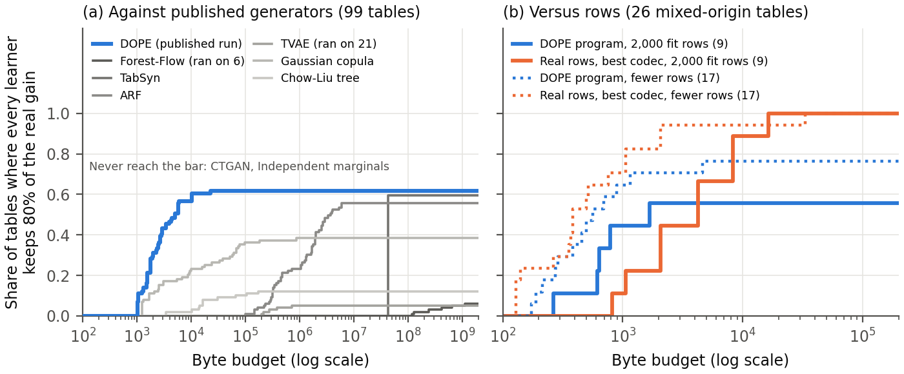
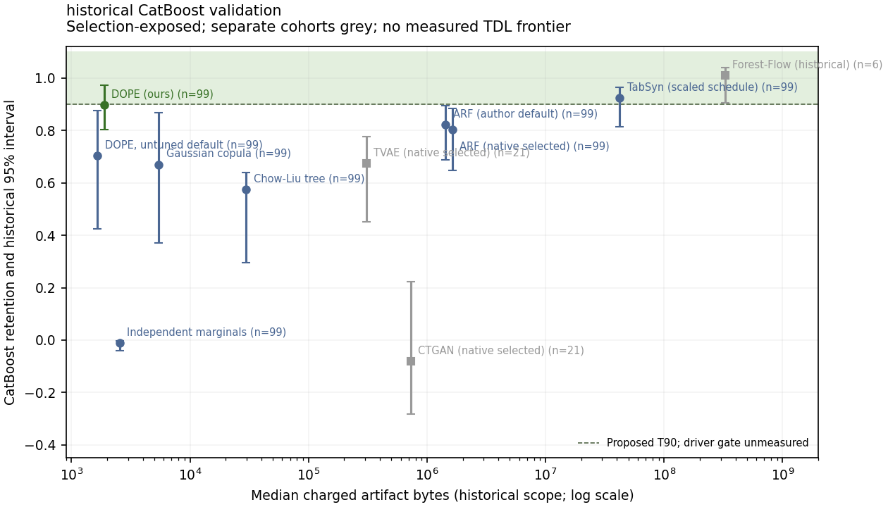
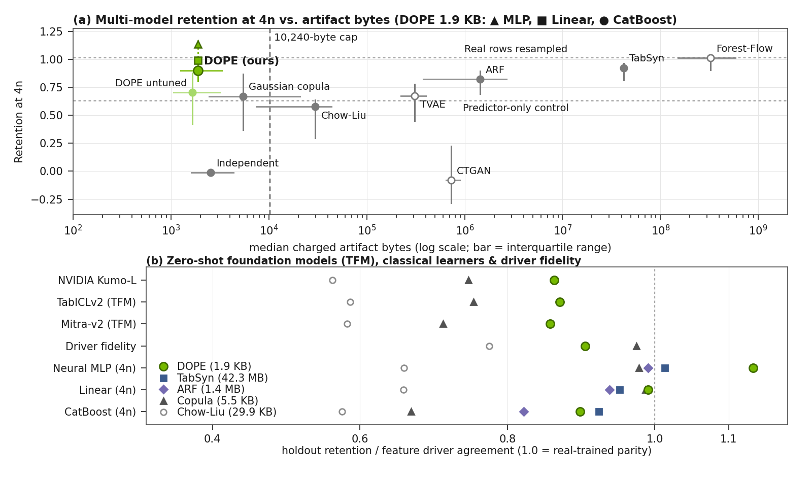
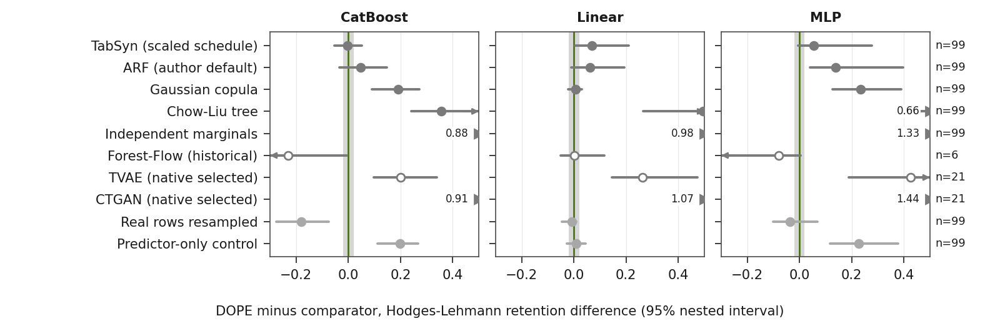
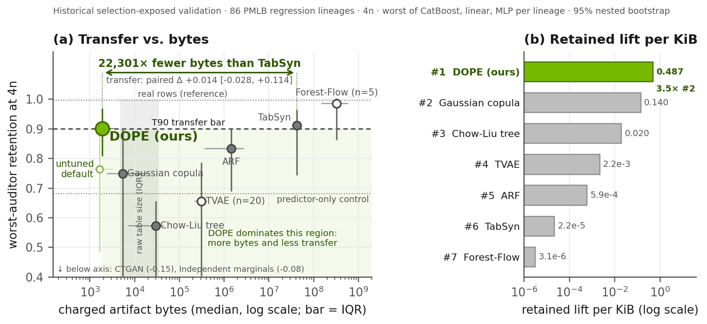
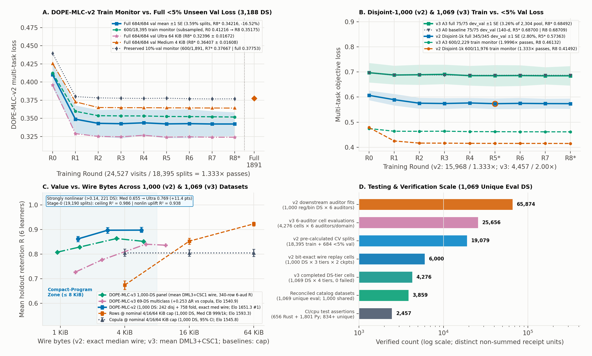

# D.O.P.E. historical results

These are historical, selection-exposed results of the research kernel (`dope-kernel`) and the v2 validation panel, kept here for provenance. They are not results of the current DOPE engine (`dope`, in [`engine/`](engine/)), whose results are in the [README](README.md).

## The research kernel and the equal-byte study

Two engines share the metric. [`engine/`](engine/) (`dope`) is the current DOPE engine,
described in the README. [`rust/`](rust/) (`dope-kernel`) is the research kernel behind the TDL protocol, the frozen
evidence and the equal-byte study below, which pits smaller kernel programs against more
generators and against the most real rows that fit in exactly their bytes. Those results
describe the kernel, not the current engine.



<!-- BEGIN EQUAL BYTES -->
<!-- Generated by docs/whitepaper/scripts/equal_bytes_render.py; edit the generator, not this block. -->
Evidence status: development validation on public tables (selection-exposed; not a sealed TDL result).
The equal-byte cohort preserves the historical name-based mask. It includes simulated pollen and is not a measured-only real-world cohort; source origin remains mixed or unverified.

- **The smallest generator at its transfer level.** On the historical 99-table panel the published DOPE run keeps 0.89 of the real gain for the worst of three learners at 1,895 B. TabSyn keeps 0.88 with 22,301x the bytes, and no generator's frontier is above DOPE's at any budget.
- **More than the real rows that fit in its bytes, once a table outgrows the program.** On the 9 tables in the historical mixed/unknown-origin cohort that reach the study's cap of 2,000 fit rows, a program keeps 0.38 [0.12, 0.69] more of the real gain than the most real rows that fit in exactly its bytes (8 wins, 0 losses, 1 within 0.01), and real rows need a median 4.3x its bytes to match it. The advantage grows with how much larger the whole table is than the program (Spearman 0.78 over 26 tables); tables of a few hundred rows compress to about a program's size and are cheapest shipped whole, so over all 26 tables the gap is 0.02 [-0.04, 0.15] (14 wins, 9 losses).
- **Checked against the obvious objections.** The real-row arm gets the best of three lossless codecs, an exact byte match, and an MLP also trained on the rows resampled to the synthetic size (early-stopped on held-out rows). The 0.38 is for the worst of three learners; per learner on the large tables it is 0.10 (least squares), 0.10 (MLP), 0.04 (CatBoost). Leaving the MLP out, the large-table gap is 0.18 [0.12, 0.69] (8 wins, 1 loss). On all 97 panel lineages, simulated families included, it is 0.24 on the 38 large tables (36 wins, 0 losses).
- **Where it stops.** A program this small is a lossy channel: its retention plateaus, so to clear the 0.8 bar real rows need fewer bytes on 14 of 26 tables (DOPE on 6), and at 0.9 on 19 (DOPE on 6). Raising that ceiling at fixed bytes is the open problem.
- **Honest bytes, no GPU.** Packed values make the same programs 1.85x smaller with bit-identical samples for the headline shape; with the column scaling charged as two 4-byte floats per column the median charge is 676 B (2,666 B before). From 250 to 16,000 rows a program stays between 598 and 1,148 B while the whole table grows to 88,166 B. The network trains in Rust; its CatBoost retention shows no systematic shift from the published GPU run (median difference 0.000 over 96 tables, tenth to ninetieth percentile -0.40 to 0.22; different splits, not a paired replay).

| UCI Adult, scored on the official test file | Bytes | Logistic | MLP | CatBoost |
|---|---:|---:|---:|---:|
| Real training rows (CSV, gzip) | 3,518,606, 398,782 | 1.00 | 1.00 | 1.00 |
| DOPE program | 1,892 | 0.94 | 0.95 | 0.83 |
| Real rows in the same bytes, 8-bit codes (152 rows) | 1,892 | 0.64 | 0.65 | 0.28 |
| Real rows in the same bytes, CSV (98 rows) | 1,892 | 0.55 | 0.56 | 0.21 |

Cells are retention: the share of the real rows' log-loss gain over the class prior (below zero is worse than the prior).
<!-- END EQUAL BYTES -->

<details><summary>Foundation-model view (historical, selection-exposed)</summary>



</details>

<details><summary>Kernel quick start, table normalization, changes and reproduction</summary>

### Kernel quick start on a real table

```bash
cargo build --release --bin dope-kernel                     # Rust toolchain pinned in rust-toolchain.toml
python3 examples/adult/prepare.py --out target/adult        # UCI Adult, CC BY 4.0, official test split
target/release/dope-kernel fit-table --csv target/adult/train.csv --target income --out target/adult/adult.dope
target/release/dope-kernel inspect-table --model target/adult/adult.dope
target/release/dope-kernel sample-table --model target/adult/adult.dope --rows 32561 --out target/adult/synthetic.csv
pip install numpy pandas scikit-learn catboost
python3 examples/adult/evaluate.py --dir target/adult --model target/adult/adult.dope
```

`synthetic.csv` keeps original units, categories, dates and missing markers, with the explicitly declared target always last. The evaluation fits logistic regression, an MLP and CatBoost on real rows, on DOPE rows, and on as many real rows as fit in the artifact's bytes, then scores all of them on the official test file. Replace the CSV and `--target` to run your own table; `--drop` removes identifier columns.

### How the kernel normalizes a raw table

`fit-table` stores an invertible plan per column, so samples decode back to the source schema:

- **Numbers** scale to the unit interval; log scaling gives skewed columns more useful resolution.
- **Categories** use one code per column, ordered by smoothed target mean. Downstream learners apply one-hot encoding; independently sampled dummies could violate the single-category constraint.
- **Dates** use day counts. Missing cells stay missing; multiple rare levels pool together. Identifier-like columns are dropped and reported.

Numeric tables already on the unit interval can use `dope-kernel compile` directly, and `dope-kernel compile-csv` remains for the typed raw and mixed carriers ([CLI](docs/cli.md)).

### What changed in the kernel

- **Native training.** The headline residual network trains in Rust with the published optimizer settings; no libtorch or GPU is needed (`--native-target-profile`).
- **Packed values.** The artifact header records a quantization grid, so values are stored as grid codes (`--packed-codec`): about half the bytes, with bit-identical samples for the headline program shape.
- **Table workflow.** `fit-table`, `sample-table` and `inspect-table` give the end-to-end path above.

The study behind the numbers is in [research/benchmark/equal_bytes](research/benchmark/equal_bytes/README.md) and the mathematics in [docs/math.md](docs/math.md).

### Reproduce the equal-byte study

```bash
python3 -B -m research.benchmark.equal_bytes.prepare --sources target/pmlb --out target/eb
python3 -B -m research.benchmark.equal_bytes.run --binary target/release/dope-kernel --out target/eb-results target/eb/*
python3 -B -m research.benchmark.equal_bytes.summarize target/eb-results --out target/eb-summary.json
python3 docs/whitepaper/scripts/equal_bytes_render.py --check
just fast    # Rust and Python gates
just paper   # historical paper, figures and the README and HISTORY.md blocks
```

</details>

<details><summary>Full historical evidence ledger (generated, selection-exposed)</summary>

<!-- BEGIN TDL RESULTS -->
<!-- Generated by tools/claims/render.py; edit headline-results.json. -->
Historical validation; selection-exposed. TDL and cross-model feature-driver preservation (`D80`) are unmeasured.

#### Historical Foundation-Model Block (`mfs-v3-density-panel.json`, 97 matched mixed/simulated lineages, fit seed 11, sample seeds 101/211/307, 4n context)

| Method | Kumo Large [historical 95% interval] | TabICLv2 [historical 95% interval] | Mitra-v2 [historical 95% interval] | Matched charged bytes | Cross-model driver preservation | Target-correlation proxy (94/97 lineages) |
|---|---:|---:|---:|---:|---|---:|
| DOPE (ours) | 86.3% [80.9%, 88.0%] | 87.1% [83.5%, 89.3%] | 85.8% [80.3%, 88.7%] | 1,844 B | `unmeasured` | 0.905 [0.589, 1.000] (`absolute_target_correlation`) |
| Gaussian copula | 74.7% [66.8%, 77.8%] | 75.4% [67.2%, 78.7%] | 71.3% [58.5%, 77.1%] | 5,464 B | `unmeasured` | 0.975 [0.743, 1.000] (`absolute_target_correlation`) |
| Chow-Liu tree | 56.2% [50.1%, 62.9%] | 58.7% [48.4%, 65.0%] | 58.3% [52.7%, 64.3%] | 29,635 B | `unmeasured` | 0.775 [0.452, 0.971] (`absolute_target_correlation`) |
| Independent marginals | -0.1% [-0.2%, 0.0%] | -0.4% [-1.2%, 0.1%] | -0.9% [-1.4%, -0.4%] | 2,538 B | `unmeasured` | 0.304 [0.220, 0.400] (`absolute_target_correlation`) |

Gaussian copula is the strongest measured comparator on this 97-lineage historical foundation block, not universally strongest (TabSyn leads the 99-lineage classical CatBoost validation panel at 42,261,045.5 B). 0.975 is the 94-lineage median of per-lineage medians across three seeds; 0.923 (0.923106) is the 94-lineage median of per-lineage minimum seed values (matching historical assembler::_min, not a pooled-seed median, which is 0.973214). All are absolute feature-target association proxies from rust/certification/privacy_attacks.rs::driver_fidelity (absolute_target_correlation); cross-model Kumo/TabICL/Mitra feature-driver preservation remains unmeasured. Foundation-model auditor qualification is pending and pretraining overlap is unknown.

#### Historical Classical CatBoost Block (`v2-headline.json`, selection-exposed)

| Method | Retention [historical 95% interval] | Median charged artifact bytes | Observed lineages | Evidence status |
|---|---:|---:|---:|---|
| DOPE (ours) | 0.898 [0.804, 0.972] | 1895.0 | 99/100 | `selection_exposed_validation` |
| TabSyn (scaled schedule) | 0.924 [0.814, 0.965] | 42261045.5 | 99/100 | `selection_exposed_validation` |
| ARF (author default) | 0.822 [0.689, 0.894] | 1438304.5 | 99/100 | `selection_exposed_validation` |
| Gaussian copula | 0.669 [0.369, 0.867] | 5464.5 | 99/100 | `selection_exposed_validation` |
| Chow-Liu tree | 0.576 [0.294, 0.638] | 29865.0 | 99/100 | `selection_exposed_validation` |
| Independent marginals | -0.012 [-0.040, -0.002] | 2549.5 | 99/100 | `selection_exposed_validation` |
| CTGAN (native selected) | -0.080 [-0.282, 0.223] | 730999.0 | 21/100 | `selection_exposed_validation` |
| TVAE (native selected) | 0.674 [0.452, 0.776] | 308629.5 | 21/100 | `selection_exposed_validation` |
| Forest-Flow (historical) | 1.011 [0.905, 1.041] | 325848913.5 | 6/100 | `selection_exposed_validation` |
| Predictor-only control | 0.631 [0.375, 0.784] | unmeasured | 99/100 | `selection_exposed_validation` |
| Real rows resampled | 1.018 [1.005, 1.028] | unmeasured | 99/100 | `selection_exposed_validation` |

Bytes are historical charged artifacts; cold sampling closure and cross-model feature-driver preservation (`D80`) are unmeasured.
Smaller cohorts are separate comparisons. These points do not establish a TDL frontier.
<!-- END TDL RESULTS -->



<!-- BEGIN BENCHMARK -->


Validation panel: 100 PMLB regression tables across three task-trained model families (CatBoost, Linear, Neural MLP), synthetic size 4n. DOPE uses five fit seeds; intervals are 95% nested bootstrap intervals (simulated-family clusters, then lineages, then fit seeds). The difference column is DOPE minus the method on shared lineages (Hodges–Lehmann). The zero-shot tabular foundation-model block below is a separate 97-lineage matched historical cohort (fit seed 11; sample seeds 101, 211, 307; lineage-level bootstrap intervals).

#### 1. Multi-Model Task-Trained Transfer & Charged Artifact Bytes (Synthetic Size `4n`)

| Method | Lineages | CatBoost (4n) | Linear (4n) | Neural MLP (4n) | DOPE − method (CatBoost) | W/T/L | Median artifact | Within 10,240 B |
| --- | ---: | --- | --- | --- | --- | ---: | ---: | ---: |
| **DOPE (ours)** | 99 | 0.898 [0.804, 0.972] | 0.991 [0.972, 0.997] | 1.133 [1.029, 1.246] | — | — | 1.9 KB | 98% |
| TabSyn (scaled schedule) | 99 | 0.924 [0.814, 0.965] | 0.952 [0.827, 0.987] | 1.013 [0.954, 1.142] | −0.003 [−0.053, 0.053] | 53/0/46 | 42.3 MB | 0% |
| ARF (author default) | 99 | 0.822 [0.689, 0.894] | 0.938 [0.846, 0.982] | 0.991 [0.886, 1.090] | +0.048 [−0.034, 0.149] | 60/0/39 | 1.4 MB | 0% |
| ARF (native selected) | 99 | 0.804 [0.647, 0.885] | 0.920 [0.828, 0.977] | 0.966 [0.843, 1.027] | +0.083 [0.006, 0.191] | 66/0/33 | 1.6 MB | 0% |
| Gaussian copula | 99 | 0.669 [0.369, 0.867] | 0.987 [0.963, 0.996] | 0.978 [0.892, 1.072] | +0.191 [0.089, 0.273] | 83/0/16 | 5.5 KB | 62% |
| Chow-Liu tree | 99 | 0.576 [0.294, 0.638] | 0.659 [0.282, 0.763] | 0.660 [0.347, 0.804] | +0.356 [0.242, 0.728] | 91/0/8 | 29.9 KB | 31% |
| Independent marginals | 99 | −0.012 [−0.040, −0.002] | 0.002 [−0.029, 0.019] | −0.049 [−0.161, −0.018] | +0.881 [0.790, 0.964] | 99/0/0 | 2.5 KB | 94% |
| TVAE (native selected) | 21 | 0.674 [0.452, 0.776] | 0.796 [0.581, 0.875] | 0.812 [0.644, 0.877] | +0.201 [0.097, 0.339] | 19/0/2 | 308.6 KB | 0% |
| CTGAN (native selected) | 21 | −0.080 [−0.282, 0.223] | −0.033 [−0.454, 0.124] | 0.033 [−0.338, 0.328] | +0.912 [0.731, 1.298] | 21/0/0 | 731.0 KB | 0% |
| Forest-Flow (historical) | 6 | 1.011 [0.905, 1.041] | 0.985 [0.977, 1.001] | 1.054 [0.929, 2.732] | −0.231 [−0.382, −0.005] | 0/0/6 | 325.8 MB | 0% |
| Real rows resampled (control) | 99 | 1.018 [1.005, 1.028] | 0.998 [0.991, 1.000] | 1.174 [1.051, 1.234] | −0.179 [−0.276, −0.074] | 10/0/89 | none | — |
| Predictor-only control (control) | 99 | 0.631 [0.375, 0.784] | 0.981 [0.955, 0.997] | 0.947 [0.883, 1.018] | +0.197 [0.112, 0.267] | 92/0/7 | none | — |

#### 2. Zero-Shot Tabular Foundation Models (TFM) & Historical Feature-Target Correlation Proxy

| Method | Lineages | NVIDIA Kumo Large (`kumo_tabular_l`) | TabICLv2 (`tabicl2`) | AutoGluon Mitra-v2 (`mitra_v2`) | Feature-Target Correlation Proxy (`driver_fidelity` proxy) | Matched median artifact |
| --- | ---: | --- | --- | --- | --- | ---: |
| **DOPE (ours)** | 97 | 0.863 [0.809, 0.880] | 0.871 [0.835, 0.893] | 0.858 [0.803, 0.887] | 0.905 (IQR [0.589, 1.000]) | 1.8 KB (1,844 B) |
| Gaussian copula | 97 | 0.747 [0.668, 0.778] | 0.754 [0.672, 0.787] | 0.713 [0.585, 0.771] | 0.975 (IQR [0.743, 1.000]) | 5.5 KB (5,464 B) |
| Chow-Liu tree | 97 | 0.562 [0.501, 0.629] | 0.587 [0.484, 0.650] | 0.583 [0.527, 0.643] | 0.775 (IQR [0.452, 0.971]) | 29.6 KB (29,635 B) |
| Independent marginals | 97 | −0.001 [−0.002, 0.000] | −0.004 [−0.012, 0.001] | −0.009 [−0.014, −0.004] | 0.304 (IQR [0.220, 0.400]) | 2.5 KB (2,538 B) |

On these matched historical TFM lineages (fit seed 11; sample seeds 101, 211, 307; synthetic size 4n; pretraining overlap is unknown), Gaussian copula is the strongest measured comparator on this historical block (not universally strongest), and cross-model feature-driver preservation is not yet measured (the proxy column reports absolute feature-target correlation agreement; Gaussian copula is 0.975 median of lineage medians vs. 0.923 median of lineage minima from historical assembler::_min; pooled-seed median is 0.973).



In the paired chart the axis runs from -0.3 to 0.7: an interval end beyond it is drawn as an arrow at the edge, and a point beyond it is drawn at the edge with its value printed.

The strongest full-panel comparator is TabSyn (scaled schedule). These are validation estimates on a training-derived cut; the official test split is reserved for one pre-registered run. Resampled real rows are a row-count diagnostic, neither a generator nor an upper bound. The release score (MFS-v3) is null for every method because its prerequisites and cleartext scan are unmeasured, and measured copy, membership, and attribute gates already fail on some cells. DOPE's median artifact is 1.9 KB, and 490 of 500 individual DOPE fits are within the 10,240-byte release cap; the paper names the lineages above it.
<!-- END BENCHMARK -->


### One measured native artifact

<!-- BEGIN PINNED DEMOS -->

<!-- Generated historical engineering notes; not a TDL result. -->

Inspect of the artifact built for this page reports `artifact_bytes` 151, `rows_fitted` 400, three positional features, dependence `chow_liu`, and target `sparse_linear`. `compliant` is false: compile sees `train.csv` only and does not certify a release. The transcript is [examples/readme-regression/INSPECT.txt](examples/readme-regression/INSPECT.txt). This toy is not the benchmark above.

The installed public demo in [examples/public-regression](examples/public-regression/) fits the UCI Airfoil Self-Noise table (Brooks, Pope, and Marcolini; CC BY 4.0; DOI 10.24432/C5VW2C) on a grouped development split and writes one native raw-unit artifact, `model.raw` (SHA-256 `0950cbe79817…`), with profile `raw-numeric-symbolic-v1` under the byte profile `native-raw-complete-v1`. Compile, `inspect`, the demo's research receipt, and the file size all report 1,558 bytes: 56 bytes of framing, 1,080 bytes of fitted schema and transforms, and 422 bytes of sampling payload. The file is its own transport archive. The generic runtime is measured separately: the debug binary and its mapped libraries came to 72,049,152 bytes, so the cold sampling closure was 72,050,710 bytes. No portable bundle or release-build runtime was measured. The run used commit `59437b1`, and privacy, driver, and geometry checks are unmeasured for this artifact. It is an engineering conformance example on one development split, not a benchmark result, and a different object from both the toy above and the paper's `.dpk` plus `projection.json` charge. The pinned values are in [docs/whitepaper/receipts/native-byte-conformance-v1.json](docs/whitepaper/receipts/native-byte-conformance-v1.json), and the supplement repeats them.

<!-- END PINNED DEMOS -->

</details>

## Additional validated workflows

[Airfoil](docs/getting-started.md) demonstrates disjoint physical groups and source-free sampling. [Rust deployment](deploy/README.md) has separate CPU conformance checks. The [Python research encoder](examples/quickstart/README.md) charges complete reloadable JSON; historical prototype subtotals remain incomplete.

<details>
<summary>Historical generator diagnostic and prototype encoder receipts</summary>

These earlier panels retain their original sources and scope. The Python prototype subtotal below omits complete reloadable receiver state; it is separate from the native table study above.

<!-- BEGIN COMPRESSION -->
<p align="center"></p>

- **Smallest program on the transfer frontier.** DOPE's median program is 1,895 bytes (1.85 KiB) of dataset-specific state, 22,301× fewer bytes than TabSyn (42.3 MB). DOPE minus TabSyn in worst-auditor retention is +0.014 [-0.028, +0.114] over 86 lineages, so the paired interval contains zero.
- **Rank 1 of 7 reported positive-lift generator estimates on retained lift per KiB** (0.487 per KiB), 3.5× the runner-up (Gaussian copula); this is a descriptive ranking across the reported method-specific cohorts.
- **Every auditor family counts.** Worst of CatBoost, linear and MLP retention per lineage: median 0.901 [0.811, 0.966] at synthetic size 4n on 86 PMLB regression lineages.

<details><summary>Every generator, every auditor (generated table)</summary>

| Rank (lift/KiB) | Generator | Worst-auditor retention (4n) | CatBoost | Linear | MLP | Median charged bytes | Retained lift per KiB |
| ---: | --- | --- | ---: | ---: | ---: | ---: | ---: |
| 1 | **DOPE (ours)** | 0.901 [0.811, 0.966] | 0.913 | 0.991 | 1.143 | 1.9 KB | 0.487 |
| 2 | Gaussian copula | 0.750 [0.398, 0.898] | 0.764 | 0.991 | 0.981 | 5.5 KB | 0.140 |
| 3 | Chow-Liu tree | 0.573 [0.246, 0.654] | 0.605 | 0.672 | 0.682 | 29.9 KB | 0.020 |
| 4 | TVAE (20 lineages) | 0.655 [0.405, 0.784] | 0.663 | 0.765 | 0.812 | 308.6 KB | 2.2e-3 |
| 5 | ARF | 0.833 [0.692, 0.896] | 0.850 | 0.950 | 0.991 | 1.4 MB | 5.9e-4 |
| 6 | TabSyn | 0.911 [0.746, 0.963] | 0.944 | 0.959 | 1.015 | 42.3 MB | 2.2e-5 |
| 7 | Forest-Flow (5 lineages) | 0.985 [0.864, 1.001] | 1.021 | 0.985 | 1.080 | 325.8 MB | 3.1e-6 |
| — | CTGAN (20 lineages) | -0.152 [-1.113, 0.162] | -0.052 | -0.005 | 0.033 | 731.0 KB | no lift |
| — | Independent marginals | -0.078 [-0.169, -0.042] | -0.012 | 0.002 | -0.046 | 2.5 KB | no lift |
| — | Predictor-only control *(control, not a generator)* | 0.681 | 0.681 | 0.986 | 0.951 | none | — |
| — | Real rows resampled 4n *(control, not a generator)* | 0.997 | 1.013 | 0.999 | 1.174 | none | — |

Auditor columns are paired within each method's reported cohort; smaller cohorts remain separate comparisons. Efficiency ranks are descriptive across available cohorts. Controls are diagnostics, not generators.
</details>

<sub>Historical selection-exposed validation: the panel also informed DOPE's profile choice, and the official test split is sealed. Generated by <code>docs/whitepaper/scripts/compression_frontier.py</code> from SHA-256-pinned ledgers; 95% nested cluster bootstrap intervals.</sub>
<!-- END COMPRESSION -->

<!-- BEGIN QUICKSTART -->
Historical prototype run on UCI Adult (census income), CC BY 4.0, DOI 10.24432/C5XW20: 32,561 fit rows, a binary target `income`, and 16,281 development query rows (the official test file).

| Step | What happens | Result |
| --- | --- | --- |
| encode | fit-row transform; incomplete prototype size only | `encoder.bin` 836 bytes (249 transforms + 587 compressed names and labels) |
| select | backends scored inside the fit rows | `sparse_gaussian_copula` (3-fold transfer on the fit rows: sparse_gaussian_copula 0.825, search 0.800, compact_neural_residual_symbolic 0.764, chow_liu 0.758) |
| compile | `dope-kernel compile` reads only the encoded fit rows | `model.dpk` 1,714 bytes |
| sample | native draws decoded with a live fitted Python encoder | 32,561 synthetic rows |
| evaluate | learners trained on real vs. synthetic rows, scored on the holdout | retention catboost 0.841 · linear 0.890 · mlp 0.923 |

Historical prototype subtotal: **2,550 bytes** (model plus diagnostic binary dump). This omits complete reloadable encoder state: its CSV/gzip ratios are not complete transfer ratios. The current command reloads and charges the full encoder.json plus model.dpk; no corrected Adult total or speed has been measured. Historical compiled program:

```text
(dpk v=3 task=binary n=32561 p=14 seed=11
  (schema (continuous i=0) (ordinal i=1) (continuous i=2) (ordinal i=3) (ordinal i=4) (ordinal i=5) (ordinal i=6) (ordinal i=7) (ordinal i=8) (binary i=9) (inflated i=10) (inflated i=11) (continuous i=12) (categoricalgrid i=13))
  (marginals (quantile_spline i=0) (categorical_grid i=1) (quantile_spline i=2) (categorical_grid i=3) (categorical_grid i=4) (categorical_grid i=5) (categorical_grid i=6) (categorical_grid i=7) (categorical_grid i=8) (bernoulli i=9) (quantile_spline i=10) (quantile_spline i=11) (quantile_spline i=12) (categorical_grid i=13))
  (dependence kind=sparse_graph)
  (target kind=sparse_gam)
  (noise kind=isotonic_calibration))
```

<sub>Local engineering demonstration on one public table and one split, with the auditors in <code>examples/quickstart/dope_eval.py</code>; not the paper benchmark and no privacy claim. Rendered from <code>examples/quickstart/results/adult-reference.json</code>.</sub>
<!-- END QUICKSTART -->

</details>

## Earlier DOPE engine releases (`v1.x`, `v2.0.0`, and `DOPE-MLC`)

Archived engine experiments and manuscripts from earlier versions, kept here for provenance:
- [Historical manuscript](paper/dope1.tex) and [supplement](paper/dope1-supplement.tex).
- [Previous `v2.0.0` scoreboard](bench/real-world/results/scoreboard/v2.0.0/README.md) and [historical MLC SafeTensors model release (`v1.0.0`)](https://github.com/neverhuman/dope/releases/tag/v1.0.0).
- Earlier signed engine releases remain pinned at `dope-engine-v1.3.0` (`cd35d9d0f0a772bea0e1ae2352eb8eb7d34ad09b`) and `dope-engine-v1.2.0` (`5fc96f2819a97ed313658c336a9a46e637299352`). Historical TDL summaries use the public form `KiB@T90/D80`, requiring nine-tenths of the real-trained lift (T90) and four-fifths of the driver agreement (D80).

<details>
<summary>Archived `v1.0.0` Adult walkthrough and multilevel study (`DOPE-MLC-v2` / `v3`)</summary>

<!-- BEGIN DOPE1 WALKTHROUGH -->
<!-- Generated by examples/adult/walkthrough.py --record; do not edit. -->

```bash
python3 bench/real-world/datasets.py --panel confirm --only adult --out data
```

```bash
dope fit data/confirm/adult/train.csv --target income -o adult.dope
```

```text
compiled data/confirm/adult/train.csv -> adult.dope  (4,079 bytes, budget 4,096)
  task         classification · 20,000 rows × 13 features
  program      9 knots · factor8 dependence × 16 regime(s) · net 10→12 (bits w5 b4 β6 v7) · 106 trees of depth 4
  parameters   3,109 total scalar slots (155 network, 2,226 forest)
  stored gain  0.504 of the null loss explained on held-out rows
  self-audit   robust retention 0.904 (linear and tree auditors trained on samples, scored on held-out training rows)
  drivers      relationship, marital_status, occupation, education, education_num, age
  time         11.0 s on cpu (102 threads)
```

```bash
dope inspect adult.dope
```

```text
adult.dope  4,079 bytes (3,975 brotli program + 104 safetensors framing)
  inflated, the program holds:
  metadata             2,054 bytes
  copula.loadings        104 bytes
  discrete.cum           210 bytes
  discrete.values         64 bytes
  features.missing        13 bytes
  forest               2,332 bytes
  marginal.atoms          24 bytes
  marginal.knots          28 bytes
  marginal.range          16 bytes
  net.codes              100 bytes
  net.params              20 bytes
  noise                    2 bytes
  regime.means           208 bytes
  regime.scales          208 bytes
  regime.weights          16 bytes
  schema.affine           40 bytes
  task         Classification, target `income`
  features     13
  parameters   3,109 total scalar slots
  dependence   factor8 × 16 regime(s)
  net          10 inputs → 12 hidden → 1 outputs
  trees        106 oblivious trees of depth 4 (6-bit leaves)
  rows stored  none
```

```bash
dope sample adult.dope -n 4 --seed 1
```

```text
age,workclass,education,education_num,marital_status,occupation,relationship,race,sex,capital_gain,capital_loss,hours_per_week,native_country,income
80,Private,HS-grad,9,Married-civ-spouse,,Husband,White,Male,5867,0,53,United-States,>50K
35,Private,Some-college,10,Never-married,Sales,Own-child,White,Female,0,0,40,United-States,<=50K
67,Private,7th-8th,7,Married-civ-spouse,,Husband,White,Male,0,0,56,United-States,>50K
35,,9th,3,Separated,Machine-op-inspct,Not-in-family,White,Male,0,0,20,Dominican-Republic,<=50K
```

```bash
dope sample adult.dope -n 3 --seed 1 --space ml   # selected columns of 107
```

```text
age,education_num,relationship=Wife,relationship=Husband,relationship=Not-in-family,relationship=Unmarried,relationship=Other-relative,relationship=Own-child,hours_per_week,…
1,0.5,0,1,0,0,0,0,0.600017,…
0.292759,0.571429,0,0,0,0,0,1,0.4375,…
0.826336,0.357143,0,1,0,0,0,0,0.64114,…
```

```bash
dope eval -m adult.dope --train data/confirm/adult/train.csv --test data/confirm/adult/test.csv
```

```text
retention on 6512 held-out real rows (classification task, artifact 4079 bytes, 50000 synthetic vs 20000 real training rows)
  auditor   null loss   real loss  synth loss  retention
  linear      0.55198     0.32922     0.33758      0.962
  gbdt        0.55198     0.28585     0.30165      0.941
  mlp         0.55198     0.32906     0.33239      0.985
  robust retention (min over families): 0.941
```

#### Head-to-Head Method Comparison on UCI Adult (`20,000` train $\to$ `6,512` held-out real test rows)

| Method & Evaluation Protocol on UCI Adult (`income`) | Charged Artifact Bytes | Source Rows Stored | Linear / Logistic $R$ | Boosted Trees (GBDT) $R$ | Neural MLP $R$ | Robust Retention $R$ (`min` over families) |
|---|---:|---|---:|---:|---:|---|
| **`dope` (`v1.0.0`) CLI above (`adult.dope`, `seed=0`, `50,000` synth rows, built-in Rust auditors)** | **`4,079 B` (`4.0 KiB`)** | **`0` rows** | **`0.962`** | **`0.941`** | **`0.985`** | **`0.941` (`seed=0`, $4\times$ cap)** |
| **`DOPE` (`v1.0.0`) @ `4 KiB` (`dope-4x@-`, external Python harness, $4\times N_{\text{train}}$ = `80,000` rows)** | **`4,079 B` (`4.0 KiB`)** | **`0` rows** | **`0.957`** | **`0.946`** | **`0.975`** | **`0.946` (`seed=0`)** |
| `DOPE` (`v1.0.0`) @ `4 KiB` (`dope-seed0@-`, external Python harness, $1\times N_{\text{train}}$ = `20,000` rows) | `4,079 B` (`4.0 KiB`) | `0` rows | `0.964` | `0.907` | `0.907` | `0.907` (`seed=0`) |
| **`DOPE` (`v1.0.0`) @ `4 KiB` (`dope@4k`, 3-seed median `seed=0,1,2`, $1\times N_{\text{train}}$)** | **`4,077 B` (`4.0 KiB`)** | **`0` rows** | **`0.946`** | **`0.907`** | **`0.933`** | **`0.907` (seeds `0.901..0.914`)** |
| `Raw Rows Subsample` @ `4 KiB` (`rows@4k`, 3-seed median, `xz`-compressed real rows) | `4,088 B` (`4.0 KiB`) | `xz` real-row subset | `0.870` | `0.777` | `-7.813` | `-7.813` (seeds `-8.311..-5.695`) |
| `Adversarial Random Forests` (`arf@-`, 3-seed median, `1,578×` larger) | `6,431,472 B` (`6.13 MiB`) | `0` rows | `0.932` | `0.874` | `0.955` | `0.866` (seeds `0.857..0.888`; $\min_f \text{med}_s = 0.874$) |
| `Gaussian Copula` (`copula@-`, 3-seed median, `22×` larger) | `91,476 B` (`89.3 KiB`) | `0` rows | `0.408` | `0.196` | `0.333` | `0.196` (seeds `0.184..0.211`) |
| `Real Rows Resampled` (`bootstrap@-`, 3-seed median, full `20,000`-row bootstrap) | `112,240 B` (`109.6 KiB`) | `20,000` real rows | `0.994` | `0.973` | `-0.036` | `-0.036` (`seed=0`) |

*Aggregation & auditor disclosure:* The first row reports the standalone Rust `dope eval` command above (`--factor 4.0`, capped at `50,000` synthetic rows, using `dope-core`'s built-in Rust logistic, histogram-GBDT, and candle-MLP auditors). All remaining rows come directly from `bench/real-world/results/confirm/summary.json` and `records.jsonl` using the external Python benchmark auditors (`LogisticRegression`, `CatBoostClassifier`, `MLPClassifier`), where 3-seed rows report the per-column median across `seed = 0, 1, 2` and `robust` reports $\text{median}_s(\min_f R_{s,f})$ (alongside the seed range and $\min_f(\text{median}_s R_{s,f})$ when they differ, as on `arf@-`: `0.866` vs. `0.874`).
<!-- END DOPE1 WALKTHROUGH -->

<!-- BEGIN DOPE1 RESULTS -->
<!-- Generated by bench/real-world/render.py from results/multilevel-convergence-snapshot.json; do not edit. -->
### 1,000-Dataset Method Comparison (`DOPE-MLC-v2`, `v1.0.0`) & 1,069-Dataset Multi-Task Expansion (`DOPE-MLC-v3`, `v1.0.0`)

| Rank & Method (`1,000` Datasets, `6` Downstream Auditors, `44,369` Matches/Method) | Tournament Elo `[95% CI]` (Win Share) | `Medium` (`4 KiB` Cap) Mean $R$ `[95% CI]` (`DOPE 1,502 B / 1.5 KiB`) | `High` (`16 KiB` Cap) Mean $R$ `[95% CI]` (`DOPE 2,836 B / 2.8 KiB`) | `Ultra` (`64 KiB` Cap) Mean $R$ `[95% CI]` (`DOPE 5,872 B / 5.7 KiB`) |
|---|---:|---:|---:|---:|
| **`#1 DOPE-MLC-v2` (`v1.0.0`, Unified 3-Level Encoder)** | **`1651.3 [1643.4, 1659.6]` (`70.58%` win; Disjoint-1k: `1650.7 #1`)** | **`0.8620 [0.8503, 0.8722]` (`#1` Elo `1652.1`)** | **`0.8971 [0.8848, 0.9080]` (`#1` Elo `1669.6`)** | **`0.8975 [0.8883, 0.9094]` (`#1` Encoder Elo `1640.1`)** |
| `#2 Raw Rows Subsample` (`rows`, raw-row subset control) | `1593.3 [1584.4, 1602.7]` (`62.32%` win) | `0.6743 [0.6564, 0.6915]` | `0.8526 [0.8404, 0.8649]` | `0.9230 [0.9141, 0.9301]` (`copies 88% raw rows`) |
| `#3 Gaussian Copula` (`copula`, parametric baseline) | `1545.8 [1535.7, 1553.5]` (`55.29%` win) | `0.8046 [0.7916, 0.8209]` | `0.8046 [0.7910, 0.8180]` | `0.8046 [0.7908, 0.8200]` |
| `#4 Joint Diffusion` (`joint_diffusion_v1`) | `1432.4 [1423.8, 1440.8]` (`38.75%` win) | `0.7034 [0.6880, 0.7184]` | `0.7541 [0.7407, 0.7702]` | `0.7886 [0.7747, 0.8033]` |
| `#5 Adversarial Random Forests` (`arf`) | `1184.7 [1167.3, 1202.3]` (`10.86%` win) | `0.4113 [0.3936, 0.4321]` | `0.4113 [0.3898, 0.4319]` | `0.4113 [0.3902, 0.4309]` |

*Byte, cohort & coverage qualification (`v8` canonical index):* The `1,000`-dataset `DOPE-MLC-v2` pooled panel (`dope_mlc_v2_s3_best.pt`) comprises **`242` strictly dataset-disjoint datasets** (`0` train overlap, `Ultra` $R = 0.8493$, `#1` Elo `1671.6 [1655.2, 1688.0]`) and **`758` in-corpus unseen-fold datasets** (row-disjoint, `Ultra` $R = 0.9129$, `#1` Elo `1645.4 [1637.8, 1653.6]`), while the strictly dataset-disjoint checkpoint (`dope_mlc_v2_disjoint1000_best.pt`, `0` train overlap across all `1,000` eval DS) reaches `Ultra` $R = 0.8998$ and **`#1` Elo `1650.7 [1643.4, 1657.5]`**. `DOPE-MLC-v2` median wire bytes (`1,502 / 2,836 / 5,872 B` = `1.5 / 2.8 / 5.7 KiB`; zlib `1,238 / 2,351 / 4,616 B`) are bit-exact `version=2` latent payloads (`6,000/6,000` cells `max_abs_diff = 0.0`), excluding the `.dope` scaler sidecar (`+545 B` median; full raw `2,031 / 3,376 / 6,398 B`) and shared frozen decoder (`292,707 B` / `285.8 KiB`, amortized `0 B/dataset`), whereas `DOPE-MLC-v3` (`DML3+CSC1`) is self-contained inside `2 / 4 / 16 / 64 KiB` caps (`960.6 / 1,550.2 / 3,429.2 / 6,144.6 B` mean on `1,000` `v2`-panel tables; `1,418.0 / 2,510.7 / 6,435.3 / 9,877.5 B` mean on `69` multiclass tables; `1,781,800 B` shared SafeTensors hypernetwork). Baseline byte tiers (`4 / 16 / 64 KiB`) reflect nominal caps and historical `fp16` byte estimates paired with `float64` in-memory scores (`baseline_wire_1000ds_qualified = false`; `rows` `medium|catboost` observed on `999/1,000` DS with `17cd766e7ec82f1e` omitted; `65,874` evaluated `v2` auditor fits alongside `1,303` `real_gain < 0.01` skips and `500` `arf` multiclass exclusions).

| Downstream Learner Family (`DOPE-MLC-v2 Ultra`, `1,000` DS) | Evaluated Datasets | Holdout Retention $R$ `[95% CI]` | Driver Fidelity $D$ `[95% CI]` |
|---|---:|---:|---:|
| **Linear / Logistic** | `n=969` | **`0.9297 [0.9182, 0.9398]`** | `0.7853 [0.7745, 0.7950]` |
| **Local Gated Attention Net** (`kumo_tabpfn` key) | `n=962` | **`0.9211 [0.9094, 0.9333]`** | **`0.8781 [0.8743, 0.8824]` (`D80` pass)** |
| **MLP** | `n=965` | **`0.9143 [0.9021, 0.9245]`** | **`0.8915 [0.8872, 0.8960]` (`D80` pass)** |
| **LightGBM** | `n=989` | **`0.8978 [0.8852, 0.9085]`** | `0.7703 [0.7615, 0.7793]` |
| **CatBoost** | `n=1,000` | **`0.8810 [0.8692, 0.8915]`** | **`0.8130 [0.8055, 0.8213]` (`D80` pass)** |
| **XGBoost** | `n=989` | **`0.8121 [0.7915, 0.8285]`** | `0.7221 [0.7131, 0.7310]` |

| Mechanism, Nonlinearity Regime & Sampling-Expansion Audit | Scope | `Medium` (`1.5 KiB`) / `1×` | `High` (`2.8 KiB`) / `2×` | `Ultra` (`5.7 KiB`) / `5×` |
|---|---|---:|---:|---:|
| **Mostly Linear Regime** (`<= 0.04` uplift) | `581` DS | `0.9401` | **`0.9579`** | `0.9459` (`D = 0.7836`) |
| **Moderate Nonlinear Regime** (`0.04–0.14` uplift) | `198` DS | `0.8637` | `0.8953` | **`0.8990`** (`+3.53` pts) |
| **Strongly Nonlinear Regime** (`> 0.14` uplift) | `221` DS | `0.6552` | `0.7390` | **`0.7689` (`+11.37` pts)** |
| **Stage-0 Signal Ceiling $R^2$** | `19,190` splits | `0.9417` | `0.9654` | **`0.9863`** |
| **Stage-0 Nonlinear Uplift $R^2$** | `19,190` splits | `0.7912` | `0.8727` | **`0.9383`** |
| **CatBoost Sampling Expansion** (`1× -> 2× -> 5× N_train`) | `n=150` DS (`ds_rank<150`) | `0.8808` (`1×`) | `0.9010` (`2×`) | **`0.9070` (`5×`, `+2.62` pts)** |



| Track / Expansion Study | Corpus & `<5%` Validation Split Allocation | Effective Passes & Visits (`R0..R8`) | Train Monitor (`R0 -> Best`) | Full-Population Validation Loss `± 1 SE` or Holdout Transfer | Key Qualification & Tournament Result |
|---|---|---|---|---|---|
| **Track 1: `DOPE-MLC-v2` Full-Corpus `<5%` Val** | `18,395` train splits (`96.41%`) / `684` unseen-DS val splits (`3.59% < 5%`, `115` DS) | `24,527` visits (`1.333351×` passes) | `0.41216 -> 0.35175` | `0.40988 ± 0.01767` $\to$ **`0.34216 ± 0.01621`** (`R8*`, `-16.52%`) | Monotonic `Ultra 0.32396 < High 0.33844 < Med 0.36407`; preserved `10%`-val `full_1891_val_final = 0.37753` |
| **Track 2: `DOPE-MLC-v2` Disjoint-`1,000` `<5%` Val** | `11,976` train splits (`97.20%`) / `345` `dev_val` splits (`2.80% < 5%`, `58` DS; `0` eval overlap) | `15,968` visits (`1.333333×` passes) | `0.47854 -> 0.41492` | `0.60691 ± 0.01915` $\to$ **`0.57363 ± 0.02131`** (`R5*`, `-5.48%`) | Disjoint-`1,000` `Ultra` $R = 0.8998$ (med `0.9671`), Driver $D = 0.7904$, **`#1` Elo `1650.7 [1643.4, 1657.5]`** |
| **Track 3: `DOPE-MLC-v3` (`A3`) Disjoint-`1,069` `<5%` Val** | `2,229` loaded train cells / `75` loaded `dev_val` cells (`3.2552% < 5%` of `2,304` pool; `0` eval overlap) | `4,457` visits (`1.999551×` passes) | `0.47454 -> 0.46132` | `0.69727 ± 0.03888` $\to$ **`0.68492 ± 0.03877`** (`R8*`, `-1.77%`) | `Small 0.69473 > Med 0.69128 > High 0.67958 > Ultra 0.67408`; active `col_gate_head` (`grad_norm = 0.001014`) |
| **`DOPE-MLC-v3` Unified `1,069`-DS (`4,276`-Cell) Eval** | `1,069` unique eval DS (`1,000` shared `v2`-panel + `69` multiclass; never summed to `2,069`) | `4,276/4,276` cells (`25,656` 6-auditor fits/domain, `0` failed) | `100.0% <= cap` (`DML3+CSC1`) | `v2`-panel `High` sender/CSC1 $R = 0.8633 / 0.8706$; MC `High` $R = 0.8402 / 0.8451$ | Equal-wire (`12,828` cells): `v3` Elo **`1457.6`** beats `copula` `1407.1` (`ΔR = +0.0941`, MC `+0.2526`); ties `v2` (`1538.0`) within `0.10` on `8,136/9,000` cells (`ΔR = -0.0084`); trails `rows_wire` (`1597.3`, `ΔR = -0.0250`) under `340`-row CPU cap |
| **Pure-Rust `dope mlc-v3` (`SafeTensors`) & CI Scale** | `56` `F32` tensors (`444,168` params, `1,781,800 B`), `3,859`-DS reconciled catalog | `2,457` CI assertions (`656` Rust + `1,801` Python, `834+` unique tests) | `0` Python/LibTorch deps at inference | **`max_forward_abs_err = 1.3255e-6 < 1e-5`**; **`max_fixed_draw_sample_abs_err = 1.1111e-6 < 1e-5`** | `12/12` standalone `--seed` `(tier, task)` cells finite; `8/8` tamper/oversize checks fail closed |

*Scope & provenance:* All `1,000`-dataset `DOPE-MLC-v2` (`65,874` auditor fits) and `1,069`-dataset `DOPE-MLC-v3` (`4,276` cells) benchmarks are selection-exposed development/reconciliation evaluations (`untouched_sealed_confirmatory_test = false`) measured on the preserved `dope_mlc_v2_s3_best.pt`, `dope_mlc_v2_disjoint1000_best.pt`, and `dope_mlc_v3_multitask_best.pt` checkpoints (local gated attention nets `_TabularKumoAttentionNet` / `_LocalGatedAttentionNet` are trained from scratch per table; official pretrained KumoTabular/TabPFN is not evaluated). Full round-by-round `R0..R8` tables, cohort breakdowns, and SHA-256 receipts: [docs/multilevel-landmark-dl-study.md](docs/multilevel-landmark-dl-study.md) and [bench/real-world/results/multilevel-convergence-snapshot.json](bench/real-world/results/multilevel-convergence-snapshot.json).
<!-- END DOPE1 RESULTS -->

</details>
