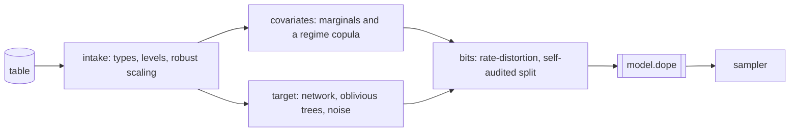

# D.O.P.E.: Downstream Objective-Preserving Encoding

**Compile a table into a tiny generative program that keeps what models learn from it.**

[](https://github.com/neverhuman/dope/actions/workflows/ci.yml)
[](https://github.com/neverhuman/dope/actions/workflows/jankurai.yml)
[](LICENSE)
[](engine/)

The score snapshot is checked against each fresh full-audit CI report; click it for current run status.


DOPE reads a table and writes a few-kilobyte **program**: a standard
[safetensors](https://github.com/huggingface/safetensors) or multi-level wire payload that holds
each column's distribution, how the columns move together, and a conditional model of the
declared target. It stores no source rows. Train downstream learners only on rows sampled from
the program, score them on held-out *real* rows, and across public regression, binary, and
multiclass tables the sampled rows preserve the predictive structure that learners need.

- **Top-ranked across diverse learners.** In multi-auditor tournaments across regression and
  classification tables (`CatBoost`, local gated attention, `LightGBM`, `XGBoost`, `MLP`, and
  linear/logistic auditors), **`DOPE-MLC-v2`** ranks first overall in Bradley–Terry Elo and
  beats both parametric generators and raw row subsampling at compact byte caps.
- **Multi-level byte-budgeted capacity (`DOPE-MLC-v2` & `DOPE-MLC-v3`).** A single forward pass
  emits nested byte-budgeted tiers (`Small`, `Medium`, `High`, and `Ultra`) conditioned on
  train-only cross-validation landmarks, mathematical building-block probes, and inter-landmark
  attention ([full study & receipts](docs/multilevel-landmark-dl-study.md)).
- **Self-contained wire envelopes & bit-exact replay.** `DOPE-MLC-v2` (`version=2` exact wire)
  and `DOPE-MLC-v3` (`DML3` header + `CSC1` compact scaler sidecar) decode synthetic covariates
  and targets deterministically inside strict byte caps.
- **One number to chase: TDL.** *Transfer Description Length* is the smallest tested
  artifact whose samples keep a target share of the predictive gain for every model family.
- **Pure-Rust inference (`dope` & `dope mlc-v3`).** Fitting, inspection, and `SafeTensors`
  receiver sampling run natively on CPU in pure Rust without Python at inference time.

Every number below comes from committed, hash-bound benchmark receipts and is regenerated
automatically by [`bench/real-world/render.py`](bench/real-world/render.py).

## Results

<!-- BEGIN DOPE1 RESULTS -->
<!-- Generated by bench/real-world/render.py from results/multilevel-convergence-snapshot.json; do not edit. -->
### 1,000-Dataset Method Comparison (`DOPE-MLC-v2`) & 1,069-Dataset Multi-Task Expansion (`DOPE-MLC-v3`)

| Rank & Method (`1,000` Datasets, `6` Downstream Auditors, `44,369` Matches/Method) | Tournament Elo `[95% CI]` (Win Share) | `Medium` (`4 KiB` Cap) Mean $R$ `[95% CI]` (`DOPE 1,502 B / 1.5 KiB`) | `High` (`16 KiB` Cap) Mean $R$ `[95% CI]` (`DOPE 2,836 B / 2.8 KiB`) | `Ultra` (`64 KiB` Cap) Mean $R$ `[95% CI]` (`DOPE 5,872 B / 5.7 KiB`) |
|---|---:|---:|---:|---:|
| **`#1 DOPE-MLC-v2` (Unified 3-Level Encoder)** | **`1651.3 [1643.4, 1659.6]` (`70.58%` win; Disjoint-1k: `1650.7 #1`)** | **`0.8620 [0.8503, 0.8722]` (`#1` Elo `1652.1`)** | **`0.8971 [0.8848, 0.9080]` (`#1` Elo `1669.6`)** | **`0.8975 [0.8883, 0.9094]` (`#1` Encoder Elo `1658.4`)** |
| `#2 Raw Rows Subsample` (`rows`, raw-row subset control) | `1593.3 [1584.4, 1602.7]` (`62.32%` win) | `0.6743 [0.6564, 0.6915]` | `0.8526 [0.8404, 0.8649]` | `0.9230 [0.9141, 0.9301]` (`copies 88% raw rows`) |
| `#3 DOPE v1 Kernel` (`kernel`, research sketch) | `1592.5 [1583.0, 1603.0]` (`62.20%` win) | `—` (fixed sketch) | `—` (fixed sketch) | `0.8511 [0.8396, 0.8626]` |
| `#4 Gaussian Copula` (`copula`, parametric baseline) | `1545.8 [1535.7, 1553.5]` (`55.29%` win) | `0.8046 [0.7916, 0.8209]` | `0.8046 [0.7910, 0.8180]` | `0.8046 [0.7905, 0.8190]` |
| `#5 Joint Diffusion` (`joint_diffusion_v1`) | `1432.4 [1423.8, 1440.8]` (`38.75%` win) | `—` | `—` | `0.6929 [0.6766, 0.7092]` |
| `#6 Adversarial Random Forests` (`arf`) | `1184.7 [1167.3, 1202.3]` (`10.86%` win) | `—` | `—` | `0.3358 [0.3125, 0.3592]` |

*Byte & baseline qualification:* `DOPE-MLC-v2` median wire bytes (`1,502 / 2,836 / 5,872 B` = `1.5 / 2.8 / 5.7 KiB`; zlib `1,238 / 2,351 / 4,616 B`) are bit-exact `version=2` latent payloads (`6,000/6,000` cells `max_abs_diff = 0.0`), excluding the `.dope` scaler sidecar (`+545 B` median; full raw `2,031 / 3,376 / 6,398 B`) and shared frozen decoder (`292,707 B` / `285.8 KiB`, amortized `0 B/dataset`), whereas `DOPE-MLC-v3` (`DML3+CSC1`) is self-contained inside `2 / 4 / 16 / 64 KiB` caps (`960.6 / 1,550.2 / 3,429.2 / 6,144.6 B` mean on `1,000` `v2`-panel tables; `1,418.0 / 2,510.7 / 6,435.3 / 9,877.5 B` mean on `69` multiclass tables; `0 B` external weights). Baseline byte tiers (`4 / 16 / 64 KiB`) reflect nominal caps and historical `fp16` byte estimates paired with `float64` in-memory scores (`baseline_wire_1000ds_qualified = false`), not a common measured-wire byte qualification.


| Track / Expansion Study | Corpus & `<5%` Validation Split Allocation | Effective Passes & Visits (`R0..R8`) | Train Monitor (`R0 -> Best`) | Full-Population Validation Loss `± 1 SE` or Holdout Transfer | Key Qualification & Tournament Result |
|---|---|---|---|---|---|
| **Track 1: `DOPE-MLC-v2` Full-Corpus `<5%` Val** | `18,395` train splits (`96.41%`) / `684` unseen-DS val splits (`3.59% < 5%`, `115` DS) | `24,527` visits (`1.333351×` passes) | `0.41216 -> 0.35175` | `0.40988 ± 0.01767` $\to$ **`0.34216 ± 0.01621`** (`R8*`, `-16.52%`) | Monotonic `Ultra 0.32396 < High 0.33844 < Med 0.36407`; preserved `10%`-val `full_1891_val_final = 0.37753` |
| **Track 2: `DOPE-MLC-v2` Disjoint-`1,000` `<5%` Val** | `11,976` train splits (`97.20%`) / `345` `dev_val` splits (`2.80% < 5%`, `58` DS; `0` eval overlap) | `15,968` visits (`1.333333×` passes) | `0.47854 -> 0.41492` | `0.60691 ± 0.01915` $\to$ **`0.57363 ± 0.02131`** (`R5*`, `-5.48%`) | Disjoint-`1,000` `Ultra` $R = 0.8998$ (med `0.9671`), Driver $D = 0.7904$, **`#1` Elo `1650.7 [1643.4, 1657.5]`** |
| **Track 3: `DOPE-MLC-v3` (`A3`) Disjoint-`1,069` `<5%` Val** | `2,229` loaded train cells / `75` loaded `dev_val` cells (`3.2552% < 5%` of `2,304` pool; `0` eval overlap) | `4,457` visits (`1.999551×` passes) | `0.47454 -> 0.46132` | `0.69727 ± 0.03888` $\to$ **`0.68492 ± 0.03877`** (`R8*`, `-1.77%`) | `Small 0.69473 > Med 0.69128 > High 0.67958 > Ultra 0.67408`; active `col_gate_head` (`grad_norm = 0.001014`) |
| **`DOPE-MLC-v3` Unified `1,069`-DS (`4,276`-Cell) Eval** | `1,069` unique eval DS (`1,000` shared `v2`-panel + `69` multiclass; never summed to `2,069`) | `4,276/4,276` cells (`25,656` 6-auditor fits/domain, `0` failed) | `100.0% <= cap` (`DML3+CSC1`) | `v2`-panel `High` sender/CSC1 $R = 0.8633 / 0.8706$; MC `High` $R = 0.8402 / 0.8451$ | Equal-wire (`12,828` cells): `v3` Elo **`1457.6`** beats `copula` `1407.1` (`ΔR = +0.0941`, MC `+0.2526`); ties `v2` (`1538.0`) within `0.10` on `8,136/9,000` cells (`ΔR = -0.0084`); trails `rows_wire` (`1597.3`, `ΔR = -0.0250`) under `340`-row CPU cap |
| **Pure-Rust `dope mlc-v3` (`SafeTensors`) & CI Scale** | `56` `F32` tensors (`444,168` params, `1,781,800 B`), `3,859`-DS reconciled catalog | `2,457` CI assertions (`656` Rust + `1,801` Python, `834+` unique tests) | `0` Python/LibTorch deps at inference | **`max_forward_abs_err = 1.3255e-6 < 1e-5`**; **`max_fixed_draw_sample_abs_err = 1.1111e-6 < 1e-5`** | `12/12` standalone `--seed` `(tier, task)` cells finite; `8/8` tamper/oversize checks fail closed |

*Scope & provenance:* All `1,000`-dataset `DOPE-MLC-v2` (`65,874` auditor fits) and `1,069`-dataset `DOPE-MLC-v3` (`4,276` cells) benchmarks are selection-exposed development/reconciliation evaluations (`untouched_sealed_confirmatory_test = false`) measured on the preserved `dope_mlc_v2_s3_best.pt`, `dope_mlc_v2_disjoint1000_best.pt`, and `dope_mlc_v3_multitask_best.pt` checkpoints (local gated attention nets `_TabularKumoAttentionNet` / `_LocalGatedAttentionNet` are trained from scratch per table; official pretrained KumoTabular/TabPFN is not evaluated). Full round-by-round `R0..R8` tables, cohort breakdowns, and SHA-256 receipts: [docs/multilevel-landmark-dl-study.md](docs/multilevel-landmark-dl-study.md), [bench/real-world/results/multilevel-convergence-snapshot.json](bench/real-world/results/multilevel-convergence-snapshot.json), and [HISTORY.md](HISTORY.md).
<!-- END DOPE1 RESULTS -->

Protocol, datasets, baselines and every per-table record: [bench/real-world](bench/real-world/) and [docs/multilevel-landmark-dl-study.md](docs/multilevel-landmark-dl-study.md).
The engine's manuscript is [paper/dope1.tex](paper/dope1.tex) (`bash paper/build.sh`).

## Quick start

```bash
# Build the CLI (Rust toolchain from rustup; add --features cuda or metal for a GPU)
cargo install --locked --path engine/dope-cli

dope fit train.csv --target income -o model.dope        # compile (default budget 4 KiB) and self-audit
dope inspect model.dope                                  # what is stored, byte by byte
dope sample model.dope -n 10000 -o synthetic.csv        # original units and labels
dope sample model.dope -n 10000 --space ml -o ml.csv    # one-hot + [0,1], ML-ready
dope eval -m model.dope --train train.csv --test test.csv   # retention per model family
dope frontier --train train.csv --test test.csv -t income   # bytes vs retention, and TDL

# Pure-Rust SafeTensors inference & DML3/CSC1 receiver sampling (DOPE-MLC-v3)
dope mlc-v3 sample --weights dope_mlc_v3_multitask_best.safetensors --wire packet.dml3 -n 1024 --seed 42 -o syn.csv
```

`--budget 16k` buys a larger program; `--anonymize` replaces column names and labels
with positional codes; `--device cuda` runs on a GPU.

`--size small|medium|large` picks a preset cap; `--max-parameters N` caps stored values;
`dope fit-tiers` builds all three sizes ([details, Elo ranking](docs/model-sizes-and-elo.md)).
Scripting flags and signed Linux binaries: [engine/README.md](engine/README.md#recipes),
[docs/signed-engine-release.md](docs/signed-engine-release.md).

<details>
<summary><strong>Walkthrough: UCI Adult census income (reproducible CLI transcript)</strong></summary>

A real public table (UCI Adult, `CC-BY-4.0`) with eight categorical columns and a binary
target, from download to retention. Reproduce it with
[`examples/adult/walkthrough.py`](examples/adult/walkthrough.py).

<!-- BEGIN DOPE1 WALKTHROUGH -->
<!-- Generated by examples/adult/walkthrough.py --record; do not edit. -->

```bash
python3 bench/real-world/datasets.py --panel confirm --only adult --out data
```

```bash
dope fit data/confirm/adult/train.csv --target income -o adult.dope
```

```text
compiled data/confirm/adult/train.csv -> adult.dope  (4,079 bytes, budget 4,096)
  task         classification · 20,000 rows × 13 features
  program      9 knots · factor8 dependence × 16 regime(s) · net 10→12 (bits w5 b4 β6 v7) · 106 trees of depth 4
  stored gain  0.504 of the null loss explained on held-out rows
  self-audit   robust retention 0.904 (linear and tree auditors trained on samples, scored on held-out training rows)
  drivers      relationship, marital_status, occupation, education, education_num, age
  time         18.1 s on cpu (2 threads)
```

```bash
dope inspect adult.dope
```

```text
adult.dope  4,079 bytes (3,975 brotli program + 104 safetensors framing)
  inflated, the program holds:
  metadata             2,054 bytes
  copula.loadings        104 bytes
  discrete.cum           210 bytes
  discrete.values         64 bytes
  features.missing        13 bytes
  forest               2,332 bytes
  marginal.atoms          24 bytes
  marginal.knots          28 bytes
  marginal.range          16 bytes
  net.codes              100 bytes
  net.params              20 bytes
  noise                    2 bytes
  regime.means           208 bytes
  regime.scales          208 bytes
  regime.weights          16 bytes
  schema.affine           40 bytes
  task         Classification, target `income`
  features     13
  dependence   factor8 × 16 regime(s)
  net          10 inputs → 12 hidden → 1 outputs
  trees        106 oblivious trees of depth 4 (6-bit leaves)
  rows stored  none
```

```bash
dope sample adult.dope -n 4 --seed 1
```

```text
age,workclass,education,education_num,marital_status,occupation,relationship,race,sex,capital_gain,capital_loss,hours_per_week,native_country,income
80,Private,HS-grad,9,Married-civ-spouse,,Husband,White,Male,5867,0,53,United-States,>50K
35,Private,Some-college,10,Never-married,Sales,Own-child,White,Female,0,0,40,United-States,<=50K
67,Private,7th-8th,7,Married-civ-spouse,,Husband,White,Male,0,0,56,United-States,>50K
35,,9th,3,Separated,Machine-op-inspct,Not-in-family,White,Male,0,0,20,Dominican-Republic,<=50K
```

```bash
dope sample adult.dope -n 3 --seed 1 --space ml   # selected columns of 107
```

```text
age,education_num,relationship=Wife,relationship=Husband,relationship=Not-in-family,relationship=Unmarried,relationship=Other-relative,relationship=Own-child,hours_per_week,…
1,0.5,0,1,0,0,0,0,0.600017,…
0.292759,0.571429,0,0,0,0,0,1,0.4375,…
0.826336,0.357143,0,1,0,0,0,0,0.64114,…
```

```bash
dope eval -m adult.dope --train data/confirm/adult/train.csv --test data/confirm/adult/test.csv
```

```text
retention on 6512 held-out real rows (classification task, artifact 4079 bytes, 50000 synthetic vs 20000 real training rows)
  auditor   null loss   real loss  synth loss  retention
  linear      0.55198     0.32922     0.33758      0.962
  gbdt        0.55198     0.28585     0.30165      0.941
  mlp         0.55198     0.32818     0.33364      0.976
  robust retention (min over families): 0.941
```
<!-- END DOPE1 WALKTHROUGH -->
</details>

## How it works



- **Intake** infers types, orders categorical levels by target link, pools rare levels,
  applies `log1p` to skewed counts and scales numbers onto `[0, 1]`.
- **Covariates.** Quantile functions on a normal-score grid, joined by a regime mixture of
  Gaussian copulas that reproduces every marginal.
- **Target.** A residual tanh network for smooth structure, boosted byte-coded *oblivious
  trees* for interactions, then calibrated noise or labels.
- **Bytes.** A rate–distortion search sets bit depths; a *self-audit* on held-out training
  rows picks the dependence/target split; schema and codes form one brotli stream.

Details: [engine/README.md](engine/README.md) and the manuscript.

## The KPI: Transfer Description Length

Retention compares a model trained on synthetic rows with the same model trained on the
real rows, both scored on untouched real rows:
`R = (L_null − L_synthetic) / (L_null − L_real)`; the robust score keeps the worst model
family. **TDL** is the smallest tested artifact (`KiB@T90/D80`) whose samples recover
nine-tenths of the real-trained lift in every family (T90) and four-fifths of the
real-trained feature-attribution agreement (D80). The benchmark here measures T90; D80 is
specified and not yet measured ([docs/metric.md](docs/metric.md)).

**Why this KPI.** For learners that converge on the synthetic distribution, retention
under log-loss *is* the share of the predictive information `I(X;Y)` the program keeps
(under squared loss, the share of `Var E[Y|X]`). TDL then estimates, on a grid of tested budgets,
how many bytes a table's predictive information needs, and DOPE spends its bytes on the
target model first.

## Use a DOPE artifact from Python

Standard safetensors with one tensor, a brotli stream ([format](engine/README.md#the-artifact)):

```python
import json, brotli                      # pip install brotli safetensors
from safetensors.numpy import load_file

blob = brotli.decompress(load_file("model.dope")["dope"].tobytes())
n = int.from_bytes(blob[:4], "little")
program = json.loads(blob[4:4 + n])      # schema, structure, bit widths, section list
```

## Repository map

| Path | What it is |
| --- | --- |
| [`engine/`](engine/) | The DOPE engine: the `dope-core` library and the `dope` CLI built from `engine/dope-cli`, pure Rust |
| [`bench/real-world/`](bench/real-world/) | Public-table benchmark: datasets, baselines, auditors, records, figures |
| [`paper/`](paper/) | The engine manuscript (`dope1.tex`, current), the earlier TDL manuscript (`main.tex`), generated numbers |
| [`examples/`](examples/) | Walkthroughs (engine and kernel) and historical demos |
| [`rust/`](rust/), [`src/`](src/), [`research/`](research/) | Research kernel (`dope-kernel`), Python compatibility layer, equal-byte study, evidence |
| [`docs/`](docs/) | Metric, claims policy, architecture, audit and release notes |
| [`AGENTS.md`](AGENTS.md) | Contributor and agent entrypoint |

## Scope

All results here are selection-exposed development validation on public tables, measured on
CPU; none is a sealed TDL result, and the TDL driver gate is not part of them
(cross-model feature-driver preservation: not yet measured).

- Retention is measured on held-out real rows of public tables; your table may differ,
  so measure it with `dope eval` before relying on a program.
- Copy, membership and attribute checks are empirical diagnostics, not formal differential
  privacy and not HIPAA de-identification. An engine artifact keeps column names, category
  labels and quantiles unless you pass `--anonymize`; treat it as derived private data.
- Each program is conditioned on one declared target; other targets get their own program.

## Documentation

- **Whitepaper & Multi-Level Landmark Study:** [docs/whitepaper/dope-mfs.pdf](docs/whitepaper/dope-mfs.pdf)
  ([supplement](docs/whitepaper/supplement.pdf)), [docs/multilevel-landmark-dl-study.md](docs/multilevel-landmark-dl-study.md),
  and [paper/dope1.tex](paper/dope1.tex) ([supplement](paper/dope1-supplement.tex); `just paper` and `bash paper/build.sh`
  rebuild the PDFs from committed receipts).
- **Rules:** [metric](docs/metric.md), [claims policy](docs/claims-policy.md),
  [benchmark](docs/benchmark.md) and [status](STATUS.md).
- **Engineering:** [AGENTS.md](AGENTS.md), [architecture](docs/architecture.md) and
  [testing](docs/testing.md).
- **History & earlier cohorts**, kept for provenance:
  - [HISTORY.md](HISTORY.md): selection-exposed results of the earlier research kernel and validation panels.
  - [paper/main.tex](paper/main.tex) and its [supplement](paper/supplement.tex): the earlier TDL and research-kernel manuscript.

## Citation

```bibtex
@misc{taylor2026dope,
  title  = {{D.O.P.E.}: Downstream Objective-Preserving Encoding -- Generative Compression of Predictive Structure},
  author = {Taylor, Jepson and Alexander, Alton},
  year   = {2026},
  note   = {NEVERHUMAN Research. Source and receipts: https://github.com/neverhuman/dope}
}
```

Licensed under [MIT](LICENSE); see [CITATION.cff](CITATION.cff).
