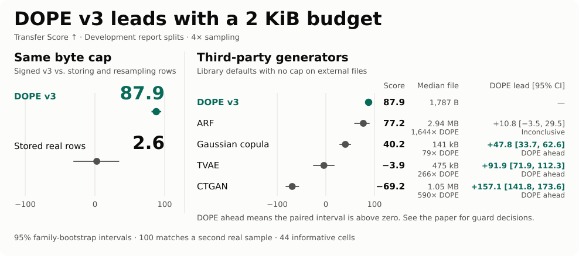

# D.O.P.E.: Downstream Objective-Preserving Encoding

DOPE fits a small **program** that generates synthetic rows for training predictive models. The file contains fitted summaries and schema without any complete fitting records.

[](docs/whitepaper-v3/dope-v3.pdf)
[](https://github.com/neverhuman/dope/actions/workflows/ci.yml)
[](https://github.com/neverhuman/dope/actions/workflows/jankurai.yml)
[](LICENSE)

- **Compact, self-contained artifacts:** `dope fit --format auto-v8` fits a table with a declared target within the whole-file cap. `dope sample` generates rows from the file and a seed.
- **One signed CPU Rust executable:** No Python, PyTorch, or LibTorch required at runtime; signed Linux x86-64 releases carry GitHub/Sigstore OIDC attestations ([`dope-engine-v3.0.0`](https://github.com/neverhuman/dope/releases/tag/dope-engine-v3.0.0)).
- **Adaptive codec selection and twin-referenced ranking:** Per-table duplicate-grouped cross-fitting chooses between `Format 1` and the `DSE8` packet inside the byte cap, ranked against third-party generators on one headline Transfer Score ([white paper PDF](docs/whitepaper-v3/dope-v3.pdf)).

<picture>
  <source media="(prefers-color-scheme: dark)" srcset="bench/real-world/figures/hero-v3-comparison-dark.svg">
  
</picture>

## Results

Under the same byte cap, **DOPE transferred more predictive utility than storing and resampling fitting rows**. The third-party generators used library defaults with no byte cap. Their scores below apply to the files they actually produced.

<!-- BEGIN DOPE1 SCOREBOARD -->
<!-- Generated by dope_kpi render-readme from dope.kpi-receipt/v2 receipts; do not edit. -->

**DOPE v3 ranks first at 87.9** (4× sampling); paired difference vs ARF is **+10.8 points** (95% CI -3.5 to +29.5; interval includes zero).

**Transfer Score = 100 × (1 + TRG).** A score of 100 matches a second real training sample. Higher is better.
On this report a copy of the real training rows scores **96.1**.

| Rank | Generator | Transfer Score ↑ | Median file |
|---:|---|---:|---:|
| 🟩 1 | DOPE v3 | 87.9 | 1,787 B |
| 🟦 2 | ARF | 77.2 † | 2.94 MB |
| ⬜ 3 | SDV Gaussian copula | 40.2 † | 141 KB |
| ⬜ 4 | SDV TVAE | -3.9 † | 475 KB |
| ⬜ 5 | SDV CTGAN | -69.2 † | 1.05 MB |
| — | *Copy of fitting rows* | *96.1* | *—* |
| — | *Bootstrap of fitting rows* | *91.2* | *—* |
| — | *Independent marginals* | *-22.2* | *—* |
| — | *Label shuffle* | *-16.4* | *—* |

† Every observed file exceeds 2048 B (0 files within 2048 B; Transfer Score shown is for those oversized files, whereas applying the 2048 B cap penalty without re-fitting scores 0.0).

A tie spans less than 1 point.

<!-- END DOPE1 SCOREBOARD -->

Across three sets of development splits, DOPE led Gaussian copula, TVAE and CTGAN at the headline sampling rate. The paired interval against ARF included zero on each set. The paper reports the task, realism and privacy guards alongside these results.

[White paper (PDF)](docs/whitepaper-v3/dope-v3.pdf)
· [Equal-budget comparison with stored fitting rows](bench/real-world/results/scoreboard/v3.0.0/evidence/addendum-k/)
· [Full metrics and guard results](bench/real-world/results/scoreboard/v3.0.0/README.md#full-benchmark-metrics-and-guard-results)
· [Third-party evaluation receipts](bench/real-world/results/scoreboard/v3.0.0/evidence/paper/README.md)

## Quick start

Linux x86-64 with glibc 2.39 or newer. The signed engine is one CPU binary: no Python, no model download, and no GitHub account. You do need `curl`, `jq`, and `gh` 2.102.0 or newer. Ubuntu 24.04's packaged `gh` is 2.45.0, which is too old; the block below installs the pinned 2.102.0 archive when yours is older (archive SHA-256 `bb766f710eef8ede859c18578c72c327597cd4c8a85b06001b1f3843c6019386`, binary SHA-256 `7469124f706944133d6a169691dd1c6c3511b12e85878d255e044e2948df4c9b`).

The installer checks the published `dope.sigstore.json` bundle, so it does not ask you to log in. It still needs network access for the download and for Sigstore's trust root. `--source-digest` is the source commit of the [`dope-engine-v3.0.0`](https://github.com/neverhuman/dope/releases/tag/dope-engine-v3.0.0) binary. The URL pins this installer script.

```bash
set -euo pipefail
if ! command -v gh >/dev/null 2>&1 || ! gh --version | awk 'NR==1 { split($3,v,"."); ok=(v[1]>2 || (v[1]==2 && v[2]>=102)); exit !ok }'; then
  mkdir -p "$HOME/.local/bin" "$HOME/.cache"
  stage=$(mktemp -d "$HOME/.cache/dope-gh.XXXXXX")
  curl -fsSL --proto '=https' --tlsv1.2 --retry 2 --connect-timeout 15 --max-time 180 \
    -o "$stage/gh.tar.gz" \
    https://github.com/cli/cli/releases/download/v2.102.0/gh_2.102.0_linux_amd64.tar.gz
  echo "bb766f710eef8ede859c18578c72c327597cd4c8a85b06001b1f3843c6019386  $stage/gh.tar.gz" | sha256sum --check
  tar -xzf "$stage/gh.tar.gz" -C "$stage" gh_2.102.0_linux_amd64/bin/gh
  install -m 0755 "$stage/gh_2.102.0_linux_amd64/bin/gh" "$HOME/.local/bin/gh"
  echo "7469124f706944133d6a169691dd1c6c3511b12e85878d255e044e2948df4c9b  $HOME/.local/bin/gh" | sha256sum --check
  rm -rf "$stage"
fi
export PATH="$HOME/.local/bin:$PATH"
curl -fsSL https://raw.githubusercontent.com/neverhuman/dope/e15c415bad9554f7c419dd240aa670d1a79a27fe/scripts/install.sh \
  | bash -s -- \
      --tag dope-engine-v3.0.0 \
      --source-digest e15c415bad9554f7c419dd240aa670d1a79a27fe \
      --require-attestation \
      --no-weights
export PATH="$HOME/.local/bin:$PATH"
dope --version
awk 'BEGIN {print "a,b,y"; for(i=0;i<160;i++){a=(i*17%997)/997;b=(i*31%991)/991;print a "," b "," 2*a+b*b}}' > train.csv
dope fit train.csv --target y --format auto-v8 --budget 2048 -o model.dope
wc -c < model.dope
dope sample model.dope -n 1000 --seed 1 -o synthetic.csv
```

`dope --version` prints `dope 3.0.0`. If the installer says `~/.local/bin` is not on `PATH`, run the `export` line it prints. It does not edit your shell startup files; add that line yourself if you want it in new shells. `command -v dope` should be `$HOME/.local/bin/dope`. Another `dope` earlier on `PATH` is a different program.

The 160-row table is the release smoke table (`y = 2*a + b*b`). A file of at most 2048 bytes and a 1,000-row `synthetic.csv` mean the commands ran. They do not measure quality. Use a new path for `-o` and for the sample CSV. Name your own target explicitly ([target-last data contract](docs/data-contract.md)). Hold real test rows out before you fit, and score a learner trained on the synthetic rows against one trained on the fitting rows:

```text
(L_null - L_syn) / (L_null - L_real)
```

On this signed binary, `dope inspect` and `dope eval` reject the `--format auto-v8` file, including `eval --synth` when `-m` is that file. The message `artifact: not a DOPE artifact (stored artifact limit)` is that limit. The file is not corrupt: `dope sample` reads it. The walkthrough, the duplicate-grouped split, and troubleshooting are in [Getting started](docs/getting-started.md).

A `.dope` file and any synthetic CSV are derived data. Schema and fitted summaries can carry information about the input. That is not formal differential privacy or HIPAA de-identification.

Confirm the installed binary when you want the release identity:

```bash
dope doctor --json | jq -r .executable_sha256
```

That digest is `8723955b1fcd59cab8996842a39b3a579c596c957ac1f89f291b0a9d1ebfaea0`.

[Verify a downloaded release](docs/signed-engine-release.md#verify-before-install)
· [Build from source](docs/signed-engine-release.md#build-and-package)
· [Getting started](docs/getting-started.md)
· [AGENTS.md](AGENTS.md)

## Documentation

- **White paper:** [DOPE v3 PDF](docs/whitepaper-v3/dope-v3.pdf) · [LaTeX sources & receipt verifier](docs/whitepaper-v3/)
- **Engine & integration:** [Signed engine releases](docs/signed-engine-release.md) · [Downstream JopeDime pin guide](docs/jopedime-integration.md) · [Rust SDK](engine/dope-sdk/) · [Native CLI](engine/dope-cli/)
- **Protocol & governance:** [Metric definitions](docs/metric.md) · [Benchmark protocol](docs/benchmark.md) · [Release gates](docs/release.md) · [Claims policy](docs/claims-policy.md)
- **History & earlier versions:** [Changelog](CHANGELOG.md) · [Archived results, earlier releases & historical manuscripts](HISTORY.md)

## Citation

```bibtex
@techreport{taylor2026dope,
  title       = {{D.O.P.E.}: Downstream Objective-Preserving Encoding},
  author      = {Taylor, Jepson and Alexander, Alton and Morrow, Jordan},
  institution = {NEVERHUMAN Research},
  year        = {2026},
  note        = {Release v3.0.0 white paper (docs/whitepaper-v3/dope-v3.pdf); source and receipts: https://github.com/neverhuman/dope}
}
```

Licensed under [MIT](LICENSE); see [CITATION.cff](CITATION.cff).
