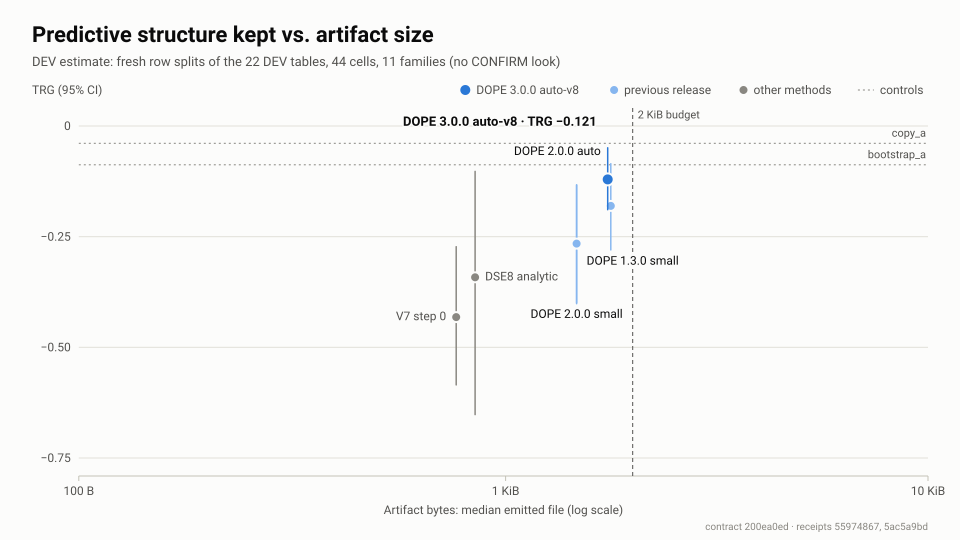
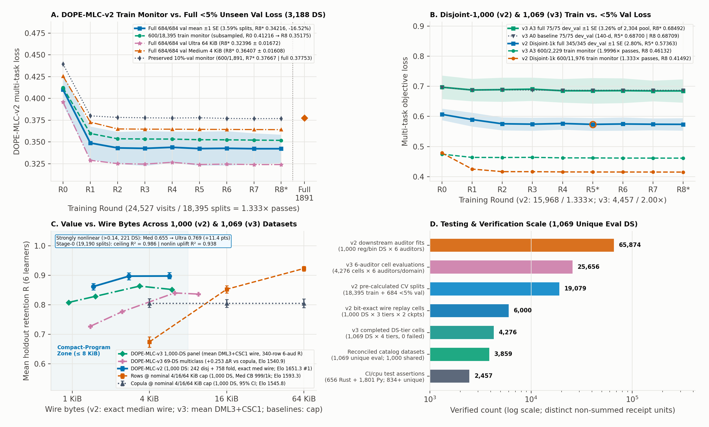

# D.O.P.E.: Downstream Objective-Preserving Encoding

Compile a table into a few-kilobyte **program** that preserves predictive structure.

[](https://github.com/neverhuman/dope/actions/workflows/ci.yml)
[](https://github.com/neverhuman/dope/actions/workflows/jankurai.yml)
[](LICENSE)

<picture>
  <source media="(prefers-color-scheme: dark)" srcset="bench/real-world/figures/hero-v3-dark.svg">
  
</picture>

DOPE `v3.0.0` adds `dope fit --format auto-v8`. It fits the calibrated analytic DSE8
packet and the `Format 1` program, compares them on a grouped two-fold split of
the fit rows, then packs the selected program within the complete byte budget.
The artifact contains zero source rows. `dope sample` generates synthetic rows
from the artifact on a recipient CPU.

- `v3.0.0` adds typed DSE8 distributions, calibrated conditionals and grouped route selection with `auto-v8`.
- `v2.0.0` introduced `auto` selection between `Format 1` and a V7 packet. The current CLI reads V7 artifacts.
- `v1.3.0` and earlier use `Format 1` and historical artifact readers. Plain `dope fit` still defaults to `Format 1`.

## Results

The frozen DEV report shows higher twin-referenced gap (TRG) for `auto-v8`
than `v2.0.0` `auto`. The figure and table show the paired lift, uncertainty
and complete artifact sizes. Higher TRG means better downstream transfer.

**Promotion decision is HOLD.** The regression lower bound, held-out MLP,
realism coverage and empirical privacy coverage missed their thresholds.
The report measures fresh row splits of families used in development. This is
an uncertified engine release.
[Scoreboard protocol and receipts](bench/real-world/results/scoreboard/v3.0.0/README.md)

<!-- BEGIN DOPE1 SCOREBOARD -->
<!-- Generated by dope_kpi render-readme from dope.kpi-receipt/v2 receipts; do not edit. -->
| Arm | Class | Bytes median / max / share <= 2048 B | TRG [95% CI] | Regression (families) | Binary (families) | Multiclass (families) | Median retention linear / gbdt / mlp | C2ST | Realism / privacy / copies mean (max) | Failed / cells |
|---|---|---:|---:|---:|---:|---:|---:|---:|---:|---:|
| `dope-v3b-auto-v8` | source_free | 1787 / 2048 / 1.000 | -0.121 [-0.189, -0.049] | -0.137 (4) | -0.136 (3) | -0.089 (4) | 0.942 / 0.916 / 0.792 | 0.967 | 0.194 / 0.688 / 0.000 (0.000) | 0 / 44 |
| `dope-2.0.0-auto` | source_free | 1817.5 / 2048 / 1.000 | -0.181 [-0.280, -0.085] | -0.118 (4) | -0.278 (3) | -0.146 (4) | 0.939 / 0.917 / 0.792 | 0.958 | 0.306 / 0.719 / 0.000 (0.001) | 0 / 44 |
| `dope-2.0.0-small` | source_free | 1508 / 2043 / 1.000 | -0.267 [-0.402, -0.133] | -0.250 (4) | -0.438 (3) | -0.112 (4) | 0.918 / 0.915 / 0.865 | 0.925 | 0.306 / 0.507 / 0.000 (0.000) | 7 / 44 |
| `dope-1.3.0-small` | source_free | 1508 / 2043 / 1.000 | -0.266 [-0.399, -0.133] | -0.249 (4) | -0.438 (3) | -0.109 (4) | 0.912 / 0.915 / 0.798 | 0.925 | 0.306 / 0.507 / 0.000 (0.000) | 7 / 44 |
| `pr390-v7-step0` | source_free | 782.5 / 2026 / 1.000 | -0.432 [-0.585, -0.273] | -0.102 (4) | -0.545 (3) | -0.648 (4) | 0.896 / 0.840 / 0.728 | 0.986 | 0.194 / 0.774 / 0.000 (0.001) | 0 / 44 |
| `dse8-p0-v3b` | source_free | 867.5 / 2048 / 1.000 | -0.342 [-0.652, -0.103] | -0.094 (4) | -0.276 (3) | -0.655 (4) | 0.950 / 0.942 / 0.741 | 0.977 | 0.194 / 0.753 / 0.000 (0.000) | 0 / 44 |
| `twin_c` | control | - | -0.060 [-0.060, -0.060] | -0.074 (1) | - | -0.046 (1) | 0.997 / 0.993 / 0.974 | 0.522 | - / - / - | 0 / 8 (36 n/a) |
| `copy_a` | control | - | -0.039 [-0.069, -0.014] | -0.017 (4) | -0.056 (3) | -0.045 (4) | 1.000 / 1.000 / 1.000 | 0.530 | - / - / - | 0 / 44 |
| `bootstrap_a` | control | - | -0.088 [-0.147, -0.036] | -0.085 (4) | -0.039 (3) | -0.139 (4) | 0.995 / 0.995 / 0.991 | 0.572 | - / - / - | 0 / 44 |
| `indep_marginals` | control | - | -1.222 [-1.387, -1.095] | -1.135 (4) | -1.381 (3) | -1.149 (4) | -0.157 / -0.011 / -0.334 | 0.967 | - / - / - | 0 / 44 |
| `label_shuffle` | control | - | -1.164 [-1.269, -1.063] | -1.235 (4) | -1.004 (3) | -1.251 (4) | -0.105 / -0.004 / -0.208 | 0.687 | - / - / - | 0 / 44 |

| Comparison | Delta TRG [95% CI] | Holm p (m) | Guards | Sign-flip PROMOTE | Outcome |
|---|---:|---:|---|---:|---|
| `dope-v3b-auto-v8` vs `dope-2.0.0-auto` | +0.060 [+0.009, +0.114] | 0.009 (1) | tasks -0.053 FAIL; mlp -0.007 FAIL; realism -0.111 FAIL; privacy -0.031 FAIL; copies 0.000 (0.000) pass; bytes 2048 pass | 0.000 | **HOLD** |

Contract `dope-kpi/v2` (embedded, candidate) sha256 `200ea0ed1ba23a25be89de2dac2a4101656119514e0d69b4ff86a98fa4857623`; panel `all`; receipt sha256 `55974867a938ff03c9c12108c9bc054c0dd40a6e2c6691e32a8b2c074c8eefba`, `5ac5a9bd0d49cef9454da192ef7adee969d0788b2d01fa76000532f6c3c36c49`.
<!-- END DOPE1 SCOREBOARD -->

## Quick start

Install the [signed Linux x86-64 engine](https://github.com/neverhuman/dope/releases/tag/dope-engine-v3.0.0)
with `gh v2.102.0` or newer. The installer verifies `SHA256SUMS` and the
GitHub/Sigstore signer, tag and source commit before installing.

```bash
curl -fsSL https://raw.githubusercontent.com/neverhuman/dope/main/scripts/install.sh | bash -s -- --no-weights
dope doctor
dope fit train.csv --target y --format auto-v8 --budget 2048 -o model.dope
dope inspect model.dope
dope sample model.dope -n 1000 -o synthetic.csv
```

Use a CSV with an explicitly declared target and follow the
[target-last data contract](docs/data-contract.md). One CPU Rust executable
fits, inspects and samples the program. The analytic path requires no external
weights, Python or LibTorch at runtime. The native `--v8-weights` interface loads
an explicit SafeTensors checkpoint for a compatible neural artifact. Historical
MLC SafeTensors assets have an [independent model tag](https://github.com/neverhuman/dope/releases/tag/v1.0.0).

[Verify a downloaded package](docs/signed-engine-release.md#verify-before-install)
· [Build from source](docs/signed-engine-release.md#build-and-package)

## Qualify a packet for your table

Choose the target before splitting the table. Keep physical duplicates in the
same split so the downstream evaluation measures transfer to new rows. Reserve
real evaluation rows and fit the packet on the remaining rows. To choose a byte
budget for your workload, `dope frontier` fits candidates at declared budgets and
reports their held-out retention. `dope eval` measures a chosen artifact against
real training and test tables. It reports linear and boosted-tree auditor results
so you can see which learner benefits from the encoding.

Read the scoreboard comparison together with the arm rows. TRG compares a learner
trained on synthetic rows with one trained on a separate real sample. The
per-task columns show how that gap varies across regression and classification.
The held-out MLP column checks transfer to a learner outside the primary score.
C2ST measures how easily a classifier distinguishes synthetic rows from real
ones. The copy and coverage columns describe the empirical checks on the same
split. The evidence status for the joint driver gate is **cross-model feature-driver
preservation: not yet measured**. Per-learner driver results from the earlier
multilevel study have their own evaluation and receipts.

Use `dope inspect` to check the format and complete artifact size before handing
it to a recipient. The recipient can set a sampling seed and choose a row count
from that file on a compatible runtime. Keep the installed engine version and
any required weight identity with the artifact. Schema and fitted summaries can
carry information about the input. Treat artifacts as derived data and apply
your normal data-handling rules to them.

## Documentation

- [Current white paper](docs/whitepaper-v3/) and [independent verification](docs/plans/v3-major/verification/).
- [Rust SDK](engine/dope-sdk/), [native CLI](engine/dope-cli/), and [downstream integrations](docs/jopedime-integration.md).
- [Benchmark](docs/benchmark.md), [metric definitions](docs/metric.md), and [claims policy](docs/claims-policy.md).
- [Previous scoreboard](bench/real-world/results/scoreboard/v2.0.0/README.md) and [changelog](CHANGELOG.md).
- [Historical manuscript](paper/dope1.tex), [supplement](paper/dope1-supplement.tex), and [result archive](HISTORY.md).

The [release procedure](docs/release.md) describes the scientific certification
and publication gates. The signed package documentation explains the verification
commands and the deliverable inventory.

<details>
<summary>Historical examples and benchmark results</summary>

The following recorded experiments are from earlier versions. Earlier signed
engine releases remain pinned at `dope-engine-v1.3.0`
(`cd35d9d0f0a772bea0e1ae2352eb8eb7d34ad09b`) and `dope-engine-v1.2.0`
(`5fc96f2819a97ed313658c336a9a46e637299352`). Historical TDL summaries use the
public form `KiB@T90/D80`, requiring nine-tenths of the real-trained lift (T90)
and four-fifths of the driver agreement (D80).

<!-- BEGIN DOPE1 WALKTHROUGH -->
<!-- Generated by examples/adult/walkthrough.py --record; do not edit. -->

```bash
python3 bench/real-world/datasets.py --panel confirm --only adult --out data
```

```bash
dope fit data/confirm/adult/train.csv --target income -o adult.dope
```

```text
compiled data/confirm/adult/train.csv -> adult.dope  (4,079 bytes, budget 4,096)
  task         classification · 20,000 rows × 13 features
  program      9 knots · factor8 dependence × 16 regime(s) · net 10→12 (bits w5 b4 β6 v7) · 106 trees of depth 4
  parameters   3,109 total scalar slots (155 network, 2,226 forest)
  stored gain  0.504 of the null loss explained on held-out rows
  self-audit   robust retention 0.904 (linear and tree auditors trained on samples, scored on held-out training rows)
  drivers      relationship, marital_status, occupation, education, education_num, age
  time         11.0 s on cpu (102 threads)
```

```bash
dope inspect adult.dope
```

```text
adult.dope  4,079 bytes (3,975 brotli program + 104 safetensors framing)
  inflated, the program holds:
  metadata             2,054 bytes
  copula.loadings        104 bytes
  discrete.cum           210 bytes
  discrete.values         64 bytes
  features.missing        13 bytes
  forest               2,332 bytes
  marginal.atoms          24 bytes
  marginal.knots          28 bytes
  marginal.range          16 bytes
  net.codes              100 bytes
  net.params              20 bytes
  noise                    2 bytes
  regime.means           208 bytes
  regime.scales          208 bytes
  regime.weights          16 bytes
  schema.affine           40 bytes
  task         Classification, target `income`
  features     13
  parameters   3,109 total scalar slots
  dependence   factor8 × 16 regime(s)
  net          10 inputs → 12 hidden → 1 outputs
  trees        106 oblivious trees of depth 4 (6-bit leaves)
  rows stored  none
```

```bash
dope sample adult.dope -n 4 --seed 1
```

```text
age,workclass,education,education_num,marital_status,occupation,relationship,race,sex,capital_gain,capital_loss,hours_per_week,native_country,income
80,Private,HS-grad,9,Married-civ-spouse,,Husband,White,Male,5867,0,53,United-States,>50K
35,Private,Some-college,10,Never-married,Sales,Own-child,White,Female,0,0,40,United-States,<=50K
67,Private,7th-8th,7,Married-civ-spouse,,Husband,White,Male,0,0,56,United-States,>50K
35,,9th,3,Separated,Machine-op-inspct,Not-in-family,White,Male,0,0,20,Dominican-Republic,<=50K
```

```bash
dope sample adult.dope -n 3 --seed 1 --space ml   # selected columns of 107
```

```text
age,education_num,relationship=Wife,relationship=Husband,relationship=Not-in-family,relationship=Unmarried,relationship=Other-relative,relationship=Own-child,hours_per_week,…
1,0.5,0,1,0,0,0,0,0.600017,…
0.292759,0.571429,0,0,0,0,0,1,0.4375,…
0.826336,0.357143,0,1,0,0,0,0,0.64114,…
```

```bash
dope eval -m adult.dope --train data/confirm/adult/train.csv --test data/confirm/adult/test.csv
```

```text
retention on 6512 held-out real rows (classification task, artifact 4079 bytes, 50000 synthetic vs 20000 real training rows)
  auditor   null loss   real loss  synth loss  retention
  linear      0.55198     0.32922     0.33758      0.962
  gbdt        0.55198     0.28585     0.30165      0.941
  mlp         0.55198     0.32906     0.33239      0.985
  robust retention (min over families): 0.941
```

#### Head-to-Head Method Comparison on UCI Adult (`20,000` train $\to$ `6,512` held-out real test rows)

| Method & Evaluation Protocol on UCI Adult (`income`) | Charged Artifact Bytes | Source Rows Stored | Linear / Logistic $R$ | Boosted Trees (GBDT) $R$ | Neural MLP $R$ | Robust Retention $R$ (`min` over families) |
|---|---:|---|---:|---:|---:|---|
| **`dope` (`v1.0.0`) CLI above (`adult.dope`, `seed=0`, `50,000` synth rows, built-in Rust auditors)** | **`4,079 B` (`4.0 KiB`)** | **`0` rows** | **`0.962`** | **`0.941`** | **`0.985`** | **`0.941` (`seed=0`, $4\times$ cap)** |
| **`DOPE` (`v1.0.0`) @ `4 KiB` (`dope-4x@-`, external Python harness, $4\times N_{\text{train}}$ = `80,000` rows)** | **`4,079 B` (`4.0 KiB`)** | **`0` rows** | **`0.957`** | **`0.946`** | **`0.975`** | **`0.946` (`seed=0`)** |
| `DOPE` (`v1.0.0`) @ `4 KiB` (`dope-seed0@-`, external Python harness, $1\times N_{\text{train}}$ = `20,000` rows) | `4,079 B` (`4.0 KiB`) | `0` rows | `0.964` | `0.907` | `0.907` | `0.907` (`seed=0`) |
| **`DOPE` (`v1.0.0`) @ `4 KiB` (`dope@4k`, 3-seed median `seed=0,1,2`, $1\times N_{\text{train}}$)** | **`4,077 B` (`4.0 KiB`)** | **`0` rows** | **`0.946`** | **`0.907`** | **`0.933`** | **`0.907` (seeds `0.901..0.914`)** |
| `Raw Rows Subsample` @ `4 KiB` (`rows@4k`, 3-seed median, `xz`-compressed real rows) | `4,088 B` (`4.0 KiB`) | `xz` real-row subset | `0.870` | `0.777` | `-7.813` | `-7.813` (seeds `-8.311..-5.695`) |
| `Adversarial Random Forests` (`arf@-`, 3-seed median, `1,578×` larger) | `6,431,472 B` (`6.13 MiB`) | `0` rows | `0.932` | `0.874` | `0.955` | `0.866` (seeds `0.857..0.888`; $\min_f \text{med}_s = 0.874$) |
| `Gaussian Copula` (`copula@-`, 3-seed median, `22×` larger) | `91,476 B` (`89.3 KiB`) | `0` rows | `0.408` | `0.196` | `0.333` | `0.196` (seeds `0.184..0.211`) |
| `Real Rows Resampled` (`bootstrap@-`, 3-seed median, full `20,000`-row bootstrap) | `112,240 B` (`109.6 KiB`) | `20,000` real rows | `0.994` | `0.973` | `-0.036` | `-0.036` (`seed=0`) |

*Aggregation & auditor disclosure:* The first row reports the standalone Rust `dope eval` command above (`--factor 4.0`, capped at `50,000` synthetic rows, using `dope-core`'s built-in Rust logistic, histogram-GBDT, and candle-MLP auditors). All remaining rows come directly from `bench/real-world/results/confirm/summary.json` and `records.jsonl` using the external Python benchmark auditors (`LogisticRegression`, `CatBoostClassifier`, `MLPClassifier`), where 3-seed rows report the per-column median across `seed = 0, 1, 2` and `robust` reports $\text{median}_s(\min_f R_{s,f})$ (alongside the seed range and $\min_f(\text{median}_s R_{s,f})$ when they differ, as on `arf@-`: `0.866` vs. `0.874`).
<!-- END DOPE1 WALKTHROUGH -->

<!-- BEGIN DOPE1 RESULTS -->
<!-- Generated by bench/real-world/render.py from results/multilevel-convergence-snapshot.json; do not edit. -->
### 1,000-Dataset Method Comparison (`DOPE-MLC-v2`, `v1.0.0`) & 1,069-Dataset Multi-Task Expansion (`DOPE-MLC-v3`, `v1.0.0`)

| Rank & Method (`1,000` Datasets, `6` Downstream Auditors, `44,369` Matches/Method) | Tournament Elo `[95% CI]` (Win Share) | `Medium` (`4 KiB` Cap) Mean $R$ `[95% CI]` (`DOPE 1,502 B / 1.5 KiB`) | `High` (`16 KiB` Cap) Mean $R$ `[95% CI]` (`DOPE 2,836 B / 2.8 KiB`) | `Ultra` (`64 KiB` Cap) Mean $R$ `[95% CI]` (`DOPE 5,872 B / 5.7 KiB`) |
|---|---:|---:|---:|---:|
| **`#1 DOPE-MLC-v2` (`v1.0.0`, Unified 3-Level Encoder)** | **`1651.3 [1643.4, 1659.6]` (`70.58%` win; Disjoint-1k: `1650.7 #1`)** | **`0.8620 [0.8503, 0.8722]` (`#1` Elo `1652.1`)** | **`0.8971 [0.8848, 0.9080]` (`#1` Elo `1669.6`)** | **`0.8975 [0.8883, 0.9094]` (`#1` Encoder Elo `1640.1`)** |
| `#2 Raw Rows Subsample` (`rows`, raw-row subset control) | `1593.3 [1584.4, 1602.7]` (`62.32%` win) | `0.6743 [0.6564, 0.6915]` | `0.8526 [0.8404, 0.8649]` | `0.9230 [0.9141, 0.9301]` (`copies 88% raw rows`) |
| `#3 Gaussian Copula` (`copula`, parametric baseline) | `1545.8 [1535.7, 1553.5]` (`55.29%` win) | `0.8046 [0.7916, 0.8209]` | `0.8046 [0.7910, 0.8180]` | `0.8046 [0.7908, 0.8200]` |
| `#4 Joint Diffusion` (`joint_diffusion_v1`) | `1432.4 [1423.8, 1440.8]` (`38.75%` win) | `0.7034 [0.6880, 0.7184]` | `0.7541 [0.7407, 0.7702]` | `0.7886 [0.7747, 0.8033]` |
| `#5 Adversarial Random Forests` (`arf`) | `1184.7 [1167.3, 1202.3]` (`10.86%` win) | `0.4113 [0.3936, 0.4321]` | `0.4113 [0.3898, 0.4319]` | `0.4113 [0.3902, 0.4309]` |

*Byte, cohort & coverage qualification (`v8` canonical index):* The `1,000`-dataset `DOPE-MLC-v2` pooled panel (`dope_mlc_v2_s3_best.pt`) comprises **`242` strictly dataset-disjoint datasets** (`0` train overlap, `Ultra` $R = 0.8493$, `#1` Elo `1671.6 [1655.2, 1688.0]`) and **`758` in-corpus unseen-fold datasets** (row-disjoint, `Ultra` $R = 0.9129$, `#1` Elo `1645.4 [1637.8, 1653.6]`), while the strictly dataset-disjoint checkpoint (`dope_mlc_v2_disjoint1000_best.pt`, `0` train overlap across all `1,000` eval DS) reaches `Ultra` $R = 0.8998$ and **`#1` Elo `1650.7 [1643.4, 1657.5]`**. `DOPE-MLC-v2` median wire bytes (`1,502 / 2,836 / 5,872 B` = `1.5 / 2.8 / 5.7 KiB`; zlib `1,238 / 2,351 / 4,616 B`) are bit-exact `version=2` latent payloads (`6,000/6,000` cells `max_abs_diff = 0.0`), excluding the `.dope` scaler sidecar (`+545 B` median; full raw `2,031 / 3,376 / 6,398 B`) and shared frozen decoder (`292,707 B` / `285.8 KiB`, amortized `0 B/dataset`), whereas `DOPE-MLC-v3` (`DML3+CSC1`) is self-contained inside `2 / 4 / 16 / 64 KiB` caps (`960.6 / 1,550.2 / 3,429.2 / 6,144.6 B` mean on `1,000` `v2`-panel tables; `1,418.0 / 2,510.7 / 6,435.3 / 9,877.5 B` mean on `69` multiclass tables; `1,781,800 B` shared SafeTensors hypernetwork). Baseline byte tiers (`4 / 16 / 64 KiB`) reflect nominal caps and historical `fp16` byte estimates paired with `float64` in-memory scores (`baseline_wire_1000ds_qualified = false`; `rows` `medium|catboost` observed on `999/1,000` DS with `17cd766e7ec82f1e` omitted; `65,874` evaluated `v2` auditor fits alongside `1,303` `real_gain < 0.01` skips and `500` `arf` multiclass exclusions).

| Downstream Learner Family (`DOPE-MLC-v2 Ultra`, `1,000` DS) | Evaluated Datasets | Holdout Retention $R$ `[95% CI]` | Driver Fidelity $D$ `[95% CI]` |
|---|---:|---:|---:|
| **Linear / Logistic** | `n=969` | **`0.9297 [0.9182, 0.9398]`** | `0.7853 [0.7745, 0.7950]` |
| **Local Gated Attention Net** (`kumo_tabpfn` key) | `n=962` | **`0.9211 [0.9094, 0.9333]`** | **`0.8781 [0.8743, 0.8824]` (`D80` pass)** |
| **MLP** | `n=965` | **`0.9143 [0.9021, 0.9245]`** | **`0.8915 [0.8872, 0.8960]` (`D80` pass)** |
| **LightGBM** | `n=989` | **`0.8978 [0.8852, 0.9085]`** | `0.7703 [0.7615, 0.7793]` |
| **CatBoost** | `n=1,000` | **`0.8810 [0.8692, 0.8915]`** | **`0.8130 [0.8055, 0.8213]` (`D80` pass)** |
| **XGBoost** | `n=989` | **`0.8121 [0.7915, 0.8285]`** | `0.7221 [0.7131, 0.7310]` |

| Mechanism, Nonlinearity Regime & Sampling-Expansion Audit | Scope | `Medium` (`1.5 KiB`) / `1×` | `High` (`2.8 KiB`) / `2×` | `Ultra` (`5.7 KiB`) / `5×` |
|---|---|---:|---:|---:|
| **Mostly Linear Regime** (`<= 0.04` uplift) | `581` DS | `0.9401` | **`0.9579`** | `0.9459` (`D = 0.7836`) |
| **Moderate Nonlinear Regime** (`0.04–0.14` uplift) | `198` DS | `0.8637` | `0.8953` | **`0.8990`** (`+3.53` pts) |
| **Strongly Nonlinear Regime** (`> 0.14` uplift) | `221` DS | `0.6552` | `0.7390` | **`0.7689` (`+11.37` pts)** |
| **Stage-0 Signal Ceiling $R^2$** | `19,190` splits | `0.9417` | `0.9654` | **`0.9863`** |
| **Stage-0 Nonlinear Uplift $R^2$** | `19,190` splits | `0.7912` | `0.8727` | **`0.9383`** |
| **CatBoost Sampling Expansion** (`1× -> 2× -> 5× N_train`) | `n=150` DS (`ds_rank<150`) | `0.8808` (`1×`) | `0.9010` (`2×`) | **`0.9070` (`5×`, `+2.62` pts)** |



| Track / Expansion Study | Corpus & `<5%` Validation Split Allocation | Effective Passes & Visits (`R0..R8`) | Train Monitor (`R0 -> Best`) | Full-Population Validation Loss `± 1 SE` or Holdout Transfer | Key Qualification & Tournament Result |
|---|---|---|---|---|---|
| **Track 1: `DOPE-MLC-v2` Full-Corpus `<5%` Val** | `18,395` train splits (`96.41%`) / `684` unseen-DS val splits (`3.59% < 5%`, `115` DS) | `24,527` visits (`1.333351×` passes) | `0.41216 -> 0.35175` | `0.40988 ± 0.01767` $\to$ **`0.34216 ± 0.01621`** (`R8*`, `-16.52%`) | Monotonic `Ultra 0.32396 < High 0.33844 < Med 0.36407`; preserved `10%`-val `full_1891_val_final = 0.37753` |
| **Track 2: `DOPE-MLC-v2` Disjoint-`1,000` `<5%` Val** | `11,976` train splits (`97.20%`) / `345` `dev_val` splits (`2.80% < 5%`, `58` DS; `0` eval overlap) | `15,968` visits (`1.333333×` passes) | `0.47854 -> 0.41492` | `0.60691 ± 0.01915` $\to$ **`0.57363 ± 0.02131`** (`R5*`, `-5.48%`) | Disjoint-`1,000` `Ultra` $R = 0.8998$ (med `0.9671`), Driver $D = 0.7904$, **`#1` Elo `1650.7 [1643.4, 1657.5]`** |
| **Track 3: `DOPE-MLC-v3` (`A3`) Disjoint-`1,069` `<5%` Val** | `2,229` loaded train cells / `75` loaded `dev_val` cells (`3.2552% < 5%` of `2,304` pool; `0` eval overlap) | `4,457` visits (`1.999551×` passes) | `0.47454 -> 0.46132` | `0.69727 ± 0.03888` $\to$ **`0.68492 ± 0.03877`** (`R8*`, `-1.77%`) | `Small 0.69473 > Med 0.69128 > High 0.67958 > Ultra 0.67408`; active `col_gate_head` (`grad_norm = 0.001014`) |
| **`DOPE-MLC-v3` Unified `1,069`-DS (`4,276`-Cell) Eval** | `1,069` unique eval DS (`1,000` shared `v2`-panel + `69` multiclass; never summed to `2,069`) | `4,276/4,276` cells (`25,656` 6-auditor fits/domain, `0` failed) | `100.0% <= cap` (`DML3+CSC1`) | `v2`-panel `High` sender/CSC1 $R = 0.8633 / 0.8706$; MC `High` $R = 0.8402 / 0.8451$ | Equal-wire (`12,828` cells): `v3` Elo **`1457.6`** beats `copula` `1407.1` (`ΔR = +0.0941`, MC `+0.2526`); ties `v2` (`1538.0`) within `0.10` on `8,136/9,000` cells (`ΔR = -0.0084`); trails `rows_wire` (`1597.3`, `ΔR = -0.0250`) under `340`-row CPU cap |
| **Pure-Rust `dope mlc-v3` (`SafeTensors`) & CI Scale** | `56` `F32` tensors (`444,168` params, `1,781,800 B`), `3,859`-DS reconciled catalog | `2,457` CI assertions (`656` Rust + `1,801` Python, `834+` unique tests) | `0` Python/LibTorch deps at inference | **`max_forward_abs_err = 1.3255e-6 < 1e-5`**; **`max_fixed_draw_sample_abs_err = 1.1111e-6 < 1e-5`** | `12/12` standalone `--seed` `(tier, task)` cells finite; `8/8` tamper/oversize checks fail closed |

*Scope & provenance:* All `1,000`-dataset `DOPE-MLC-v2` (`65,874` auditor fits) and `1,069`-dataset `DOPE-MLC-v3` (`4,276` cells) benchmarks are selection-exposed development/reconciliation evaluations (`untouched_sealed_confirmatory_test = false`) measured on the preserved `dope_mlc_v2_s3_best.pt`, `dope_mlc_v2_disjoint1000_best.pt`, and `dope_mlc_v3_multitask_best.pt` checkpoints (local gated attention nets `_TabularKumoAttentionNet` / `_LocalGatedAttentionNet` are trained from scratch per table; official pretrained KumoTabular/TabPFN is not evaluated). Full round-by-round `R0..R8` tables, cohort breakdowns, and SHA-256 receipts: [docs/multilevel-landmark-dl-study.md](docs/multilevel-landmark-dl-study.md) and [bench/real-world/results/multilevel-convergence-snapshot.json](bench/real-world/results/multilevel-convergence-snapshot.json).
<!-- END DOPE1 RESULTS -->

</details>

## Citation

```bibtex
@misc{taylor2026dope,
  title  = {{D.O.P.E.}: Downstream Objective-Preserving Encoding -- Generative Compression of Predictive Structure},
  author = {Taylor, Jepson and Alexander, Alton and Morrow, Jordan},
  year   = {2026},
  note   = {NEVERHUMAN Research. Source and receipts: https://github.com/neverhuman/dope}
}
```

Licensed under [MIT](LICENSE); see [CITATION.cff](CITATION.cff).
