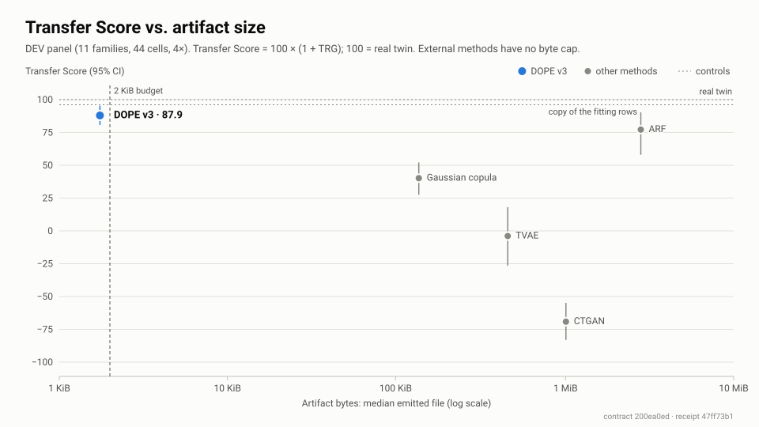

# D.O.P.E.: Downstream Objective-Preserving Encoding

Compile a tabular dataset into a compact binary **program** that stores zero source rows and preserves downstream predictive transfer.

[](docs/whitepaper-v3/dope-v3.pdf)
[](https://github.com/neverhuman/dope/actions/workflows/ci.yml)
[](https://github.com/neverhuman/dope/actions/workflows/jankurai.yml)
[](LICENSE)

- **Compact, self-contained artifacts:** `dope fit --format auto-v8` compiles a table with a declared target into a single binary program within the complete byte budget, storing zero source rows; `dope sample` generates synthetic rows on any CPU.
- **One signed CPU Rust executable:** No Python, PyTorch, or LibTorch required at runtime; signed Linux x86-64 releases carry GitHub/Sigstore OIDC attestations ([`dope-engine-v3.0.0`](https://github.com/neverhuman/dope/releases/tag/dope-engine-v3.0.0)).
- **Adaptive codec selection and twin-referenced ranking:** Per-table duplicate-grouped cross-fitting chooses between `Format 1` and the `DSE8` packet inside the byte cap, ranked against third-party generators on one headline Transfer Score ([white paper PDF](docs/whitepaper-v3/dope-v3.pdf)).

<picture>
  <source media="(prefers-color-scheme: dark)" srcset="bench/real-world/figures/hero-v3-methods-dark.svg">
  
</picture>

## Results

DOPE `v3.0.0` (`auto-v8`, within the complete byte budget) ranked against four third-party generators (ARF, SDV Gaussian copula, TVAE, and CTGAN, fitted with library defaults and no byte cap) and real-row controls on the pre-registered DEV report look ([white paper PDF](docs/whitepaper-v3/dope-v3.pdf)).

<!-- BEGIN DOPE1 SCOREBOARD -->
<!-- Generated by dope_kpi render-readme from dope.kpi-receipt/v2 receipts; do not edit. -->

**DOPE v3 ranks first at 87.9** (4× sampling); paired difference vs ARF is **+10.8 points** (95% CI -3.5 to +29.5; interval includes zero).

**Transfer Score = 100 × (1 + TRG).** A score of 100 matches a second real training sample. Higher is better.
On this report a copy of the real training rows scores **96.1**.

| Rank | Generator | Transfer Score ↑ | Median file |
|---:|---|---:|---:|
| 🟩 1 | DOPE v3 | 87.9 | 1,787 B |
| 🟦 2 | ARF | 77.2 † | 2.94 MB |
| ⬜ 3 | SDV Gaussian copula | 40.2 † | 141 KB |
| ⬜ 4 | SDV TVAE | -3.9 † | 475 KB |
| ⬜ 5 | SDV CTGAN | -69.2 † | 1.05 MB |
| — | *Copy of fitting rows* | *96.1* | *—* |
| — | *Bootstrap of fitting rows* | *91.2* | *—* |
| — | *Independent marginals* | *-22.2* | *—* |
| — | *Label shuffle* | *-16.4* | *—* |

† Scored with files above the 2048 B budget (0 files within 2048 B; Transfer Score 0.0 at 2048 B).

A tie spans less than 1 point.

<details>
<summary>Full benchmark metrics and guard results</summary>

| Arm | Class | Bytes median / max / share <= 2048 B | TRG [95% CI] | Regression (families) | Binary (families) | Multiclass (families) | Median retention linear / gbdt / mlp | C2ST | Realism / privacy / copies mean (max) | Failed / cells |
|---|---|---:|---:|---:|---:|---:|---:|---:|---:|---:|
| `dope-v3b-auto-v8` | source_free | 1787 / 2048 / 1.000 | -0.121 [-0.189, -0.049] | -0.137 (4) | -0.136 (3) | -0.089 (4) | 0.942 / 0.916 / 0.792 | 0.967 | 0.194 / 0.688 / 0.000 (0.000) | 0 / 44 |
| `twin_c` | control | - | -0.060 [-0.060, -0.060] | -0.074 (1) | - | -0.046 (1) | 0.997 / 0.993 / 0.974 | 0.522 | - / - / - | 0 / 8 (36 n/a) |
| `copy_a` | control | - | -0.039 [-0.069, -0.014] | -0.017 (4) | -0.056 (3) | -0.045 (4) | 1.000 / 1.000 / 1.000 | 0.530 | - / - / - | 0 / 44 |
| `bootstrap_a` | control | - | -0.088 [-0.147, -0.036] | -0.085 (4) | -0.039 (3) | -0.139 (4) | 0.995 / 0.995 / 0.991 | 0.572 | - / - / - | 0 / 44 |
| `indep_marginals` | control | - | -1.222 [-1.387, -1.095] | -1.135 (4) | -1.381 (3) | -1.149 (4) | -0.157 / -0.011 / -0.334 | 0.967 | - / - / - | 0 / 44 |
| `label_shuffle` | control | - | -1.164 [-1.269, -1.063] | -1.235 (4) | -1.004 (3) | -1.251 (4) | -0.105 / -0.004 / -0.208 | 0.687 | - / - / - | 0 / 44 |
| `sdv-gaussian-copula` | source_free | 140675.5 / 1145929 / 0.000 | -0.598 [-0.721, -0.482] † | -0.168 (4) | -0.612 (3) | -1.015 (4) | 0.525 / 0.510 / 0.329 | 0.992 | 0.111 / 0.601 / 0.005 (0.200) | 0 / 44 |
| `sdv-ctgan` | source_free | 1053957.5 / 5404151 / 0.000 | -1.692 [-1.827, -1.552] † | -1.502 (4) | -1.888 (3) | -1.685 (4) | -0.514 / -0.425 / -0.557 | 0.996 | 0.000 / 0.743 / 0.006 (0.271) | 0 / 44 |
| `sdv-tvae` | source_free | 475125.5 / 3340780 / 0.000 | -1.039 [-1.262, -0.822] † | -0.700 (4) | -1.432 (3) | -0.986 (4) | 0.175 / 0.466 / 0.291 | 0.977 | 0.000 / 0.326 / 0.000 (0.000) | 5 / 44 |
| `arfpy-arf` | source_free | 2937782.5 / 24068428 / 0.000 | -0.228 [-0.416, -0.100] † | -0.071 (4) | -0.412 (3) | -0.203 (4) | 0.906 / 0.874 / 0.835 | 0.941 | 0.278 / 0.031 / 0.000 (0.004) | 0 / 44 |

† Scored with packets above 2048 B (the TRG reads the rows as scored): `sdv-gaussian-copula` 64 files, TRG at 2048 B -1.000; `sdv-ctgan` 64 files, TRG at 2048 B -1.000; `sdv-tvae` 45 files, TRG at 2048 B -1.000; `arfpy-arf` 64 files, TRG at 2048 B -1.000.

| Comparison | Delta TRG [95% CI] | Holm p (m) | Guards | Sign-flip PROMOTE | Outcome |
|---|---:|---:|---|---:|---|
| `dope-v3b-auto-v8` vs `arfpy-arf` | +0.108 [-0.035, +0.295] | 0.114 (1) | tasks -0.220 FAIL; mlp -0.118 FAIL; realism -0.083 FAIL; privacy +0.656 pass; copies 0.000 (0.000) pass; bytes 2048 pass; baseline above budget 44 | 0.000 | **HOLD** |
| `dope-v3b-auto-v8` vs `sdv-gaussian-copula` | +0.478 [+0.337, +0.626] | <0.001 (1) | tasks -0.168 FAIL; mlp +0.463 pass; realism +0.083 pass; privacy +0.087 pass; copies 0.000 (0.000) pass; bytes 2048 pass; baseline above budget 44 | 0.001 | **HOLD** |
| `dope-v3b-auto-v8` vs `sdv-tvae` | +0.919 [+0.719, +1.123] | <0.001 (1) | tasks +0.273 pass; mlp +0.697 pass; realism +0.194 pass; privacy +0.361 pass; copies 0.000 (0.000) pass; bytes 2048 pass; baseline above budget 39 | 0.003 | **PROMOTE** |
| `dope-v3b-auto-v8` vs `sdv-ctgan` | +1.571 [+1.418, +1.736] | <0.001 (1) | tasks +1.191 pass; mlp +1.307 pass; realism +0.194 pass; privacy -0.056 FAIL; copies 0.000 (0.000) pass; bytes 2048 pass; baseline above budget 44 | 0.000 | **HOLD** |

Contract `dope-kpi/v2` (embedded, candidate) sha256 `200ea0ed1ba23a25be89de2dac2a4101656119514e0d69b4ff86a98fa4857623`; panel `all`; receipt sha256 `47ff73b1e35b8b29210de6df55538d60c65b59486c405d641027aff2124deda2`, `aba08611a37b197716f2f5a7ca8797c40a54bf0b5b35cd93701f781fdda683b7`, `6f1cb70a8dc695a33a3cbe37b8a441707c19c5bdc6e5760a8fb78d8413d25a58`, `97b682a81d9592637aa9f0fee0bcb1d9c9bef5df954e12ad4ee379a861d03704`, `8650350fd3d1ba74dbc564b64d40125558e5b4bb3f1e7784d01bdd5369bcad56`.

</details>

<!-- END DOPE1 SCOREBOARD -->

All scores are fresh-split DEV-SELECT estimates (no confirmation, holdout, or sealed panel was opened), and third-party generators ran with library defaults and no byte cap. Against ARF, the paired interval includes zero, so DOPE is not shown to transfer better than ARF on this look. Under the contract's full promotion rule, DOPE is **PROMOTE** against TVAE alone on the report look and **HOLD** against ARF, Gaussian copula, and CTGAN (on the second DEV look in the white paper, DOPE is **PROMOTE** against TVAE and CTGAN and **HOLD** against ARF and Gaussian copula). Synthetic rows from every generator remain easy for a boosted-tree classifier to distinguish from real rows, and the empirical privacy diagnostics are not differential privacy and not HIPAA de-identification.

[White paper (PDF)](docs/whitepaper-v3/dope-v3.pdf)
· [Scoreboard receipts](bench/real-world/results/scoreboard/v3.0.0/README.md)
· [Third-party evaluation receipts](bench/real-world/results/scoreboard/v3.0.0/evidence/paper/README.md)

## Quick start

Install the [signed Linux x86-64 engine](https://github.com/neverhuman/dope/releases/tag/dope-engine-v3.0.0) with `gh v2.102.0` or newer (`scripts/install.sh` verifies `SHA256SUMS` and the GitHub/Sigstore OIDC signer, tag, and source commit before installing):

```bash
curl -fsSL https://raw.githubusercontent.com/neverhuman/dope/main/scripts/install.sh | bash -s -- --no-weights
dope doctor
dope fit train.csv --target y --format auto-v8 --budget 2048 -o model.dope
dope inspect model.dope
dope sample model.dope -n 1000 -o synthetic.csv
dope eval -m model.dope --train train.csv --test test.csv
```

Provide a CSV with an explicitly declared target ([target-last data contract](docs/data-contract.md)). One CPU Rust executable fits, inspects, samples, and evaluates the artifact with zero external weights, Python, or LibTorch at runtime. Optional `--v8-weights` loads an attested `SingleEncV8` SafeTensors checkpoint when supplied. Treat artifacts as derived data under your normal data-handling rules.

[Verify a downloaded release](docs/signed-engine-release.md#verify-before-install)
· [Build from source](docs/signed-engine-release.md#build-and-package)
· [Getting started](docs/getting-started.md)

## Documentation

- **White paper:** [DOPE v3 PDF](docs/whitepaper-v3/dope-v3.pdf) · [LaTeX sources & receipt verifier](docs/whitepaper-v3/)
- **Engine & integration:** [Signed engine releases](docs/signed-engine-release.md) · [Downstream JopeDime pin guide](docs/jopedime-integration.md) · [Rust SDK](engine/dope-sdk/) · [Native CLI](engine/dope-cli/)
- **Protocol & governance:** [Metric definitions](docs/metric.md) · [Benchmark protocol](docs/benchmark.md) · [Release gates](docs/release.md) · [Claims policy](docs/claims-policy.md)
- **History & earlier versions:** [Changelog](CHANGELOG.md) · [Archived results, earlier releases & historical manuscripts](HISTORY.md)

## Citation

```bibtex
@misc{taylor2026dope,
  title  = {{D.O.P.E.}: Downstream Objective-Preserving Encoding -- Generative Compression of Predictive Structure},
  author = {Taylor, Jepson and Alexander, Alton and Morrow, Jordan},
  year   = {2026},
  note   = {NEVERHUMAN Research. Source and receipts: https://github.com/neverhuman/dope}
}
```

Licensed under [MIT](LICENSE); see [CITATION.cff](CITATION.cff).
