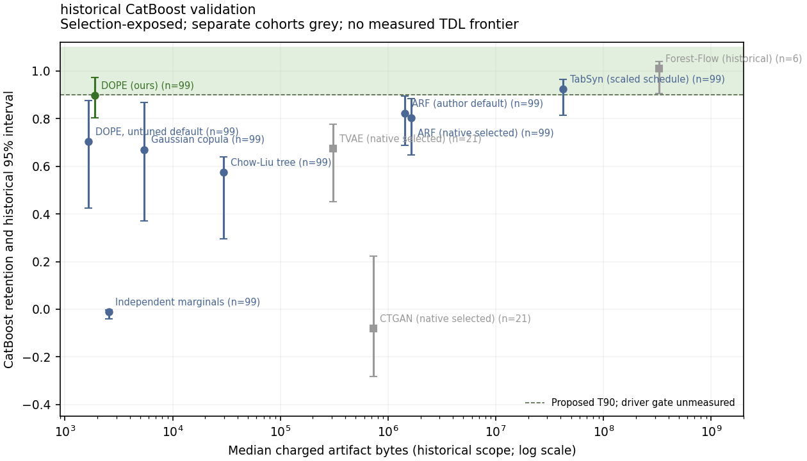
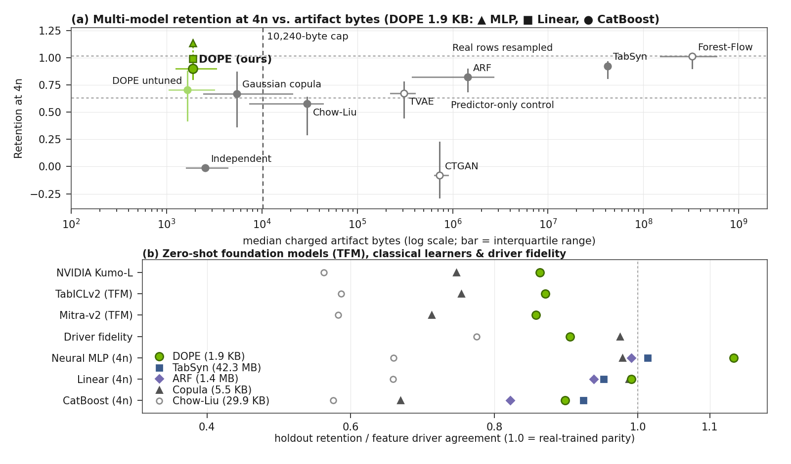
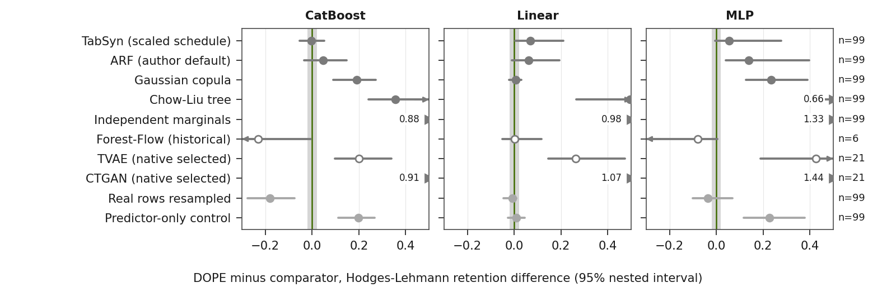

# DOPE — Generative Compression of Predictive Structure

[](https://github.com/neverhuman/dope/actions/workflows/ci.yml)
[](LICENSE)

**DOPE compiles a table into a small executable generator, then asks how few bytes it needs before models trained only on its samples still predict well on untouched real data.**

DOPE stands for **Downstream Objective-Preserving Encoding**. The artifact is a small **sampling program**, not a synthetic table. Train on generated rows. Test on untouched real rows. Count every byte that sampling reads.

> **Evidence status (2026-10-15).** The active evidence is the v2 validation panel: PMLB regression tables, CatBoost-centered and selection-exposed. The MFS-v3 and MFS-v4 release scores are historical and null for every method. The new metric, TDL, is specified and unmeasured. The official test split is sealed. Every result carries a label from the [claims policy](docs/claims-policy.md).



*Historical CatBoost validation, not a TDL frontier. The figure is rendered from `paper/generated/headline-results.json`, and the measured transfer-versus-bytes frontier will replace it when the qualified panel runs.*

## The metric: Transfer Description Length

TDL is the smallest tested number of dataset-specific bytes for which models trained or conditioned on the artifact's samples do two things on untouched real rows:

- recover at least nine-tenths of the real data's predictive gain over a null (T90), at the lower confidence bound, in every required model family (trees, neural, linear, tabular foundation models); and
- rely on the same feature drivers, reaching at least four-fifths of the agreement two real-trained models reach (D80).

The artifact must also pass the copy, cleartext, control-lift and byte-accounting gates. The public form is `KiB@T90/D80`. When no tested budget qualifies, the result is "not reached in the tested range", never zero. Bytes are the quantity being reduced; transfer and drivers are constraints, and no weight trades one against another. The definitions are in [docs/metric.md](docs/metric.md). The name and thresholds are working defaults pending owner decisions D-01 and D-02 ([docs/decisions.md](docs/decisions.md)).

## Current result card

<!-- BEGIN TDL RESULTS -->
<!-- Generated by tools/claims/render.py; edit headline-results.json. -->
Historical CatBoost validation; selection-exposed. TDL is unmeasured.

| Method | Retention [historical 95% interval] | Median charged artifact bytes | Observed lineages | Evidence status |
|---|---:|---:|---:|---|
| DOPE (ours) | 0.898 [0.804, 0.972] | 1895.0 | 99/100 | `selection_exposed_validation` |
| DOPE, untuned default | 0.704 [0.424, 0.877] | 1660.5 | 99/100 | `selection_exposed_validation` |
| DOPE, historical seed 11 | 0.949 [0.893, 0.987] | unmeasured | 97/100 | `selection_exposed_validation` |
| DOPE historical, 12 inputs, 512 steps | 0.801 [0.445, 0.958] | unmeasured | 97/100 | `selection_exposed_validation` |
| DOPE historical, 24 inputs, 512 steps | 0.802 [0.457, 0.958] | unmeasured | 93/100 | `selection_exposed_validation` |
| DOPE historical, 24 inputs, 2048 steps | 0.931 [0.814, 0.985] | unmeasured | 93/100 | `selection_exposed_validation` |
| DOPE, later binary, seed 11 | 0.944 [0.893, 0.985] | unmeasured | 99/100 | `selection_exposed_validation` |
| DOPE, later binary, seeds 23-71 | 0.862 [0.772, 0.960] | unmeasured | 99/100 | `selection_exposed_validation` |
| TabSyn (scaled schedule) | 0.924 [0.814, 0.965] | 42261045.5 | 99/100 | `selection_exposed_validation` |
| ARF (author default) | 0.822 [0.689, 0.894] | 1438304.5 | 99/100 | `selection_exposed_validation` |
| ARF (native selected) | 0.804 [0.647, 0.885] | 1627718.5 | 99/100 | `selection_exposed_validation` |
| Gaussian copula | 0.669 [0.369, 0.867] | 5464.5 | 99/100 | `selection_exposed_validation` |
| Chow-Liu tree | 0.576 [0.294, 0.638] | 29865.0 | 99/100 | `selection_exposed_validation` |
| Independent marginals | -0.012 [-0.040, -0.002] | 2549.5 | 99/100 | `selection_exposed_validation` |
| CTGAN (native selected) | -0.080 [-0.282, 0.223] | 730999.0 | 21/100 | `selection_exposed_validation` |
| TVAE (native selected) | 0.674 [0.452, 0.776] | 308629.5 | 21/100 | `selection_exposed_validation` |
| CTGAN (author default) | -0.237 [-0.509, -0.022] | unmeasured | 17/100 | `selection_exposed_validation` |
| TVAE (author default) | 0.283 [0.175, 0.596] | unmeasured | 18/100 | `selection_exposed_validation` |
| Gaussian copula (default) | 0.605 [0.305, 0.879] | unmeasured | 99/100 | `selection_exposed_validation` |
| Chow-Liu tree (default) | 0.636 [0.545, 0.754] | unmeasured | 99/100 | `selection_exposed_validation` |
| Independent marginals (default) | -0.016 [-0.040, -0.006] | unmeasured | 99/100 | `selection_exposed_validation` |
| Forest-Flow default (historical) | 1.011 [0.905, 1.041] | unmeasured | 6/100 | `selection_exposed_validation` |
| Forest-Flow (historical) | 1.011 [0.905, 1.041] | 325848913.5 | 6/100 | `selection_exposed_validation` |
| Predictor-only control | 0.631 [0.375, 0.784] | unmeasured | 99/100 | `selection_exposed_validation` |
| Predictor-only, split 2027 | 0.600 [0.365, 0.778] | unmeasured | 99/100 | `selection_exposed_validation` |
| Predictor-only, split 2999 | 0.647 [0.368, 0.777] | unmeasured | 100/100 | `selection_exposed_validation` |
| Predictor-only, split 4099 | 0.640 [0.362, 0.777] | unmeasured | 100/100 | `selection_exposed_validation` |
| Predictor-only, split 8191 | 0.677 [0.359, 0.787] | unmeasured | 100/100 | `selection_exposed_validation` |
| Real rows resampled | 1.018 [1.005, 1.028] | unmeasured | 99/100 | `selection_exposed_validation` |

Bytes are historical charged artifacts; cold sampling closure and driver gates are unmeasured.
Smaller cohorts are separate comparisons. These points do not establish a TDL frontier.
<!-- END TDL RESULTS -->

### Historical CatBoost validation panel (v2, selection-exposed)

The block below is generated from `docs/whitepaper/generated/v2-headline.json`, the ledger the historical paper also reads. It reports CatBoost retention, not a TDL result. Rows with fewer lineages are separate cohorts, not part of one ranking. The paper is [docs/whitepaper/dope-mfs.pdf](docs/whitepaper/dope-mfs.pdf), with its [supplement](docs/whitepaper/supplement.pdf).

<!-- BEGIN BENCHMARK -->
Validation panel: 100 PMLB regression tables, CatBoost auditor, synthetic size 4n. DOPE uses five fit seeds; intervals are 95% nested bootstrap intervals (simulated-family clusters, then lineages, then fit seeds). The difference column is DOPE minus the method on shared lineages (Hodges–Lehmann).

| Method | Lineages | CatBoost retention, 4n | DOPE − method | W/T/L | Median artifact | Lineage medians within 10,240 B |
| --- | ---: | --- | --- | ---: | ---: | ---: |
| **DOPE (ours)** | 99 | 0.898 [0.804, 0.972] | — | — | 1.9 KB | 98% |
| TabSyn (scaled schedule) | 99 | 0.924 [0.814, 0.965] | −0.003 [−0.053, 0.053] | 53/0/46 | 42.3 MB | 0% |
| ARF (author default) | 99 | 0.822 [0.689, 0.894] | +0.048 [−0.034, 0.149] | 60/0/39 | 1.4 MB | 0% |
| ARF (native selected) | 99 | 0.804 [0.647, 0.885] | +0.083 [0.006, 0.191] | 66/0/33 | 1.6 MB | 0% |
| Gaussian copula | 99 | 0.669 [0.369, 0.867] | +0.191 [0.089, 0.273] | 83/0/16 | 5.5 KB | 62% |
| Chow-Liu tree | 99 | 0.576 [0.294, 0.638] | +0.356 [0.242, 0.728] | 91/0/8 | 29.9 KB | 31% |
| Independent marginals | 99 | −0.012 [−0.040, −0.002] | +0.881 [0.790, 0.964] | 99/0/0 | 2.5 KB | 94% |
| TVAE (native selected) | 21 | 0.674 [0.452, 0.776] | +0.201 [0.097, 0.339] | 19/0/2 | 308.6 KB | 0% |
| CTGAN (native selected) | 21 | −0.080 [−0.282, 0.223] | +0.912 [0.731, 1.298] | 21/0/0 | 731.0 KB | 0% |
| Forest-Flow (historical) | 6 | 1.011 [0.905, 1.041] | −0.231 [−0.382, −0.005] | 0/0/6 | 325.8 MB | 0% |
| Real rows resampled (control) | 99 | 1.018 [1.005, 1.028] | −0.179 [−0.276, −0.074] | 10/0/89 | none | — |
| Predictor-only control (control) | 99 | 0.631 [0.375, 0.784] | +0.197 [0.112, 0.267] | 92/0/7 | none | — |





In the paired chart the axis runs from -0.3 to 0.7: an interval end beyond it is drawn as an arrow at the edge, and a point beyond it is drawn at the edge with its value printed.

The strongest full-panel comparator is TabSyn (scaled schedule). These are validation estimates on a training-derived cut; the official test split is reserved for one pre-registered run. Resampled real rows are a row-count diagnostic, neither a generator nor an upper bound. The release score (MFS-v3) is null for every method because its prerequisites and cleartext scan are unmeasured, and measured copy, membership, and attribute gates already fail on some cells. DOPE's median artifact is 1.9 KB, and 490 of 500 individual DOPE fits are within the 10,240-byte release cap; the paper names the lineages above it.
<!-- END BENCHMARK -->

## What is not proven

- No method has a TDL result. The qualified auditor panel, the driver measurement and the benchmark campaign have not run.
- The v2 panel is selection-exposed validation. It has no held-out learner family, no held-out source family and no official-test number.
- Against the strongest full-panel comparator, the paired interval contains zero. The panel shows a size difference, not superiority.
- Kumo Tabular, Mitra-v2, TabICLv2, TabPFN, LimiX, TabDPT and TabFM are planned, unqualified auditors. No result uses them.
- Driver fidelity is not measured for any method.
- DOPE's median size counts dataset-specific state. Sampling also needs a runtime closure, measured separately below.
- No privacy claim is made. Empirical attacks cover only the stated cells, and measured copy, membership, and attribute gates already fail on some of them. There is no formal differential privacy and no HIPAA de-identification.
- The artifact is conditioned on one declared regression target. It does not replace the table for other uses.

## Quick start

Build the native CLI and run the bundled toy:

```bash
cargo build --locked --release -p dope-kernel
target/release/dope-kernel compile --dataset-dir examples/readme-regression --task regression --out examples/readme-regression/toy.dpk
target/release/dope-kernel inspect --kernel examples/readme-regression/toy.dpk
target/release/dope-kernel sample --kernel examples/readme-regression/toy.dpk --rows 200 --out examples/readme-regression/synth.csv
```

The toy in [examples/readme-regression](examples/readme-regression/) has four columns already in `[0, 1]`, with the target last. `compile` reads `train.csv` only, and its [README](examples/readme-regression/README.md) gives the formula, the seed and the row counts. <!-- BEGIN PINNED readme-toy: checked by docs/whitepaper/scripts/test_readme_benchmark.py -->
Inspect of the artifact built for this page reports `artifact_bytes` 151, `rows_fitted` 400, three positional features, dependence `chow_liu`, and target `sparse_linear`. `compliant` is false: compile sees `train.csv` only and does not certify a release. The transcript is [INSPECT.txt](examples/readme-regression/INSPECT.txt). This toy is not the benchmark.
<!-- END PINNED readme-toy -->

Native input today is headerless numeric CSV with values in `[0, 1]` and the target in the last column. Ordinary CSV input with explicit categorical modes is a follow-on design ([decisions](docs/decisions.md)). The planned public commands are `dope compile`, `dope sample`, `dope inspect` and `dope evaluate` (D-09). Until they land, use `dope-kernel`. Python is used only for the V1 baseline, the offline research harness and the paper scripts (`just setup`).

## What the artifact stores and what is counted

| Part | Contents |
| --- | --- |
| Marginals | a quantized marginal, a monotone transform onto `[0, 1]` and a missing rate for every feature |
| Dependence | one of seven families chosen by the compile search on training rows |
| Target | a compact residual model on at most twelve screened inputs |
| Noise | a heteroscedastic scale fitted on up to four screened features |

Sampling reads only the artifact. No training row is stored or read when sampling. Two byte scopes are reported: the **dataset-specific payload**, which is the primary axis, and the **cold sampling closure**, which adds the decoder and runtime. The v2 panel's charge is the encoded `.dpk` file plus `projection.json`. Byte accounting is defined in [docs/metric.md](docs/metric.md#5-byte-scopes).

### One measured native artifact

<!-- BEGIN PINNED native-byte-conformance: checked by docs/whitepaper/scripts/native_byte_conformance.py -->
The public demo in [examples/public-regression](examples/public-regression/) fits the UCI Airfoil Self-Noise table (Creative Commons Attribution license) on a grouped development split and writes one native artifact, `model.raw` (SHA-256 `0950cbe79817…`), with profile `raw-numeric-symbolic-v1` under the byte profile `native-raw-complete-v1`. Compile, `inspect`, the demo's research receipt and the file size all report 1,558 bytes: 56 bytes of framing, 1,080 bytes of fitted schema and transforms, and 422 bytes of sampling payload. That is the dataset-specific payload. The runtime is measured separately: the debug binary and its mapped libraries came to 72,049,152 bytes, so the cold sampling closure was 72,050,710 bytes. The run used commit `59437b1`, and privacy, driver and geometry checks are unmeasured for this artifact. It is an engineering conformance example, not a benchmark result. The pinned values are in [docs/whitepaper/receipts/native-byte-conformance-v1.json](docs/whitepaper/receipts/native-byte-conformance-v1.json), and the release-build measurement is in the [archive](docs/archive/mfs-history.md).
<!-- END PINNED native-byte-conformance -->

## Reproduce

```bash
just setup          # Python environment for the research and paper scripts
just paper          # regenerate the historical paper's generated files, figures, this README's panel and both PDFs
just paper-check    # verify macros against ledgers, figure hashes and the build
```

Every number in the historical paper and in the panel above comes from a committed, SHA-pinned ledger. The public data path fetches PMLB without credentials. Reproduction details and the planned TDL benchmark are in [docs/benchmark.md](docs/benchmark.md).

## Scope and limitations

- Regression tables only, with small fit views, and most lineages come from a few simulated source families ([docs/benchmark.md](docs/benchmark.md)).
- Every benchmark number is a validation estimate. The official test split is reserved for one pre-registered run.
- The empirical attack results are not formal differential privacy and not HIPAA de-identification.
- MFS-v2, MFS-v3 and MFS-v4 are historical. Their algebra, the preprocessing contract, the artifact format and the full command catalog are in [docs/archive/mfs-history.md](docs/archive/mfs-history.md).
- The claim ledger for future capabilities is [docs/vnext/CLAIMS.md](docs/vnext/CLAIMS.md). What may not be claimed yet is in the [claims policy](docs/claims-policy.md).

## Documentation

| Topic | Where |
| --- | --- |
| Metric definition (TDL, byte scopes, result states) | [docs/metric.md](docs/metric.md) |
| Benchmark panel, auditor status, planned TDL benchmark | [docs/benchmark.md](docs/benchmark.md) |
| Decisions, including the pending D-01 to D-09 | [docs/decisions.md](docs/decisions.md) |
| Claims policy and evidence labels | [docs/claims-policy.md](docs/claims-policy.md) |
| Generated evidence status | [STATUS.md](STATUS.md) |
| New paper (skeleton) and historical paper | [paper/](paper/README.md), [docs/whitepaper/](docs/whitepaper/README.md) |
| Architecture, testing, release, audit | [architecture](docs/architecture.md), [testing](docs/testing.md), [release](docs/release.md), [audit](docs/audit.md) |
| Contributing, security, governance | [CONTRIBUTING.md](CONTRIBUTING.md), [SECURITY.md](SECURITY.md), [GOVERNANCE.md](GOVERNANCE.md) |

Development checks: `just fast` while editing and `just check` before a commit.

## Citation

```bibtex
@misc{taylor2026dope,
  title  = {{DOPE}: Generative Compression of Predictive Structure},
  author = {Taylor, Jepson and Alexander, Alton},
  year   = {2026},
  note   = {NEVERHUMAN Research. Source and receipts: https://github.com/neverhuman/dope}
}
```

See also [CITATION.cff](CITATION.cff).

## License

[MIT](LICENSE).
