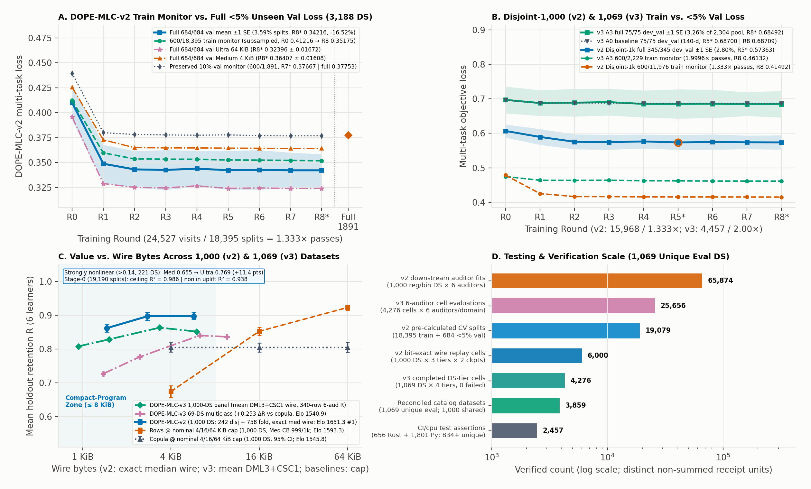

# D.O.P.E.: Downstream Objective-Preserving Encoding

**Compile a table into a tiny generative program that keeps what models learn from it.**

[](https://github.com/neverhuman/dope/actions/workflows/ci.yml)
[](https://github.com/neverhuman/dope/actions/workflows/jankurai.yml)
[](LICENSE)
[](engine/)

The score snapshot is checked against each fresh full-audit CI report; click it for current run status.


DOPE reads a table and writes a few-kilobyte **program**: a standard
[safetensors](https://github.com/huggingface/safetensors) or multi-level wire payload that holds
each column's distribution, how the columns move together, and a conditional model of the
declared target. It stores no source rows. Train downstream learners only on rows sampled from
the program, score them on held-out *real* rows, and across public regression, binary, and
multiclass tables the sampled rows preserve the predictive structure that learners need.

- **Top-ranked across diverse learners.** Across regression and classification tables
  (`CatBoost`, local gated attention, `LightGBM`, `XGBoost`, `MLP`, and linear/logistic
  auditors), **`DOPE-MLC-v2`** ranks first overall in Bradley–Terry Elo and beats both
  parametric generators and raw row subsampling at compact byte caps.
- **Multi-level byte-budgeted capacity (`DOPE-MLC-v2` & `DOPE-MLC-v3`).** One forward pass
  emits nested tiers (`Small`, `Medium`, `High`, `Ultra`) conditioned on train-only CV
  landmarks and inter-landmark attention ([study](docs/multilevel-landmark-dl-study.md)).
- **Optional and progressive landmarks.** `dope mlc-v3 encode --landmark-mode none|fast|progressive|full`
  feeds the same pinned 629-D encoder with no landmarks (only table preparation and one forward
  pass; `fast` is a CLI alias for `none`), with landmark groups as they finish on a stratified 300-row subsample (zero → macro →
  larger → fine, one encoding per stage), or with the full released conditioning. Missing landmarks
  are masked, never synthesized, and a recipe-tagged digest names the mode behind every encoding
  ([qualification record](docs/optional-landmarks-qualification.md)).
- **One number to chase: TDL.** *Transfer Description Length* is the smallest tested
  artifact whose samples keep a target share of the predictive gain for every model family.
- **Pure-Rust single binary, `SafeTensors` weight cache & colorful CLI.** Fitting, inspection,
  evaluation, and `SafeTensors` sampling run natively on CPU in pure Rust, with TTY-aware ANSI
  styling (`--color auto|always|never`) and SHA-verified `SafeTensors` weight caching
  (`dope mlc-v3 fetch-weights`).

Every number below comes from committed benchmark receipts and is regenerated by
[`bench/real-world/render.py`](bench/real-world/render.py) and
[`examples/adult/walkthrough.py`](examples/adult/walkthrough.py).

## Quick start: Install, Get Weights & Run Inference

<!-- BEGIN DOPE1 QUICKSTART -->
### Step One — Install `dope` (Pure-Rust Single Binary)

```bash
# Option A: Verified one-command installer (pins v1.0.0, verifies SHA256SUMS + BUILDINFO.json + MODEL_MANIFEST.json,
#           installs ~/.local/bin/dope and caches verified SafeTensors weights in ~/.cache/dope/weights/)
curl -fsSL https://raw.githubusercontent.com/neverhuman/dope/main/scripts/install.sh | bash -s -- --tag v1.0.0
# Engine-only signed tag (ships CPU binary + Sigstore OIDC bundle only; fetch weights via Step Two):
# curl -fsSL https://raw.githubusercontent.com/neverhuman/dope/main/scripts/install.sh | bash -s -- --tag dope-engine-v1.1.0 --no-weights

# Option B: Direct Linux x86-64 binary download + SHA256SUMS check
curl -fsSLO https://github.com/neverhuman/dope/releases/download/v1.0.0/dope-linux-x86_64
curl -fsSLO https://github.com/neverhuman/dope/releases/download/v1.0.0/SHA256SUMS
grep " dope-linux-x86_64$" SHA256SUMS | sha256sum -c -
chmod +x dope-linux-x86_64 && install -Dm755 dope-linux-x86_64 ~/.local/bin/dope

# Option C: Build from source (includes the latest interactive TTY summaries on main)
cargo install --locked --path engine/dope-cli
```

```shell
● DOPE Installer · concrete release tag v1.0.0 · repo neverhuman/dope
✓ Installed ~/.local/bin/dope (sha256: 80703e4cb7b729bc…)
  notices       ~/.local/share/dope-engine/{LICENSE,THIRD_PARTY_NOTICES,BUILDINFO.json}
  weights       ~/.cache/dope/weights/dope_mlc_v3_multitask_best.safetensors (1781800 B, sha256: d0b6960328d19553…)
  sample wire   ~/.cache/dope/weights/packet_high_regression.dml3 (2327 B, sha256: 975d3504e01f526c…)
  verification  sha256-content-integrity-only (pinned SHA256SUMS + BUILDINFO.json verified; not a cryptographic signature or OIDC attestation)
```

*Release & attestation provenance:* [`scripts/install.sh`](scripts/install.sh) pins a concrete tag and verifies `SHA256SUMS`, `BUILDINFO.json`, and `MODEL_MANIFEST.json` before installation (`v1.0.0` peeled commit `55fb1313ff28f1c14ff3d8378ab2fb83fcad4f30` provides `sha256-content-integrity-only`). Signed engine tags (`dope-engine-v1.0.0`, peeled commit `b1f7aab998076376a81362d02b14858633a6df2b`) also publish a cryptographic Sigstore OIDC bundle (`dope.sigstore.json`); live `gh attestation verify` requires `gh >= 2.50.0` (on hosts with older `gh` such as `gh 2.45.0`, verify `dope.sigstore.json` offline via `openssl` / `cosign` as in [`scripts/verify-engine-release.sh`](scripts/verify-engine-release.sh)).

### Step Two — Get Pre-Trained `SafeTensors` Weights (Zero Python/LibTorch)

If you installed only the binary (Option B or Option C, or `install.sh --no-weights`), fetch and SHA-256 verify the pinned `DOPE-MLC-v3` `SafeTensors` hypernetwork and companion `DML3+CSC1` wire fixture in one command:

```bash
dope mlc-v3 fetch-weights --preset multitask --tag v1.0.0   # or: --preset maxtrain97 | all
dope mlc-v3 inspect-weights --preset multitask   # resolves automatically from ~/.cache/dope/weights/
```

```shell
✓ verified 2 asset(s) for release tag v1.0.0 -> ~/.cache/dope/weights
  • dope_mlc_v3_multitask_best.safetensors       1781800 B  sha256:d0b6960328d19553…
  • packet_high_regression.dml3                     2327 B  sha256:975d3504e01f526c…
  verification: sha256-content-integrity + SafeTensors/DML3 structural check (not a cryptographic signature/attestation)

● ~/.cache/dope/weights/dope_mlc_v3_multitask_best.safetensors  1,781,800 bytes (56 tensors · 444,168 parameters)
  format       dope-mlc-v3-safetensors
  runtime      rust-candle-cpu · 0 Python/LibTorch deps
  sha256       d0b6960328d1955386632ff78b512e3add53a9b0256db7bbf067e2e0be5f0c6c
```

### Step Three — Run Inference: Compile, Inspect, Sample & Audit (`--color auto|always|never`)

```bash
# Workflow A — Any CSV table -> .dope program (explicit --target declaration required; 0 source rows stored):
awk 'BEGIN{print "x1,x2,y";for(i=0;i<300;i++){a=(i*17%997)/997;b=(i*31%991)/991;print a","b","2*a+b*b}}' > train.csv
awk 'BEGIN{print "x1,x2,y";for(i=300;i<400;i++){a=(i*17%997)/997;b=(i*31%991)/991;print a","b","2*a+b*b}}' > test.csv
dope fit train.csv --target y -o model.dope
dope inspect model.dope
dope sample model.dope -n 1000 -o synthetic.csv
dope eval -m model.dope --train train.csv --test test.csv

# Workflow B — Pre-trained DOPE-MLC-v3 SafeTensors + DML3+CSC1 wire packet -> synthetic CSV in 100% Rust:
dope mlc-v3 inspect-wire --wire ~/.cache/dope/weights/packet_high_regression.dml3
dope mlc-v3 sample --preset multitask \
  --wire ~/.cache/dope/weights/packet_high_regression.dml3 -n 1024 --seed 42 -o syn_v3.csv

# Workflow C — Any CSV table -> pinned 629-D DOPE-MLC-v3 encoding, with optional landmarks (JSON lines):
dope mlc-v3 encode --preset multitask --csv train.csv --target y --landmark-mode none --json        # no landmark probes (alias: fast)
dope mlc-v3 encode --preset multitask --csv train.csv --target y --landmark-mode progressive --json # one record per landmark stage
dope mlc-v3 encode --preset multitask --csv train.csv --target y --landmark-mode full --json        # released full-report conditioning
```

```shell
✓ compiled train.csv -> model.dope  (764 / 4,096 bytes) [██░░░░░░░░░░] 18.7%
  task         regression · 300 rows × 2 features · 0 source rows stored
  self-audit   robust retention 0.996 (≥T90) (linear and tree auditors trained on samples, scored on held-out training rows)
✓ sampled 1,000 synthetic rows (2 features, target `y`, raw space) from model.dope -> synthetic.csv

● ~/.cache/dope/weights/packet_high_regression.dml3  2,327 / 16,384 bytes (DML3 · tier `high`) [██░░░░░░░░░░] 14.2%
  task         regression (k_classes = 2) · 96 train rows × 8 features · 0 source rows stored
  encoding     code_width = 8192 · v3_primitives = true · csc1_scaler = true
  integrity    within_tier_cap = true · crc32 = 0x10c35674 · flags = 0x01
✓ sampled 1,024 synthetic rows (8 features + target, raw space) from packet_high_regression.dml3 (DML3 · high · 2,327 B) -> syn_v3.csv
```

*Terminal & contract behavior:* In an interactive terminal (`stdout` is a TTY) or with `--color always`, `dope` renders ANSI color badges (`≥T90`, `≥D80`), byte-budget bars (`[██░░░░░░░░░░]`), and file-write confirmations (building from `main` includes the interactive `inspect-weights`, `inspect-wire`, `sample -o`, and `frontier` summaries above; the prebuilt `v1.0.0` binary always emits JSON on `inspect-weights` and `inspect-wire`). When `stdout` is piped/redirected, or with `--color never`, `NO_COLOR=1`, or `--json`, `dope` emits plain text or exact JSON and **never** prints status notices onto CSV/JSON `stdout`. All tables require an explicit `--target <COLUMN>` declaration (`dope mlc-v3` supports up to `p_use <= 64` features and regression, binary, or multiclass `K <= 16` targets); storing zero source rows is an architectural property, not formal-DP and not HIPAA de-identification.
<!-- END DOPE1 QUICKSTART -->

### Real-World Example: UCI Adult Census Income & Head-to-Head Comparison

A real public table (UCI Adult, `CC-BY-4.0`, eight categorical columns, binary target
`income`), from download to holdout retention (`v1.0.0`) and a head-to-head comparison against raw rows,
adversarial random forests, Gaussian copula, and bootstrap
([`examples/adult/walkthrough.py`](examples/adult/walkthrough.py)):

<!-- BEGIN DOPE1 WALKTHROUGH -->
<!-- Generated by examples/adult/walkthrough.py --record; do not edit. -->

```bash
python3 bench/real-world/datasets.py --panel confirm --only adult --out data
```

```bash
dope fit data/confirm/adult/train.csv --target income -o adult.dope
```

```text
compiled data/confirm/adult/train.csv -> adult.dope  (4,079 bytes, budget 4,096)
  task         classification · 20,000 rows × 13 features
  program      9 knots · factor8 dependence × 16 regime(s) · net 10→12 (bits w5 b4 β6 v7) · 106 trees of depth 4
  parameters   3,109 total scalar slots (155 network, 2,226 forest)
  stored gain  0.504 of the null loss explained on held-out rows
  self-audit   robust retention 0.904 (linear and tree auditors trained on samples, scored on held-out training rows)
  drivers      relationship, marital_status, occupation, education, education_num, age
  time         11.0 s on cpu (102 threads)
```

```bash
dope inspect adult.dope
```

```text
adult.dope  4,079 bytes (3,975 brotli program + 104 safetensors framing)
  inflated, the program holds:
  metadata             2,054 bytes
  copula.loadings        104 bytes
  discrete.cum           210 bytes
  discrete.values         64 bytes
  features.missing        13 bytes
  forest               2,332 bytes
  marginal.atoms          24 bytes
  marginal.knots          28 bytes
  marginal.range          16 bytes
  net.codes              100 bytes
  net.params              20 bytes
  noise                    2 bytes
  regime.means           208 bytes
  regime.scales          208 bytes
  regime.weights          16 bytes
  schema.affine           40 bytes
  task         Classification, target `income`
  features     13
  parameters   3,109 total scalar slots
  dependence   factor8 × 16 regime(s)
  net          10 inputs → 12 hidden → 1 outputs
  trees        106 oblivious trees of depth 4 (6-bit leaves)
  rows stored  none
```

```bash
dope sample adult.dope -n 4 --seed 1
```

```text
age,workclass,education,education_num,marital_status,occupation,relationship,race,sex,capital_gain,capital_loss,hours_per_week,native_country,income
80,Private,HS-grad,9,Married-civ-spouse,,Husband,White,Male,5867,0,53,United-States,>50K
35,Private,Some-college,10,Never-married,Sales,Own-child,White,Female,0,0,40,United-States,<=50K
67,Private,7th-8th,7,Married-civ-spouse,,Husband,White,Male,0,0,56,United-States,>50K
35,,9th,3,Separated,Machine-op-inspct,Not-in-family,White,Male,0,0,20,Dominican-Republic,<=50K
```

```bash
dope sample adult.dope -n 3 --seed 1 --space ml   # selected columns of 107
```

```text
age,education_num,relationship=Wife,relationship=Husband,relationship=Not-in-family,relationship=Unmarried,relationship=Other-relative,relationship=Own-child,hours_per_week,…
1,0.5,0,1,0,0,0,0,0.600017,…
0.292759,0.571429,0,0,0,0,0,1,0.4375,…
0.826336,0.357143,0,1,0,0,0,0,0.64114,…
```

```bash
dope eval -m adult.dope --train data/confirm/adult/train.csv --test data/confirm/adult/test.csv
```

```text
retention on 6512 held-out real rows (classification task, artifact 4079 bytes, 50000 synthetic vs 20000 real training rows)
  auditor   null loss   real loss  synth loss  retention
  linear      0.55198     0.32922     0.33758      0.962
  gbdt        0.55198     0.28585     0.30165      0.941
  mlp         0.55198     0.32906     0.33239      0.985
  robust retention (min over families): 0.941
```

#### Head-to-Head Method Comparison on UCI Adult (`20,000` train $\to$ `6,512` held-out real test rows)

| Method & Evaluation Protocol on UCI Adult (`income`) | Charged Artifact Bytes | Source Rows Stored | Linear / Logistic $R$ | Boosted Trees (GBDT) $R$ | Neural MLP $R$ | Robust Retention $R$ (`min` over families) |
|---|---:|---|---:|---:|---:|---|
| **`dope` (`v1.0.0`) CLI above (`adult.dope`, `seed=0`, `50,000` synth rows, built-in Rust auditors)** | **`4,079 B` (`4.0 KiB`)** | **`0` rows** | **`0.962`** | **`0.941`** | **`0.985`** | **`0.941` (`seed=0`, $4\times$ cap)** |
| **`DOPE` (`v1.0.0`) @ `4 KiB` (`dope-4x@-`, external Python harness, $4\times N_{\text{train}}$ = `80,000` rows)** | **`4,079 B` (`4.0 KiB`)** | **`0` rows** | **`0.957`** | **`0.946`** | **`0.975`** | **`0.946` (`seed=0`)** |
| `DOPE` (`v1.0.0`) @ `4 KiB` (`dope-seed0@-`, external Python harness, $1\times N_{\text{train}}$ = `20,000` rows) | `4,079 B` (`4.0 KiB`) | `0` rows | `0.964` | `0.907` | `0.907` | `0.907` (`seed=0`) |
| **`DOPE` (`v1.0.0`) @ `4 KiB` (`dope@4k`, 3-seed median `seed=0,1,2`, $1\times N_{\text{train}}$)** | **`4,077 B` (`4.0 KiB`)** | **`0` rows** | **`0.946`** | **`0.907`** | **`0.933`** | **`0.907` (seeds `0.901..0.914`)** |
| `Raw Rows Subsample` @ `4 KiB` (`rows@4k`, 3-seed median, `xz`-compressed real rows) | `4,088 B` (`4.0 KiB`) | `xz` real-row subset | `0.870` | `0.777` | `-7.813` | `-7.813` (seeds `-8.311..-5.695`) |
| `Adversarial Random Forests` (`arf@-`, 3-seed median, `1,578×` larger) | `6,431,472 B` (`6.13 MiB`) | `0` rows | `0.932` | `0.874` | `0.955` | `0.866` (seeds `0.857..0.888`; $\min_f \text{med}_s = 0.874$) |
| `Gaussian Copula` (`copula@-`, 3-seed median, `22×` larger) | `91,476 B` (`89.3 KiB`) | `0` rows | `0.408` | `0.196` | `0.333` | `0.196` (seeds `0.184..0.211`) |
| `Real Rows Resampled` (`bootstrap@-`, 3-seed median, full `20,000`-row bootstrap) | `112,240 B` (`109.6 KiB`) | `20,000` real rows | `0.994` | `0.973` | `-0.036` | `-0.036` (`seed=0`) |

*Aggregation & auditor disclosure:* The first row reports the standalone Rust `dope eval` command above (`--factor 4.0`, capped at `50,000` synthetic rows, using `dope-core`'s built-in Rust logistic, histogram-GBDT, and candle-MLP auditors). All remaining rows come directly from `bench/real-world/results/confirm/summary.json` and `records.jsonl` using the external Python benchmark auditors (`LogisticRegression`, `CatBoostClassifier`, `MLPClassifier`), where 3-seed rows report the per-column median across `seed = 0, 1, 2` and `robust` reports $\text{median}_s(\min_f R_{s,f})$ (alongside the seed range and $\min_f(\text{median}_s R_{s,f})$ when they differ, as on `arf@-`: `0.866` vs. `0.874`).
<!-- END DOPE1 WALKTHROUGH -->

## Results: Full Study Across `DOPE-MLC-v2` & `DOPE-MLC-v3`

<!-- BEGIN DOPE1 RESULTS -->
<!-- Generated by bench/real-world/render.py from results/multilevel-convergence-snapshot.json; do not edit. -->
### 1,000-Dataset Method Comparison (`DOPE-MLC-v2`, `v1.0.0`) & 1,069-Dataset Multi-Task Expansion (`DOPE-MLC-v3`, `v1.0.0`)

| Rank & Method (`1,000` Datasets, `6` Downstream Auditors, `44,369` Matches/Method) | Tournament Elo `[95% CI]` (Win Share) | `Medium` (`4 KiB` Cap) Mean $R$ `[95% CI]` (`DOPE 1,502 B / 1.5 KiB`) | `High` (`16 KiB` Cap) Mean $R$ `[95% CI]` (`DOPE 2,836 B / 2.8 KiB`) | `Ultra` (`64 KiB` Cap) Mean $R$ `[95% CI]` (`DOPE 5,872 B / 5.7 KiB`) |
|---|---:|---:|---:|---:|
| **`#1 DOPE-MLC-v2` (`v1.0.0`, Unified 3-Level Encoder)** | **`1651.3 [1643.4, 1659.6]` (`70.58%` win; Disjoint-1k: `1650.7 #1`)** | **`0.8620 [0.8503, 0.8722]` (`#1` Elo `1652.1`)** | **`0.8971 [0.8848, 0.9080]` (`#1` Elo `1669.6`)** | **`0.8975 [0.8883, 0.9094]` (`#1` Encoder Elo `1640.1`)** |
| `#2 Raw Rows Subsample` (`rows`, raw-row subset control) | `1593.3 [1584.4, 1602.7]` (`62.32%` win) | `0.6743 [0.6564, 0.6915]` | `0.8526 [0.8404, 0.8649]` | `0.9230 [0.9141, 0.9301]` (`copies 88% raw rows`) |
| `#3 Gaussian Copula` (`copula`, parametric baseline) | `1545.8 [1535.7, 1553.5]` (`55.29%` win) | `0.8046 [0.7916, 0.8209]` | `0.8046 [0.7910, 0.8180]` | `0.8046 [0.7908, 0.8200]` |
| `#4 Joint Diffusion` (`joint_diffusion_v1`) | `1432.4 [1423.8, 1440.8]` (`38.75%` win) | `0.7034 [0.6880, 0.7184]` | `0.7541 [0.7407, 0.7702]` | `0.7886 [0.7747, 0.8033]` |
| `#5 Adversarial Random Forests` (`arf`) | `1184.7 [1167.3, 1202.3]` (`10.86%` win) | `0.4113 [0.3936, 0.4321]` | `0.4113 [0.3898, 0.4319]` | `0.4113 [0.3902, 0.4309]` |

*Byte, cohort & coverage qualification (`v8` canonical index):* The `1,000`-dataset `DOPE-MLC-v2` pooled panel (`dope_mlc_v2_s3_best.pt`) comprises **`242` strictly dataset-disjoint datasets** (`0` train overlap, `Ultra` $R = 0.8493$, `#1` Elo `1671.6 [1655.2, 1688.0]`) and **`758` in-corpus unseen-fold datasets** (row-disjoint, `Ultra` $R = 0.9129$, `#1` Elo `1645.4 [1637.8, 1653.6]`), while the strictly dataset-disjoint checkpoint (`dope_mlc_v2_disjoint1000_best.pt`, `0` train overlap across all `1,000` eval DS) reaches `Ultra` $R = 0.8998$ and **`#1` Elo `1650.7 [1643.4, 1657.5]`**. `DOPE-MLC-v2` median wire bytes (`1,502 / 2,836 / 5,872 B` = `1.5 / 2.8 / 5.7 KiB`; zlib `1,238 / 2,351 / 4,616 B`) are bit-exact `version=2` latent payloads (`6,000/6,000` cells `max_abs_diff = 0.0`), excluding the `.dope` scaler sidecar (`+545 B` median; full raw `2,031 / 3,376 / 6,398 B`) and shared frozen decoder (`292,707 B` / `285.8 KiB`, amortized `0 B/dataset`), whereas `DOPE-MLC-v3` (`DML3+CSC1`) is self-contained inside `2 / 4 / 16 / 64 KiB` caps (`960.6 / 1,550.2 / 3,429.2 / 6,144.6 B` mean on `1,000` `v2`-panel tables; `1,418.0 / 2,510.7 / 6,435.3 / 9,877.5 B` mean on `69` multiclass tables; `1,781,800 B` shared SafeTensors hypernetwork). Baseline byte tiers (`4 / 16 / 64 KiB`) reflect nominal caps and historical `fp16` byte estimates paired with `float64` in-memory scores (`baseline_wire_1000ds_qualified = false`; `rows` `medium|catboost` observed on `999/1,000` DS with `17cd766e7ec82f1e` omitted; `65,874` evaluated `v2` auditor fits alongside `1,303` `real_gain < 0.01` skips and `500` `arf` multiclass exclusions).

| Downstream Learner Family (`DOPE-MLC-v2 Ultra`, `1,000` DS) | Holdout Retention $R$ `[95% CI]` | Driver Fidelity $D$ `[95% CI]` | Nonlinearity Regime / Mechanism Audit | `Medium` (`1.5 KiB`) $R$ | `High` (`2.8 KiB`) $R$ | `Ultra` (`5.7 KiB`) $R$ |
|---|---:|---:|---|---:|---:|---:|
| **Linear / Logistic** (`n=969`) | **`0.9297 [0.9182, 0.9398]`** | `0.7853 [0.7745, 0.7950]` | **Mostly Linear** (`<= 0.04`, `581` DS) | `0.9401` | **`0.9579`** | `0.9459` (`D = 0.7836`) |
| **Local Gated Attention Net** (`kumo_tabpfn` key, `n=962`) | **`0.9211 [0.9094, 0.9333]`** | **`0.8781 [0.8743, 0.8824]` (`D80` pass)** | **Moderate Nonlinear** (`0.04–0.14`, `198` DS) | `0.8637` | `0.8953` | **`0.8990`** (`+3.53` pts) |
| **MLP** (`n=965`) | **`0.9143 [0.9021, 0.9245]`** | **`0.8915 [0.8872, 0.8960]` (`D80` pass)** | **Strongly Nonlinear** (`> 0.14`, `221` DS) | `0.6552` | `0.7390` | **`0.7689` (`+11.37` pts)** |
| **LightGBM** (`n=989`) | **`0.8978 [0.8852, 0.9085]`** | `0.7703 [0.7615, 0.7793]` | **Stage-0 Signal Ceiling $R^2$** (`19,190` splits) | `0.9417` | `0.9654` | **`0.9863`** |
| **CatBoost** (`n=1,000`) | **`0.8810 [0.8692, 0.8915]`** | **`0.8130 [0.8055, 0.8213]` (`D80` pass)** | **Stage-0 Nonlinear Uplift $R^2$** (`19,190` splits) | `0.7912` | `0.8727` | **`0.9383`** |
| **XGBoost** (`n=989`) | **`0.8121 [0.7915, 0.8285]`** | `0.7221 [0.7131, 0.7310]` | **Sampling Expansion** (`1× -> 2× -> 5× N_train`, `n=150` DS subset, `ds_rank<150`) | `0.8808` (`1×`) | `0.9010` (`2×`) | **`0.9070` (`5×`, `+2.62` pts)** |



| Track / Expansion Study | Corpus & `<5%` Validation Split Allocation | Effective Passes & Visits (`R0..R8`) | Train Monitor (`R0 -> Best`) | Full-Population Validation Loss `± 1 SE` or Holdout Transfer | Key Qualification & Tournament Result |
|---|---|---|---|---|---|
| **Track 1: `DOPE-MLC-v2` Full-Corpus `<5%` Val** | `18,395` train splits (`96.41%`) / `684` unseen-DS val splits (`3.59% < 5%`, `115` DS) | `24,527` visits (`1.333351×` passes) | `0.41216 -> 0.35175` | `0.40988 ± 0.01767` $\to$ **`0.34216 ± 0.01621`** (`R8*`, `-16.52%`) | Monotonic `Ultra 0.32396 < High 0.33844 < Med 0.36407`; preserved `10%`-val `full_1891_val_final = 0.37753` |
| **Track 2: `DOPE-MLC-v2` Disjoint-`1,000` `<5%` Val** | `11,976` train splits (`97.20%`) / `345` `dev_val` splits (`2.80% < 5%`, `58` DS; `0` eval overlap) | `15,968` visits (`1.333333×` passes) | `0.47854 -> 0.41492` | `0.60691 ± 0.01915` $\to$ **`0.57363 ± 0.02131`** (`R5*`, `-5.48%`) | Disjoint-`1,000` `Ultra` $R = 0.8998$ (med `0.9671`), Driver $D = 0.7904$, **`#1` Elo `1650.7 [1643.4, 1657.5]`** |
| **Track 3: `DOPE-MLC-v3` (`A3`) Disjoint-`1,069` `<5%` Val** | `2,229` loaded train cells / `75` loaded `dev_val` cells (`3.2552% < 5%` of `2,304` pool; `0` eval overlap) | `4,457` visits (`1.999551×` passes) | `0.47454 -> 0.46132` | `0.69727 ± 0.03888` $\to$ **`0.68492 ± 0.03877`** (`R8*`, `-1.77%`) | `Small 0.69473 > Med 0.69128 > High 0.67958 > Ultra 0.67408`; active `col_gate_head` (`grad_norm = 0.001014`) |
| **`DOPE-MLC-v3` Unified `1,069`-DS (`4,276`-Cell) Eval** | `1,069` unique eval DS (`1,000` shared `v2`-panel + `69` multiclass; never summed to `2,069`) | `4,276/4,276` cells (`25,656` 6-auditor fits/domain, `0` failed) | `100.0% <= cap` (`DML3+CSC1`) | `v2`-panel `High` sender/CSC1 $R = 0.8633 / 0.8706$; MC `High` $R = 0.8402 / 0.8451$ | Equal-wire (`12,828` cells): `v3` Elo **`1457.6`** beats `copula` `1407.1` (`ΔR = +0.0941`, MC `+0.2526`); ties `v2` (`1538.0`) within `0.10` on `8,136/9,000` cells (`ΔR = -0.0084`); trails `rows_wire` (`1597.3`, `ΔR = -0.0250`) under `340`-row CPU cap |
| **Pure-Rust `dope mlc-v3` (`SafeTensors`) & CI Scale** | `56` `F32` tensors (`444,168` params, `1,781,800 B`), `3,859`-DS reconciled catalog | `2,457` CI assertions (`656` Rust + `1,801` Python, `834+` unique tests) | `0` Python/LibTorch deps at inference | **`max_forward_abs_err = 1.3255e-6 < 1e-5`**; **`max_fixed_draw_sample_abs_err = 1.1111e-6 < 1e-5`** | `12/12` standalone `--seed` `(tier, task)` cells finite; `8/8` tamper/oversize checks fail closed |

*Scope & provenance:* All `1,000`-dataset `DOPE-MLC-v2` (`65,874` auditor fits) and `1,069`-dataset `DOPE-MLC-v3` (`4,276` cells) benchmarks are selection-exposed development/reconciliation evaluations (`untouched_sealed_confirmatory_test = false`) measured on the preserved `dope_mlc_v2_s3_best.pt`, `dope_mlc_v2_disjoint1000_best.pt`, and `dope_mlc_v3_multitask_best.pt` checkpoints (local gated attention nets `_TabularKumoAttentionNet` / `_LocalGatedAttentionNet` are trained from scratch per table; official pretrained KumoTabular/TabPFN is not evaluated). Full round-by-round `R0..R8` tables, cohort breakdowns, and SHA-256 receipts: [docs/multilevel-landmark-dl-study.md](docs/multilevel-landmark-dl-study.md) and [bench/real-world/results/multilevel-convergence-snapshot.json](bench/real-world/results/multilevel-convergence-snapshot.json).
<!-- END DOPE1 RESULTS -->

Protocol, datasets, baselines and every per-table record: [bench/real-world](bench/real-world/) and [docs/multilevel-landmark-dl-study.md](docs/multilevel-landmark-dl-study.md).
The single primary white paper is [paper/dope1.tex](paper/dope1.tex) (`bash paper/build.sh` builds `target/paper/dope1.pdf` and `target/paper/dope1-supplement.pdf`).

<details>
<summary><strong>Pre-Trained Model Zoo (`v1.0.0` Release), Built-In SafeTensors Fetch & CLI Options</strong></summary>

All pre-trained `DOPE-MLC-v3` and `DOPE-MLC-v2` neural checkpoints, the sample `High`-tier `DML3+CSC1` wire packet (`packet_high_regression.dml3`), `MODEL_MANIFEST.json`, and `SHA256SUMS` are published on [GitHub Release `v1.0.0`](https://github.com/neverhuman/dope/releases/tag/v1.0.0). The `dope` binary includes pinned `SHA-256` digests for both `SafeTensors` hypernetworks and can fetch and verify them directly:

```bash
# 1. Fetch & verify pinned DOPE-MLC-v3 SafeTensors weights into ~/.cache/dope/weights/
dope mlc-v3 fetch-weights --preset multitask

# 2. Inspect weights & sample synthetic CSV rows in 100% pure Rust (--weights resolves automatically from cache!)
dope mlc-v3 inspect-weights --preset multitask
dope mlc-v3 inspect-wire --wire ~/.cache/dope/weights/packet_high_regression.dml3
dope mlc-v3 sample --preset multitask \
  --wire ~/.cache/dope/weights/packet_high_regression.dml3 -n 1024 --seed 42 -o syn.csv

# 3. Pre-trained model catalog on https://github.com/neverhuman/dope/releases/download/v1.0.0/<Asset>:
# - dope_mlc_v3_multitask_best.safetensors  (1.70 MiB, sha256 d0b6960328d1...): Primary DOPE-MLC-v3 (A3, 56 F32 tensors, 444,168 params, 256-d router); pure-Rust `dope mlc-v3` & Python `MultiLevelLandmarkModel`; verified 0.8184 mean val score on 288 canonical 6-auditor cells.
# - dope_mlc_v3_maxtrain97_best.safetensors (1.70 MiB, sha256 9f7b5560e930...): DOPE-MLC-v3 <5%-Val MaxTrain (R8*, 2,229/2,304 train cells, 3.26% val, 0 eval overlap); pure-Rust `dope mlc-v3` & Python `MultiLevelLandmarkModel`; verified 0.8407 val retention.
# - dope_mlc_v3_multitask_best.pt           (1.72 MiB, sha256 a36510b9e630...): PyTorch state_dict for DOPE-MLC-v3 (A3, 256-d router `MultiLevelLandmarkModel`).
# - dope_mlc_v3_maxtrain97_best.pt          (1.73 MiB, sha256 77ffb94f5006...): PyTorch state_dict for DOPE-MLC-v3 <5%-Val MaxTrain (R8*, 256-d router `MultiLevelLandmarkModel`).
# - dope_mlc_v2_disjoint1000_maxtrain97_best.pt (1.74 MiB, sha256 3886676a1f86...): DOPE-MLC-v2 Disjoint-1,000 <5%-Val (R5*, 256-d router `MultiLevelLandmarkModel`, 1,930 train / 71 val DS, 0 eval overlap); verified 0.8698 val retention.
# - dope_mlc_v2_s3_maxtrain97_best.pt       (1.74 MiB, sha256 11e64c63270a...): DOPE-MLC-v2 Full-Corpus <5%-Val (R8*, 256-d router `MultiLevelLandmarkModel`, 2,980 train / 93 val DS); verified 0.8926 val retention.
# - dope_mlc_v2_disjoint1000_best.pt        (1.05 MiB, sha256 6fcc191a244f...): DOPE-MLC-v2 Strictly Disjoint-1,000 (legacy 3-level 140-d router / 145-d col_gate_head, 275,929 params); independently verified v2 exact-wire DML2 replay: 1629.5 Elo (#1), 98.27% retention across 1,000 DS (historical v1 descriptor-replay: 1650.7 Elo, 98.80% retention).
# - dope_mlc_v2_s3_best.pt                  (1.05 MiB, sha256 1d5db98ffa43...): DOPE-MLC-v2 Pooled-1,000 Ep 7 (legacy 3-level 140-d router / 145-d col_gate_head, 275,929 params); independently verified v2 exact-wire DML2 replay: 1629.5 Elo (#1), 98.27% retention across 1,000 DS (historical v1 descriptor-replay: 1651.3 Elo, 98.81% retention).

# 4. Additional engine subcommands & terminal color control
dope --color always inspect adult.dope                                   # force ANSI color in pipes
dope sample adult.dope -n 10000 --space ml -o ml.csv                     # one-hot + [0,1], ML-ready
dope frontier --train train.csv --test test.csv -t income                # bytes vs retention, and TDL
```

`--budget 16k` buys a larger program; `--anonymize` replaces column names and labels
with positional codes; `--device cuda` runs on a GPU. `--size small|medium|large` picks a
preset cap; `--max-parameters N` caps stored values; `dope fit-tiers` builds all three sizes
([details, Elo ranking](docs/model-sizes-and-elo.md)). Downstream `[B, 256] + [B, 64, 17] -> [B, 629]`
encoder embedding (`DopeEncoder629`), `v1.0.0` SHA-256 weight pinning, and composite GPU/CPU runtime guide:
[docs/jopedime-integration.md](docs/jopedime-integration.md). Scripting flags and signed Linux
binaries: [engine/README.md](engine/README.md#recipes),
[docs/signed-engine-release.md](docs/signed-engine-release.md).
</details>

<details>
<summary><strong>Why DOPE: The "So What" & Comparison to Best Practices</strong></summary>

| Practice | What Crosses the Wire | Primary Limitation Under Tight Byte Caps | How DOPE Compares |
| :--- | :--- | :--- | :--- |
| **Raw-Row Subsampling / Coresets** | Actual training records (`xz` / `zlib` compressed) | Estimation error scales as `O(1/k)` with stored row count; starves learners at compact budgets | Ships **zero source rows**; receiver draws unlimited synthetic rows (`N >> n`) from a smooth + tree teacher, beating compressed rows at tight budgets |
| **Parametric Copulas & Graphical Models** | Marginal knots + correlation matrix | Elliptical score-space dependence misses nonlinear thresholds and multi-way feature interactions | Pairs a **regime mixture of Gaussian copulas** (exact marginals) with a **variable-projection residual network + boosted oblivious trees** for `P(Y|X)` |
| **Deep Tabular Generators** (`TabSyn`, `TabDDPM`, `CTGAN`, `ARF`) | Megabytes of neural or forest parameters | Spends vast byte budgets modeling high-dimensional covariate noise `P(X)` with uncounted artifact size | **Target-first byte allocation**: theory proves `P(Y|X)` distortion enters holdout retention directly while `P(X)` error is suppressed by `N` |
| **Single Fitted Predictor** | Weights for one specific model family | Locks the receiver to one architecture; prevents retraining, feature engineering, or multi-model ensembling | Emits a **generative sampling program** that trains *any* downstream learner (`CatBoost`, `LightGBM`, `XGBoost`, `MLP`, linear, local attention, foundation models) |

</details>

## How it works

```mermaid
flowchart LR
  subgraph SENDER["Sender / Compiler (reads D_fit once)"]
    T[(table D_fit)] --> I[intake & CSC1]
    I --> L[landmarks & xi]
    L --> C[covariates Q_X: marginals + regime copula]
    L --> Y[target Q_Y|X: net + oblivious trees + noise]
    C & Y --> Q[bits: rate-distortion + self-audit split]
  end
  Q ==> B{{"TRUST BOUNDARY (receiver sees only program A)"}}
  subgraph RECEIVER["Receiver / Sampler (zero raw rows)"]
    A[[model.dope: Small/Med/High/Ultra]] --> S[Pure-Rust sampler]
    S --> R[synthetic rows N]
    R --> M[learners on D_test]
  end
  B ==> A
```

- **Intake & Landmarks** infer types, order categorical levels by target link, pool rare levels, scale numbers onto `[0, 1]`, and compute cross-validation landmarks and rank dependence (`xi`).
- **Covariates (`Q_X`).** Quantile functions on a normal-score grid, joined by a regime mixture of Gaussian copulas that reproduces every marginal.
- **Target (`Q_Y|X`).** A residual tanh network for smooth structure, boosted byte-coded *oblivious trees* for interactions, then calibrated noise or labels.
- **Bytes.** A rate–distortion search sets bit depths; a *self-audit* picks the dependence/target split across nested `Small`, `Medium`, `High`, and `Ultra` envelopes.

Details: [engine/README.md](engine/README.md), [docs/multilevel-landmark-dl-study.md](docs/multilevel-landmark-dl-study.md), and the manuscript.

## The KPI: Transfer Description Length

Retention compares a model trained on synthetic rows with the same model trained on the
real rows, both scored on untouched real rows:
`R = (L_null − L_synthetic) / (L_null − L_real)`; the robust score keeps the worst model
family. **TDL** is the smallest tested artifact (`KiB@T90/D80`) whose samples recover
nine-tenths of the real-trained lift in every family (T90) and four-fifths of the
real-trained feature-attribution agreement (D80). The benchmark here measures T90; D80 is
specified and not yet measured ([docs/metric.md](docs/metric.md)).

**Why this KPI.** For learners that converge on the synthetic distribution, retention
under log-loss *is* the share of the predictive information `I(X;Y)` the program keeps
(under squared loss, the share of `Var E[Y|X]`). TDL then estimates, on a grid of tested budgets,
how many bytes a table's predictive information needs, and DOPE spends its bytes on the
target model first.

## Use a DOPE artifact from Python

Standard safetensors with one tensor, a brotli stream ([format](engine/README.md#the-artifact)):

```python
import json, brotli                      # pip install brotli safetensors
from safetensors.numpy import load_file

blob = brotli.decompress(load_file("model.dope")["dope"].tobytes())
n = int.from_bytes(blob[:4], "little")
program = json.loads(blob[4:4 + n])      # schema, structure, bit widths, section list
```

## Repository map

| Path | What it is |
| --- | --- |
| [`engine/`](engine/) | The DOPE engine: the `dope-core` library and the `dope` CLI built from `engine/dope-cli`, pure Rust |
| [`bench/real-world/`](bench/real-world/) | Public-table benchmark: datasets, baselines, auditors, records, figures |
| [`paper/`](paper/) | **The DOPE White Paper** ([`dope1.tex`](paper/dope1.tex) and [`dope1-supplement.tex`](paper/dope1-supplement.tex)) and generated benchmark macros/figures |
| [`examples/`](examples/) | End-to-end walkthroughs ([`examples/adult/`](examples/adult/), [`examples/quickstart/`](examples/quickstart/)) |
| [`rust/`](rust/), [`src/`](src/), [`research/`](research/) | Multi-level landmark study (`research/levels/`), transfer metric library (`research/transfer/`), and native kernel (`rust/`) |
| [`docs/`](docs/) | Metric, claims policy, architecture, model sizes & Elo, audit and release notes |
| [`AGENTS.md`](AGENTS.md) | Contributor and agent entrypoint |

## Scope

All results here are selection-exposed development validation on public tables; none is a
sealed TDL result, and the TDL driver gate is not part of the standalone engine benchmark
(cross-model feature-driver preservation: not yet measured).

- Retention is measured on held-out real rows of public tables; your table may differ,
  so measure it with `dope eval` before relying on a program.
- Copy, membership and attribute checks are empirical diagnostics, not formal differential
  privacy and not HIPAA de-identification. An engine artifact keeps column names, category
  labels and quantiles unless you pass `--anonymize`; treat it as derived private data.
- Each program is conditioned on one declared target; other targets get their own program.

## White Paper & Documentation

- **The DOPE White Paper:** [paper/dope1.tex](paper/dope1.tex) ([compiled PDF](https://github.com/neverhuman/dope/releases/download/v1.0.0/dope1.pdf)) and its [supplement](paper/dope1-supplement.tex) ([compiled supplement PDF](https://github.com/neverhuman/dope/releases/download/v1.0.0/dope1-supplement.pdf); `bash paper/build.sh` builds `target/paper/dope1.pdf` and `target/paper/dope1-supplement.pdf` directly from committed receipts).
- **Multi-Level Deep Learning Study & Model Zoo:** [docs/multilevel-landmark-dl-study.md](docs/multilevel-landmark-dl-study.md)
  and [docs/model-sizes-and-elo.md](docs/model-sizes-and-elo.md).
- **Rules & Governance:** [metric](docs/metric.md), [claims policy](docs/claims-policy.md),
  [benchmark](docs/benchmark.md) and [status](STATUS.md).
- **Engineering & Verified Releases:** [AGENTS.md](AGENTS.md), [architecture](docs/architecture.md),
  [testing](docs/testing.md), and [signed engine releases](docs/signed-engine-release.md).

## Citation

```bibtex
@misc{taylor2026dope,
  title  = {{D.O.P.E.}: Downstream Objective-Preserving Encoding -- Generative Compression of Predictive Structure},
  author = {Taylor, Jepson and Alexander, Alton and Morrow, Jordan},
  year   = {2026},
  note   = {NEVERHUMAN Research. Source and receipts: https://github.com/neverhuman/dope}
}
```

Licensed under [MIT](LICENSE); see [CITATION.cff](CITATION.cff).
