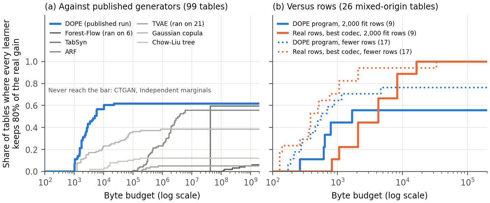
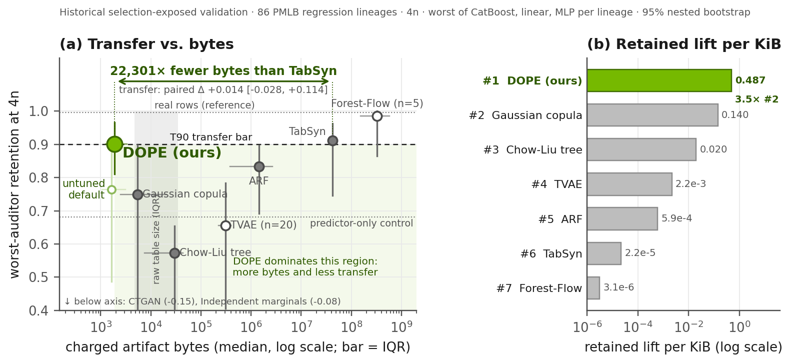

# D.O.P.E.: Downstream Objective-Preserving Encoding

[](https://github.com/neverhuman/dope/actions/workflows/ci.yml)
[](LICENSE)

**Compile a table into a small sampling program. Measure what models learn from its samples, including against real rows at the same byte budget.**

DOPE compiles a table into a small **sampling program**: marginals, dependence, a target network and noise. The program and column plan count as payload; cold runtime closure remains unmeasured. The goal is to ship less while preserving a declared supervised workload. Privacy requires separate evaluation and release review.



<!-- BEGIN EQUAL BYTES -->
<!-- Generated by docs/whitepaper/scripts/equal_bytes_render.py; edit the generator, not this block. -->
Evidence status: development validation on public tables (selection-exposed; not a sealed TDL result).

- **The smallest generator at its transfer level.** On the historical 99-table panel the published DOPE run keeps 0.89 of the real gain for the worst of three learners at 1,895 B. TabSyn keeps 0.88 with 22,301x the bytes, and no generator's frontier is above DOPE's at any budget.
- **More than the real rows that fit in its bytes, once a table outgrows the program.** On the 9 real-world tables that reach the study's cap of 2,000 fit rows, a program keeps 0.38 [0.12, 0.69] more of the real gain than the most real rows that fit in exactly its bytes (8 wins, 0 losses, 1 within 0.01), and real rows need a median 4.3x its bytes to match it. The advantage grows with how much larger the whole table is than the program (Spearman 0.78 over 26 tables); tables of a few hundred rows compress to about a program's size and are cheapest shipped whole, so over all 26 tables the gap is 0.02 [-0.04, 0.15] (14 wins, 9 losses).
- **Checked against the obvious objections.** The real-row arm gets the best of three lossless codecs, an exact byte match, and an MLP also trained on the rows resampled to the synthetic size (early-stopped on held-out rows). The 0.38 is for the worst of three learners; per learner on the large tables it is 0.10 (least squares), 0.10 (MLP), 0.04 (CatBoost). Leaving the MLP out, the large-table gap is 0.18 [0.12, 0.69] (8 wins, 1 loss). On all 97 panel lineages, simulated families included, it is 0.24 on the 38 large tables (36 wins, 0 losses).
- **Where it stops.** A program this small is a lossy channel: its retention plateaus, so to clear the 0.8 bar real rows need fewer bytes on 14 of 26 tables (DOPE on 6), and at 0.9 on 19 (DOPE on 6). Raising that ceiling at fixed bytes is the open problem.
- **Honest bytes, no GPU.** Packed values make the same programs 1.85x smaller with bit-identical samples for the headline shape; with the column scaling charged as two 4-byte floats per column the median charge is 676 B (2,666 B before). From 250 to 16,000 rows a program stays between 598 and 1,148 B while the whole table grows to 88,166 B. The network trains in Rust; its CatBoost retention shows no systematic shift from the published GPU run (median difference 0.000 over 96 tables, tenth to ninetieth percentile -0.40 to 0.22; different splits, not a paired replay).

| UCI Adult, scored on the official test file | Bytes | Logistic | MLP | CatBoost |
|---|---:|---:|---:|---:|
| Real training rows (CSV, gzip) | 3,518,606, 398,782 | 1.00 | 1.00 | 1.00 |
| DOPE program | 1,892 | 0.94 | 0.95 | 0.83 |
| Real rows in the same bytes, 8-bit codes (152 rows) | 1,892 | 0.64 | 0.65 | 0.28 |
| Real rows in the same bytes, CSV (98 rows) | 1,892 | 0.55 | 0.56 | 0.21 |

Cells are retention: the share of the real rows' log-loss gain over the class prior (below zero is worse than the prior).
<!-- END EQUAL BYTES -->

<details><summary>Foundation-model view (historical, selection-exposed)</summary>


</details>

## The KPI: transfer per byte

Transfer Description Length (TDL) asks how few bytes carry a table's predictive value to learners that never see the table. Its operating point is `KiB@T90/D80`: the smallest tested budget at which learners trained only on synthetic rows recover nine-tenths of the real data's gain over a null model (T90) in every learner family, keep four-fifths of the real feature drivers (D80), and pass copy and byte-accounting gates, all scored on untouched real rows ([metric](docs/metric.md)).

Copying grows with rows; a program can grow with structure. The frontier shows the share of tables meeting the transfer bar at each budget. This study's transfer-only frontier does not establish all TDL gates.

## Quick start on a real table

```bash
cargo build --release --bin dope-kernel                     # Rust toolchain pinned in rust-toolchain.toml
python3 examples/adult/prepare.py --out target/adult        # UCI Adult, CC BY 4.0, official test split
target/release/dope-kernel fit-table --csv target/adult/train.csv --target income --out target/adult/adult.dope
target/release/dope-kernel inspect-table --model target/adult/adult.dope
target/release/dope-kernel sample-table --model target/adult/adult.dope --rows 32561 --out target/adult/synthetic.csv
pip install numpy pandas scikit-learn catboost
python3 examples/adult/evaluate.py --dir target/adult --model target/adult/adult.dope
```

`synthetic.csv` keeps original units, categories, dates and missing markers, with the explicitly declared target always last. The evaluation fits logistic regression, an MLP and CatBoost on real rows, on DOPE rows, and on as many real rows as fit in the artifact's bytes, then scores all of them on the official test file. Replace the CSV and `--target` to run your own table; `--drop` removes identifier columns.

## How a raw table is normalized

`fit-table` stores an invertible plan per column, so samples decode back to the source schema:

- **Numbers** scale to the unit interval; log scaling gives skewed columns more useful resolution.
- **Categories** use one code per column, ordered by smoothed target mean. Downstream learners apply one-hot encoding; independently sampled dummies could violate the single-category constraint.
- **Dates** use day counts. Missing cells stay missing; multiple rare levels pool together. Identifier-like columns are dropped and reported.

Numeric tables already on the unit interval can use `dope-kernel compile` directly, and `dope-kernel compile-csv` remains for the typed raw and mixed carriers ([CLI](docs/cli.md)).

## What changed in the core

- **Native training.** The headline residual network trains in Rust with the published optimizer settings; no libtorch or GPU is needed (`--native-target-profile`).
- **Packed values.** The artifact header records a quantization grid, so values are stored as grid codes (`--packed-codec`): about half the bytes, with bit-identical samples for the headline program shape.
- **Table workflow.** `fit-table`, `sample-table` and `inspect-table` give the end-to-end path above.

The study behind the numbers is in [research/benchmark/equal_bytes](research/benchmark/equal_bytes/README.md) and the mathematics in [docs/math.md](docs/math.md).

## Reproduce

```bash
python3 -B -m research.benchmark.equal_bytes.prepare --sources target/pmlb --out target/eb
python3 -B -m research.benchmark.equal_bytes.run --binary target/release/dope-kernel --out target/eb-results target/eb/*
python3 -B -m research.benchmark.equal_bytes.summarize target/eb-results --out target/eb-summary.json
python3 docs/whitepaper/scripts/equal_bytes_render.py --check
just fast    # Rust and Python gates
just paper   # historical paper, figures and README blocks
```

## Scope

Results are development validation on public regression and binary tables; the official test split stays sealed for one pre-registered run, and cross-model feature-driver preservation: not yet measured. Copy, membership and attribute checks are empirical diagnostics, not formal differential privacy and not HIPAA de-identification. Each program is conditioned on one declared target.

## Documentation

Manuscript: [paper/main.tex](paper/main.tex) and [supplement](paper/supplement.tex); frozen historical paper: [docs/whitepaper/dope-mfs.pdf](docs/whitepaper/dope-mfs.pdf). Metric, claims and benchmark rules: [docs/metric.md](docs/metric.md), [docs/claims-policy.md](docs/claims-policy.md), [docs/benchmark.md](docs/benchmark.md), [STATUS.md](STATUS.md). Engineering: [AGENTS.md](AGENTS.md), [docs/architecture.md](docs/architecture.md), [docs/testing.md](docs/testing.md).

## Citation

```bibtex
@misc{taylor2026dope,
  title  = {{D.O.P.E.}: Downstream Objective-Preserving Encoding -- Generative Compression of Predictive Structure},
  author = {Taylor, Jepson and Alexander, Alton},
  year   = {2026},
  note   = {NEVERHUMAN Research. Source and receipts: https://github.com/neverhuman/dope}
}
```

Licensed under [MIT](LICENSE); see [CITATION.cff](CITATION.cff).

<details><summary>Full historical evidence ledger (generated, selection-exposed)</summary>

<!-- BEGIN TDL RESULTS -->
<!-- Generated by tools/claims/render.py; edit headline-results.json. -->
Historical validation; selection-exposed. TDL and cross-model feature-driver preservation (`D80`) are unmeasured.

#### Historical Foundation-Model Block (`mfs-v3-density-panel.json`, 97 matched mixed/simulated lineages, fit seed 11, sample seeds 101/211/307, 4n context)

| Method | Kumo Large [historical 95% interval] | TabICLv2 [historical 95% interval] | Mitra-v2 [historical 95% interval] | Matched charged bytes | Cross-model driver preservation | Target-correlation proxy (94/97 lineages) |
|---|---:|---:|---:|---:|---|---:|
| DOPE (ours) | 86.3% [80.9%, 88.0%] | 87.1% [83.5%, 89.3%] | 85.8% [80.3%, 88.7%] | 1,844 B | `unmeasured` | 0.905 [0.589, 1.000] (`absolute_target_correlation`) |
| Gaussian copula | 74.7% [66.8%, 77.8%] | 75.4% [67.2%, 78.7%] | 71.3% [58.5%, 77.1%] | 5,464 B | `unmeasured` | 0.975 [0.743, 1.000] (`absolute_target_correlation`) |
| Chow-Liu tree | 56.2% [50.1%, 62.9%] | 58.7% [48.4%, 65.0%] | 58.3% [52.7%, 64.3%] | 29,635 B | `unmeasured` | 0.775 [0.452, 0.971] (`absolute_target_correlation`) |
| Independent marginals | -0.1% [-0.2%, 0.0%] | -0.4% [-1.2%, 0.1%] | -0.9% [-1.4%, -0.4%] | 2,538 B | `unmeasured` | 0.304 [0.220, 0.400] (`absolute_target_correlation`) |

Gaussian copula is the strongest measured comparator on this 97-lineage historical foundation block, not universally strongest (TabSyn leads the 99-lineage classical CatBoost validation panel at 42,261,045.5 B). 0.975 is the 94-lineage median of per-lineage medians across three seeds; 0.923 (0.923106) is the 94-lineage median of per-lineage minimum seed values (matching historical assembler::_min, not a pooled-seed median, which is 0.973214). All are absolute feature-target association proxies from rust/certification/privacy_attacks.rs::driver_fidelity (absolute_target_correlation); cross-model Kumo/TabICL/Mitra feature-driver preservation remains unmeasured. Foundation-model auditor qualification is pending and pretraining overlap is unknown.

#### Historical Classical CatBoost Block (`v2-headline.json`, selection-exposed)

| Method | Retention [historical 95% interval] | Median charged artifact bytes | Observed lineages | Evidence status |
|---|---:|---:|---:|---|
| DOPE (ours) | 0.898 [0.804, 0.972] | 1895.0 | 99/100 | `selection_exposed_validation` |
| TabSyn (scaled schedule) | 0.924 [0.814, 0.965] | 42261045.5 | 99/100 | `selection_exposed_validation` |
| ARF (author default) | 0.822 [0.689, 0.894] | 1438304.5 | 99/100 | `selection_exposed_validation` |
| Gaussian copula | 0.669 [0.369, 0.867] | 5464.5 | 99/100 | `selection_exposed_validation` |
| Chow-Liu tree | 0.576 [0.294, 0.638] | 29865.0 | 99/100 | `selection_exposed_validation` |
| Independent marginals | -0.012 [-0.040, -0.002] | 2549.5 | 99/100 | `selection_exposed_validation` |
| CTGAN (native selected) | -0.080 [-0.282, 0.223] | 730999.0 | 21/100 | `selection_exposed_validation` |
| TVAE (native selected) | 0.674 [0.452, 0.776] | 308629.5 | 21/100 | `selection_exposed_validation` |
| Forest-Flow (historical) | 1.011 [0.905, 1.041] | 325848913.5 | 6/100 | `selection_exposed_validation` |
| Predictor-only control | 0.631 [0.375, 0.784] | unmeasured | 99/100 | `selection_exposed_validation` |
| Real rows resampled | 1.018 [1.005, 1.028] | unmeasured | 99/100 | `selection_exposed_validation` |

Bytes are historical charged artifacts; cold sampling closure and cross-model feature-driver preservation (`D80`) are unmeasured.
Smaller cohorts are separate comparisons. These points do not establish a TDL frontier.
<!-- END TDL RESULTS -->


<!-- BEGIN BENCHMARK -->


Validation panel: 100 PMLB regression tables across three task-trained model families (CatBoost, Linear, Neural MLP), synthetic size 4n. DOPE uses five fit seeds; intervals are 95% nested bootstrap intervals (simulated-family clusters, then lineages, then fit seeds). The difference column is DOPE minus the method on shared lineages (Hodges–Lehmann). The zero-shot tabular foundation-model block below is a separate 97-lineage matched historical cohort (fit seed 11; sample seeds 101, 211, 307; lineage-level bootstrap intervals).

#### 1. Multi-Model Task-Trained Transfer & Charged Artifact Bytes (Synthetic Size `4n`)

| Method | Lineages | CatBoost (4n) | Linear (4n) | Neural MLP (4n) | DOPE − method (CatBoost) | W/T/L | Median artifact | Within 10,240 B |
| --- | ---: | --- | --- | --- | --- | ---: | ---: | ---: |
| **DOPE (ours)** | 99 | 0.898 [0.804, 0.972] | 0.991 [0.972, 0.997] | 1.133 [1.029, 1.246] | — | — | 1.9 KB | 98% |
| TabSyn (scaled schedule) | 99 | 0.924 [0.814, 0.965] | 0.952 [0.827, 0.987] | 1.013 [0.954, 1.142] | −0.003 [−0.053, 0.053] | 53/0/46 | 42.3 MB | 0% |
| ARF (author default) | 99 | 0.822 [0.689, 0.894] | 0.938 [0.846, 0.982] | 0.991 [0.886, 1.090] | +0.048 [−0.034, 0.149] | 60/0/39 | 1.4 MB | 0% |
| ARF (native selected) | 99 | 0.804 [0.647, 0.885] | 0.920 [0.828, 0.977] | 0.966 [0.843, 1.027] | +0.083 [0.006, 0.191] | 66/0/33 | 1.6 MB | 0% |
| Gaussian copula | 99 | 0.669 [0.369, 0.867] | 0.987 [0.963, 0.996] | 0.978 [0.892, 1.072] | +0.191 [0.089, 0.273] | 83/0/16 | 5.5 KB | 62% |
| Chow-Liu tree | 99 | 0.576 [0.294, 0.638] | 0.659 [0.282, 0.763] | 0.660 [0.347, 0.804] | +0.356 [0.242, 0.728] | 91/0/8 | 29.9 KB | 31% |
| Independent marginals | 99 | −0.012 [−0.040, −0.002] | 0.002 [−0.029, 0.019] | −0.049 [−0.161, −0.018] | +0.881 [0.790, 0.964] | 99/0/0 | 2.5 KB | 94% |
| TVAE (native selected) | 21 | 0.674 [0.452, 0.776] | 0.796 [0.581, 0.875] | 0.812 [0.644, 0.877] | +0.201 [0.097, 0.339] | 19/0/2 | 308.6 KB | 0% |
| CTGAN (native selected) | 21 | −0.080 [−0.282, 0.223] | −0.033 [−0.454, 0.124] | 0.033 [−0.338, 0.328] | +0.912 [0.731, 1.298] | 21/0/0 | 731.0 KB | 0% |
| Forest-Flow (historical) | 6 | 1.011 [0.905, 1.041] | 0.985 [0.977, 1.001] | 1.054 [0.929, 2.732] | −0.231 [−0.382, −0.005] | 0/0/6 | 325.8 MB | 0% |
| Real rows resampled (control) | 99 | 1.018 [1.005, 1.028] | 0.998 [0.991, 1.000] | 1.174 [1.051, 1.234] | −0.179 [−0.276, −0.074] | 10/0/89 | none | — |
| Predictor-only control (control) | 99 | 0.631 [0.375, 0.784] | 0.981 [0.955, 0.997] | 0.947 [0.883, 1.018] | +0.197 [0.112, 0.267] | 92/0/7 | none | — |

#### 2. Zero-Shot Tabular Foundation Models (TFM) & Historical Feature-Target Correlation Proxy

| Method | Lineages | NVIDIA Kumo Large (`kumo_tabular_l`) | TabICLv2 (`tabicl2`) | AutoGluon Mitra-v2 (`mitra_v2`) | Feature-Target Correlation Proxy (`driver_fidelity` proxy) | Matched median artifact |
| --- | ---: | --- | --- | --- | --- | ---: |
| **DOPE (ours)** | 97 | 0.863 [0.809, 0.880] | 0.871 [0.835, 0.893] | 0.858 [0.803, 0.887] | 0.905 (IQR [0.589, 1.000]) | 1.8 KB (1,844 B) |
| Gaussian copula | 97 | 0.747 [0.668, 0.778] | 0.754 [0.672, 0.787] | 0.713 [0.585, 0.771] | 0.975 (IQR [0.743, 1.000]) | 5.5 KB (5,464 B) |
| Chow-Liu tree | 97 | 0.562 [0.501, 0.629] | 0.587 [0.484, 0.650] | 0.583 [0.527, 0.643] | 0.775 (IQR [0.452, 0.971]) | 29.6 KB (29,635 B) |
| Independent marginals | 97 | −0.001 [−0.002, 0.000] | −0.004 [−0.012, 0.001] | −0.009 [−0.014, −0.004] | 0.304 (IQR [0.220, 0.400]) | 2.5 KB (2,538 B) |

On these matched historical TFM lineages (fit seed 11; sample seeds 101, 211, 307; synthetic size 4n; pretraining overlap is unknown), Gaussian copula is the strongest measured comparator on this historical block (not universally strongest), and cross-model feature-driver preservation is not yet measured (the proxy column reports absolute feature-target correlation agreement; Gaussian copula is 0.975 median of lineage medians vs. 0.923 median of lineage minima from historical assembler::_min; pooled-seed median is 0.973).


In the paired chart the axis runs from -0.3 to 0.7: an interval end beyond it is drawn as an arrow at the edge, and a point beyond it is drawn at the edge with its value printed.

The strongest full-panel comparator is TabSyn (scaled schedule). These are validation estimates on a training-derived cut; the official test split is reserved for one pre-registered run. Resampled real rows are a row-count diagnostic, neither a generator nor an upper bound. The release score (MFS-v3) is null for every method because its prerequisites and cleartext scan are unmeasured, and measured copy, membership, and attribute gates already fail on some cells. DOPE's median artifact is 1.9 KB, and 490 of 500 individual DOPE fits are within the 10,240-byte release cap; the paper names the lineages above it.
<!-- END BENCHMARK -->


### One measured native artifact

<!-- BEGIN PINNED DEMOS -->

<!-- Generated historical engineering notes; not a TDL result. -->

Inspect of the artifact built for this page reports `artifact_bytes` 151, `rows_fitted` 400, three positional features, dependence `chow_liu`, and target `sparse_linear`. `compliant` is false: compile sees `train.csv` only and does not certify a release. The transcript is [examples/readme-regression/INSPECT.txt](examples/readme-regression/INSPECT.txt). This toy is not the benchmark above.

The installed public demo in [examples/public-regression](examples/public-regression/) fits the UCI Airfoil Self-Noise table (Brooks, Pope, and Marcolini; CC BY 4.0; DOI 10.24432/C5VW2C) on a grouped development split and writes one native raw-unit artifact, `model.raw` (SHA-256 `0950cbe79817…`), with profile `raw-numeric-symbolic-v1` under the byte profile `native-raw-complete-v1`. Compile, `inspect`, the demo's research receipt, and the file size all report 1,558 bytes: 56 bytes of framing, 1,080 bytes of fitted schema and transforms, and 422 bytes of sampling payload. The file is its own transport archive. The generic runtime is measured separately: the debug binary and its mapped libraries came to 72,049,152 bytes, so the cold sampling closure was 72,050,710 bytes. No portable bundle or release-build runtime was measured. The run used commit `59437b1`, and privacy, driver, and geometry checks are unmeasured for this artifact. It is an engineering conformance example on one development split, not a benchmark result, and a different object from both the toy above and the paper's `.dpk` plus `projection.json` charge. The pinned values are in [docs/whitepaper/receipts/native-byte-conformance-v1.json](docs/whitepaper/receipts/native-byte-conformance-v1.json), and the supplement repeats them.

<!-- END PINNED DEMOS -->

</details>

## Additional validated workflows

[Airfoil](docs/getting-started.md) demonstrates disjoint physical groups and source-free sampling. [Rust deployment](deploy/README.md) has separate CPU conformance checks. The [Python research encoder](examples/quickstart/README.md) charges complete reloadable JSON; historical prototype subtotals remain incomplete.

<details>
<summary>Historical generator diagnostic and prototype encoder receipts</summary>

These earlier panels retain their original sources and scope. The Python prototype subtotal below omits complete reloadable receiver state; it is separate from the native table study above.

<!-- BEGIN COMPRESSION -->
<p align="center"></p>

- **Smallest program on the transfer frontier.** DOPE's median program is 1,895 bytes (1.85 KiB) of dataset-specific state, 22,301× fewer bytes than TabSyn (42.3 MB). DOPE minus TabSyn in worst-auditor retention is +0.014 [-0.028, +0.114] over 86 lineages, so the paired interval contains zero.
- **Rank 1 of 7 reported positive-lift generator estimates on retained lift per KiB** (0.487 per KiB), 3.5× the runner-up (Gaussian copula); this is a descriptive ranking across the reported method-specific cohorts.
- **Every auditor family counts.** Worst of CatBoost, linear and MLP retention per lineage: median 0.901 [0.811, 0.966] at synthetic size 4n on 86 PMLB regression lineages.

<details><summary>Every generator, every auditor (generated table)</summary>

| Rank (lift/KiB) | Generator | Worst-auditor retention (4n) | CatBoost | Linear | MLP | Median charged bytes | Retained lift per KiB |
| ---: | --- | --- | ---: | ---: | ---: | ---: | ---: |
| 1 | **DOPE (ours)** | 0.901 [0.811, 0.966] | 0.913 | 0.991 | 1.143 | 1.9 KB | 0.487 |
| 2 | Gaussian copula | 0.750 [0.398, 0.898] | 0.764 | 0.991 | 0.981 | 5.5 KB | 0.140 |
| 3 | Chow-Liu tree | 0.573 [0.246, 0.654] | 0.605 | 0.672 | 0.682 | 29.9 KB | 0.020 |
| 4 | TVAE (20 lineages) | 0.655 [0.405, 0.784] | 0.663 | 0.765 | 0.812 | 308.6 KB | 2.2e-3 |
| 5 | ARF | 0.833 [0.692, 0.896] | 0.850 | 0.950 | 0.991 | 1.4 MB | 5.9e-4 |
| 6 | TabSyn | 0.911 [0.746, 0.963] | 0.944 | 0.959 | 1.015 | 42.3 MB | 2.2e-5 |
| 7 | Forest-Flow (5 lineages) | 0.985 [0.864, 1.001] | 1.021 | 0.985 | 1.080 | 325.8 MB | 3.1e-6 |
| — | CTGAN (20 lineages) | -0.152 [-1.113, 0.162] | -0.052 | -0.005 | 0.033 | 731.0 KB | no lift |
| — | Independent marginals | -0.078 [-0.169, -0.042] | -0.012 | 0.002 | -0.046 | 2.5 KB | no lift |
| — | Predictor-only control *(control, not a generator)* | 0.681 | 0.681 | 0.986 | 0.951 | none | — |
| — | Real rows resampled 4n *(control, not a generator)* | 0.997 | 1.013 | 0.999 | 1.174 | none | — |

Auditor columns are paired within each method's reported cohort; smaller cohorts remain separate comparisons. Efficiency ranks are descriptive across available cohorts. Controls are diagnostics, not generators.
</details>

<sub>Historical selection-exposed validation: the panel also informed DOPE's profile choice, and the official test split is sealed. Generated by <code>docs/whitepaper/scripts/compression_frontier.py</code> from SHA-256-pinned ledgers; 95% nested cluster bootstrap intervals.</sub>
<!-- END COMPRESSION -->

<!-- BEGIN QUICKSTART -->
Historical prototype run on UCI Adult (census income), CC BY 4.0, DOI 10.24432/C5XW20: 32,561 fit rows, a binary target `income`, and 16,281 development query rows (the official test file).

| Step | What happens | Result |
| --- | --- | --- |
| encode | fit-row transform; incomplete prototype size only | `encoder.bin` 836 bytes (249 transforms + 587 compressed names and labels) |
| select | backends scored inside the fit rows | `sparse_gaussian_copula` (3-fold transfer on the fit rows: sparse_gaussian_copula 0.825, search 0.800, compact_neural_residual_symbolic 0.764, chow_liu 0.758) |
| compile | `dope-kernel compile` reads only the encoded fit rows | `model.dpk` 1,714 bytes |
| sample | native draws decoded with a live fitted Python encoder | 32,561 synthetic rows |
| evaluate | learners trained on real vs. synthetic rows, scored on the holdout | retention catboost 0.841 · linear 0.890 · mlp 0.923 |

Historical prototype subtotal: **2,550 bytes** (model plus diagnostic binary dump). This omits complete reloadable encoder state: its CSV/gzip ratios are not complete transfer ratios. The current command reloads and charges the full encoder.json plus model.dpk; no corrected Adult total or speed has been measured. Historical compiled program:

```text
(dpk v=3 task=binary n=32561 p=14 seed=11
  (schema (continuous i=0) (ordinal i=1) (continuous i=2) (ordinal i=3) (ordinal i=4) (ordinal i=5) (ordinal i=6) (ordinal i=7) (ordinal i=8) (binary i=9) (inflated i=10) (inflated i=11) (continuous i=12) (categoricalgrid i=13))
  (marginals (quantile_spline i=0) (categorical_grid i=1) (quantile_spline i=2) (categorical_grid i=3) (categorical_grid i=4) (categorical_grid i=5) (categorical_grid i=6) (categorical_grid i=7) (categorical_grid i=8) (bernoulli i=9) (quantile_spline i=10) (quantile_spline i=11) (quantile_spline i=12) (categorical_grid i=13))
  (dependence kind=sparse_graph)
  (target kind=sparse_gam)
  (noise kind=isotonic_calibration))
```

<sub>Local engineering demonstration on one public table and one split, with the auditors in <code>examples/quickstart/dope_eval.py</code>; not the paper benchmark and no privacy claim. Rendered from <code>examples/quickstart/results/adult-reference.json</code>.</sub>
<!-- END QUICKSTART -->

</details>
