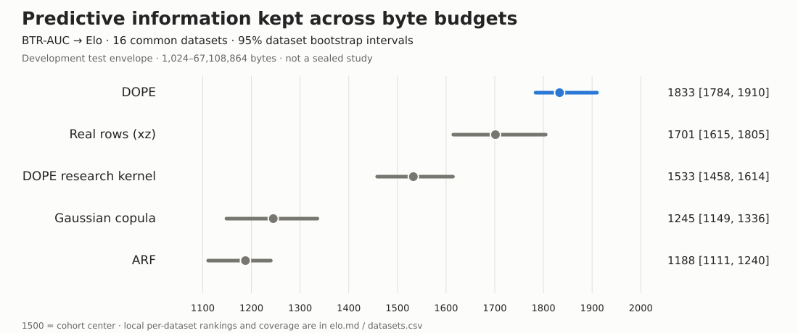
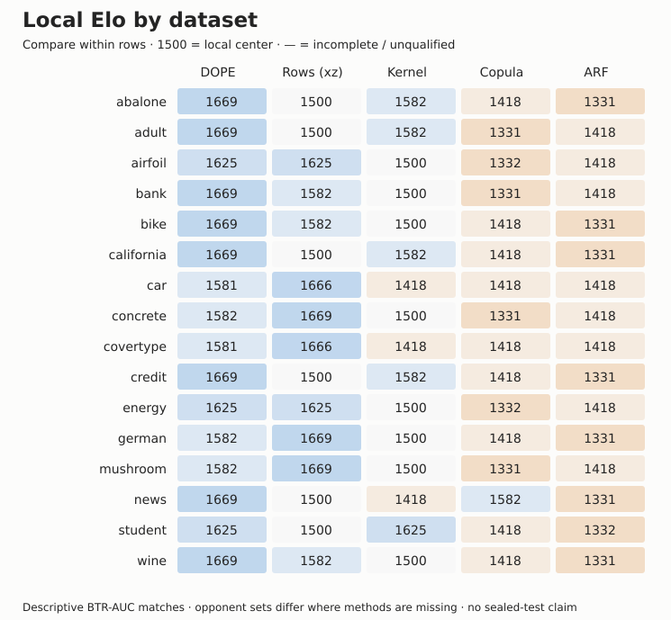

# Budgeted transfer Elo

Selection-exposed development evidence; no sealed-test or D80 claim.

BTR-AUC: area under clipped worst-family retention versus log byte budget (0–100).
This is the envelope of tested configurations; it does not predict validation-selected deployment performance.
Common complete cohort: 16/16 datasets. Tie margin: 1 BTR-AUC points. 95% intervals resample datasets.

| Alternative | Elo [95% interval] | Mean BTR-AUC | W / T / L |
|---|---:|---:|---:|
| DOPE | 1833 [1784, 1910] | 87.1 | 56 / 3 / 5 |
| Compressed original training rows | 1701 [1615, 1805] | 78.5 | 47 / 2 / 15 |
| DOPE research kernel | 1533 [1458, 1614] | 60.2 | 32 / 5 / 27 |
| Gaussian copula | 1245 [1149, 1336] | 20.1 | 10 / 4 / 50 |
| ARF | 1188 [1111, 1240] | 15.9 | 6 / 4 / 54 |

**Compressed original training rows** (method ID `rows`; previously “Real rows (xz)”) is a storage baseline: a seeded random subset of the original training table, stored as an xz-compressed CSV. It keeps as many rows as fit each byte budget; larger budgets may hold the full training table. The downstream models train on those retained original rows and are scored on held-out real rows. xz is lossless compression, not a learned model.

## Individual dataset rankings

Local Elo uses only the alternatives complete on that dataset. Its 1500 center is local, so compare alternatives within a row group, not scores across datasets.

| Dataset | Alternative | BTR-AUC | Local Elo | Status |
|---|---|---:|---:|---|
| abalone | DOPE | 97.9 | 1669 | complete |
| abalone | DOPE research kernel | 94.5 | 1582 | complete |
| abalone | Compressed original training rows | 79.1 | 1500 | complete |
| abalone | Gaussian copula | 57.5 | 1418 | complete |
| abalone | ARF | 31.9 | 1331 | complete |
| adult | DOPE | 88.7 | 1669 | complete |
| adult | DOPE research kernel | 82.4 | 1582 | complete |
| adult | Compressed original training rows | 75.9 | 1500 | complete |
| adult | ARF | 18.9 | 1418 | complete |
| adult | Gaussian copula | 11.6 | 1331 | complete |
| airfoil | DOPE | 95.8 | 1625 | complete |
| airfoil | Compressed original training rows | 95.4 | 1625 | complete |
| airfoil | DOPE research kernel | 76.4 | 1500 | complete |
| airfoil | ARF | 35.2 | 1418 | complete |
| airfoil | Gaussian copula | 8.4 | 1332 | complete |
| bank | DOPE | 84.7 | 1669 | complete |
| bank | Compressed original training rows | 64.1 | 1582 | complete |
| bank | DOPE research kernel | 60.9 | 1500 | complete |
| bank | ARF | 17.4 | 1418 | complete |
| bank | Gaussian copula | 5.0 | 1331 | complete |
| bike | DOPE | 93.8 | 1669 | complete |
| bike | Compressed original training rows | 81.6 | 1582 | complete |
| bike | DOPE research kernel | 46.9 | 1500 | complete |
| bike | Gaussian copula | 19.2 | 1418 | complete |
| bike | ARF | 15.4 | 1331 | complete |
| california | DOPE | 93.2 | 1669 | complete |
| california | DOPE research kernel | 82.4 | 1582 | complete |
| california | Compressed original training rows | 77.0 | 1500 | complete |
| california | Gaussian copula | 47.9 | 1418 | complete |
| california | ARF | 18.7 | 1331 | complete |
| car | Compressed original training rows | 97.7 | 1666 | complete |
| car | DOPE | 96.3 | 1581 | complete |
| car | ARF | 0.0 | 1418 | complete |
| car | Gaussian copula | 0.0 | 1418 | complete |
| car | DOPE research kernel | 0.0 | 1418 | complete |
| concrete | Compressed original training rows | 92.0 | 1669 | complete |
| concrete | DOPE | 87.0 | 1582 | complete |
| concrete | DOPE research kernel | 45.2 | 1500 | complete |
| concrete | ARF | 4.8 | 1418 | complete |
| concrete | Gaussian copula | 0.0 | 1331 | complete |
| covertype | Compressed original training rows | 61.6 | 1666 | complete |
| covertype | DOPE | 26.6 | 1581 | complete |
| covertype | ARF | 0.0 | 1418 | complete |
| covertype | Gaussian copula | 0.0 | 1418 | complete |
| covertype | DOPE research kernel | 0.0 | 1418 | complete |
| credit | DOPE | 90.1 | 1669 | complete |
| credit | DOPE research kernel | 81.7 | 1582 | complete |
| credit | Compressed original training rows | 61.3 | 1500 | complete |
| credit | Gaussian copula | 12.8 | 1418 | complete |
| credit | ARF | 0.0 | 1331 | complete |
| energy | DOPE | 99.1 | 1625 | complete |
| energy | Compressed original training rows | 99.9 | 1625 | complete |
| energy | DOPE research kernel | 53.6 | 1500 | complete |
| energy | ARF | 48.4 | 1418 | complete |
| energy | Gaussian copula | 27.5 | 1332 | complete |
| german | Compressed original training rows | 86.5 | 1669 | complete |
| german | DOPE | 77.1 | 1582 | complete |
| german | DOPE research kernel | 70.3 | 1500 | complete |
| german | Gaussian copula | 23.2 | 1418 | complete |
| german | ARF | 0.0 | 1331 | complete |
| mushroom | Compressed original training rows | 98.3 | 1669 | complete |
| mushroom | DOPE | 94.8 | 1582 | complete |
| mushroom | DOPE research kernel | 93.2 | 1500 | complete |
| mushroom | ARF | 40.2 | 1418 | complete |
| mushroom | Gaussian copula | 23.4 | 1331 | complete |
| news | DOPE | 95.5 | 1669 | complete |
| news | Gaussian copula | 46.9 | 1582 | complete |
| news | Compressed original training rows | 28.1 | 1500 | complete |
| news | DOPE research kernel | 24.0 | 1418 | complete |
| news | ARF | 0.0 | 1331 | complete |
| student | DOPE | 96.9 | 1625 | complete |
| student | DOPE research kernel | 96.9 | 1625 | complete |
| student | Compressed original training rows | 92.6 | 1500 | complete |
| student | Gaussian copula | 5.0 | 1418 | complete |
| student | ARF | 3.6 | 1332 | complete |
| wine | DOPE | 75.7 | 1669 | complete |
| wine | Compressed original training rows | 65.0 | 1582 | complete |
| wine | DOPE research kernel | 54.3 | 1500 | complete |
| wine | Gaussian copula | 33.9 | 1418 | complete |
| wine | ARF | 19.8 | 1331 | complete |
