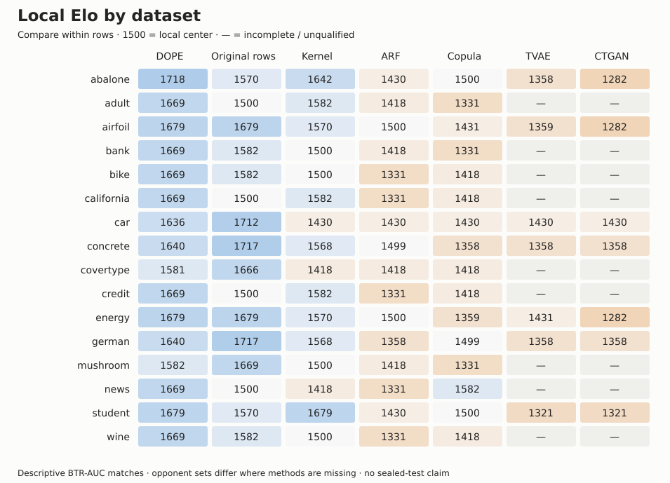

# Budgeted transfer Elo

Selection-exposed development evidence; no sealed-test or D80 claim.

BTR-AUC: area under clipped worst-family retention versus log byte budget (0–100).
This is the envelope of tested configurations; it does not predict validation-selected deployment performance.
Common complete cohort: 7/16 datasets. Tie margin: 1 BTR-AUC points. 95% intervals resample datasets.

| Alternative | Elo [95% interval] | Mean BTR-AUC | W / T / L |
|---|---:|---:|---:|
| DOPE | 1837 [1787, 1912] | 92.9 | 36 / 3 / 3 |
| Compressed original training rows | 1825 [1737, 1948] | 91.9 | 36 / 2 / 4 |
| DOPE research kernel | 1640 [1520, 1766] | 62.4 | 26 / 5 / 11 |
| ARF | 1398 [1326, 1458] | 17.7 | 13 / 6 / 23 |
| Gaussian copula | 1380 [1289, 1459] | 17.4 | 12 / 6 / 24 |
| TVAE | 1253 [1180, 1309] | 9.4 | 4 / 9 / 29 |
| CTGAN | 1167 [1043, 1263] | 2.8 | 0 / 9 / 33 |

**Compressed original training rows** (method ID `rows`; previously “Real rows (xz)”) is a storage baseline: a seeded random subset of the original training table, stored as an xz-compressed CSV. It keeps as many rows as fit each byte budget; larger budgets may hold the full training table. The downstream models train on those retained original rows and are scored on held-out real rows. xz is lossless compression, not a learned model.

## Individual dataset rankings

Local Elo uses only the alternatives complete on that dataset. Its 1500 center is local, so compare alternatives within a row group, not scores across datasets.

| Dataset | Alternative | BTR-AUC | Local Elo | Status |
|---|---|---:|---:|---|
| abalone | DOPE | 97.9 | 1718 | complete |
| abalone | DOPE research kernel | 94.5 | 1642 | complete |
| abalone | Compressed original training rows | 79.1 | 1570 | complete |
| abalone | Gaussian copula | 57.5 | 1500 | complete |
| abalone | ARF | 31.9 | 1430 | complete |
| abalone | TVAE | 28.7 | 1358 | complete |
| abalone | CTGAN | 19.3 | 1282 | complete |
| adult | DOPE | 88.7 | 1669 | complete |
| adult | DOPE research kernel | 82.4 | 1582 | complete |
| adult | Compressed original training rows | 75.9 | 1500 | complete |
| adult | ARF | 18.9 | 1418 | complete |
| adult | Gaussian copula | 11.6 | 1331 | complete |
| adult | CTGAN | — | — | incomplete |
| adult | TVAE | — | — | incomplete |
| airfoil | DOPE | 95.8 | 1679 | complete |
| airfoil | Compressed original training rows | 95.4 | 1679 | complete |
| airfoil | DOPE research kernel | 76.4 | 1570 | complete |
| airfoil | ARF | 35.2 | 1500 | complete |
| airfoil | Gaussian copula | 8.4 | 1431 | complete |
| airfoil | TVAE | 4.6 | 1359 | complete |
| airfoil | CTGAN | 0.0 | 1282 | complete |
| bank | DOPE | 84.7 | 1669 | complete |
| bank | Compressed original training rows | 64.1 | 1582 | complete |
| bank | DOPE research kernel | 60.9 | 1500 | complete |
| bank | ARF | 17.4 | 1418 | complete |
| bank | Gaussian copula | 5.0 | 1331 | complete |
| bank | CTGAN | — | — | incomplete |
| bank | TVAE | — | — | incomplete |
| bike | DOPE | 93.8 | 1669 | complete |
| bike | Compressed original training rows | 81.6 | 1582 | complete |
| bike | DOPE research kernel | 46.9 | 1500 | complete |
| bike | Gaussian copula | 19.2 | 1418 | complete |
| bike | ARF | 15.4 | 1331 | complete |
| bike | CTGAN | — | — | incomplete |
| bike | TVAE | — | — | incomplete |
| california | DOPE | 93.2 | 1669 | complete |
| california | DOPE research kernel | 82.4 | 1582 | complete |
| california | Compressed original training rows | 77.0 | 1500 | complete |
| california | Gaussian copula | 47.9 | 1418 | complete |
| california | ARF | 18.7 | 1331 | complete |
| california | CTGAN | — | — | incomplete |
| california | TVAE | — | — | incomplete |
| car | Compressed original training rows | 97.7 | 1712 | complete |
| car | DOPE | 96.3 | 1636 | complete |
| car | ARF | 0.0 | 1430 | complete |
| car | Gaussian copula | 0.0 | 1430 | complete |
| car | CTGAN | 0.0 | 1430 | complete |
| car | DOPE research kernel | 0.0 | 1430 | complete |
| car | TVAE | 0.0 | 1430 | complete |
| concrete | Compressed original training rows | 92.0 | 1717 | complete |
| concrete | DOPE | 87.0 | 1640 | complete |
| concrete | DOPE research kernel | 45.2 | 1568 | complete |
| concrete | ARF | 4.8 | 1499 | complete |
| concrete | Gaussian copula | 0.0 | 1358 | complete |
| concrete | CTGAN | 0.0 | 1358 | complete |
| concrete | TVAE | 0.0 | 1358 | complete |
| covertype | Compressed original training rows | 61.6 | 1666 | complete |
| covertype | DOPE | 26.6 | 1581 | complete |
| covertype | ARF | 0.0 | 1418 | complete |
| covertype | Gaussian copula | 0.0 | 1418 | complete |
| covertype | DOPE research kernel | 0.0 | 1418 | complete |
| covertype | CTGAN | — | — | incomplete |
| covertype | TVAE | — | — | incomplete |
| credit | DOPE | 90.1 | 1669 | complete |
| credit | DOPE research kernel | 81.7 | 1582 | complete |
| credit | Compressed original training rows | 61.3 | 1500 | complete |
| credit | Gaussian copula | 12.8 | 1418 | complete |
| credit | ARF | 0.0 | 1331 | complete |
| credit | CTGAN | — | — | incomplete |
| credit | TVAE | — | — | incomplete |
| energy | DOPE | 99.1 | 1679 | complete |
| energy | Compressed original training rows | 99.9 | 1679 | complete |
| energy | DOPE research kernel | 53.6 | 1570 | complete |
| energy | ARF | 48.4 | 1500 | complete |
| energy | TVAE | 32.9 | 1431 | complete |
| energy | Gaussian copula | 27.5 | 1359 | complete |
| energy | CTGAN | 0.0 | 1282 | complete |
| german | Compressed original training rows | 86.5 | 1717 | complete |
| german | DOPE | 77.1 | 1640 | complete |
| german | DOPE research kernel | 70.3 | 1568 | complete |
| german | Gaussian copula | 23.2 | 1499 | complete |
| german | ARF | 0.0 | 1358 | complete |
| german | CTGAN | 0.0 | 1358 | complete |
| german | TVAE | 0.0 | 1358 | complete |
| mushroom | Compressed original training rows | 98.3 | 1669 | complete |
| mushroom | DOPE | 94.8 | 1582 | complete |
| mushroom | DOPE research kernel | 93.2 | 1500 | complete |
| mushroom | ARF | 40.2 | 1418 | complete |
| mushroom | Gaussian copula | 23.4 | 1331 | complete |
| mushroom | CTGAN | — | — | incomplete |
| mushroom | TVAE | — | — | incomplete |
| news | DOPE | 95.5 | 1669 | complete |
| news | Gaussian copula | 46.9 | 1582 | complete |
| news | Compressed original training rows | 28.1 | 1500 | complete |
| news | DOPE research kernel | 24.0 | 1418 | complete |
| news | ARF | 0.0 | 1331 | complete |
| news | CTGAN | — | — | incomplete |
| news | TVAE | — | — | incomplete |
| student | DOPE | 96.9 | 1679 | complete |
| student | DOPE research kernel | 96.9 | 1679 | complete |
| student | Compressed original training rows | 92.6 | 1570 | complete |
| student | Gaussian copula | 5.0 | 1500 | complete |
| student | ARF | 3.6 | 1430 | complete |
| student | CTGAN | 0.0 | 1321 | complete |
| student | TVAE | 0.0 | 1321 | complete |
| wine | DOPE | 75.7 | 1669 | complete |
| wine | Compressed original training rows | 65.0 | 1582 | complete |
| wine | DOPE research kernel | 54.3 | 1500 | complete |
| wine | Gaussian copula | 33.9 | 1418 | complete |
| wine | ARF | 19.8 | 1331 | complete |
| wine | CTGAN | — | — | incomplete |
| wine | TVAE | — | — | incomplete |
