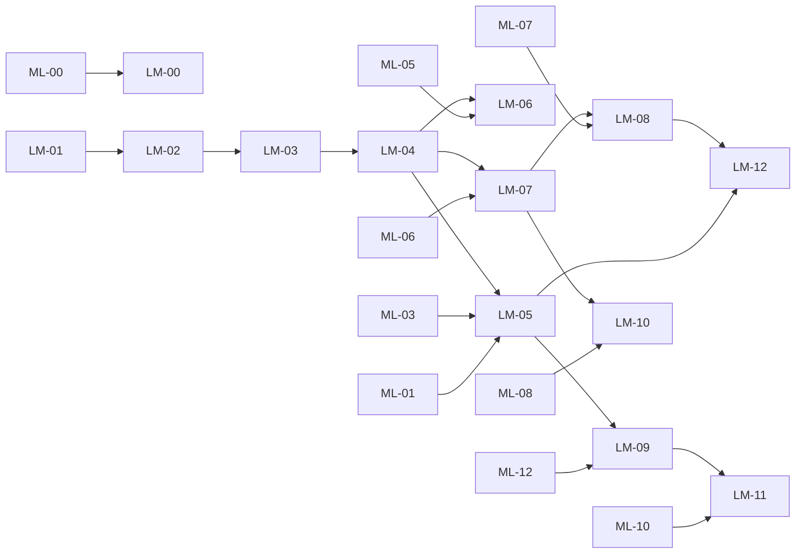

# DOPE landmark signatures: fast micro-fits that tell the encoder, the auditor and the generator what kind of table this is

**Engineering specification and assessment · v1.0 · 2026-10-22**

| | |
|---|---|
| Status | `specified_unrun`. Proposed design plus a small development probe. No product behavior changes until its gates pass. |
| Builds on | [PR #310](https://github.com/neverhuman/dope/pull/310) `docs/plans/multilevel-implementation.md` (branch `codex/dope-multilevel-plan-20261022`, head `cc0585a`), which itself depends on PR #308 (`codex/budgets-tiers-elo`, head `65b1d2a`) and its CI fixes in PR #309 (`claude/pr308-fixes`, head `fa11956`). Reviewed `main` is `098702a`. |
| Proposed repo path | `docs/plans/landmark-signatures.md`, linked from #310's §10, §11, §12 and §13 |
| Ticket prefix | `LM-` (this document) alongside #310's `ML-`; experiments `E-L*`; acceptance tests `A-L*` |
| Reader | An engineer or coding agent; every ticket in §15 names files, signatures, algorithm, tests and a done condition |

> Native implementation status and deliberate recipe differences are tracked in
> [the implementation guide](../landmarks.md). The proposed `landmarks-v1` is not
> silently equated with the implemented `landmarks-native-v1`.

### How to read this

§0 is the opinion the request asked for. §2 is the evidence. §4 defines the panel. §6–§7 are the
leakage and custody rules, which matter more here than usual because these fits read real
labels. §8–§9 are the implementation and its integration points with #310. §13 is how we find
out whether it works, and §15 is the work order.

---

## 0. Verdict

### 0.1 What the idea is

Run a deliberately diverse panel of very fast learners on the real training rows with
cross-validation; keep their *relative* scores; feed that pattern into the learned encoder (and
the compiler) so the model knows what kind of structure the table has before it tries to encode
or regenerate it.

This is **landmarking**, a known and well-regarded meta-learning technique: the performance of
cheap learners characterizes a dataset well enough to predict how expensive learners will do
([Pfahringer, Bensusan and Giraud-Carrier, ICML 2000](https://mlanthology.org/icml/2000/pfahringer2000icml-meta/);
relative and subsample variants in [Leite and Brazdil, ICML 2005](https://mlanthology.org/icml/2005/leite2005icml-predicting);
landmarking is one of the standard meta-feature groups surveyed by
[Rivolli et al., Knowledge-Based Systems 2022](https://arxiv.org/abs/1808.10406)). What is
new in this proposal is where the signal is used: not only to recommend a learner, but to
**select and steer a synthetic-data generator**, by comparing three signatures of the same
panel:

| Signature | Panel trained on | Scored on | Information status |
|---|---|---|---|
| **Real signature** `S_real` | real fit rows (K-fold) | held-out folds of the same fit rows | private: a measurement of the data |
| **Synthetic signature** `S_syn` | the program's samples (K-fold) | held-out folds of the same samples | public-safe: a deterministic function of the released artifact |
| **Transfer signature** `T` | synthetic samples, and a real reference on fit rows | real tune rows (not used to train either learner) | private: a paired train-synthetic/test-real measurement |

`T` is a much wider version of today's self-audit. `S_real` vs `S_syn` is the "synthetic
signature" the request describes: whether the generated table *behaves* like the real one to a
broad set of learners.

### 0.2 My assessment

**Yes, it can help us, if it is used in the right place.** The probe in §2.2 sharpened my view
into one rule:

> **Describe with many learners. Select with the learners you will be judged by, on rows nobody
> trained on.**

* As a **description of the real table** (encoder input, model-selection meta-features, compiler
  proposals, diagnostics) a diverse micro-fit panel is well founded in the meta-learning
  literature, cheap, and visibly "telling" on our tables. This is the use you asked about, and I
  think it is the strongest one.
* As a **selection score** for which synthetic program to keep, the broad panel *hurt* in the
  probe: every broad aggregate lost to two ordinary learners scored on untouched rows, and the
  two-learner audit cut selection regret about tenfold versus today's self-audit. The landmark
  machinery still helps here, because it builds that clean audit, but diversity belongs in the
  diagnostics, not in the score.
* As a **target for the generator** ("make the synthetic signature match the real one"), the
  probe found no relationship between signature match and external quality. I would not train
  toward signature matching. I would condition on the real signature and train toward transfer
  measured by roster-mirroring learners, as #310 already does.

It is a measurement-and-steering instrument, not new generative capacity: it will not by itself
fix the covariate-model limits in the levels spec (mushroom, covertype), though it will name them.

My value and confidence by use, updated by the probe (subjective probabilities that the use
clears its §13 gate on development families):

| # | Use | Value if it works | Confidence | Cost | Probe evidence and main risk |
|---|---|---|---|---|---|
| U1a | **Clean, roster-mirroring audit** built with the panel machinery: core learners plus micro versions of the judging families, scored on tune rows, in the auditors' representation | High: directly better program selection and calibration | ~75% | Low | Two learners on clean rows: regret 0.029 → 0.003, bias +0.038 → +0.003 on 9 tables. Risk: small probe; confounded with learner implementation |
| U1b | **Broad diverse panel inside the selection score** | Low–medium | ~25% | Low | Every broad aggregate lost to U1a in the probe; landmarks react to differences the judges ignore |
| U2 | **Structure-loss diagnostics** ("interactions lost, additive shape kept") | High for engineering speed and support | ~80% | Very low | Probe localized a real failure to interactions (§2.2 D) and missed another; over-reading noisy contrasts |
| U3 | **Encoder input**: real signature and per-feature spectrum into #310's table-encoder task branch | High for model selection, retention prediction, similarity | ~65% | Low–medium | Not testable without the corpus; signatures look telling (§2.2 C). Risks: circularity with profile labels, panel lock-in |
| U4 | **Compiler proposer features** (what to spend bytes on) | Medium | ~45% | Low | The audit already searches; gain mostly compute |
| U5 | **Spectrum transfer loss** for the shared decoder | Medium | ~30% | Medium | Broad-landmark agreement did not track judged retention; Goodhart |
| U6 | **Synthetic signature as a quality predictor** | Low | ~15% | Low | No within-table correlation in the probe. Still useful as *descriptor content* of the released artifact (~50%) |
| U7 | **Landmark-guided input transforms** inside the stored network | Medium | ~40% | Medium | Untested; bytes per transform code vs gain |

Why I still rate U3 well despite U1b and U6 failing: those two asked the panel to *judge*
synthetic data, where its extra learners measure the wrong thing. U3 asks it to *describe* real
data for a model whose job is to predict learner behavior, which is exactly what landmarking was
designed for. The two arguments that carry over: the encoder's context is bounded (1,024 rows by
64 features in #310's pilot) while ridge landmarks see up to 50,000 rows; and normalized gains
and their contrasts are unit-free, so they mean the same thing across tables.

### 0.3 What it will not do

* It does not add capacity to the program. Where the program family cannot represent the
  structure (exclusive one-hot groups, categorical interactions under a Gaussian copula), the
  panel will *report* the loss precisely; WS4/ML-09 capacity work still has to fix it.
* It does not certify anything. `T` is a selection heuristic on tune rows, exactly like
  today's self-audit (#310 §3, "a selection heuristic, not external transfer certification").
* It is not free information. `S_real` is a measurement of private data and stays private by
  default (§7).

### 0.4 Recommendation and order

1. **Now (with #310 ML-01/ML-03):** build the native panel core (LM-01..LM-04) and
   `TransferReference`, and use it to give the compiler a clean, roster-mirroring audit on tune
   rows (LM-05, rule `Mirror`). Keep the broad panel in the private report as diagnostics.
2. **With the corpus (ML-06):** compute real signatures for every corpus table; report the
   landmarks-only meta-model baseline; feed signatures into the table-encoder pilot (ML-07) as an
   ablated input (LM-08). Decide with E-L3. This is where your idea should pay off most.
3. **Gated later:** the proposer (U4), the spectrum loss restricted to judging families (U5) and
   landmark-guided transforms (U7).
4. **Do not** put the broad panel into the selection score or train the generator to match
   signatures unless E-L1/E-L2 on development families reverse the probe's result.
5. Keep the panel small and versioned. Twenty well-chosen landmarks beat fifty correlated ones.

---

## 1. How this plugs into PR #310

| #310 object or ticket | Landmark contribution | Section |
|---|---|---|
| ML-01 clean data roles | Real signature from fit rows only; transfer signature scored on tune rows; nothing reads calibration, confirmation or test | §6 |
| ML-03 audited carry/replace, fixed evaluator representation | `TransferReference` builds the clean, roster-mirroring audit (`R_mirror`); the broad panel goes to diagnostics; typed uninformative states | §9.1 |
| ML-04 drivers | Per-feature landmark spectrum is *not* a driver metric; drivers stay as defined in `docs/metric.md` §4 | §9.5 |
| ML-05 deterministic descriptor (16 "artifact-generated probe summaries") | `S_syn` defines those probe summaries | §9.3 |
| ML-06 corpus and episodes | Job J-L computes all three signatures per table and program; meta-dataset | §11 |
| ML-07 table encoder (`H_X` target-free, `H_T` task branch) | Landmark tokens and per-feature spectrum enter `H_T` only | §9.4 |
| ML-08 shared decoder, transfer-aware loss (§13.3 differentiable ridge auditors) | Ridge-family landmarks generalize that single ridge auditor into a spectrum; held-out landmarks guard against overfitting | §9.7 |
| ML-11 program embeddings | `S_syn` per authorized level | §9.3 |
| ML-12 learned compiler proposal | Landmark features and transparent heuristics as the baseline proposer | §9.6 |
| §13.4 profile heads (labels) | Landmarks are *inputs* from fit rows; profile labels stay roster losses on inner-query rows; never the same rows or recipes | §9.5 |

---

## 2. Evidence

### 2.1 Prior work (motivation, not proof for this use)

* Landmarking for algorithm selection: Pfahringer et al. 2000; Bensusan and Giraud-Carrier 2000;
  relative landmarks and sampling landmarks (Leite and Brazdil 2005). Survey and taxonomy:
  Rivolli et al. 2022. Tooling: the `pymfe`/`mfe` "landmarking" group.
* Kernel ridge regression trained on synthetic data and evaluated on real data as a
  differentiable objective for producing training data: Nguyen, Chen and Lee, "Dataset
  Meta-Learning from Kernel Ridge-Regression", ICLR 2021 (KIP). The spectrum loss in §9.7 is a
  multi-kernel version of that idea.
* Random Fourier features as a cheap smooth-kernel learner: Rahimi and Recht, NeurIPS 2007.

None of these measured synthetic-data selection or generator steering, so §13's gates decide.

### 2.2 Development probe on the nine-table levels probe

Setup in Appendix C: a Python prototype of a 16-landmark subset, the 45 programs of the
earlier levels probe (nine PMLB tables × five programs), each table's held-out file split into
**T1** (scoring rows the compiler never saw) and **T2** (external evaluation with the engine's
three auditors, three sampling seeds). Small and selection-exposed; it shows direction and
failure modes, not effect sizes. External T2 retention varies by about
0.0109 between sampling seeds (median standard deviation), so per-table
differences below about 0.01 are noise. Part of that spread is the engine's MLP auditor, whose
CPU weight initialization is not seeded (repeated `dope eval` of one fixed program on fixed
files: MLP retention 0.944–0.977 on `197_cpu_act`, 0.888–1.069 on `574_house_16H`; see
[the probe README](../../bench/real-world/probes/README.md)).

**A. Which program does each audit pick?** (external T2 retention of the picked program)

| Table | external T2 retention, best program | pick by engine self-audit | pick by 2 learners, clean T1 | pick by 16-landmark family-min, T1 | pick by signature gap (no real holdout) |
|---|---|---|---|---|---|
| `197_cpu_act` | low 0.965 (range 0.635–0.965) | low 0.965 | low 0.965 | low 0.965 | ultra 0.635 |
| `218_house_8L` | ultra 0.995 (range 0.987–0.995) | ultra 0.995 | ultra 0.995 | ultra 0.995 | ultra 0.995 |
| `225_puma8NH` | low 0.982 (range 0.936–0.982) | ultra 0.936 | low 0.982 | high 0.962 | low 0.982 |
| `344_mv` | low 0.998 (range 0.998–0.998) | ultra 0.998 | low 0.998 | sum 0.998 | ultra 0.998 |
| `574_house_16H` | med 0.887 (range 0.723–0.887) | high 0.723 | med 0.887 | high 0.723 | high 0.723 |
| `adult` | med 0.889 (range 0.854–0.889) | low 0.854 | sum 0.884 | sum 0.884 | low 0.854 |
| `car_evaluation` | med 0.976 (range 0.969–0.976) | sum 0.975 | sum 0.975 | sum 0.975 | sum 0.975 |
| `churn` | med 0.845 (range 0.814–0.845) | high 0.832 | sum 0.828 | low 0.815 | low 0.815 |
| `mushroom` | sum 0.732 (range 0.728–0.732) | med 0.731 | ultra 0.731 | med 0.731 | high 0.730 |

**B. Selection quality across the nine tables**

| Predictor | mean selection regret | best-program hits | mean within-table Spearman | pooled Spearman | mean bias vs T2 |
|---|---:|---:|---:|---:|---:|
| Engine self-audit (today) | 0.0288 | 2/9 | 0.33 | 0.87 | +0.038 |
| Two learners (ridge + small GBDT) on clean T1 | 0.0026 | 5/9 | 0.50 | 0.77 | +0.003 |
| 16-landmark family minimum | 0.0243 | 2/9 | 0.16 | 0.64 | -0.168 |
| Same, kNN-1 excluded (post hoc) | 0.0452 | 2/9 | 0.11 | 0.81 | -0.098 |
| Minimum over strong landmarks | 0.0262 | 2/9 | 0.22 | 0.45 | -0.299 |
| Gain-weighted mean over the panel | 0.0450 | 2/9 | 0.27 | 0.63 | +0.033 |
| Pooled ratio over strong landmarks | 0.0399 | 3/9 | 0.50 | 0.71 | +0.028 |
| Signature gap `S_syn` vs `S_real` (no real holdout) | 0.0622 | 2/9 | 0.01 | 0.62 | — |
| Always the 2 KiB program | 0.0099 | | | | |
| Always the 64 KiB program | 0.0526 | | | | |

Spearman correlations use average ranks for ties (tied scores occur, for example where the low
and medium artifacts are identical). The prototype's first report broke ties in NumPy's
platform-dependent `argsort` order; the replay in [`bench/real-world/probes/`](../../bench/real-world/probes/README.md)
moved six cells by 0.01 and changed no conclusion. Every table in this section is regenerated
from the committed receipts by `dope-probes replay-landmarks` and checked in CI.

**C. Real signatures are telling** (5-fold CV gains on real training rows; Brier for the four
classification tables; "linearity" = linear gain / best gain; "interaction" = GBDT gain minus best
additive gain, over best gain; last column = largest change between two CV repetitions)

| Table | linear | step | pairs | rff | rows | fourier | gbdt | knn1 | knn15 | mlp | linearity | interaction | repeat-CV max diff |
|---|---:|---:|---:|---:|---:|---:|---:|---:|---:|---:|---:|---:|---:|
| 197_cpu_act | 0.74 | 0.93 | 0.96 | 0.87 | 0.90 | 0.97 | 0.96 | 0.88 | 0.85 | 0.55 | 0.76 | -0.02 | 0.021 |
| 218_house_8L | 0.49 | 0.56 | 0.56 | 0.62 | 0.52 | 0.59 | 0.64 | 0.29 | 0.61 | -0.91 | 0.77 | +0.09 | 0.046 |
| 225_puma8NH | 0.37 | 0.41 | 0.37 | 0.45 | 0.38 | 0.43 | 0.67 | 0.17 | 0.53 | 0.66 | 0.55 | +0.37 | 0.048 |
| 344_mv | 0.81 | 0.82 | 0.99 | 0.99 | 0.85 | 0.82 | 1.00 | 0.90 | 0.94 | 0.99 | 0.81 | +0.00 | 0.014 |
| 574_house_16H | 0.35 | 0.45 | 0.42 | 0.49 | 0.37 | 0.48 | 0.59 | 0.23 | 0.47 | -0.91 | 0.60 | +0.18 | 0.023 |
| adult | 0.31 | 0.42 | 0.37 | 0.36 | 0.31 | 0.43 | 0.47 | -0.20 | 0.33 | 0.32 | 0.65 | +0.09 | 0.038 |
| car_evaluation | 0.33 | 0.42 | 0.47 | 0.54 | 0.38 | 0.42 | 0.97 | 0.23 | 0.63 | 0.35 | 0.34 | +0.52 | 0.123 |
| churn | 0.17 | 0.29 | 0.33 | 0.39 | 0.23 | 0.31 | 0.67 | -0.14 | 0.37 | 0.27 | 0.26 | +0.51 | 0.144 |
| mushroom | 0.74 | 0.98 | 0.96 | 0.93 | 0.78 | 0.99 | 1.00 | 1.00 | 0.98 | 0.93 | 0.74 | +0.01 | 0.036 |

**D. Diagnostics name the lost structure.** On `574_house_16H`, the 16 KiB program tests far
worse than the 4 KiB one (external MLP family 0.86 → 0.71, GBDT 0.96 → 0.92, seed 0). Its additive
landmarks barely move (linear 0.96 → 0.94, step 0.90 → 0.88), while the interaction landmarks
drop (depth-3 tree 0.78 → 0.47, pairs 0.91 → 0.83, smooth kernel 0.86 → 0.80): the larger program
lost interaction structure, not marginal shapes. On `225_puma8NH` the panel did *not* see the
external MLP's drop (1.00 → 0.94), so diagnostics are informative, not complete.

**What the probe changed in this specification**

1. **Clean scoring rows matter most.** Two ordinary learners scored on rows the compiler never
   used cut mean selection regret from 0.029 to 0.003 and calibration bias from +0.038 to
   +0.003; today's self-audit did worse than always shipping the 2 KiB program (0.010). The
   comparison is confounded: the control also differs in learner implementation (scikit-learn
   gradient boosting, robust ridge) and in its real reference. It is still #310's ML-01/ML-03
   direction, and the landmark machinery (`TransferReference`) is a convenient way to build it.
2. **A broad panel inside the selection score hurt.** Every broad aggregate lost to the
   two-learner control and most were strongly pessimistic. Several landmarks react to
   differences that the judging auditors do not care about (kNN-1 cannot benefit from
   near-duplicates in synthetic data, high-variance bases extrapolate, the small MLP is
   unstable). So: **select with learners that mirror the judging roster; describe with the
   whole panel** (§5.5 rewritten accordingly).
3. **Matching signatures did not predict quality.** The synthetic-vs-real signature gap had no
   within-table correlation with external retention (0.01). The synthetic signature stays a
   *description* of the released artifact, not a quality score or a training target.
4. **The representation must match the auditors** (§5.5a), and **kNN-1 is a memorization probe**
   (§5.5b).
5. **Real signatures separate tables in sensible ways** (table C): car and churn are
   interaction-dominated (+0.52, +0.51), 197_cpu_act is strongly nonlinear but additive
   (linearity 0.76, interaction −0.02), 344_mv is near-noiseless (kNN-1 0.90, GBDT 1.00). That is
   anecdotal support for the encoder-input use, which this probe cannot test (it needs the
   corpus, E-L3).
6. **Stability gating is necessary**: the prototype's MLP landmark changed by up to 0.14 between
   CV repetitions (car, churn) and produced negative gains on two tables; kNN-1 was the least
   stable landmark on three others.

---

## 3. Definitions

* **Landmark** `m`: a fixed (representation, learner, capacity, row cap) recipe from a frozen
  panel. It exposes `fit(train) → state` and `predict(state, rows)`, the same shape as the
  General Regressor Challenge's `RegressorApi` (§18).
* **Panel** `P`: an ordered, versioned set of landmarks (`landmarks-v1`). The panel version is
  part of every coordinate-space identity.
* **Loss** `L`: regression MSE on the fit-standardized target; classification Brier score
  `Σ_c (p_c − 1[y=c])²` (proper, closed-form friendly, defined for every landmark). Null loss
  `L_0` is the fit-row mean or class-frequency predictor.
* **Normalized gain** `g_m = 1 − L_m / L_0` (cross-validated). Signature
  `S = (g_m, se_m)_{m ∈ P}`.
* **Transfer retention** per landmark on tune rows:
  `R_m = (L_0 − L_syn,m) / (L_0 − L_real,m)`, informative when
  `L_0 − L_real,m ≥ max(0.01·L_0, 0.25·max_m'(L_0 − L_real,m'))`.
* **Contrasts** `C`: fixed functions of `S` that isolate one kind of structure (§4.4).
* **Per-feature spectrum** `F`: for each of up to 64 original features, univariate gains under a
  small basis set (§4.3).

---

## 4. The panel: a "telling variety", not a leaderboard

### 4.1 Design principles

1. **Maximize diagnostic information, not accuracy.** Each landmark should differ from the
   others in exactly one inductive bias, so that the *difference* between two scores isolates
   one kind of structure.
2. **Closed vocabulary.** The additive basis families are the scalar fundamentals of the
   General Regressor Challenge allowlist (abs, sqrt, log1p/log/asinh, sin/cos, tanh/sigmoid/erf/
   atan, step/floor/round/sign, exp, min/max/clip, power) plus its row summaries. Every coordinate
   then has a mathematical meaning and the panel cannot drift into an arbitrary model zoo.
3. **Cheap, deterministic, native.** Closed-form ridge wherever possible; tiny trees, kNN and a
   tiny network otherwise; no candle dependency for the core panel; fixed seeds; fixed work
   budgets measured in operations, not seconds.
4. **Uniform protocol.** Same folds, same representation, same loss for every landmark, so
   scores are comparable within a table.
5. **Stable or dropped.** A landmark whose repeat-CV variation is large relative to its gain
   is marked unstable for that table and excluded from contrasts (§5.4).

### 4.2 `landmarks-v1` (core panel)

`Z` is the fit-only representation (§8.3): robust-standardized numerics clipped to ±5, one-hot
categoricals under the fit-only schema, missing values as 0 plus one indicator per original
feature that has missing values. Ridge landmarks use `[Z ⊕ φ(Z_num)]` with `φ` applied to
numeric columns only.

| ID | Family | Recipe | Fundamentals | What a high gain *relative to L01* indicates |
|---|---|---|---|---|
| L01 `lin` | additive | ridge on `Z` | arithmetic | (reference) linear signal |
| L02 `log` | additive | `Z ⊕ asinh(Z)` | log1p, log, asinh | concave/convex monotone effects, multiplicative scale |
| L03 `sqrt` | additive | `Z ⊕ sign(Z)·√\|Z\|` | sqrt, sign | diminishing returns near zero |
| L04 `pow` | additive | `Z ⊕ Z² ⊕ Z³/3` | power | curvature, U shapes, cubic trends |
| L05 `sat` | additive | `Z ⊕ tanh(Z) ⊕ tanh(Z/3)` | tanh, sigmoid, erf, atan | saturation, soft thresholds |
| L06 `abs` | additive | `Z ⊕ \|Z\|` | abs | V shapes around the center |
| L07 `hinge` | additive | `Z ⊕ max(0, Z − q_k)`, 7 fit-quantile knots per feature | min, max, clip | piecewise-linear effects, regime changes in slope |
| L08 `step` | additive | `Z ⊕ 1[Z > q_k]`, 15 knots | step, floor, round | thresholds, binned effects (a binned GAM) |
| L09 `periodic` | additive | `Z ⊕ sin/cos(kπu)`, `u` = fit-rank scaled to [−1, 1], k = 1..3 | sin, cos | periodic or oscillating effects (time of day, angle) |
| L10 `bump` | additive | `Z ⊕ exp(−(Z − c)²/2)`, c ∈ {−1, 0, 1} | exp | localized effects in a band |
| L11 `rows` | additive | `Z ⊕` row mean, sum, L1, L2, std, min, max of numeric `Z` | row summaries | target is an aggregate of many columns |
| L12 `pairs` | interaction | `Z ⊕` products of the 8 numerics with largest fold-train \|corr\| with `y` | multiplication | pairwise multiplicative interactions |
| L13 `rff` | smooth kernel | ridge on 256 random Fourier features, bandwidth = median pairwise distance of 512 fold-train rows | sin, cos | smooth, rotation-invariant nonlinear structure |
| L14 `missing` | missingness | ridge on missing indicators only (absent when no feature has missing values) | step | informative missingness |
| L15 `best1` | dominance | best single original feature under its univariate `step` basis | step | one feature dominates |
| L16 `stump` | tree | one split, best over features and 255 code thresholds | step | a single dominant threshold |
| L17 `otree3` | tree | one oblivious tree of depth 3 (`forest::boost`, `max_trees = 1`, `eta = 1`) | step | low-order axis-aligned interactions |
| L18 `gbdt` | tree | `eval::gbdt` with 64 rounds, depth 4, learning rate 0.15, 32 bins | step | full axis-aligned interactions |
| L19 `knn1` | local | 1-nearest neighbor, Euclidean on `Z` (random-projected to 32 dims if wider) | arithmetic | near-deterministic target; low noise |
| L20 `knn16` | local | 16-NN mean / class frequency | arithmetic | local smoothness under noise |
| L21 `net` | neural | the engine's residual tanh network (`train_cpu`), 16 hidden, 300 steps, variable-projection readout | tanh | what DOPE's own conditional-model family can learn |
| L22 `lin@¼` | learning curve | L01 trained on a fixed 25% of each training fold | — | data hunger of the linear view |
| L23 `gbdt@¼` | learning curve | L18 trained on a fixed 25% of each training fold | — | data hunger of the interaction view |

Non-learner target statistics in the same signature (computed on fit rows only):
`T01` target skewness (regression) or normalized class entropy (classification), `T02` excess
kurtosis or minority-class share, `T03` heteroscedasticity: gain of L07 predicting
`log |out-of-fold residual of L18|` (regression; class-margin entropy for classification).

Row caps per training fold: ridge family (L01–L15) up to 50,000 rows; trees, kNN reference set,
network: 4,096 rows (kNN reference 2,048). Caps are panel constants; the actual rows used are
recorded.

**Core auditors as landmarks (transfer signature only).** `T` additionally contains `L00a
core_lin` and `L00b core_gbdt`: the self-audit's own learners, recipes and representation,
verbatim. The panel therefore contains today's audit as a subset, and `Panel` can never lose
information `Core` had (§5.5).

### 4.3 Per-feature spectrum `F`

For each original feature `j` among the 64 with the highest fold-train Chatterjee ξ with `y`
(`stats::chatterjee_xi`, rank-based, detects non-monotone dependence; ties by index), compute
univariate cross-validated gains under `lin`, `step` (15 knots), `hinge`, `log`, `sat`,
`periodic`, `abs`, plus ξ itself and the univariate `stump` gain: 9 coordinates per feature.
Categorical features use their one-hot block as the univariate design (shape bases do not
apply; those coordinates are masked). This is the most "telling" part of the signature for an
encoder: it says, per feature, *which kind of shape* carries the signal.

### 4.4 Contrasts `C` (the "relative scores")

Let `s = max_m g_m` (best panel gain) and `A = max(g_L01..L11, g_L15)` (best additive). All
contrasts are clipped to [−1, 1] and masked when `s < 0.01` (no signal) or an input landmark is
unstable.

| ID | Name | Formula | Reading |
|---|---|---|---|
| C01 | signal | `s` | how predictable the target is at all |
| C02 | linearity | `g_lin / s` | ≈1: linear table |
| C03 | additivity | `A / s` | ≈1: an additive model suffices |
| C04 | interaction | `(max(g_gbdt, g_rff, g_net) − A) / s` | > 0.1: interactions matter |
| C05 | pairwise | `(g_pairs − g_lin) / s` | multiplicative pairs |
| C06 | threshold vs slope | `(g_step − g_hinge) / s` | > 0: steps; < 0: smooth slopes |
| C07 | periodic | `(g_periodic − max(g_lin, g_sat)) / s` | oscillation |
| C08 | monotone curvature | `(max(g_log, g_sqrt, g_sat) − g_lin) / s` | monotone nonlinear effects |
| C09 | symmetric curvature | `(max(g_abs, g_pow, g_bump) − g_lin) / s` | U/V/band shapes |
| C10 | determinism | `g_knn1 / max(g_knn16, ε)` | ≈1: low noise; ≪1: noisy |
| C11 | smooth vs axis-aligned | `(g_rff − g_gbdt) / s` | rotation-invariant vs axis-aligned structure |
| C12 | dominance | `g_best1 / s` | one feature carries the signal |
| C13 | aggregate target | `(g_rows − g_lin) / s` | target summarizes many columns |
| C14 | informative missingness | `g_missing / s` | missingness predicts the target |
| C15 | linear data hunger | `(g_lin − g_lin@¼) / s` | more rows still help a linear model |
| C16 | interaction data hunger | `(g_gbdt − g_gbdt@¼) / s` | more rows still help trees |
| C17 | DOPE-family gap | `(g_net − max(g_gbdt, g_rff)) / s` | < 0: structure DOPE's network family misses |
| C18 | heteroscedasticity | `T03` | noise scale depends on `x` |

---

## 5. Statistics

### 5.1 Cross-validation protocol

* K = 5 folds on fit rows. Assignment is a deterministic hash of the physical row identity
  (and group or time block when the dataset declares them, per #310 §5.1), stratified by class
  for classification. The same folds serve every landmark.
* Every fold-dependent choice (knots, top-8 pairs, top-64 features, RFF bandwidth, robust
  scaling inside the panel) is fitted on the training part of that fold only.
* `g_m` is the pooled out-of-fold gain: `1 − Σ_folds L_m / Σ_folds L_0` with fold-size weights.
* `se_m` is the standard deviation of per-fold gains divided by √K.

### 5.2 Ridge solver and regularization

Closed-form ridge with intercept, multi-output (one-hot targets for classification). Build the
full Gram `G = Σ_k G_k` once per basis and solve each fold with `G − G_k` (exact downdating;
`K` solves of a `p × p` system instead of `K` Gram builds). Ridge strength is chosen per
landmark from `λ ∈ {1e-4, 1e-2, 1} × mean(diag(G))` by an inner pass using the same folds;
the chosen λ index is recorded. Classification probabilities are clipped at 1e-4 and
renormalized before the Brier score.

### 5.3 Informative and uninformative states

A landmark cell is one of `Complete`, `Uninformative` (in `S`: `g_m ≤ 0.01`; in `T`: the real
reference fails the informative rule of §3), `Unsupported` (for example L14 without missing
values, L09 on a binary column), `OverBudget`, or `Failed`. These map onto
#310's `CellState`. An uninformative landmark is never scored as perfect retention (#310 §3.1
item 6).

### 5.4 Stability

Each signature records, per landmark, a stability flag: unstable when
`se_m > max(0.02, 0.25·|g_m|)`. Unstable landmarks are excluded from contrasts and from the
audit aggregate, and still reported. The probe (§2.2) found repeat-CV differences above 0.1
for the tiny network on small tables, which is why this rule exists.

### 5.5 Aggregating the transfer signature for selection

Two aggregates, with different jobs. The probe (§2.2) is why the first is the default candidate.

**`R_mirror` (default candidate for selection).** Learners that mirror the families the protocol
will judge with, scored on tune rows in the auditors' representation:

```text
judging families (from the frozen protocol roster; today linear, tree, neural):
    linear -> L00a core_lin        tree -> L00b core_gbdt        neural -> L21 net (only when stable)
R_mirror = min over judging families of R_m
```

When #310's roster adds families (for example tuned LightGBM or a foundation model as held-out
auditors), the mirror gains a *micro* member for each judging family, never the held-out judge
itself.

**`R_panel` (experimental, diagnostics).** The family-robust aggregate over the whole panel:

```text
families: core = L00a, L00b; additive = L01..L15; tree = L16..L18; local = L20; neural = L21
(L19 excluded, §5.5b)
for each family f:
    M_f = informative, stable landmarks in f
    R_f = Σ_{m∈M_f} gain_m · clip(R_m, −1, 1.5) / Σ_{m∈M_f} gain_m      (gain_m = real reference gain on tune rows)
R_panel = min over families with nonempty M_f
```

E-L1 also reports the minimum over strong landmarks (`gain_m ≥ 0.5 · max gain`), the gain-weighted
mean and the pooled ratio, because the probe found them all inferior to a two-learner audit and
that finding needs confirmation on more tables before it is treated as settled. Uncertainty
follows #310 §5.3: bootstrap paired tune-row losses and recompute every family score and the
minimum in each replicate.

### 5.5a Two representations, on purpose

* **Signatures `S_real`, `S_syn`** describe the table. They use the robust panel representation
  `Z` (§8.3) and a standardized target, so outliers and units do not dominate.
* **The transfer signature `T`** predicts what auditors will do. It must see what auditors see:
  the protocol's fixed auditor representation (#310 ML-03; today `MlEncoder` in model space,
  with numerics on [0, 1] and `log1p` where the schema applies it) and the protocol's target
  loss space. Basis expansions are applied on top of that encoding after fold-fitted
  standardization, without further clipping.

The probe shows why (§2.2): on `197_cpu_act`, the engine's model-space linear auditor drops
from 0.96 to 0.66 between the low and med programs, while a linear landmark on robust raw-unit
features moves only from 0.80 to 0.74 (an unclipped mean/sd-scaled one: 0.82 to 0.78). That points
to the auditors' model-space encoding (`log1p` on skewed columns, unit scaling) rather than
clipping, though the probe cannot isolate it. A panel in the wrong representation misses the failure that matters.

### 5.5b kNN-1 is a memorization probe, not a utility target

Synthetic rows should never coincide with real rows, so a 1-nearest-neighbor learner trained on
synthetic rows loses the near-duplicate advantage it has on real data. Its transfer retention
is structurally low (the probe saw values down to −0.29 on tables where every other landmark
kept more than 0.85). `L19` is therefore excluded from every `T` aggregate and reported next to
the empirical privacy diagnostics: a *high* `L19` transfer retention is a copying warning, not
a quality signal. It stays in `S_real` and `S_syn`, where `C10` uses it to measure noise.

### 5.6 Versioning

`landmarks-v1` fixes: landmark list and order, every constant above, the representation recipe,
fold rule, loss definitions, stability rule, contrast formulas and the coordinate layout
(Appendix A). Any change creates `landmarks-v2`; encoders trained on one version refuse the other.

---

## 6. Data roles, leakage and invariance

The real and transfer signatures read real labels, so they are governed by #310 §5 exactly
like any fit statistic.

| Signature | Rows it reads | Allowed uses | Forbidden |
|---|---|---|---|
| `S_real` | fit role only, internal K-fold | compile proposals; private diagnostics; table-encoder `H_T` inputs; proposer training features in research | tune, calibration, confirmation or external test rows; the target-free `H_X` branch; any public output by default |
| `T` | synthetic samples; real reference fit on fit rows; scored on tune rows | candidate selection and private diagnostics, as part of the tune-role selection protocol | calibration, confirmation, external test; training any candidate |
| `T` at confirmation | frozen candidates; real reference fit on fit rows; scored on confirmation rows | the bounded #310 §5.3 confirmation decision only, with the frozen candidate graph | any further training, recalibration, or graph change |
| `S_syn` | the program's own samples only | program descriptors and embeddings; public diagnostics | reading any real row |

Required invariances (tests in §16):

* Changing tune, calibration, confirmation or test targets leaves `S_real` byte-identical.
* Changing calibration, confirmation or test targets leaves `T` (tune-scored) identical.
* Permuting `y` with `X` fixed leaves every `H_X` input unchanged (landmarks are not `H_X` inputs).
* `S_syn` computed from a released file never opens a real table or a private report.
* Fold assignment never puts one physical row, group or time block in both parts of a fold.
* The panel computed for low is identical whether the session computes through high or ultra
  (domain-separated seeds; no shared RNG consumption; #310 §7.4).

---

## 7. Custody and export

Follows #310 §6. `S_real` and `T` are private diagnostics in the same class as raw-data audit
curves (#310 §6.2): they never attach to a level export by default and are absent from public
inventories, logs and embeddings.

* **Explicit export.** `--export-signature` admits `S_real` (global coordinates only, f16,
  about 200 bytes for v1) as its own charged public object with its own inventory entry. The
  per-feature spectrum needs a separate `--export-feature-spectrum` because it is per-feature
  information. Neither is implied by `all` or by any level.
* **Derived outputs.** A table code produced by an encoder that read `S_real` is a function of
  the authorized fit rows, which the encoder already reads; it needs no extra admission. A
  *program* embedding may use only `S_syn`, never `S_real`.
* **Low-only policy.** Under a low-only export, the synthetic signature may be computed only from
  the low program. A low-level selection may use `T` of low candidates only; scores of higher
  candidates never influence a low export (#310 §6.2, A10).

---

## 8. Native implementation (Rust, `engine/`)

The panel is product code: it runs inside `dope fit` (audit), `dope embed` (encoder inputs) and
`dope landmarks` (diagnostics). It is pure Rust, CPU, deterministic, and reuses existing engine
numerics. The core panel needs no candle tensors.

### 8.1 Module tree (new `engine/dope-core/src/landmark/`)

| File | Responsibility |
|---|---|
| `mod.rs` | Public API and re-exports; `PanelId`, `LandmarkId`, `Family`, `SignatureKind`; error mapping to `DopeError` |
| `panel.rs` | The frozen `landmarks-v1` definition: ordered recipes, families, row caps, constants, coordinate layout version |
| `frame.rs` | `LandmarkFrame`: fit-only representation (robust scaling, one-hot under the fit-only schema, missing indicators, feature groups), target encoding, row identities |
| `folds.rs` | Deterministic fold assignment (row-identity hash; class strata; group/time blocks from #310 ML-01 `compile/splits.rs`), learning-curve subsets |
| `basis.rs` | Basis builders for L01–L15 (asinh, signed sqrt, powers, tanh, abs, hinge, step, periodic, bump, row summaries, pairs, RFF, missing, best1) |
| `ridge.rs` | Row-blocked Gram accumulation, exact fold downdating, multi-output solves, λ grid, Brier/MSE scoring |
| `local.rs` | kNN with seeded Gaussian random projection to ≤ 32 dims, deterministic tie-breaking by row identity |
| `trees.rs` | Stump and depth-3 oblivious tree through `forest::boost`; micro-GBDT through `eval::gbdt::fit_predict` |
| `net.rs` | Micro network through `train_cpu::train_cpu` with fixed small options |
| `spectrum.rs` | Per-feature spectrum (§4.3) including `stats::chatterjee_xi` |
| `contrasts.rs` | C01–C18, masks and stability handling |
| `transfer.rs` | `TransferReference`, transfer signatures, family aggregation, paired bootstrap |
| `cost.rs` | Operation-count estimates, work budget, deterministic drop order, `WorkReport` |
| `report.rs` | Serde types; private report vs explicitly exported coordinate tensors; layout JSON |

### 8.2 Public API

```rust
// engine/dope-core/src/landmark/mod.rs
pub const PANEL_V1: &str = "landmarks-v1";

#[derive(Clone, Debug)]
pub struct LandmarkOptions {
    pub panel: String,              // PANEL_V1
    pub folds: usize,               // 5
    pub ridge_rows: usize,          // 50_000 per training fold
    pub small_rows: usize,          // 4_096 (trees, kNN queries, network)
    pub knn_reference: usize,       // 2_048
    pub spectrum_features: usize,   // 64
    pub seed: u64,
    pub work_budget: u64,           // abstract operation units (§8.6)
}

#[derive(Clone, Copy, Debug, PartialEq, Eq, Serialize)]
pub enum SignatureKind { Real, Synthetic }

#[derive(Clone, Debug, Serialize)]
pub struct LandmarkCell {
    pub id: LandmarkId,
    pub state: CellState,           // #310 CellState: Complete | Uninformative | Unsupported | OverBudget | Failed
    pub gain: Option<f64>,          // cross-validated normalized gain
    pub se: Option<f64>,
    pub stable: bool,
    pub lambda_index: Option<u8>,
    pub rows: usize,                // training rows actually used per fold (after caps)
}

#[derive(Clone, Debug, Serialize)]
pub struct Signature {
    pub panel: String,
    pub kind: SignatureKind,
    pub head: Head,
    pub cells: Vec<LandmarkCell>,              // panel order
    pub target_stats: [Option<f64>; 3],        // T01..T03
    pub contrasts: Vec<Option<f64>>,           // C01..C18, None = masked
    pub spectrum: Vec<FeatureSpectrum>,        // ≤ 64, bound to feature slot ids, not names
    pub work: WorkReport,
}

pub fn signature(frame: &LandmarkFrame, opts: &LandmarkOptions) -> Result<Signature>;

// engine/dope-core/src/landmark/frame.rs
impl LandmarkFrame {
    /// Real rows under a fit-only representation; `rows` must be the fit role only.
    pub fn real(schema: &Schema, data: &ModelData, rows: &[usize], groups: Option<&[u64]>) -> Result<Self>;
    /// Program samples; representation fitted on the samples themselves (source-free).
    pub fn synthetic(program: &Program, samples: &Samples) -> Result<Self>;
    /// Program samples under a fixed real-fitted representation (the evaluator representation for T).
    pub fn synthetic_in(&self, program: &Program, samples: &Samples) -> Result<Self>;
}

// engine/dope-core/src/landmark/transfer.rs
pub struct TransferReference { /* real-trained landmark states, tune-row frame, null losses, representation id */ }
impl TransferReference {
    pub fn new(fit: &LandmarkFrame, query: &LandmarkFrame, opts: &LandmarkOptions) -> Result<Self>;
    pub fn score(&self, synthetic: &LandmarkFrame) -> Result<TransferSignature>;
    pub fn compare(&self, a: &TransferSignature, b: &TransferSignature, draws: usize, seed: u64) -> PairedComparison;
}
#[derive(Clone, Debug, Serialize)]
pub struct TransferSignature {
    pub panel: String,
    pub cells: Vec<TransferCell>,                      // null, real, synthetic loss; retention; informative; stable
    pub families: Vec<(Family, Option<f64>)>,
    pub mirror_retention: Option<f64>,                 // §5.5 R_mirror: selection default candidate
    pub panel_retention: Option<f64>,                  // §5.5 R_panel: experimental, diagnostics
    pub alternatives: AggregateAlternatives,           // strong-min, gain-weighted, pooled (for E-L1)
    pub per_row_losses: PrivateLosses,                 // kept for paired bootstrap; never serialized publicly
}
```

`LandmarkFrame` reuses the fit-only schema from #310 ML-01 and `encode::MlEncoder` for one-hot
layout, extended with `MlEncoder::groups() -> Vec<usize>` (encoded column → original feature),
which #310 ML-03/ML-04 also need.

### 8.3 Representation (`frame.rs`)

* Numerics: `z = clip((x − median) / s, −5, 5)` with `s = IQR / 1.349`, falling back to the
  standard deviation, then 1. Statistics from the frame's own rows (fit rows for real; samples
  for `S_syn`; real fit rows for the evaluator representation of `T`).
* Categoricals: one-hot under the frame schema's levels (rare levels pooled exactly as the
  schema pools them; no target-dependent ordering is used by the panel).
* Missing: value 0 plus one indicator per original feature with any missing value in the frame.
* Target: regression `(y − mean)/sd` from frame rows; classification declared class order and
  one-hot. Classes absent from synthetic samples keep their column (all zeros); query rows are
  never dropped (#310 A25).
* `φ` builders apply to numeric columns only, restricted to the 64 numerics with the largest
  fold-train ξ when there are more (keeps `p ≤ 512`).

### 8.4 Algorithms

* **Ridge (L01–L15, spectrum).** Row-blocked Gram: rows in chunks of 4,096, each chunk's
  partial `ΦᵀΦ` and `ΦᵀY` computed in parallel and summed in chunk-index order (deterministic).
  Fold `k` solves `(G − G_k + λ D) w = (b − b_k)` with `D` = diag(G) mean scaling, intercept
  unpenalized, using `stats::cholesky`; `stats::solve_spd` as the fallback. Fold-specific basis
  choices (knots, top-8 pairs, top-64 features, RFF bandwidth) mean the Gram is rebuilt per fold
  for those landmarks; the downdating shortcut applies to L01–L06, L10, L11 whose bases are fixed
  given the frame.
* **L15 `best1`.** Univariate step-ridge per original feature on fold-train rows; the feature with
  the best fold-train gain is scored on the fold's held-out rows (choice inside the fold).
* **kNN (L19, L20).** Reference set: first `knn_reference` training rows in a seeded permutation.
  Seeded Gaussian projection to 32 dims when the encoded width exceeds 32. Exact brute force,
  partial sort, ties broken by row identity.
* **Trees (L16–L18).** Reuse `forest::column_codes` and `forest::boost` with `depth = 1` or `3`,
  `max_trees = 1`, `eta = 1`, `bits = 8` for L16/L17; `eval::gbdt::fit_predict` with
  `Params { rounds: 64, max_depth: 4, learning_rate: 0.15, bins: 32, patience: 64, .. }` for L18.
* **Network (L21).** `train_cpu::train_cpu` with `hidden = 16`, `max_steps = 300`, seeded,
  inputs = the first 32 columns of `Z` by fold-train ξ; readout re-solved as the trainer does.
* **Learning curves (L22, L23).** The first 25% of each training fold in its seeded permutation.
* **Target statistics.** Computed once on all fit rows; `T03` uses out-of-fold L18 residuals.

### 8.5 Determinism and parallelism

Every (landmark, fold, kind) job derives its seed as
`splitmix64(seed ^ fnv1a(panel) ^ fnv1a(landmark_id) ^ (fold << 8) ^ kind)`. Jobs run in parallel
with rayon and are collected in panel order. No job reads another job's RNG. A signature is
bit-identical across thread counts on the same platform; across platforms it is equal within
the engine's existing floating-point tolerance policy.

### 8.6 Cost and budget

| Component | Cost (per fold) |
|---|---|
| Ridge Gram per basis | `O(n_r · p²)`, `n_r ≤ 50,000`, `p ≤ 512` |
| Ridge solves | `O(\|λ\| · p³ / 3)` |
| kNN | `O(n_q · n_ref · 32)`, `n_q ≤ 4,096 / K`, `n_ref ≤ 2,048` |
| Stump, oblivious tree | `O(n_s · d_e · 256)` histograms |
| Micro-GBDT | `O(64 · n_s · d_e)` with 32 bins |
| Network | `O(300 · batch · s · h)` with `s ≤ 32`, `h = 16` |
| Spectrum | `O(F · n_r · 17²)` |

`cost.rs` estimates operation units from the actual shapes before running. If the estimate
exceeds `work_budget`, landmarks are dropped in a fixed reverse-priority order (first L23, L22,
L21, L10, L04, L03, L06, L05, L02, then L09, L11, L13; L01, L08, L12, L16–L20 and L15 are kept
last) and marked `OverBudget`. The default budget is set by LM-04 from measured timings to meet
the proposed targets: real signature ≤ 2 s median and ≤ 6 s p90 on two threads for
`n ≤ 200,000`, `d ≤ 100`; one transfer score ≤ 1.5 s median. These are targets to measure (E-L8),
not promises.

### 8.7 Errors and privacy in code

Errors are `DopeError::Input` (bad options, unsupported task), `DopeError::Budget` (budget too
small to run L01) or typed cell states; messages never contain values, names or labels.
`Signature` derives `Serialize` only through `report.rs` views: a private report view and an
explicit export view with global coordinates only. There is no blanket `Debug` printing of
private row losses.

---

## 9. Integration points

### 9.1 Clean, roster-mirroring audit in the compiler (with #310 ML-03)

* `eval/audit.rs`: `SelfAudit` gains `panel: Option<TransferReference>`, built once per session
  from fit and tune rows under the fixed evaluator representation (#310 §3.1 item 5).
* `AuditScore` gains `panel: Option<TransferSignature>`.
* New option `FitOptions::audit_rule: AuditRule { Core, Mirror, Panel }`.
  `Core` is today's self-audit (and, after #310 ML-01, the same learners on tune rows). `Mirror`
  uses `R_mirror` (§5.5) and is the intended default once E-L1 confirms it. `Panel` uses
  `R_panel` and is experimental; the probe found broad aggregates worse than `Mirror`.
* Synthetic rows per candidate: `n_fit` (as the current self-audit samples), with the panel's
  row caps applied per landmark.
* Confirmation (#310 §5.3): incumbent and challenger are rescored with identical seeds, sample
  counts and representation on confirmation rows; the paired bootstrap recomputes every family
  score and the minimum. No confirmation outcome feeds any training or calibration.
* Every candidate's transfer signature goes to the private report so E-L1 can be analyzed
  without refitting.

### 9.2 Structure-loss diagnostics

For a chosen program, compute "synthetic-trained gains on tune rows"
`g'_m = 1 − L_syn,m / L_0` and the same contrasts `C'` from them; compare with `C` from the real
reference trained on fit rows and scored on the same tune rows. Report contrasts with
`|C'_i − C_i| ≥ 0.1` and beyond twice their bootstrap SE as sentences, for example:

```text
structure check (private, tune rows, landmarks-v1)        [illustrative output]
  interaction      real 0.52   synthetic-trained 0.09   lost   (trees keep 0.94 of their gain; additive models 1.01)
  thresholds       real 0.06   synthetic-trained 0.05   kept
  periodic         real 0.11   synthetic-trained 0.00   lost   → the program has no periodic basis
```

This goes to `dope fit --explain` and `dope landmarks compare`. It is a development and support
tool; it is never published as a quality score.

### 9.3 Synthetic signature in program descriptors (with #310 ML-05 and ML-11)

`descriptor-v1`'s 16 deterministic artifact-generated probe summaries are defined as
`C01..C16` of `S_syn`, computed from 4,096 rows sampled with a fixed descriptor seed through the
existing sampler. The full `S_syn` (global coordinates) is an optional token set for the
learned program encoder (ML-11). Neither ever reads a real row. A recipient can recompute both
from the artifact, so they add no disclosure beyond the artifact.

### 9.4 Inputs to the shared table encoder (with #310 ML-07)

| Input | Where | Construction |
|---|---|---|
| Landmark tokens | `H_T` cross-attention key/value set | one token per landmark: `MLP([g, se, stable, state one-hot, rank/\|P\|]) + E_slot[landmark]`, slot embeddings keyed by panel version |
| Contrast token | `H_T` | `MLP([C01..C18, T01..T03, masks])` |
| Per-feature spectrum | task-branch column state of the matching feature slot | `MLP([F_j, mask_j])`, aligned by #310's feature binding tags |
| Nothing | `H_X` | The target-free branch never sees landmarks (A04) |

* Episodes compute `S_real` from the episode's context/fit rows only (internal K-fold); inner
  query rows are untouched.
* Dropout: whole-panel 25% (replaced by a learned "absent" token and mask), per-token 10%,
  per-feature-spectrum 10%. The encoder must work when the panel is over budget or disabled.
* The encoder package manifest records whether it expects landmarks and the panel version;
  mismatches are refused (A-L09).
* Encode time and memory include the signature and are reported separately.

### 9.5 Inputs versus labels (with #310 §13.4 profile heads)

Profile labels are a frozen roster of tuned learners scored on inner-query rows. Landmarks are
micro recipes cross-validated on context rows. Rules: no landmark recipe equals a roster recipe;
the rows never overlap; a **landmarks-only meta-model** (gradient boosting on the Appendix A
coordinates) is always reported as a baseline, so any encoder gain is measured *beyond* what the
landmarks already carry. The per-feature spectrum may feed a driver-prediction head as an input,
but it is not a driver-fidelity measurement and never appears in driver scoreboards.

### 9.6 Compiler proposals and landmark-guided transforms (with #310 ML-12, ML-09, ML-10)

Transparent baseline proposer (research flag `--propose landmarks`), which only reorders and
prunes within the bounded candidate set; carry and the baseline ladder always remain:

| Condition on `S_real` | Proposal |
|---|---|
| `C04 > 0.15` | order candidates with lower dependence shares first (more bytes to trees); enable stack candidates |
| `C02 > 0.9` and `C04 < 0.05` | prefer leaner networks and larger dependence shares |
| `C10 > 0.8` | allow longer boosting (lower `eta` floor) at higher levels |
| `C14 > 0.05` | flag conditional-missingness candidates (ML-09) |
| `C17 < −0.1` | flag "network family gap"; enable residual stages |
| `C07 > 0.05` or per-feature periodic wins | flag periodic structure; enable U7 transform candidates once admitted |

The learned proposer (ML-12) takes `S_real` coordinates as additional features.

**U7, landmark-guided input transforms (new program semantics, gated by ML-10):** each
screened input of the stored network gets a transform code from
`{identity, asinh, sat, abs, hinge(knot), periodic1}` chosen by the per-feature spectrum when the
winner beats `lin` by more than 2 SE (3 bits per input plus one f16 knot for hinge). Both
samplers, the decoder and `ParameterCount` implement it. Admission only through E-L6.

### 9.7 Spectrum transfer loss for the shared decoder (with #310 ML-08 §13.3)

#310 trains the decoder with a differentiable ridge auditor. Generalize it to the ridge-family
landmarks, which are all closed form and therefore differentiable with respect to synthetic rows:

```math
\mathcal L_{spec} = \operatorname{smoothmax}_\tau\{e_b\}_{b\in B_{train}} + \operatorname{mean}_{b\in B_{train}} e_b,
\qquad e_b = \frac{L_{syn,b} - L_{real,b}}{\max(g_b, \epsilon)}
```

with `B_train` the differentiable members of the *mirror* (ridge on the auditors' representation,
plus #310's unrolled logistic and small-MLP proxies), and optionally broad ridge bases
`{log, sat, hinge, step_σ, periodic, pairs, rff}` at low weight (step relaxed to sigmoid steps
for gradients, hard steps for evaluation). `L_syn,b` is the inner-query loss of the learner
trained on the synthetic batch; `L_real,b` and `g_b` come from the real context. The probe found
broad-landmark agreement poorly aligned with judged retention, so broad bases start at weight 0
and enter only if E-L5 shows a held-out gain. Rules:

* **Held-out judges.** Trees, kNN, the network landmark and every leader auditor are never in
  the loss; promotion requires improvement on them (E-L5). This is the Goodhart guard.
* Start with weight 0 and ramp in after generation pretraining, like #310's transfer term.
* Log every `e_b` separately.

---

## 10. CLI and library surface

| Command | Behavior | Privacy |
|---|---|---|
| `dope landmarks real CSV -t Y [--panel landmarks-v1] [--fit-protocol levels-v1] [--json] [-o FILE]` | Real signature on the fit role (or all authorized rows under `legacy-v1`, labeled as such) | private; prints a one-line notice |
| `dope landmarks synthetic MODEL [--rows 4096] [--json]` | Synthetic signature from the artifact only | public-safe |
| `dope landmarks compare MODEL --train TRAIN --query QUERY [--json]` | Transfer signature and structure-loss report; refuses when `QUERY` overlaps `TRAIN` by row hash | private |
| `dope fit ... --audit core\|mirror\|panel` | Audit rule; default `core` until E-L1, then `mirror` if it passes | — |
| `dope fit ... --explain` | Appends the structure-loss report to the private fit report and stderr | private |
| `dope embed ... --landmarks on\|off` | Table-encoder input switch; default from the model manifest | follows #310 export policy |
| `dope fit-levels ... --export-signature` | Exports `S_real` global coordinates as a charged public object | explicit only |

Library: `dope_core::landmark::{signature, LandmarkFrame, LandmarkOptions, Signature,
TransferReference, TransferSignature}`.

---

## 11. Research corpus job and meta-dataset (with #310 ML-06)

* Job `J-L` in `research/levels/landmarks.py`: for each corpus table, `S_real` on the fit role; for
  every portable program and candidate recorded by J1, `S_syn` and `T` on tune rows; join with
  J2 external transfer, J3 roster outcomes and J4 drivers (job names from the levels spec; #310
  runs them through `research/levels/evaluate.py`). Records follow
  `schemas/landmark-signature-v1.schema.json`; compacted to
  `target/levels-corpus/landmarks/*.parquet`.
* Synthetic structural-causal tables carry their generating mechanism (additive, threshold,
  periodic, pairwise, high-order, noise level, missingness mechanism, aggregate target). Store it
  as `planted` labels; they are the ground truth for E-L0.
* Calls the native CLI (`dope landmarks --json`); Python never reimplements the panel. A small
  Python reference implementation lives only in tests, for goldens (A-L10).

---

## 12. Benchmark integration (`bench/real-world/`)

* `landmarks.py` (new): computes `S_real` per table, `S_syn` and `T` per DOPE cell, writes
  `results/<campaign>/landmarks.jsonl` with the same cell identities as `records.jsonl`.
* `report.py`: a non-ranked diagnostics panel per table (contrasts; per-landmark transfer
  retention for each method), including baselines, so structure loss is visible for every
  generator, not only DOPE.
* Nothing in this section changes `summary.json`, BTR-AUC, Elo or historical records.

---

## 13. Experiments and promotion gates

All gates are proposed development gates under #310 §16 rules: paired source-family bootstrap,
noninferiority by lower bound, failures kept, final numbers once on sealed families.

| ID | Question | Arms and controls | Proposed decision rule |
|---|---|---|---|
| E-L0 | Is the panel telling? | SCM prior tables with planted mechanisms; contrasts and spectrum vs planted labels | Macro-F1 ≥ 0.7 recovering the planted mechanism class from contrasts with a fixed simple classifier; per-feature spectrum recovers the planted shape for ≥ 70% of planted features. Otherwise revise the panel before any other use |
| E-L1 | Which audit selects and calibrates best? | `Core` (old rows), `Core` on tune rows, `Mirror`, `Panel` and the other aggregates of §5.5, all on the same tune rows | Default `Mirror` if its mean external selection regret is below `Core`'s with a paired interval excluding 0, lower-tail regret no worse, and calibration (K1.9) improves. `Panel` becomes eligible only if it beats `Mirror` the same way (the probe says it will not) |
| E-L2 | Does the synthetic signature alone (`S_syn` vs `S_real`, no tune rows) track external transfer? | Signature gap vs `T` vs core | Low priority after the probe (within-table Spearman 0.01). Use as a pre-filter only if within-table Spearman ≥ 0.5 on development families |
| E-L3 | Do landmarks improve the table encoder? | Encoder ± landmarks ± spectrum; landmarks-only meta-model; handcrafted statistics; #310 controls; equal corpus and schedule | Adopt if model-selection regret (#310 §10.3) falls with a paired interval excluding 0 and no K3 metric worsens beyond noise, at the measured extra encode time |
| E-L4 | Do landmark proposals help the compiler? | Ladder vs heuristic proposer vs learned proposer, equal wall-clock | Default on if retention ≥ +0.005 at equal time, or equal retention at ≤ 60% time |
| E-L5 | Does the spectrum loss help generation? | Decoder with and without `L_spec`; judged on held-out learners and leaders only | Adopt if held-out-learner transfer improves with paired interval excluding 0 and no driver or lower-level regression |
| E-L6 | Do landmark-guided transforms help programs? | Programs with and without transform codes at equal caps | Admit through ML-10 if median retention ≥ +0.005 at medium/high with no tail regression |
| E-L7 | Which landmarks earn their place? | Leave-one-out and family-out on E-L0, E-L1, E-L3; stability rates | Remove landmarks that are unstable on > 30% of tables or whose removal changes no gated metric beyond noise; ship as `landmarks-v2` |
| E-L8 | Cost | Real signature, transfer score and encode-time overhead by shape | Meet §8.6 targets or reduce caps; never reduce a control's search to make the panel look cheap |

---

## 14. File-by-file map

States: **existing** on reviewed `main`; **#308** (unmerged dependency); **#310** (planned there,
new); **new** (this document). Recheck the tree before each ticket; do not create duplicates of
modules #310 tickets have already landed.

### 14.1 Engine (product)

| Path | State | Change |
|---|---|---|
| `engine/dope-core/src/landmark/{mod,panel,frame,folds,basis,ridge,local,trees,net,spectrum,contrasts,transfer,cost,report}.rs` | new | The panel (§8) |
| `engine/dope-core/src/landmark/layout-v1.json` | new | Coordinate layout of `landmarks-v1` (Appendix A), embedded with `include_str!` and hash-tested |
| `engine/dope-core/src/lib.rs` | existing | `pub mod landmark;` and re-exports |
| `engine/dope-core/src/encode.rs` | existing | `MlEncoder::groups()` (shared with #310 ML-03/04) |
| `engine/dope-core/src/stats.rs` | existing | No change needed; reuse `cholesky`, `solve_spd`, `chatterjee_xi`, `quantile_sorted`, `spearman` |
| `engine/dope-core/src/forest.rs`, `forest/boost.rs` | existing | No change; L16/L17 call `boost` with `max_trees = 1` |
| `engine/dope-core/src/eval/gbdt.rs` | existing | No change; L18 uses `fit_predict` with small `Params` |
| `engine/dope-core/src/train_cpu.rs` | existing | No change; L21 uses `train_cpu` |
| `engine/dope-core/src/eval/audit.rs` | existing (+#310 ML-03) | `TransferReference` field; `AuditScore::panel`; `AuditRule` |
| `engine/dope-core/src/compile.rs`, `compile/levels.rs` | existing / #310 | Thread `AuditRule` and the panel into candidate scoring and confirmation; write transfer signatures to the private report |
| `engine/dope-core/src/compile/prepare.rs`, `compile/splits.rs` | #310 ML-01 | Provide fit/tune/confirmation row sets and group/time blocks to `LandmarkFrame` and `folds.rs` |
| `engine/dope-core/src/compile/propose.rs` | new (research flag) | Transparent landmark proposer (§9.6) |
| `engine/dope-core/src/embedding/descriptor.rs` | #310 ML-05 | Probe-summary block = `S_syn` C01–C16 |
| `engine/dope-core/src/learned/table_encoder.rs` | #310 ML-13 | Native inputs for landmark/contrast/spectrum tokens when the package declares them |
| `engine/dope-core/src/program.rs`, `sample.rs`, `sample_cpu.rs`, `artifact/generator_v2.rs` | existing / #310 ML-10 | Only for U7 transform codes, only after E-L6 |
| `engine/dope-core/src/error.rs` | existing | No new variants; new messages for budget/unsupported panel |
| `engine/dope-cli/src/args.rs`, `main.rs` | existing | `landmarks` subcommand; `--audit`, `--explain`, `--landmarks`, `--export-signature` |
| `engine/dope-cli/src/landmarks.rs` | new | CLI adapter, JSON output, overlap refusal for `compare` |
| `engine/dope-core/tests/landmarks.rs` | new | A-L01..A-L08, A-L11 |
| `engine/dope-core/tests/landmark_goldens.rs` + `tests/golden/landmarks-v1/*.json` | new | A-L10 parity with the Python reference |
| `engine/dope-cli/tests/cli.rs` | existing | `dope landmarks` commands, refusals, privacy notice |

### 14.2 Research, benchmark, docs and governance

| Path | State | Change |
|---|---|---|
| `research/levels/landmarks.py` | new (under #310's area) | Job J-L via the native CLI; meta-dataset compaction |
| `schemas/landmark-signature-v1.schema.json` | new | Signature and record schema shared by `dope landmarks --json` and research records (beside #310's new schemas) |
| `research/levels/priors.py` | #310 | Emit `planted` mechanism labels |
| `research/levels/table_encoder.py`, `losses.py` | #310 | Landmark/contrast/spectrum tokens with dropout; `L_spec` (gated) |
| `research/levels/landmarks_reference.py` | new | Small NumPy reference of `landmarks-v1` for goldens only |
| `research/levels/tests/test_landmarks_*.py` | new | Reference, schema, planted-mechanism and leakage tests |
| `bench/real-world/landmarks.py`, `bench/real-world/tests/test_landmarks.py` | new | §12 |
| `bench/real-world/report.py` | existing | Non-ranked diagnostics panel |
| `docs/plans/landmark-signatures.md` | new | This document |
| `docs/landmarks.md` | new | User guide: what the panel measures, privacy, commands |
| `docs/plans/multilevel-implementation.md` | #310 | Cross-links in §9, §10, §11, §13 and the ticket list |
| `engine/README.md`, `docs/cli.md`, `docs/testing.md`, `CHANGELOG.md` | existing | Commands, gates, entries |
| `agent/owner-map.json` | existing | `engine/dope-core/src/landmark/`, `engine/dope-cli/src/landmarks.rs`, engine tests → `rust-core`; `research/levels/**` landmark files, `bench/real-world/landmarks.py` → `external-evidence` |
| `agent/test-map.json` | existing | Engine paths → `bash ops/ci/engine.sh`; research → #310's research test command; bench → existing bench command |

---

## 15. Tickets

Each ticket is one reviewable PR; "done" includes tests passing under the named gate, maps and
docs updated, `just check` green.

**LM-00 Probe in repository.** *Done* in [`bench/real-world/probes/`](../../bench/real-world/probes/README.md):
the receipts, the pinned inputs and the Rust tool `engine/dope-probes` (not shipped), which rebuilds the
inputs with a NumPy-exact split and regenerates §2.2 A–D and the §5.5a comparison from the receipts, with
CI checks. The Python prototype's scikit-learn learners are not ported; a rerun of the question uses the
native panel (`dope landmarks compare`) under E-L1. *Depends on:* #310 ML-00.

**LM-01 Frame, folds and ridge core.** `landmark/{mod,panel,frame,folds,ridge,basis}.rs` with
L01–L15 and the target statistics; `MlEncoder::groups()`. *Tests:* A-L01 (determinism across
thread counts), A-L02 (fold integrity, group/time blocks), A-L04 (downdated solve equals refit
within 1e-9 relative), A-L11 (no values in errors). *Done:* `dope_core::landmark::signature`
returns L01–L15 on fixtures.

**LM-02 Non-ridge landmarks.** `local.rs`, `trees.rs`, `net.rs` for L16–L23. *Tests:* kNN tie
determinism; stump finds a planted threshold; L17 equals one `boost` tree; net reproducible.

**LM-03 Spectrum, contrasts, stability, layout.** `spectrum.rs`, `contrasts.rs`, `report.rs`,
`layout-v1.json`. *Tests:* A-L05 (feature-permutation equivariance of the spectrum, invariance of
globals), A-L06 (masks for no signal, unstable and unsupported), layout hash test.

**LM-04 Cost model and CLI.** `cost.rs`, `dope landmarks real` and `dope landmarks synthetic`, JSON output,
privacy notice. *Tests:* A-L07 (over-budget drop order typed), CLI fixtures. *Done:* E-L8 timing
table on the confirm panel shapes; default `work_budget` set from it.

**LM-05 Transfer signature and audit rule.** `transfer.rs`; `SelfAudit` integration;
`AuditRule { Core, Mirror, Panel }`; private report fields; `dope landmarks compare`; `--explain`. *Depends on:* #310
ML-01 (roles) and ML-03 (fixed evaluator representation). *Tests:* A-L03 (role mutation),
A-L08 (paired bootstrap recomputes every family), overlap refusal. *Done:* E-L1 on the confirm
panel and ≥ 50 development tables; default stays `core` unless the gate passes.

**LM-06 Descriptor probe block.** `S_syn` C01–C16 as the #310 descriptor probe summaries.
*Depends on:* ML-05. *Tests:* source-free provenance (A13-style trace: no real table opened).

**LM-07 Corpus job and planted labels.** J-L, schema, planted mechanism labels in the prior,
NumPy reference and goldens (A-L10). *Depends on:* ML-06. *Done:* E-L0 and E-L2 reports.

**LM-08 Encoder inputs.** Landmark, contrast and spectrum tokens in the research table encoder,
with dropout and manifest flags; A04 extension (A-L12). *Depends on:* ML-07. *Done:* E-L3.

**LM-09 Proposer.** `compile/propose.rs` heuristics behind a research flag; learned-proposer
features. *Depends on:* ML-12. *Done:* E-L4.

**LM-10 Spectrum loss.** `L_spec` in research losses, held-out judges enforced in config
validation. *Depends on:* ML-08. *Done:* E-L5.

**LM-11 Transform codes (U7).** Only after E-L6 on a research build; then through #310 ML-10's
format admission. *Depends on:* ML-09, ML-10.

**LM-12 Panel v2.** Apply E-L7 pruning; freeze `landmarks-v2`; retire v1 only with a migration
for encoders trained on it.



---

## 16. Acceptance tests

| ID | Property | Criterion |
|---|---|---|
| A-L01 | Determinism | Same frame, options and panel give bit-identical signatures across 1, 2 and 8 threads |
| A-L02 | Fold integrity | No physical row, group or time block appears on both sides of a fold; strata respected |
| A-L03 | Role mutation | Changing tune, calibration, confirmation or test targets leaves `S_real` unchanged; changing calibration, confirmation or test targets leaves tune-scored `T` unchanged |
| A-L04 | Ridge downdating | Downdated fold solutions equal direct refits within 1e-9 relative |
| A-L05 | Equivariance | Permuting input feature order permutes spectrum entries by binding slot and leaves globals unchanged (within tolerance) |
| A-L06 | Typed states | No-signal, unstable, unsupported and failed cells are typed and masked; none counts as perfect retention |
| A-L07 | Budget | Over-budget runs drop landmarks in the fixed order and say so; L01 never silently disappears |
| A-L08 | Paired uncertainty | Bootstrap recomputes every family aggregate and the minimum; adding a worse family cannot raise `R_panel` |
| A-L09 | Version binding | An encoder package expecting `landmarks-v1` refuses `landmarks-v2` input and vice versa |
| A-L10 | Reference parity | Native and NumPy reference agree within 1e-6 on gains for ridge landmarks and exactly on tree/kNN predictions for fixed seeds on ten fixtures |
| A-L11 | No disclosure | Errors, logs and public views contain no values, names or labels (canary test); `S_real` absent from every level export unless `--export-signature` |
| A-L12 | Target-free branch | With landmarks enabled, permuting `y` with fixed `X` leaves every `H_X` input and the distribution code unchanged |
| A-L13 | Source-free synthetic signature | `dope landmarks synthetic` and the descriptor probe block open only the artifact |
| A-L14 | Planted structure | On fixed planted tables, the expected contrast is the largest nonzero contrast (additive, threshold, periodic, pairwise, aggregate, missingness, noise) |
| A-L15 | Auditor representation | `T`'s representation identity equals the protocol's fixed auditor representation; `L00a`/`L00b` reproduce the self-audit learners' predictions exactly on fixtures |

---

## 17. Risks and fallbacks

| Risk | Detection | Response |
|---|---|---|
| The panel is not telling (contrasts do not separate mechanisms) | E-L0 | Revise basis families and constants before any other use |
| Broad landmarks disagree with the judging auditors (observed in the probe) | E-L1, E-L5 | Select and train with the mirror; keep the broad panel descriptive |
| More audit criteria increase winner's curse | E-L1 paired regret and tail; A/B confirmation | Keep `core` default; use the panel for diagnostics; tighten confirmation margins |
| Weak or unstable landmarks add noise | Stability rates; E-L7 | Stability masking; prune in v2 |
| Encoder just copies landmarks (circularity with profile labels) | Landmarks-only meta-model baseline | Report the increment honestly; keep landmarks as a cheap stand-alone selector if that is the result |
| Goodhart in the spectrum loss | Held-out judges in E-L5 | Disable `L_spec`; keep landmarks as inputs only |
| Panel lock-in across encoder checkpoints | Version binding A-L09 | Versioned migrations only |
| Compute creep | E-L8 per-shape timing | Lower row caps; budget drop order |
| Disclosure through exported signatures | A-L11; #310 export policy | Private by default; explicit charged export only |
| Classification Brier vs log-loss mismatch with external metrics | E-L1 calibration by task type | Add a log-loss variant for tree/kNN/net landmarks in v2 if Brier underperforms as a proxy |

---

## 18. Relation to the General Regressor Challenge

* **Shared vocabulary.** The challenge's scalar-function allowlist and row summaries are a good,
  closed basis for the additive landmarks (§4.2). Using it keeps the panel interpretable and
  stops it from drifting into an arbitrary model zoo.
* **Shared interface shape.** Landmarks implement `fit(train) → state; predict(state, rows)` on
  target-last tables, like the challenge's `RegressorApi`. Frozen challenge entrants can later
  join the *benchmark* as leader auditors through a thin adapter, under their 600-second budget
  and the same scheduled-cell rules. They are far too slow to be landmarks.
* **Keep the challenge clean.** The challenge's organizer appendix forbids project-specific
  information in the participant packet. Nothing from this panel, its contrasts, or DOPE results
  may enter that packet. If the challenge's hidden datasets overlap DOPE's corpus, assign them to
  sealed families in both programs, or exclude them from landmark and encoder training.
* **A useful by-product.** Landmark signatures on the challenge's hidden panel would be a strong
  meta-dataset for predicting which entrant wins where, after the challenge has closed and its
  results are public. Not before.

---

## Appendix A. `landmarks-v1` coordinate layout (global, exportable view)

| Range | Count | Content |
|---|---:|---|
| 0–22 | 23 | `g` for L01–L23 (masked when not `Complete`) |
| 23–45 | 23 | `se` for L01–L23 |
| 46–68 | 23 | within-table rank of each `g` scaled to [0, 1] |
| 69–86 | 18 | C01–C18 |
| 87–89 | 3 | T01–T03 |
| 90–95 | 6 | task one-hot (3), `log2 classes / 6`, `log10 rows_used / 6`, `log2 d / 12` |
| mask | 96 | presence bit per coordinate |

Per-feature spectrum (private by default): up to 64 rows of 9 coordinates
(`lin, step, hinge, log, sat, periodic, abs` gains, Chatterjee ξ, stump gain) plus a mask, bound
to feature slot identities.

## Appendix B. Formulas

* Gain: `g_m = 1 − Σ_k L_m,k / Σ_k L_0,k` over held-out folds; `se_m = sd_k(g_m,k)/√K`.
* Brier: `L = mean_i Σ_c (p_ic − 1[y_i = c])²`; probabilities clipped at 1e-4 and renormalized.
* Transfer retention: `R_m = (L_0 − L_syn,m)/(L_0 − L_real,m)` on tune rows; informative when the
  denominator ≥ `max(0.01·L_0, 0.25·max_m' denominator)`.
* Mirror: `R_mirror = min over judging families of R_m` for their micro members.
* Family aggregate: `R_f = Σ_m gain_m clip(R_m, −1, 1.5) / Σ_m gain_m`; `R_panel = min_f R_f`.
* Stability: unstable when `se_m > max(0.02, 0.25·|g_m|)`.
* Chatterjee ξ: `stats::chatterjee_xi` (rank-based; 0 for independence, 1 for a noiseless
  function).
* Spectrum loss: §9.7.

## Appendix C. Probe method

Receipts, inputs and a Rust replay are in [`bench/real-world/probes/`](../../bench/real-world/probes/README.md)
(LM-00). The probe itself was a **Python prototype** run outside the repository (NumPy closed-form ridge plus scikit-learn
trees, kNN and a small MLP), not the native panel, and a 16-landmark subset of `landmarks-v1`:
`lin, log, square, tanh, abs, fourier, rows, step, pairs, rff, stump, tree3, gbdt (100 × depth 4),
knn1, knn15, mlp (32 tanh units)`. No learning-curve, missingness or `best1` landmarks;
classification uses the Brier score.

* **Programs.** The 45 artifacts of the earlier levels probe: nine PMLB tables × (2, 4, 16,
  64 KiB independent fits, plus one fit at the summed low+med+high bytes), built by the engine
  release binary of `65b1d2a`, on the train/test files of that probe (shuffle seed 20261022,
  test = min(20%, 5,000) rows, train ≤ 12,000 rows; `dope-probes split` rebuilds them). Raw
  results: `results/landmark-probe.jsonl` and `results/landmark-rawlin.jsonl`;
  `dope-probes replay-landmarks`, `landmark-diff` and `rawlin` regenerate the §2.2 tables and the
  §5.5a comparison.
* **Splits.** Each table's held-out test file is halved with a fixed seed: **T1** plays the tune
  role for the panel (the compiler never saw it); **T2** is the external evaluation
  (`dope eval --factor 1`, engine linear/GBDT/MLP auditors, three sampling seeds, median robust
  retention). T1 and T2 are disjoint.
* **Panel transfer score.** Real-reference landmarks trained on the real training file (≤ 4,096
  rows), synthetic landmarks on `n_train` program samples (seed 11, ≤ 4,096 rows), both scored
  on T1. Aggregates: the two-learner control (`lin`, `gbdt` only, same T1), a 16-landmark family
  minimum (families additive, kernel/local, tree, neural, with kNN-1 included; §5.5's `R_panel`
  differs), the strong-landmark minimum, the gain-weighted mean, the pooled ratio.
* **Self-audit.** The engine's own value from each fit report (scored on its internal validation
  rows, which were part of the training file).
* **Signature gap.** `−mean |g_syn − g_real|` over landmarks with real gain > 0.01, from 5-fold CV
  on real training rows and on program samples (no T1 or T2 rows).
* **Selection.** Per table, each predictor picks the program with the highest score (ties go to
  the smaller program); regret is the best T2 retention minus the picked program's T2 retention.

Limitations: nine tables, 45 programs, one synthetic seed for the panel, T1 and T2 of at most
2,500 rows each, and the real reference trained on rows the compiler also saw. It can show
direction and failure modes, not effect sizes.

## Appendix D. References

* B. Pfahringer, H. Bensusan, C. Giraud-Carrier. Meta-Learning by Landmarking Various Learning
  Algorithms. ICML 2000. <https://mlanthology.org/icml/2000/pfahringer2000icml-meta/>
* R. Leite, P. Brazdil. Predicting Relative Performance of Classifiers from Samples. ICML 2005.
  <https://mlanthology.org/icml/2005/leite2005icml-predicting>
* A. Rivolli, L. Garcia, C. Soares, J. Vanschoren, A. de Carvalho. Meta-features for
  meta-learning. Knowledge-Based Systems, 2022 (preprint: <https://arxiv.org/abs/1808.10406>).
* T. Nguyen, Z. Chen, J. Lee. Dataset Meta-Learning from Kernel Ridge-Regression. ICLR 2021.
* A. Rahimi, B. Recht. Random Features for Large-Scale Kernel Machines. NeurIPS 2007.
* S. Chatterjee. A New Coefficient of Correlation. JASA 2021.
* PR #310 references R1–R11 (Matryoshka, Set Transformer, Dataset2Vec, TabSyn, TabDiff and others)
  apply unchanged.
