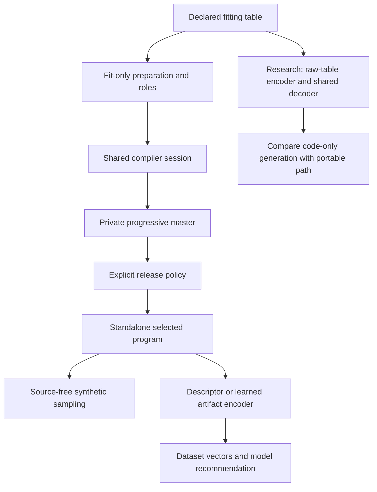

# Multi-level DOPE: consolidated implementation plan

**Status:** proposed engineering plan; no new runtime, trained weights, benchmark result or certification is introduced by this document.

**Date:** 22 October 2026.

**Base reviewed:** `main` at `098702ae9fb6dd9be198f95e36026c621d3b67f8`.

**Related work:** [PR #308](https://github.com/neverhuman/dope/pull/308), reviewed while open at `65b1d2a66fe49a1a077b0bf4c3aba3fb1108ce09`.

This is the implementation handoff after reconciling the three supplied proposals. It supersedes their conflicting recommendations for this workstream, not existing repository contracts. Follow [AGENTS.md](../../AGENTS.md), [architecture](../architecture.md), [testing](../testing.md), [data contract](../data-contract.md) and [claims policy](../claims-policy.md). Every implementation ticket below has a measurable completion condition.

## 1. Product decision

Build toward two related capabilities:

1. **One compilation session, independently releasable generators.** Share intake, splits, fitted state, teacher work and caches; produce low, medium, high and ultra programs. Each higher level considers carrying forward the lower program. The user chooses which standalone files and derived outputs leave.
2. **One shared learned encoder, multiple useful dataset vectors.** First encode only the authorized released program(s), using one set of pretrained weights. Train every supported vector width and available-level mask explicitly. Separately test the original longer-term goal: encode a raw table once into multiple compact codes from which a shared decoder generates synthetic data.

The portable progressive compiler is the first product path because it builds directly on the existing engine and preserves source-free sampling without a large shared checkpoint. The raw-table neural generator remains a first-class research path with a prototype ticket and a promotion gate. It must not be silently substituted by a per-table optimizer and called single-inference foundation encoding.

The primary goal is **what independent models learn from synthetic data when tested on real data, with faithful drivers**. Dataset recommendation, comparison and drift detection are separate representation goals. Neither reconstruction loss nor an attractive embedding plot establishes these outcomes.

## 2. Reconciliation of the supplied plans

| Input | Keep | Revise or reject |
| --- | --- | --- |
| `progressive-tiers-and-embeddings.md` | Shared compilation, residual stages, learned artifact encoder, explicit external evidence | A safetensors file cannot be safely released by arbitrary byte truncation; one binding-family standard error is insufficient; a fixed empirical privacy threshold is not a release certificate |
| `dope-levels-spec.md` | Carry/replace bootstrap, standalone release isolation, deterministic descriptor, source-lineage splits, progressive rollout | Do not delete #308's interfaces before integration; do not call a mixture zero-byte; resolve standalone versus bundle caps consistently; supplied probe measurements need reproducible receipts |
| `DOPE_Multilevel_Encoding_Engineering_Spec(1).md` | Split-first preprocessing, explicit information accounting, conditional export rules, joint generation/transfer/driver objectives, native deployment | Do not replace the proven portable compiler with an unqualified shared decoder; nested prefixes do not gain information through concatenation; a new gated scalar with an arbitrary saturation cap should not replace existing KPI contracts |

Input SHA-256 digests, for provenance rather than claims of published availability:

| Input | SHA-256 |
| --- | --- |
| Progressive proposal | `3170c682ce654217fdbc96458ea19b7362116be3d1cc24b689cd45a82f0a1ce7` |
| Levels proposal | `edb9c7a43f2b415a2765271b3bccd6057aa9a67a24c4a15c86daa4a6ad369554` |
| Multilevel neural proposal | `f26d193af0a3cf2fae71b1dd2dcc9c2aa972526ee4955ad13cd112df5dee4b94` |

### Resolved disagreements

- Use **level**, not certification tier, in new code and documentation.
- Canonical names: `low`, `medium`, `high`, `ultra`; accept `med` as an input alias.
- Generator caps start at **2/4/16/64 KiB**. A **256 KiB ultra** is an explicit research sweep, not a second undocumented default.
- `all` selects available outputs; it is not an alias for a quality guarantee or implicit permission to export ultra.
- Every level's default release is a **standalone generator**, including ultra. The private master bundle has a separate size report/cap.
- Progressive refinement is a logical dependency between layers, not a claim that each original file byte prefix is a valid safetensors file.
- Preserve old defaults and old formats. Make any default change a separate, measured release decision.
- Train internal neural models in a bounded research area; ship native Rust inference and signed packages.
- Do not promise no regret on final test data. Enforce a conservative internal acceptance policy and measure actual external regressions.
- Do not promise that all-level embeddings beat a single high-level embedding. Require matched-byte and matched-compute ablations.

## 3. Verified baseline and evidence limits

The active product is the standalone Rust workspace in `engine/`. Its compiler stores a schema, marginals, dependence/regimes, a small conditional network, oblivious trees and calibrated noise. The current `dope encode` command produces ML-ready **rows**; it does not produce the new learned dataset vector. Keep that command's meaning.

Main does not yet contain #308's named presets, `fit-tiers` builder or Elo reducer. At the reviewed head, #308's `fit-tiers` loops over three separate `fit` calls. Those artifacts are dataset/target-specific generators, not cross-dataset pretrained weights. Recheck #308 before implementation and reuse its merged code without importing the unrelated release/ranking diff into this plan PR.

The committed confirmation ledger gives the following development summaries, recomputed from `bench/real-world/results/confirm/records.jsonl` as median across tables of within-table seed medians:

| Byte cap | Tables | Median robust retention | Median actual file bytes |
| --- | ---: | ---: | ---: |
| 2 KiB | 16 | 0.905120 | 2,029 |
| 4 KiB | 16 | 0.909096 | 3,912 |
| 8 KiB | 16 | 0.939253 | 4,418 |
| 16 KiB | 16 | 0.933073 | 5,840.5 |
| 64 KiB | 16 | 0.929639 | 9,842.5 |

These are **selection-exposed development results**, not sealed evidence, new benchmarks or proof of a modeling diagnosis. They motivate testing capacity and selection improvements; merely increasing a byte cap has not reliably increased aggregate retention here.

The proposals' additional nine-table probes, conditional-compression savings and sample-mixture gains are **unreproduced input claims**. Their scripts and authenticated raw receipts are not among the three supplied Markdown attachments. Ticket P00 must reproduce or replace them before they influence a default. In particular, `compressed(A+B)-compressed(A)` is not a measurement of a separately decodable conditional layer, nor a guaranteed nonnegative coding cost.

Concrete implementation issue: `compile::fit` calls `schema::infer` before splitting its input into internal fit/validation roles, and `Ctx::marginals` uses `self.rows`, including internal validation. Target-associated category ordering and fitted numeric transforms therefore are not independent of the internal self-audit's validation rows. This does **not** establish that an external benchmark test file was used. Fix the new path's role isolation and retain old results under their original identities.

## 4. Controls: three different kinds of size

| Control | Constrains | Example |
| --- | --- | --- |
| Generator level/cap | Complete dataset-specific released sampling payload | Medium at 4 KiB, including schema and framing |
| Embedding width | Coordinates in a dataset representation | 64/128/256/512, trained at every width |
| Shared model capacity | Parameters/checkpoint bytes/FLOPs of encoder or decoder | Measured starter network, then larger scaling variants |

Never equate these. A large shared encoder may produce a short vector. A tiny vector may require a large shared decoder. A higher capacity preset is not a promised quality or privacy level.

Retain #308's `--size` and `--budget` behavior when integrating with it. Add `--level` for progressive compilation rather than silently changing `--size large` into an embedding-width request. Reject ambiguous combinations and print the resolved caps in reports.

## 5. System architecture



The master and private diagnostics never become automatic outputs beside a low-only release. The artifact encoder accepts released bytes, not an unrestricted compiler context. The research raw-table encoder has its own input/export identity and cannot masquerade as artifact-derived encoding.

## 6. Invariants and release semantics

1. **Standalone fidelity:** decoding a standalone release gives the same effective generator as selecting that level from the master.
2. **Isolation:** a standalone medium object includes only what its effective generator needs. It excludes unused upper layers, upper audit values, private reports and encoder context.
3. **Lower-output stability:** in greedy mode, requesting additional upper levels does not change the lower-level artifact. Per-level seeds, cache keys and preparation must enforce this.
4. **Exact caps:** count complete serialized release bytes, including names, labels, transforms, quantizer state and framing. Count each distinct release separately, and the master separately.
5. **Stored-code fidelity:** retain original quantized codes so extraction/re-encoding does not drift by requantizing decoded floating-point values.
6. **Carry is feasible:** higher caps include the preceding effective program as a candidate; any retagging/framing overhead is measured. If even carry cannot fit a requested representation, return an explicit size failure.
7. **No external monotonicity claim:** acceptance controls internal selection risk, not unseen-test performance. Publish adjacent-level regressions and uncertainty.
8. **No raw-context sampler dependency:** a recipient samples using the release and declared shared closure only.
9. **Historical compatibility:** old format-1/DPK readers and historical receipt semantics stay intact.
10. **No untrained learned output:** deterministic descriptors and random parity fixtures are labeled as such; neither is a trained universal encoder.

Low, medium, high and ultra are **program choices**. A higher program may replace a lower one rather than literally contain its parameters. The private bundle may retain that trajectory; the standalone highest program need not. Such a trajectory can be useful to a learned model, but all of its retained dataset-dependent bytes must be charged and authorized.

If low cannot fit the schema floor, report low as unavailable with a safe numeric size estimate. Continue only when the caller requested higher feasible levels. Do not silently emit a higher-rate object under the low name.

## 7. Data preparation and role isolation

Add `PreparedFit` and explicit row-role manifests before changing fitting behavior:

- Resolve the declared target before canonical target-last conversion; never infer it from the last raw source column.
- Preserve original physical row identities, source digest and feature roster privately.
- Split by entity/group/time when declared; use deterministic random/stratified roles otherwise. Entity and time-role metadata must not become predictors.
- Fit types, transforms, vocabularies, category target ordering, missingness, screening, marginals and sketches on the permitted fitting role only.
- Use selection role A for candidate search/early stopping. Keep upgrade-confirmation roles B separate from those decisions. Keep final external query/test data unavailable to the compiler.
- Use cross-fitted calibration or a separate calibration role for residual noise/temperature; do not repeatedly tune against a final confirmation partition.
- A no-target distribution representation needs its own target-free preprocessing. Removing target tensors after target-aware category ordering is insufficient.
- Validate requested task, minimum rows, class coverage, target constancy and finite values. Unsupported small-data configurations abstain rather than fabricate stable estimates.

For the new path, compare all baselines using the **same clean preparation policy**. Preserve the old fitting path as a historical compatibility profile until a documented new default is qualified. The comparison against old behavior is a separate diagnostic, not a clean architecture ablation.

## 8. One compiler session and progressive candidates

### 8.1 State and cache refactor

Extract `prepare`, `fit_budget` and `finish_report` behind the existing `fit` facade. Initially preserve legacy behavior byte-for-byte using fixed fixture hashes. Then add the clean split-first profile for new levels.

`PreparedFit` owns schema/data, roles, fit-only marginals, driver order, dependence candidates, audit references and optional cross-fitted teacher. A session reuses them across levels. Keep private diagnostic reports separate from exported artifact metadata.

Cache keys must include all behavior-changing inputs: preparation identity, role IDs, plan, training seed, optimizer/teacher recipe, bit allocation tolerance, base-program digest and explicit boosting shape. Today forest depth and training settings depend on budget; a cache keyed only by `(inputs, hidden)` cannot safely reuse forests across all budgets. Reuse immutable network training where valid; extend or invalidate boosting caches explicitly.

### 8.2 Candidate sequence

Implement in this order:

| Candidate | Mechanism | First enabled |
| --- | --- | --- |
| Base | Existing allocator under low cap | Bootstrap |
| Carry | Previous decoded generator, unchanged | Bootstrap |
| Replace | Existing allocator under the current cap, shared valid caches | Bootstrap |
| Extend | Continue forest against decoded base outputs; refit calibration | After continuation parity |
| Stack | Residual network plus trees on a fixed base margin | After offset trainer/sampler parity |
| Covariates | Measured marginal/dependence/regime refinements | After format/PSD/marginal tests |
| Mixture | Sample from retained generators with explicit weights | Research only until semantics and bytes are qualified |

Deduplicate identical serialized candidates. Start with a bounded set: carry, up to three replace reserve shares, and up to three refinement reserve shares. More candidates increase both compute and selection exposure. Record the full nominated candidate set, not just its winner.

Fit every candidate against the **decoded quantized** preceding program. Quantization error belongs in residual targets and validation. Noise/temperature must describe the combined model, not only its last stage.

### 8.3 Acceptance

Choose one challenger on A. Require its A score to be no worse than carry under the same families, seeds and recipe. Confirm only that challenger on the level's preassigned B role with paired losses. Evaluate all required families; a test of only the currently binding family can miss harm to another family.

Use paired candidate-minus-carry loss differences, with uncertainty respecting entity/time clusters and synthetic/auditor randomness. Freeze an internal practical margin and simultaneous family rule on development sources. A provisional 0.002 retention-equivalent margin is a tunable heuristic, not a significance certificate. Record raw differences, intervals, informative-family state and the decision.

Do not recycle one B partition adaptively for arbitrary search across levels. Options are preassigned per-level B folds, bounded cross-fitting with explicit selection-exposure accounting, or conservative carry when there is insufficient independent evidence. A B result cannot select another challenger after rejection. None of these internal guards replaces the final external campaign.

All claimed “no regression” properties must say **which score and which data**. Exact equality from carry is a property; improved future test performance is an empirical question.

## 9. Progressive container and safe extraction

Keep format 1 unchanged. Introduce a distinct versioned layered safetensors container after a codec spike, with at most four level records and a canonical level/operation order.

Recommended initial records:

- A complete base program with stored codes.
- `carry` or complete `replace` on the inherited schema for the first working release.
- Later: `forest.extend`, `stack`, `noise`, `marg.refine`, `dep.grow|dep.set`, `reg.split|reg.set`.
- A carry/replace record is exclusive. Noise/calibration update is required after a conditional-model change. Every operation declares its required parent identity and section lengths.

Use full SHA-256 parent/chain identities, binding all relevant prior bytes and codec version. Hashes provide integrity, not authentication. Restrict all dimensions and aggregate allocation before constructing arrays.

### Standalone versus bundle

`release(master, level, Standalone)` materializes the selected effective program and writes its complete stored-code representation. It must match the compiler's cap-checked standalone bytes. `release(..., Bundle)` retains only the authorized logical layers, then rewrites the safetensors header and length table. It must not copy an original header that still indexes removed data.

Do not use OS file truncation as release. Safetensors offsets/header and compressed streams have structural constraints. Only complete logical layers may be retained. Stripping high from a compressed stream containing all levels is not safe merely because high bytes appear last after decompression.

Bundle cap is a separate optional `master_budget`; it is not the standalone ultra cap. If a master exceeds its cap, report a master failure or store only requested standalone releases. Never silently charge only the newest layer while a recipient needs every preceding layer.

### Compression spike

Try independently compressed layers first. Test custom-dictionary brotli on the exact locked versions with a native encoder/decoder round trip, bounded dictionary memory and an actual saved-file comparison. A lower-layer dictionary must use only prior authorized bytes; no upper-level data may prime a lower stream.

Ship conditional coding only if real bytes, reader support and resource limits justify it. Keep a codec identifier and a no-dictionary fallback. Public shared dictionaries are a later experiment: license/audit their source corpus, hash them, and count them in closure bytes.

### Admission limits

Preserve current format-1 limits. Define separate versioned format-2 limits for total stored/inflated bytes, metadata, sections, layers, operations, stages, features, knots, regimes and total materialization. Use checked arithmetic, exact length sums and bounded varints. Reject unknown operations, unknown dictionaries, duplicate sections, invalid references, trailing data, unsupported shapes and decompression bombs before allocation. Avoid raising limits merely to make an experiment pass.

Test carry and identical effective programs at multiple named levels. Deterministic re-encoding applies to canonical writer outputs, not arbitrary third-party safetensors serializations.

## 10. Accuracy improvements that earn additional bytes

Each is default-off until a paired development ablation supports it:

1. **Cross-fitted teacher.** Fit a bounded tree/MLP ensemble on fit folds; produce out-of-fold targets; blend hard and soft labels. Select blend using true-label A loss. Keep calibration on true labels. An external OOF file requires row/role provenance; a filename is not proof of OOF generation.
2. **Residual stages.** Offset-aware AdamW/variable-projection readout and boosting; consistent regression, binary soft labels and multiclass probability targets. Zero offsets must reproduce the old trainer.
3. **Higher-level boosting.** Explicit shape rather than hidden budget coupling; test deeper trees, learning-rate floors, quantization-aware updates and sufficient patience at equal compute.
4. **Categorical/indicator structure.** Declared one-hot groups preserve exclusivity. Automatically inferred groups require validation and an explicit policy; empirical near-exclusivity is not a domain constraint or causal truth.
5. **Covariate expressivity.** Nested monotone quantile refinements, decoded-factor growth, PSD correlation correction, conditional missingness and richer regimes. Evaluate mixture-of-factor-analyzers only if simpler upgrades leave a demonstrated gap.
6. **Conditional/tail fidelity.** Preserve useful heavy-tail signals and calibrated heteroscedastic noise. Measure subgroup/tail transfer rather than improving average likelihood alone.
7. **Optimization experiments.** Test quantization-aware fine-tuning, multi-start and variable-projection second-order methods. Do not assume second-order methods beat AdamW on every task; use equal-time controls.

Fix the sign convention for teacher weight: `soft_target=(1-alpha)*hard+alpha*teacher`, with `alpha=0` meaning no distillation. Both input proposals used different conventions; use this one throughout code, manifests and CLI.

Mixtures are not zero-byte: weights, component identities, component state and sampler semantics count. A generator mixture's conditional prediction generally is not the top component's prediction or a constant-weight mean. Keep mixtures research-only until `sample`, `predict`, `eval`, `inspect` and descriptors have coherent semantics, or explicitly refuse unsupported prediction. Never score one effective generator while sampling another.

## 11. Artifact-derived encodings: useful baseline first

Add `dope embed` without changing row-oriented `dope encode`. First ship a deterministic **descriptor**, computed entirely from the authorized released bytes and fixed public probe seeds. It is a baseline and tokenizer, not pretrained deep learning.

Starter descriptor layout:

| Component | Shape | Information |
| --- | --- | --- |
| Global | 128 floats | Task/shape, marginal summaries, missingness, dependence/regimes, conditional-model structure and sampled behavior |
| Column | 32 floats per feature | Type, model-space quantiles/frequencies, missingness, program reliance and stage participation |
| Target | 32 floats | Task/prior/noise and conditional behavior |
| Multi-level view | Masked global blocks plus declared differences | Retained resolution trajectory, only from levels actually supplied |

Specify every index, normalization, unavailable-value mask and reserved zero in a versioned layout JSON before implementation. Do not infer stability or scale comparability merely from a fixed dimension. Compute expensive features such as effective rank with explicit time/memory bounds on wide tables.

No raw row count, original-unit extrema, self-audit result, fitting time or source digest may enter a descriptor unless it is already present in the authorized release or separately authorized metadata. `dope embed FILE` must work with the file alone. Program reliance estimated on generated probes is not real-data driver fidelity.

Use a fixed CPU path for byte-identical descriptor fixtures. Device-dependent approximate descriptors have a different mode and numeric parity contract. Names and category strings are excluded by default, but exclusion does not make derived numeric vectors private.

## 12. Shared learned artifact encoder

Use one pretrained network over released program tokens, generated probe rows and descriptor features. The same weights serve single-level and multi-level inputs.

Starter research architecture:

- Native typed tokenizer: structural column tokens, program token and bounded generated row-cell tokens.
- Axial feature attention plus induced row attention, width 256, eight heads, eight blocks and 32 inducing slots as an initial experiment.
- Pooling readouts for table vectors and 128-dimensional column vectors.
- Table output 512 coordinates; explicitly train normalized prefixes of 64/128/256/512.
- Masked multi-level fusion readout trained with level dropout. Full model parameter count, FLOPs and memory are measured from the implementation, not asserted from a rough architecture description.

### One forward pass must not leak higher levels

A shared trunk attending to every level can contaminate its low readout with high input. Producing a tensor named low and discarding the high output does not solve this.

Use independent per-level token processing with shared weights, or a level-causal attention mask where a level may read only authorized dependencies. The all-level fusion head is distinct. Poison/remove upper tokens and require lower outputs to remain unchanged. Local feature normalization and token statistics must obey the same mask.

If a standalone high program lacks lower compilation history, its input differs from a high prefix of the private trajectory. Declare `input_mode=standalone|trajectory`, train both modes, and test their relationship. Never fabricate absent lower descriptors from hidden compiler state. Missing views have explicit masks, never plausible zero-valued codes.

### Does all add information?

There are two different cases:

- If shorter neural vectors are exact prefixes of the longest vector, concatenating them cannot add dataset information. Compare a larger head on the long vector before attributing gains to multiple resolutions.
- If the bundle retains earlier programs that a later replacement discarded, the trajectory can contain additional algorithm-dependent information. Its extra bytes are real and must be counted. Compare fusion with an equal-byte single representation and with the highest program alone.

Useful multi-level computation is a hypothesis. Promote fusion only after it improves held-out-lineage recommendation/representation metrics beyond matched controls.

## 13. Direct raw-table encoding and shared generative decoder

This research path addresses the user's original single-inference vision directly:

`raw fit table -> frozen shared encoder -> permitted dataset code -> frozen shared decoder -> synthetic rows`.

Prototype a target-free distribution tower and target-conditioned task tower. One coordinated encoding produces explicitly trained coarse/fine blocks. Suggested experimental generation-code widths are 256/1,024/4,096 coordinates; ultra adds a 1,024-coordinate specialty residual. These are hypotheses about **code capacity**, separate from the artifact encoder's 64/128/256/512 representation widths and from complete generator byte caps.

Train the selected-code decoder with no raw-context bypass: it may see only the code, charged schema/transforms/adapters, noise and shared weights. A mixed-type diffusion teacher is a reasonable initial quality experiment; compare a simpler latent generator as a compute control. “One inference” refers to table encoding, not a claim that denoising or sampling takes one step.

For exact nested codes, all ordinary views contain no more information than high. A true ultra needs an additional residual or independently useful heads. It must beat both high and an equal-byte wider single code. If it does not, expose ordinary views without claiming a better ultra encoder.

Prototype this path before committing large pretraining compute. Promotion requires:

1. Code-only source-free generation with complete schema/adapter accounting.
2. Better prospective transfer/driver frontier or accuracy-first quality at declared resources.
3. Explicit cold closure and amortized checkpoint costs.
4. No material regressions in lower levels and independently useful task/distribution vectors.
5. Native inference parity and supported hardware evidence.

Keep frozen/no-local-update and adaptation modes distinct. A successful per-table fine-tuned model is not evidence for frozen one-pass encoding. A learned compile proposer may guide the portable compiler in the meantime, but cannot bypass its audits or be labeled a foundation generator.

## 14. Training objectives and optimization

### Artifact encoder

Train auxiliary objectives at **every supported prefix width**:

- Same-task/refit consistency with independent row-subsample views.
- Model-profile prediction and pairwise/listwise ranking, with missing-run masks.
- Measured regret of choosing a model/configuration.
- Per-level transfer/driver prediction with calibrated uncertainty.
- Column reliance/interaction prediction, masking unstable real-reference targets.
- Masked structural-token reconstruction and controlled distribution/task perturbation sensitivity.

Do not use source-name identification as the sole contrastive task. Exclude near-duplicate lineage mates from ordinary negatives; changed targets are explicitly modeled tasks, not accidental false positives or arbitrary hard negatives. Same-task retrieval alone is insufficient evidence of broader useful similarity.

Model/profile labels are obtained on **inner evaluation partitions of meta-training sources**. Calling a partition test does not make it safe to use the final meta-test source for a training label. External final sources never enter pretraining, loss targets, normalization or checkpoint selection.

### Direct generator

Use normalized mixed-type generation loss plus transfer, driver, representation/profile, consistency and measured rate terms. A differentiable transfer surrogate can train ridge/logistic/small-MLP auditors on generated rows and score them on inner real validation. Tree training is an exact external evaluation/selection signal, not automatically differentiable.

A utility critic may help training but must not certify its own outputs. Periodically validate it against exact independent tree/neural auditors. Ground driver promotion in actual synthetic-trained models on real query rows, not teacher attribution matching alone.

### Starter recipe and scale gate

AdamW starter: learning rate `3e-4`, betas `(0.9,0.95)`, epsilon `1e-8`, matrix weight decay `0.05`, no decay on biases/norm scales; BF16 where supported with FP32 sensitive reductions/master state; clip global gradient norm at `1.0`; 2% warmup then cosine decay to 10% of peak. Effective batch initially 128 dataset episodes, bucketed by shape. EMA `0.999` is an ablation.

Begin with fixed normalized loss weights. Log unweighted losses, gradients, clipping and uncertainty; test learned uncertainty weighting or gradient balancing only if there is a measured conflict. The optimizer and coefficients are starting experiments, not established best settings.

Checkpoint selection uses meta-validation recommendation regret and actual transfer/driver evidence, not reconstruction alone. Compare roughly 5M and 20M parameter models first, measured from code. Consider larger models only if independent-lineage gains justify their compute. Changing width, data, optimizer and objective simultaneously makes attribution impossible; use staged ablations.

Use the Rust tokenizer for artifact-model training inputs, or a golden-conformant Python tokenizer with checked identities. Export a restricted native-supported graph and safetensors weights. A tiny random checkpoint is only a parity fixture; trained weight publication requires the actual corpus/recipe/evaluation model card.

## 15. Corpus, lineage, schedules and cost

Begin with a rights-cleared development pilot, then scale toward thousands of independent sources. Register source URL/version, license, training/redistribution rights, raw digest, declared target, physical entities/time semantics, schema, lineage and split role.

Group exact duplicates and known mirrors before meta-train/validation/test splitting. Near-duplicate detectors, schema similarity and descriptor cosine are candidate-review signals; identical schema or a high cosine alone must not automatically union unrelated sources. Record the reason for every lineage merge and audit suspicious cross-split neighbors.

Provisional family allocation: 70% training, 15% validation, 15% final; freeze the actual roster after applicability/power analysis. Keep every target swap, subset and transformed copy within its source lineage. Additional task views do not increase independent evaluation sample size.

Mix real-source tasks with seeded structural-prior tasks: nonlinear mechanisms, thresholds, XOR, heavy tails, heteroscedasticity, skew, rare groups, correlated proxies and MCAR/MAR missingness. Structural-parent labels are ground truth only for their artificial generating systems; they are not causal labels for arbitrary real datasets. Start near 50/50 real/prior episodes and validate the mixture.

Resumable jobs write one immutable receipt per exact cell ID under ignored `target/levels/<campaign>/<shard>/`; one writer per shard. IDs bind source/target/roles, preparation, method/configuration, fit/sample/auditor seeds, binary/checkpoint and protocol. Atomic merge rejects conflicting duplicate receipts. Explicit schedules preserve wholly missing jobs. Retries cannot replace failed outcomes invisibly.

Cache exact model/reference labels only under full split/recipe identities. Keep raw data, private provenance, checkpoints and large samples out of Git. Commit manifests, schemas, small fixtures and admitted summaries.

Do not inherit the proposals' CPU-hour estimates as budgets. Measure at least a shape-stratified pilot and estimate total training plus audit cost from observed episode/cell throughput. Track cells/s, CPU/GPU memory, I/O, exact-auditor time and checkpoint cost. Set explicit wall/compute caps before scale-up; merging infrastructure does not launch the campaign.

## 16. Quality, drivers and Elo

### Predictive transfer

Preserve the metric definitions in [docs/metric.md](../metric.md):

```math
R_m=(L_0-L_{S,m})/(L_0-L_{R,m}).
```

Use original-unit squared error for primary regression and log-loss for classification. Store raw negative and above-one retention. Determine informativeness from real-reference evidence, not the candidate's result. For threshold inference use paired harm:

```math
h_i=\ell_{S,i}-\tau\ell_{R,i}-(1-\tau)\ell_{0,i}.
```

The unfrozen successor's calibration and multiplicity fields remain unresolved until its own workflow completes. This plan does not fill them or reinterpret historical receipts.

Keep the historical linear/CatBoost/MLP panel for compatibility. Add a separately versioned expanded panel with admitted CatBoost, XGBoost, LightGBM, linear and neural recipes. Group related tree models into one family; publish every member's scores as well as family aggregates. Foundation auditors require pinned weights/licenses/limits and a suitable no-information prior null; report a separate qualified track before adding them to a headline family.

Select the leading model set from **real selection data**, not final-test rankings. Give real-trained and synthetic-trained auditors the same frozen recipe or the same declared tuning allowance. Fix synthetic count, initially 1x real fit rows, with 0.25x/4x sensitivities. Account for search and adaptation costs.

### Driver fidelity

Implement grouped permutation importance on the same held-out real rows and paired perturbation seeds. Rejoin one-hot columns and missing indicators with their original feature. Report raw mass/rank/stable-direction/interaction components, real-real reproducibility ceilings, normalized values and eligibility.

Use a declared conditional/group perturbation method for correlated features; simple quantile-bin permutation is an approximation that needs sensitivity checks. Unstable real-real ceilings or missing required interactions cannot become passing D80 evidence through division or omission. A self-audit with only mass/rank is a **proxy**, not the complete driver gate.

Driver agreement concerns model behavior under an estimator. It does not prove causal importance. Reuse the existing Rust metric implementation and shared goldens rather than creating subtly different Python/engine definitions.

### Three reporting tracks

| Track | Primary question | Report |
| --- | --- | --- |
| Accuracy-first quality | What is the best synthetic-to-real transfer under the declared generous resource envelope while passing drivers? | Predictive retention, driver coverage, paired losses, tail harm and quality Elo |
| Compression | How few dataset-specific bytes achieve useful transfer and drivers? | Prospective frontier, qualified TDL where applicable, BTR-AUC successor and compression Elo |
| Representation | Do vectors recommend models and compare tasks usefully? | Recommendation regret, learning-curve/profile error, retrieval/shift tests and per-width results |

Preserve #308's BTR-AUC v1 and historical descriptive envelope unchanged. Its 1 KiB–64 MiB grid is not the same as the TDL grid. New prospective selection nominates one configuration per method/budget using validation only; no test-time oracle envelope.

For quality Elo, first apply the same declared driver/applicability rules across methods. A measured driver failure is a failed quality gate, not a dropped favorable subset. Missing jobs are incomplete, not wins or implicit zeroes. Publish predictive-only rankings beside gated outcomes. Fix the pairwise win/draw policy, prior and opponent roster before final testing.

Reuse batch Bradley–Terry on the 400-point Elo scale, centered at 1500 when compatible with #308. Assign one total weight per independent source lineage, aggregating its tasks under frozen weights. Bootstrap whole lineages with paired methods/seeds intact. Per-dataset ratings are local comparisons, not independent observations or portable global skill values.

Do not optimize a weighted mixture of Elo, drivers and bytes that lets one failed constraint be rescued by another. Publish absolute metrics, confidence intervals, completeness, failed/unsupported states and domains where the method loses.

### Planning targets, not results

- High median worst-family retention at least 0.95 on informative prospective development tasks.
- D80 coverage at least 90% of reference-stable applicable tasks.
- Adjacent-level test regression larger than 0.02 on at most 5% of applicable tasks.
- Multi-level learned representation lowers held-out-lineage recommendation regret against the strongest statistics/action/descriptor baseline.
- Ultra and fusion must show meaningful paired gains against matched-budget controls, not merely a higher point score.

Finalize effect sizes, margins and power from the pilot. Thousands of correlated task views do not establish the precision of thousands of independent sources. Report a statistically unresolved Elo lead as unresolved; never promise #1 on every dataset.

## 17. Export, privacy and version identity

Use private `LocalSession`/`LocalEncoding` types and an explicit `ReleasePolicy`; serialization and transport accept only an `ExportedArtifact`/`ExportedEncoding`. Do not derive unrestricted serialization/debugging for sensitive local tensors.

Release authorization applies to derived outputs too. High-conditioned synthetic rows, high-derived embeddings, upper audit reports and high-conditioned selection of a supposedly low sample batch can disclose upper-level information. A low-only export operation must use only its admitted low object, public shared model and public randomness for every released derivative.

The caller may authorize local high computation without authorizing transmission. Emit only requested files. No automatic master, raw-source digest or full catalog beside a low release. Keep rich catalogs/private source hashes in a separate explicitly requested private output.

Medium/high may encode information mathematically sufficient to derive a lower representation; flags cannot make deterministic functions of exported information secret. Changing flags later does not retract a previous export. Artifact-derived embedding adds no source information beyond the artifact **if the recipient already has those exact bytes and public weights**; exporting only an embedding still discloses derived data.

Evaluate empirical membership, copy/attribute and nearest-neighbor diagnostics with a predeclared protocol. Do not adopt a 0.05 distance-excess cutoff or iterative trimming as automatic privacy authorization. Small codes and synthetic data are not formal DP. Formal DP would require a separate accountant/training/neighbor definition and qualification workflow.

Every representation binds encoder checkpoint, tokenizer/preprocessing, layout, normalization, input mode, target inclusion and coordinate-space ID. Equal dimension does not imply compatible coordinates. Version these independently; reject mixed-space indexes unless an admitted alignment is supplied. Preserve exact previous weights and layouts for rollback.

Byte reports include:

```math
B_{payload}=B_{program/code}+B_{schema/transforms}+B_{adapters}+B_{framing},
\quad B_{closure}=B_{payload}+B_{shared\ sampler\ dependencies}.
```

Report actual sampling access, memory and latency separately. An encoder needed only at fitting is not a sampler dependency; a decoder opened by sampling is. Publish amortized costs only with explicit reuse count K and caching assumptions.

## 18. Proposed interfaces

All commands here are planned, not available because this document merged:

```bash
# Existing row encoding stays unchanged.
dope encode real.csv --model model.dope -o real-ml.csv

# Compile through high; write only high's standalone program.
dope fit train.csv -t price --level high -o high.dope

# One session, explicitly chosen releases; no automatic private master.
dope fit-levels train.csv -t price --release low,medium,high \
  --caps low=2KiB,medium=4KiB,high=16KiB,ultra=64KiB --out releases

# Private master is an explicit opt-in, separately capped and reported.
dope fit-levels train.csv -t price --release medium --out releases \
  --master private/master.dope --master-budget 128KiB

# Extract exactly a named standalone level without refitting.
dope release private/master.dope --level medium -o medium.dope

# Start with deterministic descriptors; trained encoder is explicit.
dope embed medium.dope --kind descriptor -o medium.descriptor.json
dope embed medium.dope --kind learned --weights encoder.safetensors \
  --dimensions 128 -o medium.embedding.safetensors

# All means views actually present in the explicitly supplied object.
dope embed authorized-master.dope --views all --kind learned \
  --weights encoder.safetensors -o master.embedding.safetensors
```

Keep `fit --budget` on the legacy format/profile by default. Define `--level`/`--caps`/`--budget` conflicts explicitly rather than relying on CLI declaration order. Preserve #308's `fit-tiers` behavior until an explicit migration; do not remove an unmerged API in an unrelated PR.

Core boundary:

```rust
pub enum Level { Low, Medium, High, Ultra }
pub struct LevelCaps { /* validated, strictly increasing whole-file caps */ }
pub struct PreparedFit { /* private role-aware fitted state */ }
pub struct CompileSession { /* caches, immutable preparation identity */ }
pub struct FittedLevels { /* private master and effective per-level states */ }
pub struct ReleasePolicy { /* levels, derivative kinds, metadata, caps */ }
pub struct ExportedArtifact { /* admitted bytes and safe metadata */ }

// Proposed signatures, implemented in the tickets below.
// prepare(raw, declared_target, split_options) -> PreparedFit
// CompileSession::fit_levels(prepared, fit_options, level_options) -> FittedLevels
// FittedLevels::release(policy) -> Vec<ExportedArtifact>
// describe(released_bytes, descriptor_options) -> Descriptor
// embed(released_bytes, admitted_weights, embedding_options) -> Embedding
```

The service/MCP wrapper calls the same core semantics through a thin native adapter or fixed-argument engine subprocess, without a shell. Reuse existing authorization, job limits, cancellation and isolation. JSON request fields include explicit output policy, target, modes, caps and checkpoint identity. Progress goes to stderr/events; machine result is a single schema-valid object. Unknown levels, incompatible weights, denied output and over-budget states return typed safe errors.

Do not broaden the historical `dope-kernel` MCP contract by changing the meaning of existing fields. Generated protocol/studio changes belong to the implementation ticket that adds the corresponding wire schema.

## 19. File and ownership map

Paths marked new are proposed. Recheck them against then-current main and #308. Existing historical inputs and generated result blocks are not manually rewritten.

| Area | Existing files to change | New files | Owner / proof route |
| --- | --- | --- | --- |
| Levels/options | `engine/dope-core/src/lib.rs`, `compile.rs`, #308 `budget.rs` when merged | `engine/dope-core/src/level.rs` | rust-core; `just engine` |
| Clean preparation | `compile.rs`, `schema.rs`, `compile/ctx.rs` | `compile/prepare.rs`, `compile/splits.rs` | rust-core; role/poison fixtures |
| Shared search/cache | `compile/ctx.rs`, `compile/allocate.rs`, `forest/boost.rs` | `compile/levels.rs`, `compile/accept.rs`, `compile/report.rs` | rust-core; legacy/level determinism |
| Container/extraction | `artifact.rs`, `artifact/container.rs`, `artifact/decode.rs`, `artifact/limits.rs` | `artifact/layers.rs`, `artifact/refine.rs` | rust-core; hostile/round-trip fixtures |
| Stages/teacher | `program.rs`, `target.rs`, `train.rs`, `train_cpu.rs`, `forest/boost.rs` | `compile/teacher.rs`, `compile/refine.rs` | rust-core; offset/OOF parity |
| Sampling | `sample.rs`, `sample_cpu.rs`, `sample/forest.rs` | Explicit generator dispatch only if mixtures qualify | rust-core; CPU/tensor/source-free proof |
| Covariates | `schema.rs`, `marginal.rs`, `copula.rs`, `regimes.rs` | Split modules as complexity requires | rust-core; support/PSD/group tests |
| Descriptor and embeddings | `lib.rs`, `engine/Cargo.toml`, lockfile | `engine/dope-core/src/embed/{mod,descriptor,tokens,levels,weights,model}.rs` | rust-core; determinism/export/parity |
| CLI | `engine/dope-cli/src/{args,main}.rs`, #308 `tiers.rs` when merged | `engine/dope-cli/src/{levels,release,embed}.rs` | rust-core; real binary smoke |
| Evaluation | `engine/dope-core/src/eval/{mod,audit,frontier}.rs`, `bench/real-world/{methods,run,auditors}.py` | Engine/bench driver adapters and versioned level campaign reducer | rust-core/external-evidence; existing metric goldens |
| Elo | #308 `bench/real-world/{elo,elo_math,render_elo}.py` when merged | Successor reducer only where needed | external-evidence; completeness/cluster fixtures |
| Corpus/training | Existing admitted corpus/transfer adapters | `research/levels/{corpus,jobs,embed,generative,configs,tests}/`, locked environment and README | external-evidence; no product import |
| Model registry | Existing model/deployment admission patterns | `models/registry/` manifests/cards, small parity fixtures | rust-core/governance; exact hash/graph/license |
| Schemas | Existing protocol generator, service and studio entrypoints after inspecting their current layout | `schemas/levels-fit-report-v1.schema.json`, `embedding-v1.schema.json`, `levels-campaign-result-v1.schema.json` | governance; generated snapshot/typecheck |
| User docs | `README.md`, `engine/README.md`, `docs/{cli,architecture,testing,release,privacy}.md` | `docs/levels.md`, `docs/embeddings.md`, `examples/levels/` | governance; claims/link/native example |
| Governance/CI | `agent/{owner-map,test-map}.json`, `agent/boundaries.toml`, `ops/ci/{engine,cpu,gpu}.sh`, `Justfile` | Budgeted manual training/evaluation workflow | Per current path authority; no automatic large campaign |

Keep artifact inference inside `engine/` and bounded training outside its runtime graph. A separate `dope-embed` crate is unnecessary for the pilot; extract it only when dependency isolation or reuse justifies the extra workspace member. Do not import the root research kernel into the engine for convenience.

## 20. Implementation tickets and completion gates

Each row is a reviewable implementation PR. A gate may reject an experimental default without blocking useful infrastructure.

| ID | Deliverable and concrete files | Completion condition |
| --- | --- | --- |
| P00 | Baseline inventory, raw probe receipts, `research/levels/probe/`, immutable source/input manifests | Reproduce committed summaries; supplied missing probes reproduced or explicitly retired; no new quality claim |
| P01 | Legacy golden guard; `engine/dope-core/tests/golden_v1.rs`, small fixed artifacts/hash manifest | Existing deterministic fits, decode, sampling and caps recorded before refactor |
| P02 | `compile/prepare.rs`, `compile/splits.rs`; explicit target/roles and new preparation identity | Validation-extreme/category and test-label poison tests pass; group/time disjointness enforced; old profile intact |
| P03 | `level.rs`; cap parser and interface migration with #308 | Aliases/units/conflicts/overflows tested; one canonical 2/4/16/64 KiB default |
| P04 | Codec spike and `artifact/layers.rs`; carry/replace, standalone and bundle extraction | Exact stored-code round trip; header/length/parent limits; each release cap and isolation proven |
| P05 | Shared `CompileSession`, cache keys and carry/replace `fit_levels` | One preparation/dependence pass; lower bytes independent of requested top; paired clean-profile baseline report |
| P06 | `compile/accept.rs`; A selection and bounded per-level B confirmation | All-family paired decisions, insufficient-evidence carry, no B-driven challenger search |
| P07 | CLI `fit-levels`, `release`, level-aware inspect/sample/eval | Real binary end-to-end; only requested outputs; private master explicit; atomic completion marker |
| P08 | `Program` stages and offset trainers/samplers; extend/stack ops | Zero-offset historical parity, multi-stage CPU/tensor parity, exact quantized residual fitting |
| P09 | Teacher/quantization/boosting improvements and covariate refinement ops | Individually measured equal-compute/byte ablations; no arbitrary all-on default |
| P10 | Deterministic descriptor and native tokenizer | Source-free operation, fixed layout/masks, upper-level poison isolation, bounded wide-table behavior |
| P11 | Expanded exact auditors, driver adapter and metric conformance | Historical definitions preserved; actual synthetic-trained driver receipts; missing components never pass |
| P12 | Prospective campaign/Elo and scheduled cells | No oracle selection; source-cluster uncertainty; all failure/missing states and opponent roster visible |
| P13 | Licensed corpus, lineage review, resumable label jobs | Independent source splits; strict role identities; estimate and enforce pilot compute caps |
| P14 | Learned artifact encoder training and matched-width/fusion ablations | Held-out-lineage regret/profile advantage beyond statistics, router-action and descriptor baselines |
| P15 | Native learned encoder, admitted checkpoint/graph, signed package integration | Tiny parity fixture plus actual trained-model parity; no Python/libtorch/helper runtime; explicit hardware support |
| P16 | Direct raw-table encoder and code-only shared decoder pilot | Frozen/adapt tracks distinguished; actual code/payload/closure measurements; no raw-context bypass |
| P17 | Learned compiler proposer/shared dictionary, if evidence warrants | Measured fit-time or transfer benefit; carry/audit retained; all shared dependencies charged |
| P18 | Documentation, model cards, freeze prospective final campaign and evaluate once | Current rosters/metrics/resources/weights fixed; headline wording supported by qualified evidence |
| P19 | Optional default flip and production release | Lower-level regressions, cost, compatibility and package gates satisfied; separate changelog/release decision |

### Dependency order

P00/P01 precede runtime changes. P02/P03/P04 enable P05/P06/P07. P08/P09 improve capacity after a working carry/replace baseline. P10/P13 enable P14/P15. P11/P12 provide the measurement foundation for every quality claim. P16 starts after the role/export/measurement interfaces and a small corpus exist, before a massive neural training investment. P17 is conditional. P18/P19 require the relevant prior gates.

The goal is not to merge all tickets without evidence. It is to make working outputs available early while testing the strongest model idea against an honest portable baseline.

## 21. Test matrix and required CI

| Test group | Required behaviors |
| --- | --- |
| Historical | Format-1/DPK readers, old receipts and legacy fixture outputs unchanged |
| Data roles | Target explicit; test-label poisoning; fit-only vocabulary/quantiles; entity/time overlap rejected |
| Levels | Caps actual; infeasible low explicit; carry exact; lower output independent of top; valid cache identity |
| Codec | Malformed lengths/varints/parents/ops/dtypes, decompression bombs, duplicate sections and aggregate allocation refused |
| Release | Standalone equals selected generator; no upper data in padding/streams/reports; nested extraction rewrites header correctly |
| Training | OOF provenance, true-label calibration, offset/soft-multiclass loss, quantized-base residuals, deterministic resume |
| Sampling | Native/tensor parity, conditional missingness/group support, source-free denied-network replay |
| Representation | Upper-token poison test, per-prefix supervision, absent-mask correctness, coordinate/version refusal, input-mode identities |
| Export | Only authorized files/derivatives/logs; no high-based sample selection under low policy; atomic cancellation |
| Metrics | Negative/above-one retention, weak gain, unstable ceilings, driver mismatch, family grouping and strict incomplete states |
| Ranking | Order-independent finite Elo, paired lineage bootstrap, missing schedule cells, conflicting duplicates and no test oracle |
| Deployment | Restricted graph admission, exact weights/license/hash identity, optimized native binary and actual supported device evidence |

Scientific sanity fixtures: pure noise, linear signal, XOR, correlated interchangeable predictors, rare impactful groups, heteroscedasticity, heavy tails, class imbalance and conditional missingness. These test behavior but do not qualify real-world superiority.

Add targeted fixtures to `engine/dope-core/tests/`, `engine/dope-cli/tests/`, benchmark tests and `research/levels/tests/` as the corresponding ticket lands. Update ownership/test maps for every new source area. Run `just engine`, the mapped proof commands, `just fast` while editing and `just check` before implementation commits; retain existing hosted required gates. Documentation-only changes run appropriate document/claims checks and the repository-required checks, reporting unavailable tooling honestly.

No large training run on ordinary PR CI. Use a manually dispatched, budgeted lane for training/evaluation and real hardware jobs for CUDA/Metal claims. Random tiny-model fixtures must not be the only evidence for a released trained checkpoint.

## 22. Experiments that decide the architecture

| Experiment | Essential controls | Decision |
| --- | --- | --- |
| Carry/refinement | Independent same-preparation fits; matched seeds/caps/compute | Does progressive selection reduce actual external regressions? |
| Teacher/optimizer | Hard labels and existing AdamW at equal resources | Is new training improving transfer rather than only stored loss? |
| Covariates | Existing regimes/copula; support/tail/missingness probes | Which added state earns its bytes? |
| Artifact encoding | Statistics, existing router-action embedding, descriptor and Dataset2Vec-style baseline | Is learned representation useful on independent source lineages? |
| Prefix training | High-only then truncate; explicitly trained widths | Do short vectors retain useful objectives? |
| Fusion | Highest alone, wider equal-byte code, independent heads, trajectory-aware model | Is all-level benefit more than duplication/extra capacity? |
| Raw-table generation | Portable path, modern admitted generative baselines, context-using ablation | Does a compact code work without hidden context? |
| Ultra | High, equal-byte wider-high, specialty residual | Does ultra add useful information? |
| Scale | More sources versus more parameters, equal processed cells | Where does additional compute help? |
| Quantization | FP32/FP16/INT8 and actual container bytes | Which precision preserves utility and native behavior? |

Freeze primary effects, independent units, draw margins, stopping rules and multiplicity before confirmation. Estimate sample size from source-level paired pilot variation, not seed count or synthetic rows. A very large bootstrap does not compensate for a small independent-source cohort.

## 23. What the implementing agent should do first

1. Read current repository instructions and recheck main/#308. Keep this design's level, embedding-width and checkpoint controls distinct.
2. Establish legacy fixtures and clean-preparation baseline before refactoring caches or measuring improvements.
3. Deliver carry/replace levels and isolated standalone release before residual/dictionary complexity.
4. Add descriptors, exact driver evaluation and prospective scheduled records before large learned-model training.
5. Train a small shared artifact encoder and a small direct-generator prototype; use matched controls to choose where to scale.
6. Promote only measured quality/representation gains. Preserve the portable baseline and explicit frozen/adapt identities.
7. Publish complete payload/closure bytes, tail failures, per-model drivers and source-lineage uncertainty with any ranking claim.

Completion means the user can select what leaves, obtain independently useful multi-level vectors, and measure what strong models learn from the resulting synthetic data. The single-inference neural path is complete only when frozen code-only generation is actually demonstrated; an infrastructure PR or per-table compilation does not establish it.
