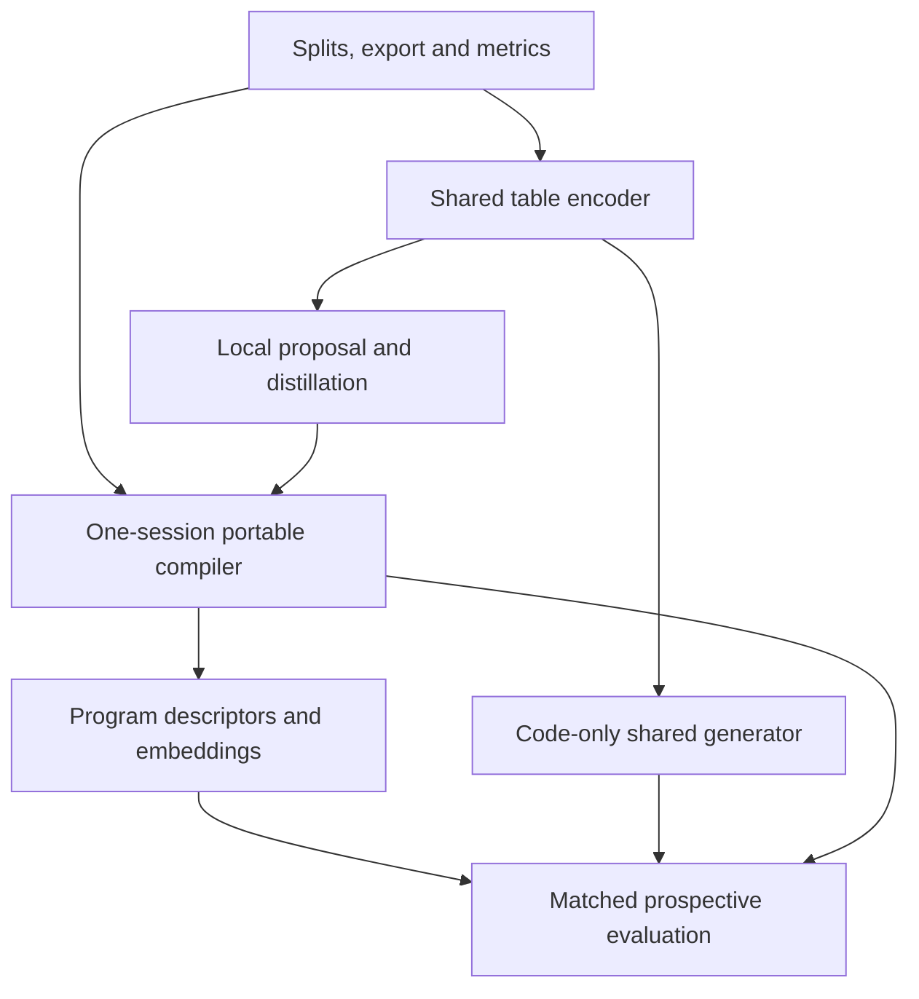

# DOPE multi-level encodings and transfer

**Consolidated engineering and research plan — 2026-10-22**

| Field | Value |
| --- | --- |
| Status | **`specified_unrun`**. Architecture, dimensions, schedules and promotion targets below are proposals, not measured improvements. |
| Reviewed base | `main` at [`098702ae9fb6dd9be198f95e36026c621d3b67f8`](https://github.com/neverhuman/dope/tree/098702ae9fb6dd9be198f95e36026c621d3b67f8) |
| Integration dependency | [PR #308](https://github.com/neverhuman/dope/pull/308), **open at review**, head `65b1d2a66fe49a1a077b0bf4c3aba3fb1108ce09`; its presets, parameter caps, tier CLI and Elo are not in this main snapshot. |
| This change | An implementation plan and a documentation index link. Runtime behavior, defaults, contracts, historical evidence and trained models are unchanged. |
| Implementation boundary | Native Rust product in `engine/`; bounded offline research under `research/levels/`; measured evidence in `bench/real-world/` and existing transfer infrastructure. |
| Primary outcome | Models trained on generated rows recover real-data predictive gain **and** feature-driver agreement on untouched real evaluation rows. |
| Secondary outcome | Useful dataset/task vectors for model selection, retrieval, learning-curve prediction and drift analysis. |

This is the canonical plan in [PR #310](https://github.com/neverhuman/dope/pull/310).
It incorporates the supplied final-plan review into the existing PR rather than creating
a second competing plan. Approval of this document establishes no benchmark result and
does not automatically launch training; implementation and evidence arrive through the tickets.

## Contents

1. [Decision and product contract](#1-decision-and-product-contract)
2. [Synthesis of the three inputs](#2-synthesis-of-the-three-inputs)
3. [Verified repository baseline](#3-verified-repository-baseline)
4. [Names, budgets and public interfaces](#4-names-budgets-and-public-interfaces)
5. [Data roles and evaluation integrity](#5-data-roles-and-evaluation-integrity)
6. [Export and custody boundary](#6-export-and-custody-boundary)
7. [One-session portable compiler](#7-one-session-portable-compiler)
8. [Portable quality and capacity](#8-portable-quality-and-capacity)
9. [Formats and exact accounting](#9-formats-and-exact-accounting)
10. [Artifact-derived representations](#10-artifact-derived-representations)
11. [Shared pretrained table encoder](#11-shared-pretrained-table-encoder)
12. [Shared generative decoder](#12-shared-generative-decoder)
13. [Losses, optimizer and training recipe](#13-losses-optimizer-and-training-recipe)
14. [Corpus and scaling](#14-corpus-and-scaling)
15. [Predictive transfer, drivers and rankings](#15-predictive-transfer-drivers-and-rankings)
16. [Experiments and promotion decisions](#16-experiments-and-promotion-decisions)
17. [File-by-file implementation map](#17-file-by-file-implementation-map)
18. [Ordered implementation tickets](#18-ordered-implementation-tickets)
19. [Acceptance tests and verification](#19-acceptance-tests-and-verification)
20. [Delivery, observability and documentation](#20-delivery-observability-and-documentation)
21. [Risks and explicit fallback decisions](#21-risks-and-explicit-fallback-decisions)
22. [References and evidence provenance](#22-references-and-evidence-provenance)
23. [Definition of complete](#23-definition-of-complete)

## 1. Decision and product contract

Build **one local session with explicitly releasable information levels**, and pursue a
**shared pretrained table encoder** as a first-class research track. Preserve DOPE's
compact native generator as the deployment baseline and as a destination for learned
proposals and distillation.

The three objects below have different information and execution contracts. Name them
in APIs, receipts and benchmark plots; otherwise an improvement to one can be mistaken
for an improvement to another.

| Object | Input and computation | What the recipient receives | Purpose |
| --- | --- | --- | --- |
| Portable program | A per-dataset compile session, with reusable preparation and audited candidates | A selected `.dope` program and the native runtime | Compact source-free generation |
| Program embedding | A deterministic descriptor or fixed-weight encoder of approved program bytes | A versioned vector, optionally the approved program | Dataset/task reasoning from already released information |
| Table code | One frozen cross-dataset encoder applied to authorized fitting rows | A selected code plus admitted schema; generation additionally needs a shared decoder | The user's one-inference learned-encoding objective |

Program embeddings cannot recover information already discarded by the program. A
one-session compiler still performs per-dataset fitting. Neither is a substitute for
proving that the shared table encoder works on new source families.

### 1.1 Answers to the original questions

**Can one model/session produce all levels?** Yes as a design goal. The portable path
shares preparation and fitting caches; the learned path shares a frozen encoder trunk
with trained multi-level readouts. Count the actual table scans, chunks, encoder passes,
adaptation steps and decoder steps. A single session is not a promise of a single matrix
operation or one-step diffusion sampling.

**Does low force different features from high?** A constrained bottleneck can prioritize
different structure. Train and evaluate every level explicitly. A high code truncated
after training has no reason to be a good low code. Smaller programs also need their own
selection objective; do not sacrifice them to make the upper level cheaper.

**Does combining low, medium and high create more information?** It depends on the
representation. If low and medium are exact prefixes of high, their concatenation is a
deterministic function of high and contains no additional dataset information. A different
downstream head might use it better; compare against an equally capable high-only head.
Independently fitted programs or independent neural heads may retain complementary
information. Compare their union at equal complete bytes, compute and selection effort.

**What should ultra mean?** Additional useful capacity, not a synonym for packaging
duplicates. Portable ultra is initially an experimental larger program budget. Learned
ultra adds a trained residual to high. A private bundle, an exported bundle and `all`
are separate concepts.

**Can the user decide what leaves?** Yes: a typed export allowlist applies to program
bytes, vectors, derived synthetic rows, recommendations and sidecars. Computing high
locally does not authorize a high-conditioned output under a low-only policy.

### 1.2 Execution strategy

Common contracts and honest measurement come first. Then run the portable and shared
encoder tracks in parallel; a successful program embedding is not a prerequisite for
starting the table encoder.



The first product milestone is honest multilevel portable fitting with exact standalone
exports. The central research milestone is a frozen table encoder whose codes preserve
transfer and improve model-selection regret on held-out source families. The deployment
choice is made from both payload and complete sampling-closure frontiers.

## 2. Synthesis of the three inputs

This document supersedes conflicting recommendations **for this proposed workstream**.
It does not override repository governance or freeze the candidate TDL protocol.

| Input | Keep | Correct or defer |
| --- | --- | --- |
| `DOPE_Multilevel_Encoding_Engineering_Spec.md` | Shared table encoder; nested codes; target-free/task spaces; code-only decoding; typed export; complete closure; rigorous ablations | Put progressive compiler delivery alongside the research path; avoid a new opaque weighted headline KPI; make current calibration/cache hazards explicit. |
| `progressive-tiers-and-embeddings.md` | Shared preparation; audited carry; target/covariate refinement; artifact encoder; learned local proposer | Do not alias `all` to 256 KiB ultra; avoid blanket monotonicity claims, arbitrary DCR trimming, mandatory dictionary coding and immediate binary-format commitments. |
| `dope-levels-spec.md` | Standalone selected releases; carry/replace alternatives; practical implementation tickets; per-level caches; deterministic descriptor | Base the PR on main, not #308; preserve legacy flags; split calibration cleanly; do not call mixture free; do not make ultra synonymous with a bundle; treat supplied probe numbers as unverified. |

The third input references `levels_probe.py` and `analyze_probe.py`. These scripts and
their raw receipts are not in the three attachments or the reviewed checkout. Its
nine-table gains, mixture wins and compression percentages are **supplied observations,
not independently reproduced evidence**. They motivate experiments E0/E3/E11, not
requirements or performance claims. Marginal compression estimates such as
`compressed(A+B)-compressed(A)` do not measure a valid framed conditional codec.

### Review corrections retained in this revision

The final review keeps the shared raw-table encoder alongside portable delivery, freezes
candidate training before confirmation, and delays a new wire format until actual new
generator semantics need it. Further corrections are normative below:

- `all` is exactly the ordinary three views; an uninformative score is never perfect utility.
- Freeze the complete candidate graph and its parent/recipe identities before reading any
  confirmation outcome. Confirmation cannot train or recalibrate a later residual.
- Feature-binding fixtures use equal marginal distributions with distinguishable rowwise
  features. Exactly duplicate observational columns cannot identify a unique causal driver.
- Test dataflow isolation, including attention, normalization, RNG and quantizer state;
  absence of a literal marker in an output file is insufficient.
- Authenticate model packages against an admitted trust root, not a digest supplied beside
  attacker-controlled weights. Reject path escapes, special files and unsafe writes.
- A driver-gated scoreboard still publishes failure/applicability coverage and raw results;
  missing comparisons cannot become wins or disappear into an advantageous cohort.

## 3. Verified repository baseline

Paths in this section are relative to the reviewed main commit. Pinned source links and
input digests are in section 22. New paths elsewhere are explicitly marked **new**.

| Area | Observed implementation | Consequence |
| --- | --- | --- |
| Product | `engine/` is a standalone Rust workspace; `rust/` is the research kernel | Keep the new customer fit/sample/embed runtime in `engine/`. |
| Compile | `engine/dope-core/src/compile.rs::fit`, `compile/allocate.rs`, `compile/ctx.rs` fit schema, marginals, dependence, target network, forest and noise | Share a local session; preserve the independently fitted candidate as a control. |
| Existing row encoding | `encode.rs::MlEncoder` encodes rows for ML | Keep `dope encode` semantics; introduce `dope embed` for dataset representations. |
| Artifact | `artifact.rs`, `artifact/container.rs`, `artifact/decode.rs` implement format 1: one U8 tensor containing a Brotli stream | Preserve this reader. New behavior uses explicit format dispatch. |
| Exact candidate evaluation | `compile/ctx.rs::assemble` serializes and decodes before returning a candidate | Preserve encode → decode → evaluate at every level. |
| Samplers | `sample.rs` and `sample_cpu.rs`; existing native/tensor parity fixtures | Both must implement any new target or covariate semantics. |
| Self-audit | `eval/audit.rs` uses fast linear and histogram-GBDT references | It is a selection heuristic, not external transfer certification. |
| Development benchmark | `bench/real-world/` has linear, CatBoost and MLP auditors and a public 16-table panel | Retain the panel for development; source-family generalization needs new frozen evidence. |
| Drivers | Definitions and conformance machinery exist in `docs/metric.md`, `rust/metrics/`, and `research/transfer/tdl/` | Add measured engine/benchmark integration; do not invent a competing driver definition. |
| Existing representation | `rust/embedding/part_01.rs` has a 4,168-dimensional action embedding and capability metadata | Include as an offline baseline; do not import the root kernel into the engine. |
| #308 only | `ModelSize`, parameter caps, `fit-tiers`, `budget.rs`, `tiers.rs`, `elo.py`, `elo_math.py` | Reuse after merge and re-audit; they are not files/APIs on this main snapshot. |

### 3.1 Correctness findings that shape the plan

1. `compile.rs` fits `schema::infer` before its internal row split, and estimates missing
   rates using the internal fit/validation union after working-set filtering/truncation.
   `Ctx::marginals` also reads that union.
2. Network early stopping, bit allocation, regression residual calibration and
   classification temperature fitting reuse internal validation rows; self-audit uses
   those rows again to select candidates. Moving schema inference alone is insufficient.
3. Current network and boost caches use `(inputs, hidden)` while depth, tree count,
   learning rate and patience depend on the fit budget. Those keys are insufficient once
   a context is reused across budgets or base predictors.
4. `Program::impute` derives missing-value replacements from current marginals. A marginal
   replacement can change an earlier stage's predictions without changing its weights.
5. `SelfAudit` builds real/reference matrices from its first program's `MlEncoder` and
   synthetic matrices from each candidate. Schema/group/missing-indicator changes require
   a new reference identity or a fixed candidate-independent evaluator representation.
6. `SelfAudit::retention` returns `1.0` if no family is informative. The successor must
   return a typed `uninformative` outcome, not rank this case as perfect transfer.
7. The CPU sampler uses per-feature missing-rate draws; regression generation clamps to
   a fitted target range; ML row encoding clips numeric features to `[0,1]`. Conditional
   missingness and tail-sensitive tasks need dedicated diagnostics.
8. Forced architecture plans on main have budget bypasses addressed by #308's proposed
   changes. Reuse and verify that fix after integration; do not assume main has it.

These are source observations about internal selection and representation. They do not
show that an external benchmark test file was used in fitting, or establish a measured
loss of utility on any particular dataset.

## 4. Names, budgets and public interfaces

### 4.1 Separate controls

| Quantity | Proposed control | Meaning |
| --- | --- | --- |
| Portable artifact preset | `fit --size small\|medium\|large` from #308 | Existing complete-file budget, retained for compatibility |
| Portable levels to compute | `fit-levels --levels low,medium,high,ultra` | One local compile session; does not authorize all outputs |
| Learned code capacity | `--level low\|medium\|high\|ultra` on learned encoding/generation | A versioned code layout, not a portable file size |
| Selected views to export | `--export-levels low,medium,high` or `--release medium` | An explicit allowlist of public objects |
| Ordinary-view shorthand | `all` | Exactly low, medium and high; never implicitly ultra |
| Complete payload cap | `--budget`, `--embedding-budget` | Exact total serialized bytes for the relevant object |
| Shared model capacity | `--encoder`, `--decoder` checkpoint IDs | Fixed weights, independent of exported level |
| Local adaptation | `--mode frozen\|adapt` | No weight update versus measured per-dataset adaptation |
| Private retention | `--retain-local-master PATH` | Explicitly writes private session state; absent by default |

Use canonical spelling `medium`; accept `med`. The new portable level interface accepts
`small`/`large` aliases for low/high. Do not automatically make `--size large` select the
learned high code: those constrain different objects. Do not delete `ModelSize` or
`fit-tiers` when #308 lands. A separately reviewed migration may delegate their behavior
to the new session implementation after compatibility evidence.

### 4.2 Initial portable presets

| Level | Whole standalone file cap | Status |
| --- | ---: | --- |
| Low | 2,048 bytes | Matches #308 small once integrated |
| Medium | 4,096 bytes | Matches #308 medium once integrated |
| High | 16,384 bytes | Matches #308 large once integrated |
| Ultra | 65,536 bytes | Experimental larger capacity; promotion requires E4 |

Use 256 KiB and larger portable budgets as explicit research-grid points, not alternate
meanings of ultra. Override caps through a versioned level-budget map with strictly
increasing caps. Parse decimal and binary units consistently with #308. If schema plus
the leanest admissible program cannot fit, report `unavailable_budget` and measured
required bytes. Never silently upgrade an authorized release to a larger level.

The old single-fit command keeps its established defaults. New multilevel commands
default to exporting low only, and print the resolved selection without raw values.
Requesting an infeasible low default fails; it does not emit medium. A carried higher
level is reported as `carried_from`, not described as a new improvement.

### 4.3 Proposed command examples

These examples are an API specification, **not commands available on the reviewed main**.

```bash
# Compute ordinary portable levels once; write only the medium generator.
dope fit-levels train.csv --target price --task regression \
  --levels low,medium,high --release medium --out medium.dope \
  --fit-protocol levels-v1 --seed 42

# Explicit private master, explicit ordinary public files; ultra is not implied.
dope fit-levels train.csv --target price --levels low,medium,high,ultra \
  --release all --out-dir approved --retain-local-master private/master.dope-session
dope release private/master.dope-session --level medium --out medium.dope

# Frozen shared encoder: one trunk, selected ordinary code view.
dope embed train.csv --source table --target price --mode frozen \
  --encoder /models/table-encoder-v1 --compute-levels all \
  --export-levels medium --out medium.dope-embedding.safetensors

# Only the selected code and charged schema condition source-free generation.
dope sample learned.dope-code --decoder /models/decoder-v1 \
  --rows 10000 --seed 42 --out synthetic.csv

# Program-derived vector; no source table or private fit report is opened.
dope embed medium.dope --source program --encoder descriptor-v1 \
  --out medium.program-embedding.safetensors
```

`--release all --out-dir` writes three standalone files plus an explicit public inventory;
it does not imply a delta bundle. An optional `--bundle` changes packaging only, is charged
separately, and still obeys the named level allowlist. Omitted required decoder weights
cause a typed error with an installation hint; the sampler never downloads them silently.

### 4.4 Proposed native API boundary

```rust
pub enum Level { Low, Medium, High, Ultra }
pub enum RepresentationKind { PortableProgram, ProgramEmbedding, TableCode }
pub enum FitProtocol { LegacyV1, LevelsV1 }
pub enum CellState {
    Complete, Uninformative, Unsupported, OverBudget, TimedOut, Failed, Missing
}

// Opaque/private fields: no blanket Debug or Serialize on sensitive local state.
pub struct LocalFitSession { /* admitted per-level bytes, private caches */ }
pub struct LocalEncoding { /* all local neural state */ }
pub struct ExportPolicy { /* levels, output kinds, bytes, metadata profile */ }
pub struct ExportedArtifact { /* admitted bytes + public provenance only */ }
pub struct ExportedEncoding { /* admitted tensors + public manifest only */ }

pub fn fit_levels(raw: &RawTable, options: &LevelOptions) -> Result<LocalFitSession>;
pub fn export_level(session: &LocalFitSession, policy: &ExportPolicy)
    -> Result<ExportedArtifact>;
pub fn encode_table(raw: &RawTable, model: &TableEncoder, options: &EncodeOptions)
    -> Result<LocalEncoding>;
pub fn export_encoding(local: &LocalEncoding, policy: &ExportPolicy)
    -> Result<ExportedEncoding>;
```

The real implementation may refine these signatures. Preserve the private/public type
separation, explicit protocol identity and typed outcomes. Serializers/transports accept
only exported types. `Complete` describes execution; scientific qualification remains a
separate authority-controlled state. Do not overload certification-tier enums with `Level`.

## 5. Data roles and evaluation integrity

### 5.1 Two levels of splitting

**Across datasets:** assign a complete source family to meta-training, development or
sealed evaluation before sampling tasks, targets, subsets or transformations. Related
targets and near-duplicate tables remain together. Names, source hashes and registry
IDs stay private unless their disclosure is explicitly authorized.

**Within a dataset:** partition physical row/entity/time identities before fitting any
schema, transforms, vocabulary, target-dependent category ordering, screen, marginal,
teacher, target model, missingness model or calibration state.

| Role | Allowed use | Forbidden use |
| --- | --- | --- |
| Fit/context | Parameter learning, fit-only transforms, encoder context | None of the other roles may be merged into it silently. |
| Tune | Early stopping, bit allocation, candidate and hyperparameter selection | Calling its results untouched confirmation |
| Calibration | Noise, regression scale, class temperature and other final calibration | Reusing it as an untouched scoring set |
| Local confirmation | A bounded, predeclared challenger-versus-incumbent selection check | Gradients, preprocessing, noise fitting, adaptive unlimited search |
| External test | Frozen campaign's paired transfer/driver measurements | Choosing levels, mixtures, coefficients, checkpoint, sample count or winner |

For IID pilot fixtures, a proposed starting allocation is 65/15/10/10% of the compiler's
authorized training table across the first four roles. This is a development recipe,
not a certified protocol default. Group/time tasks use declared group blocks and temporal
order; they must not shuffle time to achieve these ratios. Small tasks use explicitly
versioned nested cross-fitting, or report that independent confirmation is unsupported.
Do not manufacture four tiny splits with unreliable denominators.

An external experiment supplies its own untouched test; the compiler never receives it.
The benchmark's real-trained and synthetic-trained learners use the same allowed feature
representation, tuning allowance, target transform and query rows. Report compiler
selection/calibration compute and the amount of data each baseline uses.

Declare target-class support from authorized fit data and/or an independently supplied
schema, without fitting held-out class frequencies. If evaluation contains an unsupported
target class, use the protocol's explicit unsupported/failure disposition for that task.
Never map it to NaN and silently discard its query rows. A class missing from a synthetic
sample also cannot remove matching real query rows from evaluation. Apply the same declared
class order and probability-loss rule to real and synthetic learners.

### 5.2 Version the correction

Retain historical decoding and a pinned `legacy-v1` replay path. Implement clean roles
under `levels-v1`. Refactoring legacy preparation first should preserve golden behavior;
switching fit policy intentionally changes learned bytes and receives a new fit-protocol
identity. Reader compatibility does not require perpetuating contaminated selection in
the new path. A later default change requires a separate matched evaluation and migration.

### 5.3 Confirmation is still selection

Local confirmation influences which artifact is emitted. It is selection-exposed, even
when excluded from model training. Predeclare the number of candidates and level decisions,
record every attempted decision and reuse, and keep final evaluation outside that loop.
In the default protocol, construct and freeze the bounded candidate graph using
fit/tune/calibration roles **before** the confirmation sweep. Confirmation chooses among
already-built artifacts; it never feeds a later training or calibration step. A rejected
lower proposal does not trigger training a new higher residual on confirmation feedback.
Such an adaptive alternative would need a separate protocol and weaker independence claims.
If a statistical confirmation gate is used, its multiplicity/alpha-spending policy must
be calibrated and frozen before the final campaign. This plan does not fill the candidate
TDL contract's unresolved calibration fields.

Bootstrap paired query losses and recompute **all** family means and the worst-family
reduction in each replicate. Resample physical groups/time blocks where appropriate.
The standard error of only the challenger's currently binding family is not uncertainty
for the difference of two minima. In every comparison, rescore carry and challenger with
the same split, seeds, sample count, auditor recipes and preprocessing identity.

### 5.4 Integrity acceptance

Changing confirmation/test targets, rows or category values must not change fit-only
transforms, teacher weights, context selection, candidate training or calibration. It may
change an explicitly authorized confirmation decision or final score. Mutation tests must
check those two effects separately. Target-free encoders also pass a target-permutation
invariance test with fixed `X`; removing `y` after target-aware preprocessing is insufficient.

## 6. Export and custody boundary

### 6.1 Exact meaning of each release

| Allowlist | Permitted public object | Excluded state |
| --- | --- | --- |
| Low | Standalone low program/code and necessary admitted schema | Higher codes, high-derived embeddings/profiles, private fit reports |
| Medium | Standalone medium program/code | Separate high/ultra state or high-conditioned derived output |
| High | Standalone high program/code | Ultra residual, extra component programs not used by high |
| `all` | Low/medium/high views; exact duplicate coordinates may be stored once | Ultra, local master and unlisted metadata |
| Ultra | Explicit ultra program/code and its declared dependencies | Unrelated caches, raw contexts, unlisted checkpoints |

Medium/high nested codes contain their smaller prefixes. A standalone refined program
contains every lower-stage component it actually needs. “Only medium leaves” means only
the medium public object is emitted; it cannot make deterministic functions of that object
secret from its recipient.

Filter before serialization, compression, hashing, logging and transport. Materialize
only admitted buffers; do not send a rich archive with a client-side visibility flag.
Public inventories list exact tensors/sections, dtype, dimensions, format IDs, byte counts,
approved artifact hashes and declared dependency identities. Default diagnostics use
positional schema and opaque task IDs, not source names, extrema or category examples.
Any original-name/category mapping needed by a receiving application is an explicit
schema disclosure profile, serialized and charged; unsupported raw-value reconstruction
fails rather than consulting an uncharged dictionary.

### 6.2 Derived outputs are part of the policy

A low-only export may sample only from the admitted low representation. Choosing the
best low sample batch using high-state scores is also a high-conditioned channel.
Apply the policy to model recommendations, confidence scores, synthetic rows, drift
reports and embeddings, not merely `.dope` and tensor files. Raw-data audit curves and
actual downstream performance measurements remain in private diagnostics unless separately
admitted; they are not a free attachment to a low artifact.

A program-derived embedding may use fixed public weights and approved artifact bytes
only. That dependency restriction does not imply that the vector is resistant to attacks;
a convenient representation can make existing information easier to exploit.

### 6.3 Failure, composition and persistence

Export is atomic: validate the complete policy and size, write a temporary restricted
file, verify, then rename without overwriting unrelated output. A failed export leaves no
partial public file. A private session is written only when explicitly requested, with
private permissions and no inclusion in public catalogs. Test interruption and retry.

Use host-authorized destination handles/roots and race-safe no-overwrite creation, not a
check-then-rename that can replace another file. Reject symlinks, FIFOs/devices and paths
escaping the destination; names read from a model/session manifest never become unchecked
filesystem paths. For a multi-file public release, validate the complete inventory first
and stage it in one destination filesystem before an atomic directory commit. Refuse an
unsupported cross-filesystem transaction instead of promising all-or-nothing output.
Private and public roots remain distinct, and completion markers appear only after the
whole requested set is committed. These requirements are exercised by A30.

Changing a setting controls subsequent exports; it cannot retract earlier high codes.
Repeated releases, multiple targets, related tables and multiple checkpoints form a
combined disclosure surface. Keep a private release ledger for organizational policy.
Small size, source-free sampling and favorable empirical attacks do not establish formal
privacy. Membership, attribute and copy diagnostics remain separate measured outcomes.

## 7. One-session portable compiler

### 7.1 Deliver useful sharing before a new wire format

Phase P1 keeps every emitted generator representable by format 1. One session stores
the **exact accepted standalone bytes** for each level in private memory. Reuse intake,
row-role partitions, schema, screening, candidate fits where compatible, and real-auditor
references. Carry plus full replacement are sufficient for this first milestone.

An optional local directory/session manifest can preserve these exact snapshots for
later release. Label it private. Shared delta storage is a later optimization; it must
not block correct multilevel fitting, export or representation experiments.

### 7.2 Search algorithm

```text
prepare fixed fit/tune/calibration/confirmation roles and schema
prepare candidate-independent auditor representation and real references
for level in the ordered requested levels:
    candidates = carry(previous tune-selected proposal), when present and within cap
    add bounded independent-fit/replacement candidates at this level's cap
    add enabled refinement/distillation candidates from fixed provisional parents
    for each candidate:
        calibrate using only declared calibration information
        serialize complete standalone bytes; enforce byte + parameter caps
        decode those bytes; score using one fixed selection protocol
    freeze the candidate bytes, parent identities and tune-selected proposal
freeze the complete bounded graph; no further candidate training or calibration
for level in order:
    compare frozen challenger with the previously accepted carry under the same protocol
    apply the bounded local confirmation policy to these already-built artifacts
    retain the exact selected bytes and private decision record
export only the allowlisted standalone objects
```

A higher frozen proposal may use a provisional parent that local confirmation did not
select for the lower public level. Its standalone bytes include that required base, with
the true parent identity recorded privately. It is a replacement relative to the accepted
lower level; it must not be represented as a delta against the wrong parent. This preserves
candidate-training independence while allowing full-replacement escape from a poor prefix.

Candidate failure/unsupported/uninformative states remain explicit. If all candidates are
uninformative, return that status with an admissible structural fallback if requested;
do not label it a transfer success. A lower accepted artifact always remains a candidate
where the larger cap permits it. This is an **incumbent-preservation rule**, not proof
that unseen-real-data quality rises at every level.

Use stable deterministic tie-breaking: informative complete selection score, lower complete bytes,
then canonical candidate ID. All comparison inputs are recorded privately. No test-set
score enters a candidate tie-break.

Before the first confirmation read, hash a canonical inventory of candidate bytes,
provisional-parent edges, recipes, calibration states and per-level search budgets.
Confirmation may choose an accepted carry that was not the provisional parent; it cannot
rewrite this inventory. Test mutations that change a lower acceptance decision and prove
that every already-built higher candidate remains byte-identical. Freeze graph generation
to a bounded recipe; do not enumerate exponentially many confirmation-conditioned paths.

### 7.3 Semantic cache keys

Create explicit key types rather than tuples whose meaning depends on mutable context.
Each reusable entry binds the effective semantics it depends on:

```text
prepared data + physical row-role identities
preprocessing, feature order/group and target/task identities
fit protocol, candidate recipe, seed, device and precision policy
input count, hidden width, output shape, quantization layout
base predictor bytes/hash + imputation identity
teacher/soft-target identity
boost depth, leaf bits, eta, max_trees, patience and stopping protocol
```

Reuse a smaller tree prefix only when the training path is actually shared. Increasing
the cap while changing eta or patience does not establish prefix equivalence. Exact
continuation must retain optimizer, RNG and path state and pass a fixed-recipe equivalence
fixture. Cache-hit counters must distinguish semantic reuse from recomputation.

### 7.4 Lower-level independence

In default greedy mode, low exported bytes must be identical whether the caller requests
only low or computes through ultra, with fixed options/backend. Use domain-separated
per-level/per-candidate seeds and teacher/preprocessing settings independent of the top
requested level. Changing search order must not change shared RNG consumption.

Per-level time/search budgets and allowed reference rows also remain independent of the
highest requested level. A global deadline must report truncation explicitly rather than
silently changing low's search allowance when ultra is requested. Record resolved options,
including environment overrides, in recipe/cache identities.

The shared pretrained encoder can compute all heads at once, but ordinary outputs must
not depend on which later head is requested. Checkpoints themselves can change lower
codes after joint training; they receive a new coordinate-space identity and must pass
lower-level noninferiority before promotion.

### 7.5 Frozen stages require frozen input semantics

Bind every residual target stage to an immutable preprocessing and imputation identity.
If marginals, category grouping, missing-indicator widths or target mapping change, either
keep the stage's old input semantics explicitly or invalidate/refit/re-audit it. Updating
weights alone is not the complete definition of a model change.

### 7.6 Compute target

Measure multilevel runtime against the sum of independent fits **under the same protocol,
caps, search allowance and hardware**. A proposed development target is at least 20%
lower median time for low/medium/high with no loss beyond the predeclared quality margin.
Also report p90 latency, peak memory, calibration/auditor cost and ultra overhead. If
sharing produces little benefit, ship correctness and export controls first and keep
the old independent implementation available; do not manufacture a speedup by reducing
the challenger search or auditing only the new path less thoroughly.

## 8. Portable quality and capacity

Enable improvements individually with receipt-bound feature flags. Do not enable all
capacity changes at once and attribute the result to multilevel encoding.

### 8.1 Teacher distillation

Fit a bounded native teacher or an admitted offline research teacher on fit rows. Use
out-of-fold predictions on fit rows for distillation labels. For calibration, evaluate
fit-trained fold models on the separate calibration rows; those rows never train a teacher.
Record soft-target recipe,
teacher identity, compute and data roles. For regression, distill conditional means and
calibrate residual variance/tails separately. For classification, distill probabilities
with calibrated temperature, preserving declared class order. A teacher never reads
confirmation/test targets. Its weights are not a sampling dependency unless the recipient
actually opens them; if opened, charge them.

### 8.2 Target capacity

Try budget-aware tree counts/depths, stronger multiclass readout, quantization-aware
optimization and residual target stages. Every stage adds its base prediction before
training loss, bit allocation and forest boosting. Train native and tensor paths with
the same offset convention. Recalibrate the **combined** predictor using its declared
calibration role, then serialize/decode before selection.

Use current AdamW/readout behavior as the baseline before testing second-order readout,
longer training, wider networks or alternate schedules. Increasing budget without adding
useful model capacity need not increase transfer; a failed capacity experiment is evidence
to keep a smaller program, not to relabel it ultra.

### 8.3 Covariates, support and missingness

Candidate families include nested quantile-knot insertion, factor-rank growth, dependence
replacement, hierarchical regime refinement and conditional missingness. Validate factor
normalization/positive definiteness, regime-weight normalization and bounded allocation.
Preserve categorical code semantics across a chain. A replacement remains admissible when
strict refinement traps the generator in a poor low-budget choice.

For declared one-hot/exclusive indicator groups, implement constrained group sampling;
do not infer exclusive groups from incidental agreement on too few rows. Measure invalid
combinations, rare groups, conditional missingness and tail losses separately. Add a
tail-capable target distribution only if it improves held-out utility and remains stable;
do not disable range safeguards without a replacement finite-support/error policy.

### 8.4 Mixtures remain an experiment

A mixture of independently useful levels may help, but pooling rows is not equivalent
to combining codes. Initially benchmark mixtures offline with all component bytes and
weights charged. If admitted, use an explicit `Generator::Single | Generator::Mixture`
representation and make sampling, inspection, descriptor construction and source-free
replay agree on the same generator.

Prediction must either implement the mixture conditional with covariate-dependent
posterior component weights or return `unsupported`. Averaging unconditional weights or
using the top component is not automatically that conditional. Require one-hot mixture
parity, deterministic RNG rules, full dependency inventory and no silent predictor fallback.
Do not describe a mixture as zero-byte merely because components are already in a private
master. Lower-level release cannot depend on unauthorized mixture components.

## 9. Formats and exact accounting

### 9.1 Three independent carriers

| Carrier | Initial form | Required semantics |
| --- | --- | --- |
| Portable generator | Existing format-1 `.dope` wherever representable | Selected complete program, exact legacy decode, no implicit learned dependency |
| Private session/bundle | Versioned private manifest plus exact standalone snapshots first | Local provenance, admitted snapshots, no default public export |
| Dataset embedding / learned generation code | Separate typed safetensors carriers with canonical manifests | Representation kind, code layout, dependencies, policy, coordinate-space identity |

A vector file is not automatically a generator. A generator code additionally needs all
schema, inverse transforms, categorical dictionaries, calibration/adapters and decoder
references required to produce its promised output. Extension alone never determines the
reader. Unknown type/version/codec fails before materialization.

### 9.2 Optional progressive codec spike

New generator semantics such as residual stages can earn a minimal **flat**, versioned
generator format on E3/E5 quality and correctness evidence. They do not depend on a
compression win. Only after E11 demonstrates a useful gain should optional progressive
storage/dictionary coding become stable. Start its spike with complete base plus `carry` and
`replace`; add refinements only for admitted generator semantics. Freeze a specification
and tiny golden binaries in a dedicated PR before production consumption.

The codec ADR must fix: carrier magic/version, canonical metadata encoding, integer
representation, entry count/order, exact section lengths, per-layer parent/program
identity, operation semantics, dictionary rules and resource limits. Required initial
limits for the spike are four levels, at most four target stages, at most eight operations
per layer, 8 MiB aggregate inflated bytes and 64 KiB external dictionary bytes. These
are initial format-specific bounds to profile, not permission to weaken existing v1
limits or claim arbitrary table support. Add a separate materialized-memory limit and
check all dimensions with overflow-safe arithmetic before allocation.

Validate aggregate chain inflation, simultaneous materialization and bounded dictionary
history, not just each layer independently. Reject duplicate sections, gaps, trailing
bytes, forward parents, cycles, unsupported operations, nonfinite values, noncanonical
lengths and unknown graphs. Empty refinement metadata still consumes bytes.

Dictionary-free standalone release remains the initial baseline. Conditional Brotli or a
learned/shared dictionary needs an exact supported encoder/decoder API, fixed version and
digest, held-out compression measurements and native interoperation evidence. A Python
package's ability to decode ordinary Brotli does not prove custom-dictionary compatibility.
Do not promise a specific compression saving before constructing and decoding actual files.

Copying leading compressed layer streams requires rewriting the container directory and
header. Call it **stream-prefix reuse after reframing**, not a literal file-byte prefix.
Standalone release may have a different size from the corresponding bundle increment.
It must materialize the selected generator and reproduce the exact cap-checked bytes.
A public bundle may expose only authorized program views and components required to
execute them. If a delta/replacement chain retains a separately recoverable unselected
historical program, materialize/re-encode the selected snapshot or require explicit
authorization for that additional view. Necessary base-stage components inside one
selected generator are different from complete historical program snapshots.
Retain canonical stored integer codes when decoding; floating-point requantization must
not silently change bytes or predictions. Not every legacy file must re-encode identically;
the requirement applies to newly emitted canonical forms and retained admitted snapshots.

### 9.3 Example embedding manifest

This is a schema illustration. Angle-bracket placeholders are not admitted production IDs.

```json
{
  "format": "dope-dataset-embedding",
  "format_version": 1,
  "representation_kind": "table_code",
  "encoder_id": "table-encoder-v1",
  "encoder_sha256": "<64-lowercase-hex>",
  "preprocessing_id": "table-view-v1",
  "layout_id": "nested-256-1024-4096-plus-1024-v1",
  "coordinate_space_id": "<weights-layout-preprocessing-projection-id>",
  "target_included": true,
  "public_task_id": "<opaque-id>",
  "exported_levels": ["medium"],
  "dtype": "F16",
  "tensors": [{"name": "code", "shape": [1024]}],
  "views": [{"level": "medium", "tensor": "code", "offset": 0, "length": 1024}],
  "normalization": "raw_generation_code",
  "evidence_status": "specified_unrun"
}
```

The stored tensor must end at the authorized view. Padding, trailing sections and hidden
compressed parent files cannot retain higher code bytes. `all` can store one high tensor
and three view descriptors because exact prefixes are duplicates. A separate normalized
retrieval projection has its own layout/space ID. Equal dimensions do not permit mixed
checkpoint comparison; indexes reject incompatible spaces unless an evaluated alignment
transform is explicitly declared.

### 9.4 Byte scopes

```math
B_{payload}=B_{code/program}+B_{schema}+B_{transforms}
            +B_{dataset\ adapters}+B_{framing}
```

```math
B_{closure}=B_{payload}+B_{shared\ decoder}+B_{dictionary}
            +B_{other\ files\ required\ by\ sampling}
```

Measure the complete files actually opened under the repository's byte-scope rules.
Report the runtime/dependency inventory alongside them. If encoder and decoder share
one file and sampling opens it, charge that complete file; an encoder-only dependency
can be excluded only when the sampler does not need or open it. Deduplicate genuinely
shared files by admitted identity, not by hypothetical future installation.

Publish these separate quantities: selected payload, all-level public union, private
session size, cold closure, amortized `payload + shared/K` for explicit `K`, decoded
parameter count, coordinate count and peak resident memory. A 4,096-coordinate FP16 buffer
contains 8,192 data bytes before manifest/schema/scales; that is not its deployed size.

### 9.5 Source-free replay

Launch a fresh restricted process containing only selected bytes, declared local models,
native executable/dependencies and a seed. Deny source tables, fit caches, private session
paths and network access. Trace opened files and reject undeclared data dependencies.
Compare deterministic replay where supported and declared numerical/distributional parity
where backends differ. A source-free test is about dependency closure, not a proof of
privacy or absence of memorization.

## 10. Artifact-derived representations

### 10.1 Deterministic descriptor first

Implement `descriptor-v1` in Rust from an approved decoded generator only. It supplies an
early usable vector, a low-cost baseline and a way to validate representation provenance.
It has no input path for raw rows or private fit diagnostics.

Proposed schema: a 128-coordinate global descriptor plus permutation-equivariant
32-coordinate column descriptors. Before implementation, commit a JSON layout defining
each coordinate, range, normalization, missingness mask and version. Initial global
blocks are 16 structural counters/flags, 32 pooled marginal/support summaries, 32
dependence/regime summaries, 32 conditional/noise summaries and 16 deterministic
artifact-generated probe summaries. Every statistic must be derivable from the released
generator. Unavailable fields use a presence mask, not a measured zero.

Exclude source names, raw hashes, dataset IDs and label strings from statistical tokens.
Separate quantities actually represented by the program from observations it never
stored. Tests include row-free construction, column-permutation behavior, target-role
metadata, finite values, repeatability and unsupported-generator refusal.

For both program and table encoders, a low-output dataflow test poisons every upper-level
token/state while holding the low input, public weights and low randomness fixed. Low must
remain identical under the declared backend reproducibility contract. A full attention
trunk, a normalization statistic pooled across levels, or upper-state-dependent RNG can
leak even when the final serializer writes only a short tensor. Use per-view processing
with shared weights or an information-causal mask; apply the same rule to preprocessing,
quantizer scales, projection and auxiliary readouts. This is separate from prefix-width
training and A17's quantized-coordinate equality.

### 10.2 Learned program encoder

Tokenize decoded schema/marginal/dependence/target components and optional deterministic
source-free probe summaries. Use a set encoder with initial width 256, six blocks,
eight heads, bounded inducing/pooling slots, and Matryoshka retrieval prefixes
64/128/256/512. These retrieval widths differ from the table-generation code widths.

Neural hidden-unit order, tree order and equivalent parameterizations can make raw-weight
distance misleading. Use functional probes and component-set aggregation as controls;
test hidden-unit permutations and category/feature relabeling. If raw parameter tokens
hurt invariance, prefer functional tokens rather than forcing an arbitrary canonical
neuron ordering.

A multilevel program encoder receives the set of **authorized** programs and a presence
mask. Train every supported mask. The master vector cannot be computed from high/private
programs and then exported as a low-derived vector. Measured rate-distortion curves from
raw validation rows are private auxiliary labels; the inference encoder cannot read them
unless they are separately authorized and charged.

### 10.3 Representation KPIs

Primary: held-out-source model-selection regret and learning-curve prediction. Secondary:
NDCG/top-k ranking, retrieval, perturbation sensitivity, refit stability and column-driver
prediction. Same-source retrieval alone can reward source recognition without improving
model choice.

Freeze an admitted learner/recipe roster `M`; the selector must choose a member of `M`.
On each reference-informative task, define normalized selection regret using losses on
the same real query rows:

```math
r_d = \frac{L_{selected,d}-\min_{m\in M}L_{m,d}}
             {L_{null,d}-\min_{m\in M}L_{m,d}}.
```

The denominator must pass a predeclared informative-reference rule independent of the
selector. The minimum is the **observed roster oracle**, not the unknown population-best
model. Report raw loss regret too; keep zero/small-denominator tasks explicit. Missing
required roster outcomes make the comparison incomplete. Bootstrap the paired full
roster and recompute its minimum each time. Meta-training inner-query outcomes may supply
profile labels; final-source outcomes never train or tune the selector.

Controls include best global learner, simple fit-only statistics, existing research
router/action embeddings with their actual capability restrictions, Dataset2Vec-style
training on the same corpus, random projections of equal width, each individual level,
authorized master fusion and equally wide high-only heads. Include metadata-only controls
to expose dependence on row count/task type rather than richer statistical structure.

## 11. Shared pretrained table encoder

### 11.1 Architecture and information paths

```text
H_X = E_X(fit-only feature cells, target-free schema)
H_T = E_T(H_X, fit target values, target role/task)
b_j = [distribution_readout_j(H_X), task_readout_j(H_T)]
rU = [distribution_residual(H_X), task_residual(H_T)]
z_low = b0
z_medium = [b0, b1]
z_high = [b0, b1, b2]
z_ultra = [b0, b1, b2, rU]
```

Only fixed, versioned readouts make the frozen mode one encoder inference session.
Table-specific gradient descent, code optimization, router search or decoder finetuning
is `adapt` and gets separate timing, memory and payload accounting.

| Component | Starter research configuration |
| --- | --- |
| Tokenizer | Typed shared MLP/type embeddings, width 256; explicit observed/missing/unknown states |
| Feature interactions | Four alternating feature/row blocks, eight attention heads |
| Row-set aggregation | Two induced-attention blocks with 64 inducing vectors |
| Global pooling | Two cross-attention blocks into 32 latent summary slots |
| Target branch | Two cross-attention blocks reading target tokens and feature state |
| Readouts | Separate block MLPs with independent distribution/task subspaces |
| Native operator set | Pre-normalization, linear/attention/pooling, GELU or SiLU selected and versioned |
| Pilot context | 1,024 rows by up to 64 features; explicit masks and cell cap |

Count parameters and memory from the implemented model. Approximately 15M/50M/150M
parameter scaling variants are later experiments, not a promised exact size or proof
that larger is better. Set Transformer and Dataset2Vec motivate set-based aggregation;
their results do not establish the success of this generative information bottleneck [R2,R3].

**Feature binding is mandatory.** Give each feature an immutable opaque slot in the
charged schema; include its binding tag in encoder cell/column tokens and decoder-column
queries. Reordering input columns carries tags and schema with them. Generation codes
are schema-bound: reconstructed output columns must be permutation-equivariant, but raw
generation coordinates need not stay invariant to a reassignment of slot identities.
A separate tag-free pooling/projection or explicitly tested invariant readout supports
dataset retrieval across arbitrary schema orderings. Generic type-only schema plus an
invariant pooled vector cannot preserve which of two identical-marginal columns drives
the target. Test that case explicitly. Feature bindings are small charged metadata;
rich per-column hidden states are still forbidden uncharged decoder inputs.

The binding fixture uses distinct, non-collinear feature columns with equal marginal
distributions and changes their target association while preserving those marginals.
Exactly identical columns are observationally interchangeable; no representation can
identify a unique causal driver from that table alone. Such a fixture tests group-level
reliance or records non-identifiability instead of requiring an impossible unique answer.
Decoder admission binds the ordered slot/type/category/inverse-transform map to the code
and rejects a different schema, even if its dimensions match.

### 11.2 Code layout

| Level | Coordinates | Added block | FP16 data bytes only |
| --- | ---: | ---: | ---: |
| Low | 256 | 256 | 512 |
| Medium | 1,024 | 768 | 2,048 |
| High | 4,096 | 3,072 | 8,192 |
| Ultra | 5,120 | 1,024 | 10,240 |

These are experimental widths. Initially allocate half of each block to distribution
and half to task information; measure alternate allocations. Distribution tokens must
never use target-derived ordering, screening or normalization. With fixed `X` and a
different target, distribution output stays unchanged while task output can change.
Without a target, emit a distribution-only representation and explicit task-absent mask.

Every ordinary level appears in training and checkpoint selection. Ultra first trains
against residual errors with high stopped-gradient/frozen, then joint tuning is admitted
only if low/medium/high retain noninferiority. Ultra competes against a wider single high
code with the same total bytes and comparable decoder capacity.

Use exact raw prefixes before per-view normalization. For quantization, use fixed
blockwise scales so separately exporting low yields the same coordinate codes as the
low prefix of high. A scale selected from high's extrema would break that property.
Generation consumes raw calibrated code; cosine retrieval consumes a separately
versioned normalized projection. Quantizer scales and codebooks are dependencies.

### 11.3 Typed inputs, invariances and large tables

Numeric tokens include fit-only robust value/rank coordinates, a bounded tail-distance
channel, missing/zero/integer flags and support summaries. Categorical tokens preserve
consistent within-table identity plus fit frequencies and explicit rare/unknown states.
Random category renaming is a training augmentation, never a new mapping for each batch.
Column names are excluded by default; optional semantic names define a different input
mode and disclosure profile.

For large tables, combine deterministic fit-only reservoir/rare-stratum samples with
streaming sketches and bounded chunk summaries. Preserve sampling weights in losses.
For `H_X`, context selection, strata, sketches and pooling weights are all target-independent.
An additional target-stratified context may feed `H_T` only, with its own identity and
weights. Using target labels to choose supposedly target-free input rows violates A04
even if the target column is removed afterward.
Log scanned versus attended cells, chosen context recipe, chunk order and memory.
Evaluate context sizes 256/1,024/4,096/16,384 and feature counts 16/64/256/1,024 within
actual profiled limits. Unsupported shapes/cardinality return explicit states.

Do not silently retain only the top 256 marginally important columns. Weak marginal
features can carry strong interactions. Compare hierarchical full-feature processing
with screened alternatives on XOR, suppressor and sparse high-order tasks. Chunked
attention is not automatically associative or exactly independent of chunk order;
measure that variation instead of claiming streaming equivalence.

Test row permutation on a fixed selected set, feature equivariance with aligned schema,
category relabeling, repeated-subsample stability, sensitivity to changes in `P(X)` and
`P(Y|X)`, rare groups, tails and conditional missingness. Invariance to information-destroying
transforms is not a design goal.

### 11.4 Required independent-head alternative

Use the same trunk with independently trained low/medium/high bottleneck heads and a
presence-masked fusion head. Compare against nested codes, concatenated nested views,
high alone, a wider high-only code and equal-capacity downstream heads. Match **unique
serialized bytes**, encoder/decoder compute, corpus and tuning allowance. View dropout
must cover every supported mask. Do not force complete orthogonality: useful common
structure should be shared. Adopt fusion only if prospective downstream evidence earns
its additional disclosure and compute.

## 12. Shared generative decoder

### 12.1 Starter decoder and isolation

Implement a schema-conditioned mixed-type diffusion decoder as the initial research
teacher: six pre-normalized transformer blocks, width 256, eight heads, code-derived
condition tokens and schema-restricted categorical vocabularies. Use continuous numeric
noise, masked categorical corruption and jointly modeled missingness. Pin schedules,
noise parameterization, loss weights and sampler in the graph manifest.

Start at 32 sampling steps; ablate 8/16/32/64 on development lineages. Compare joint
`P(X,Y)` modeling with `P(X)P(Y|X)` and an explicit calibrated target conditional. For
regression, begin with a small heteroscedastic mixture head and test tail support; for
classification, use calibrated class probabilities. Guidance/step distillation is optional
and must preserve support, drivers and diversity. TabSyn/TabDiff are relevant baselines,
not evidence that compact whole-table code conditioning will succeed [R4,R5].

The decoder API receives only selected code, admitted schema, noise/seed and fixed shared
weights. It has no parameter for original rows, rich per-column encoder states or hidden
context caches. During training, use the same bottleneck, including quantization/masks;
an unrestricted teacher may be a separate labeled control, never the model evaluated
as code-only. Per-table adapters used at sampling are serialized, authorized and charged.

### 12.2 Local compiler integration

First use table codes to propose existing native allocation plans and candidate ordering.
Bound the proposal set and retain the baseline candidate. The audit verifies proposals
using the clean roles; a learned utility critic cannot certify its own recommendation.
Report both fixed-search and proposal-guided quality/compute.

Bind every proposal/distillation job to its information-source contract. A low-code-only
job may use only the admitted low code and schema, never a hidden high code or high-based
selection. Authorized local raw-table or richer-teacher compilation may compress its
permitted training information into a new low-budget portable program, just as ordinary
DOPE fits from raw data. Record that as `raw_table_compilation`/`teacher_distillation`,
not low-code-only generation; its audit and source-free tests refer to the resulting
program. Default lower-level recipes and teachers remain independent of the requested
top level. This distinction avoids both a covert high-conditioned output and an accidental
ban on legitimate local compression from richer training data.

Then distill admitted teachers into portable programs. Compare real-row training, teacher
soft labels, teacher-generated covariates and mixtures under the same fit budget. Only the
final serialized portable program's measurements count as its result. A high-quality
teacher does not establish that the compact student inherited the gain.

### 12.3 Native serving and checkpoint packages

Research training may use pinned Python/PyTorch in its declared offline boundary. Product
inference uses Candle/native Rust in `engine/` with a restricted graph/operator manifest,
not Python, pickle, arbitrary custom operators or runtime code download. Export encoder
and decoder separately where possible. Keep weights in immutable artifact storage; Git
contains recipes, manifests, hashes, licenses, cards and tiny parity fixtures.

Model packages bind checkpoint/graph/preprocessing/layout/projection IDs, training-source
manifest, supported shape/task envelopes, dtype/backend policy, source code commit and
actual parameter counts. CPU is the first reference path; CUDA/Metal are separate
qualified backends. Rust/Python parity includes intermediate activations, code prefixes,
hard categorical outputs and distributional checks after sampling, not just matching a
single latent vector. Rollback pins every prior identity, including retrieval space.

Integrity and authenticity are separate. An adjacent manifest with a matching digest
does not authorize arbitrary attacker-supplied weights: admitted production model packages
bind that digest and restricted graph to an expected trusted registry/signing identity or
an explicitly authorized local model. Never accept a substituted manifest as its own
trust root. Check shape/operator/precision compatibility before materialization, including
checkpoint replacement and rollback cases. No model file may select an arbitrary source
path, plugin, shell command or runtime library.

## 13. Losses, optimizer and training recipe

### 13.1 Multi-level objective

For ordinary levels `k`, start with equal `w_k = 1/3` and:

```math
\mathcal L = \sum_k w_k\big[
  \mathcal L_{gen,k} + 0.25\mathcal L_{transfer,k}
  +0.10\mathcal L_{driver,k}+0.10\mathcal L_{profile,k}
  +0.05\mathcal L_{consistency,k}+\lambda_R\mathcal L_{rate,k}\big].
```

The coefficients are reproducible starting hypotheses. Normalize each task/type by
valid counts and source-episode weights. Log raw loss terms, gradient norms and clipping,
not just a weighted total. Generation/profile pretraining precedes a gradual transfer and
driver ramp. Fixed-width FP16 has no rate gradient initially; introduce a calibrated
rate surrogate only for an actual learned/variable-rate codec. Final acceptance uses
measured transfer and separate driver constraints, never this weighted loss.

### 13.2 Generation and statistics

Combine numeric denoising, categorical cross-entropy, missingness likelihood and conditional
query losses. Add bounded train/inner-validation regularizers for marginal CDFs, dependence,
conditional tails, constraints and rare strata. Wide vocabularies and wide tables must
not dominate by count alone. These surrogates supplement actual train-synthetic/test-real
measurements; statistical fidelity can improve while learned predictive drivers degrade.

### 13.3 Transfer-aware training

For meta-training episodes, context rows feed the encoder; disjoint inner-query real rows
provide training objectives. Neither comes from sealed meta-evaluation families. Use
regularized differentiable ridge, bounded unrolled logistic/softmax and small MLP auditors.
For an informative reference gain `g_f = L_null - L_real,f`, optimize normalized regret:

```math
e_{k,f} = \frac{L_{syn,k,f}-L_{real,f}}{\max(g_f,\epsilon)}.
```

Use a smooth worst-family surrogate plus a mean term; choose its temperature on development
families. Mask uninformative references explicitly. Numerically unstable solves use a
recorded regularized fallback, not silent NaNs. Log proxy approximation error from longer
unrolls and actual auditors.

Production CatBoost/XGBoost/LightGBM training is outside autograd. Periodic exact runs can
select development configurations or label an uncertainty-calibrated critic. Straight-through
or relaxed categorical gradients are biased training surrogates: promotion uses hard
categorical generation and exact learner training. A critic-selected candidate still
needs independently measured external utility.

### 13.4 Driver, representation and residual objectives

Use grouped prediction-difference/perturbation surrogates from stable fit/inner-query
teachers; do not substitute generator weights for downstream driver fidelity. A structural
causal generator's parent set is not automatically the correct predictive-importance
label in the presence of correlation, redundancy or confounding.

Profile heads predict a frozen roster's normalized losses, learning curves, pairwise
preferences and uncertainty, with Huber/regression and pairwise logistic losses. Missing
runs use masks; failed runs keep disposition labels. Subsample consistency is weak enough
to retain sensitivity to changed task and distribution. Strongly forcing low and ultra
to match can erase the detail ultra is supposed to add.

Train the ultra residual against remaining high-code errors: rare/tail behavior, nonlinear
interactions, conditional missingness and profile residuals. Its usefulness is measured
against wider-high controls, not inferred from extra width or orthogonality.

### 13.5 Optimization and reproducibility

| Item | Initial recipe |
| --- | --- |
| Optimizer | AdamW; learning rate `2e-4`, betas `(0.9, 0.95)`, epsilon `1e-8`, weight decay `0.01` |
| Decay exclusions | Biases and normalization scales |
| Schedule | 2% linear warmup, cosine decay to `2e-5` |
| Stability | Global gradient norm clip `1.0`; record nonfinite updates and their disposition |
| Precision | BF16 where supported; FP32 sensitive probability/metric reductions and optimizer state |
| Batch | Effective 64 dataset episodes through accumulation, shape-bucketed with a measured cell cap |
| Optional EMA | Decoder EMA `0.999` as a measured ablation |
| Checkpoint | Weights, optimizer, RNG, sampler/corpus cursor, processed cells and episode count |
| Selection | Actual development transfer/driver/profile metrics, preserving lower-level margins |

Compare a momentum optimizer or gradient-conflict method only after the baseline reveals
a specific optimization problem, with equal processed cells/tuning. Report loss and
per-level gradient conflicts before adding complexity. Resume must reproduce the data
order and next optimizer update within the declared backend reproducibility policy.

## 14. Corpus and scaling

### 14.1 Acquisition and partitioning

Start with approximately 20 independent development lineages for deterministic pilots,
expand toward 200 for architecture selection, then target thousands where rights and
independence permit. These are acquisition goals, not an assertion that such a corpus
already exists. A possible large-corpus allocation is 70/15/15% by source family for
training/development/final evaluation; freeze actual membership and sample-size analysis
before opening final outcomes.

Admit public sources using existing inventory/split infrastructure, dataset-specific
licenses, origin/provenance and applicable use rights. Preserve physical row identities,
explicit target declarations and the mandatory [target-last contract](../data-contract.md).
The same source, transformed versions, overlapping participants and alternative targets
belong to the same family. Deduplicate by available provenance and data similarity;
report uncertainty rather than claiming unknown pretraining overlap is absent.

Use the research kernel's corpus tooling offline where appropriate without importing it
into the engine. Source manifests, model rosters and sample/seed schedules are hashed and
append-only. Never convert one dataset's many subsets into many independent final matches.

### 14.2 Synthetic prior and hard cases

Begin with a 50/50 real/prior episode mixture as a development setting. Include additive,
tree/threshold, nonlinear interaction, heteroscedastic, multimodal, heavy-tailed, sparse,
high-cardinality, redundant-feature, low-signal and group/time-shift tasks. Vary missingness
mechanisms and constraints; distinguish generative missingness from masked context.
Known causal structure supports controlled diagnostics but not automatic causal claims
from a predictive driver score.

Curriculum: 256 rows/16 columns → 1,024/64 → 4,096/256, then larger shapes after profiling.
Measure out-of-prior families and difficult rare/tail strata, not only tasks current DOPE
fits well. Keep task families used to tune prior generation out of the sealed challenge set.

### 14.3 Resumable evidence jobs

Every scheduled cell includes source-family/task/split IDs, fit protocol, representation,
level/mask, budget scope, model/codec/auditor identities, seeds, sample count, compute cap
and expected output contract. Terminal states distinguish complete, overbudget, unsupported,
uninformative, failed and not-run. Content hashes bind data/config/code/checkpoints; no
best-seed overwrite. Retry only with an explicit repair and retained prior disposition.

Use source-lineage weighting and balanced shape buckets so one large table cannot dominate
the optimizer. Profiles are trained using inner splits of meta-training sources; final
source outcomes never become router or embedding labels.

### 14.4 Scaling gates and compute

Measure cells/second, peak allocated/resident memory, dataloader time, audit cost,
checkpoint I/O and end-to-end encoding/sample latency on actual target hardware.
Estimate campaign duration from measured throughput plus exact auditor/validation cost,
not from parameter count. Record training energy/cost if the environment exposes it.

Run pilot, architecture/loss ablations, then a nominated scale-up. Compare 1x/2x/4x
processed cells and independent-source counts separately. Continue only if external
development utility or model-selection regret improves enough to justify the next budget.
The user's ability to supply large data motivates scalability; it does not authorize
this planning PR to launch paid training or override `agent/cost-budget.toml`.

## 15. Predictive transfer, drivers and rankings

### 15.1 Preserve metric authority

Read [metric definitions](../metric.md), [claims policy](../claims-policy.md), the
[candidate protocol decision](../decisions/tdl-v1.md) and their immutable/candidate
contracts before adding a scorer. Historical v1 definitions and conformance defaults
do not freeze the unfrozen successor. Its calibration, stability and multiplicity fields
remain unresolved until the designated protocol work closes them.

The current engine frontier's transfer-only threshold shorthand is not full driver-qualified
T90/D80. New reports distinguish `transfer_threshold_diagnostic`, `driver_diagnostic` and
qualified results under a frozen protocol. Python workers can collect evidence and mirror
goldens; they do not acquire independent certification authority.

### 15.2 Transfer

For paired losses on the same untouched real query rows:

```math
T_{d,m}=\frac{L_{null}-L_{syn}}{L_{null}-L_{real}},\qquad
T_f=\operatorname{mean}_{m\in f}T_{d,m},\qquad
T_{robust}=\min_{f\in\mathcal F_{required}}T_f.
```

Report original-unit regression MSE, classification log loss, optional task-native scores,
unclipped retention, reference gain, informative state and uncertainty. Negative retention
means harmful transfer; values over one remain visible. A display or historical AUC may
clip only with a stated rule. Do not let a strong family offset a failed required family.

The candidate successor's transfer-harm variable at the 0.90 retention target is:

```math
z_i=\ell_{syn,i}-0.90\ell_{real,i}-0.10\ell_{null,i}.
```

Admission requires the frozen protocol's simultaneous one-sided upper bound to be at
most zero, with its informative-reference conditions satisfied. This plan neither
invents missing calibration constants nor reinterprets historical opposite-sign receipts.

Start with three required families: tree, linear/additive and task-trained neural.
Expand tree controls to admitted tuned CatBoost, LightGBM and XGBoost recipes, while
retaining the existing fixed recipes for historical comparison. Use held-out foundation
auditors such as admitted TabPFN/TabICL/Mitra/Kumo versions under their exact rights,
weights, shape limits and overlap disclosure. Naming a model does not qualify it or
assert that it is currently best. Foundation auditors withheld from compiler tuning
remain outside the training loss and model selection roster.

For in-context auditors, use the protocol's strongest legitimate no-information baseline
so prior model capability is not credited to DOPE. A missing required family makes the
cell incomplete; `uninformative` cannot silently shrink the roster until a method wins.

The synthetic-trained auditor sees synthetic training rows only. Hyperparameters are
fixed from independent development lineages or tuned using synthetic training/validation
data according to the admitted recipe. Tuning that learner on real query labels is a
different, explicitly disclosed assisted track. Real-trained references receive their
declared real training pool; both paths have matched model/tuning budgets and evaluation rows.
For external TSTR, the real reference must have access to the same authorized source
observations/labels the generator used across fit, tune, calibration and local confirmation,
with a predeclared refit/tuning rule. If a generator refits on a union, the reference may
use that union too. Internal self-audit references still obey their own clean roles and
cannot train on local confirmation. External final rows remain excluded from both paths.

The primary synthetic-row budget is `n_syn = n_authorized_real_training`, after declared
intake validity rules, for every method and level. It does not shrink to the number of
rows an encoder happened to attend. Freeze separate 0.25x/1x/4x sample-count sensitivity
arms, rather than picking the best count per final task. The prospective quality protocol
also fixes maximum fit/encode time, sampling time, memory, CPU/GPU resources and auditor
tuning allowance. Unconstrained quality and equal-compute tracks remain separate; all
pretraining/adaptation cost is disclosed even when common weights are amortized.

### 15.3 Driver transfer

Train matched real and synthetic versions of each admitted learner. Compute grouped
permutation importance using the same real evaluation rows and perturbation seeds.
Group all one-hot and missing-indicator descendants of an original semantic feature.
Record mass, rank, direction and required interaction components, their raw values,
real-versus-real ceilings, absolute-importance floors and stability states.

Measure real-real ceilings using the protocol's independent refit/resampling recipe;
two identical deterministic fits do not establish uncertainty. A weak/unstable ceiling
is uninformative, not an excuse to divide by a tiny number and produce a good score.
Required missing components remain incomplete. Reuse native metric admission and
Rust/Python golden parity rather than redefining thresholds in a benchmark renderer.

For correlated features, predeclare the perturbation estimand. If conditional permutation
is used, fit and validate a conditional sampler using allowed fitting data and report its
adequacy. A correlation threshold followed by bins of one partner is not generally a
valid multivariate conditional sampler. Publish unconditional/conditional sensitivity
where their interpretations differ. Driver transfer describes model behavior; it does
not establish causal identification.

### 15.4 Primary scoreboards

| Board | Main measurements | What it answers |
| --- | --- | --- |
| Predictive quality | Per-family/worst-family retention, raw loss, lower-tail harm, coverage | Does synthetic training preserve predictive value? |
| Joint transfer and drivers | Fraction of scheduled informative tasks meeting both constraints; component failures | Does it preserve useful predictions and the learner's drivers together? |
| Rate frontier | Exact payload bytes versus joint outcome; cold closure and explicit amortization panels | How much useful information is delivered per deployment cost? |
| Representation utility | Model-selection regret, learning-curve error, ranking/retrieval and stability | Does the vector improve downstream decisions about datasets/models? |

Report the smallest **tested** byte budget passing the relevant frozen transfer/driver
requirements; otherwise `not_reached_in_tested_range` and the largest tested budget.
No extrapolation or transfer-only pass is a full T90/D80 qualification. Preserve separate
artifact, campaign, empirical-attack, formal-privacy, release-authorization and claim states.
Do not collapse them into one `safe=true` or weighted quality scalar.

### 15.5 Elo and BTR-AUC

Retain #308's BTR-AUC v1 and historical reduction exactly when it merges. Its selection-exposed
configuration envelope remains labeled. Any new roster, driver requirement, budget grid,
source weighting or failure rule gets a new protocol ID and separate output directory.

Prospective Elo is a secondary view of fixed match data, not the training objective or a
claim of global superiority. Use batch Bradley–Terry estimation with a declared prior,
one preweighted observation per independent source lineage, a development-calibrated
practical draw band and source-cluster bootstrap intervals. Publish paired raw differences,
win/draw/loss, rank uncertainty, disconnected comparison components and full coverage.

Nominate one configuration per budget before final evaluation. Never choose each dataset's
best candidate, seed, sample count or budget using final outcomes and call the resulting
oracle envelope deployable. A portfolio policy must be trained/frozen beforehand, charged
and evaluated as one method.

For the new prospective quality board, pairs lacking valid measured outcomes are marked
incomplete/failed, never manufactured quality wins. Keep **all scheduled attempts** in
coverage and reliability denominators; publish a separate failure-aware operational view
if desired, with a predeclared rule. Historical v1's failure treatment is not rewritten.
A method with a favorable complete-case rank but material missing/failed coverage cannot
earn a broad headline. Disclose actual applicability limits and matched comparison cohorts.

### 15.6 Seeds, uncertainty and applicability

Use five generator-fit seeds by three sample seeds for the final campaign where required
by the existing protocol, plus declared auditor seeds. Frozen no-adaptation encoders have
context/sample seeds, not fabricated weight-fit seeds. Pilot runs may use fewer, labeled
development-only. Keep every method/level/seed paired in source-family bootstrap samples;
within-task losses respect physical group/time dependence. Choose sample size from pilot
variance and desired noninferiority/power before opening the final panel.

Both regression and classification, small/wide/large tables, categorical domains,
missingness and time/entity tasks get declared applicability and subgroup reports. Tiny
public panels and synthetic priors cannot establish broad real-source superiority.
Pretraining overlap that is unknown stays unknown. Report auditor/version licenses and
model failures rather than silently substituting a more convenient model.

## 16. Experiments and promotion decisions

All numeric targets below are **proposed development gates**. They are not new frozen
contract constants or results. Freeze exact margins, populations and multiplicity before
the confirmatory campaign. A change in the gate after observing a result creates a new
development experiment, not a retroactive pass.

| ID | Question and matched controls | Decision / evidence needed |
| --- | --- | --- |
| E0 | Reproduce legacy and #308 independent fits; recover or rerun supplied probe observations | Pinned raw receipts, scripts, input identities, exact artifacts and environment; no inherited numeric claim without reproduction |
| E1 | Does clean-role fitting correct selection behavior without unreasonable utility cost? | Holdout-mutation invariants pass; matched external changes and calibration cost reported; historical scores untouched |
| E2 | Shared preparation/carry/replace versus independent fits | Exact export invariants; proposed median time saving ≥20%; external retention noninferiority margin 0.01 with paired source intervals |
| E3 | Strict refinement, replacement, independent ensemble and mixture | Equal public-union bytes and compute; do not promote the more complex method unless external transfer/driver tradeoff improves |
| E4 | Portable high versus 64 KiB ultra; 256 KiB explicit research arm | Proposed useful gain: ≥0.01 mean robust retention or ≥20% lower bytes for the same joint outcome, plus lower-tail/driver noninferiority |
| E5 | Teacher, capacity, missingness, tail and quantization changes one at a time | Exact decoded-program results; measured change attributable to each component; malformed/missingness/constraint fixtures pass |
| E6 | Descriptor versus stats/router/metadata controls | Source-free deterministic descriptor and honest baseline utility; no minimum improvement needed to publish it as a diagnostic |
| E7 | Learned program embeddings/master fusion versus best single/equal-width controls | Proposed ≥10% relative reduction in nonzero mean selection regret, with paired interval excluding no gain; report absolute regret too |
| E8 | Raw-table nested codes versus truncated-high and independent-head fusion | Every ordinary level usable; matched corpus/bytes/FLOPs; lower-level noninferiority and leakage/custody tests |
| E9 | Frozen table codes versus program encodings and best global selector | Held-out-source profile/selection benefit; distinguish generation success from representation success |
| E10 | Learned ultra residual versus high and wider-high equal-byte control | Positive paired incremental utility without driver/lower-level regression; otherwise keep ultra experimental |
| E11 | Progressive storage and shared dictionary versus exact standalone snapshots | Actual full-container savings, native decode and aggregate-limit proofs; savings justify complexity after closure charges |
| E12 | Shared decoder versus portable/TabSyn/TabDiff/admitted newer methods | Payload **and** cold-closure frontiers, source-free sampling, complete quality/driver/attack/compute evidence |
| E13 | Native CPU then optional accelerator inference | Versioned numerical tolerances, hard-category/distribution parity, unavailable-backend refusal and actual performance receipts |
| E14 | More independent sources, processed cells and model capacity | Measured scaling benefit and bounded cost; no default change from reconstruction loss alone |
| E15 | Final prospective campaign | Frozen models/protocol/adapters, one nominated policy per cell, completed scheduled evidence, proper authority and claim scope |

For noninferiority, a paired lower bound above `-margin` is required under the chosen
procedure; failure to find a significant difference is not a pass. Avoid relative regret
percentages when the control regret is zero or too small; report absolute differences and
use a predeclared absolute target. Evaluate catastrophic lower-tail harm and source strata,
not only a mean. Each experiment logs failed/overbudget arms and selection exposure.

## 17. File-by-file implementation map

This map distinguishes **existing on main**, **#308 dependency**, and **new**. Recheck the
then-current tree before each ticket. Do not create duplicate modules merely to satisfy
a stale path in a plan. Paths are relative to the repository root.

### 17.1 Native core and public interface

| Path | State | Required change |
| --- | --- | --- |
| `engine/dope-core/src/compile.rs` | Existing | Keep legacy facade; dispatch explicit fit protocol and expose `fit_levels` without rewriting legacy receipts. |
| `engine/dope-core/src/compile/prepare.rs` | New | Physical row roles, fit-only schema/preparation, immutable prepared-data identity. |
| `engine/dope-core/src/compile/splits.rs` | New | IID/group/time assignments, nested-cross-fit policy and role accessors. |
| `engine/dope-core/src/compile/levels.rs` | New | Shared session, carry/replace/refine orchestration, deterministic seeds and accepted byte snapshots. |
| `engine/dope-core/src/compile/cache.rs` | New | Semantic key structs, bounded caches and counters; no mutable hidden budget assumptions. |
| `engine/dope-core/src/compile/ctx.rs` | Existing | Explicit fit/tune/calibration roles, complete cache keys, preserved encode/decode assembly. |
| `engine/dope-core/src/compile/allocate.rs` | Existing | Exact per-level whole-file/parameter enforcement and bounded candidate search. |
| `engine/dope-core/src/level.rs` | New | Level parsing/aliases, explicit caps, availability and ordinary `all` semantics. |
| `engine/dope-core/src/budget.rs` | #308 dependency | Reuse size/byte-unit/parameter-cap semantics; retain old type/flags. |
| `engine/dope-core/src/export.rs` | New | Opaque exported types, allowlist, metadata profile, exact filtering and atomic-output contract. |
| `engine/dope-core/src/schema.rs` | Existing | Separate fit/transform, target-free mode, stable grouping and explicit unseen-category behavior. |
| `engine/dope-core/src/encode.rs` | Existing | Preserve row encoder; expose feature groups/representation identity for auditors. |
| `engine/dope-core/src/program.rs` | Existing | Bind imputation/preprocessing semantics; add new generator variants only after format admission. |
| `engine/dope-core/src/target.rs`, `train.rs`, `train_cpu.rs`, `forest/boost.rs` | Existing | Offset-aware residual candidates, teacher objectives, calibrated multiclass/readout experiments. |
| `engine/dope-core/src/noise.rs`, `marginal.rs`, `copula.rs`, `regimes.rs` | Existing | Explicit calibration, admitted tail/missingness/dependence/refinement candidates. |
| `engine/dope-core/src/sample.rs`, `sample_cpu.rs`, `sample/forest.rs` | Existing | Implement admitted generator semantics in both backends; respect source-free selected state. |
| `engine/dope-core/src/eval/audit.rs` | Existing | Typed informative state, fixed auditor encoding, paired multi-family score/confirmation records. |
| `engine/dope-core/src/eval/drivers.rs` | New | Collect bounded driver evidence; reuse canonical definitions/goldens, not an independent certification policy. |
| `engine/dope-core/src/lib.rs`, `error.rs`, `output.rs` | Existing | Re-exports, safe structured refusals and new private/public report types. |
| `engine/dope-cli/src/args.rs`, `main.rs` | Existing | Add commands/options and dispatch; keep legacy command meanings. |
| `engine/dope-cli/src/levels.rs`, `embed.rs`, `release.rs` | New | CLI adapters, exact output selection, format/model admission and source-free embedding. |
| `engine/dope-cli/src/tiers.rs` | #308 dependency | Retain compatibility; later delegate with a versioned migration. |

### 17.2 Codecs, representations and learned runtime

| Path | State | Required change |
| --- | --- | --- |
| `engine/dope-core/src/artifact.rs` | Existing | Preserve v1; dispatch admitted future versions explicitly. |
| `engine/dope-core/src/artifact/container.rs`, `decode.rs`, `limits.rs` | Existing | Maintain v1 bounds/goldens; no broad relaxation for experimental formats. |
| `engine/dope-core/src/artifact/session.rs` | New | Private snapshot manifest and exact selected release; not a public sampling format. |
| `engine/dope-core/src/artifact/generator_v2.rs` | New, gated | Minimal flat reader/writer for admitted new generator semantics; independent of optional compression gains. |
| `engine/dope-core/src/artifact/layers.rs` | New, gated | ADR-approved layered codec, parent/operation bounds and canonical stored-code behavior. |
| `engine/dope-core/src/embedding/mod.rs`, `descriptor.rs`, `tokens.rs` | New | Representation kinds, deterministic layout and program tokenization. |
| `engine/dope-core/src/embedding/model.rs`, `container.rs` | New | Admitted learned program encoder and safe embedding serialization. |
| `engine/dope-core/src/learned/mod.rs`, `manifest.rs`, `table_encoder.rs`, `decoder.rs` | New | Restricted native graph, local checkpoint identities, typed code-only inference. |
| `engine/dope-core/src/learned/quant.rs` | New | Fixed block quantization and exact-prefix tests. |
| `models/registry/` | New manifests only | Encoder/decoder/layout/projection identities, rights, cards and hashes; no large weights in Git. |
| `schemas/level-options-v1.schema.json` | New | Computed versus released levels, independent caps and explicit policy. |
| `schemas/dope-session-v1.schema.json` | New | Private session inventory; not silently admissible as public export. |
| `schemas/dope-embedding-v1.schema.json` | New | Coordinate identity, exact tensor/view bounds and admitted metadata. |
| `schemas/dope-model-manifest-v1.schema.json` | New | Restricted graph/model/closure/shape/backend dependencies. |
| `schemas/levels-result-v1.schema.json` | New | Experimental result envelope binding existing metric receipts and separate state axes. |

### 17.3 Research and evidence

| Path | State | Required change |
| --- | --- | --- |
| `research/levels/README.md`, `protocols/`, `configs/` | New | Research boundary, experiment preregistrations, seed/corpus/compute manifests. |
| `research/levels/corpus.py`, `episodes.py`, `priors.py` | New | Rights/lineage-aware episodes, context/query separation, synthetic task families. |
| `research/levels/program_encoder.py`, `table_encoder.py`, `decoder.py` | New | Bounded research models matching the future native graph. |
| `research/levels/losses.py`, `train.py`, `export.py` | New | Normalized multi-level objectives, reproducible resume, restricted safetensors export. |
| `research/levels/evaluate.py`, `ablate.py` | New | E0–E15 execution, exact-byte/resource controls and representation comparisons. |
| `research/levels/tests/` | New | Episode/leakage, model-prefix, hard-category and native-export conformance fixtures. |
| `bench/real-world/run.py`, `methods.py`, `auditors.py`, `datasets.py` | Existing | Versioned level/shared-method arms, pinned auditors, scheduled cells, roles and exact losses. |
| `bench/real-world/levels.py`, `drivers.py`, `representations.py` | New | Campaign orchestration and evidence collection under declared protocols. |
| `bench/real-world/elo.py`, `elo_math.py` | #308 dependency | Preserve v1; add distinctly versioned prospective reducers only after protocol admission. |
| `bench/real-world/report.py`, `render.py`, `render_tex.py` | Existing | New non-overwriting outputs, coverage labels and attributable figures. |
| `bench/real-world/protocols/levels-v1.json` | New | Prospective roster, schedules, byte scopes, failure/draw rules; unresolved fields block final qualification. |
| `rust/metrics/`, `rust/transfer_metrics.rs`, `research/transfer/tdl/` | Existing | Reuse canonical admission and goldens; necessary extensions get separate reviewed versioning. |
| `rust/embedding/`, `rust/corpus/` | Existing | Offline controls/inventory only; no new dependency from engine into root kernel. |

The proposed research Python area needs its explicit non-product boundary in repository
governance before source lands. It may train and collect evidence; it may not implement
customer runtime routes or grant release authority. Existing scientific artifacts/ledgers
are never edited to make new results look historical.

### 17.4 Tests, docs and integration

| Path | State | Required change |
| --- | --- | --- |
| `engine/dope-core/tests/end_to_end.rs`, `artifact_limits.rs` | Existing | Preserve existing end-to-end, size, malformed-input and parity coverage. |
| `engine/dope-core/tests/levels.rs`, `split_roles.rs`, `export_policy.rs` | New | Carry, unavailable states, cache semantics, holdout mutation and exact release inventory. |
| `engine/dope-core/tests/embedding.rs`, `learned_parity.rs` | New | Source provenance, prefix/space checks, native/teacher parity. |
| `engine/dope-cli/tests/cli.rs` | Existing | Legacy compatibility and new command refusal/output checks. |
| `bench/real-world/tests/test_levels.py`, `test_drivers.py`, `test_rankings_v2.py` | New | Scheduled-cell integrity, paired driver evidence and ranking/missingness fixtures. |
| `docs/levels.md`, `docs/embeddings.md`, `docs/learned-models.md` | New | User concepts, explicit export, model compatibility, byte scopes and actual capabilities. |
| `docs/README.md`, `docs/cli.md`, `engine/README.md` | Existing | Discoverability and runnable recipes after commands exist. |
| `docs/architecture.md`, `docs/testing.md` | Existing | Runtime/research boundaries, source-free/parity gates and exact commands. |
| `agent/owner-map.json`, `agent/test-map.json` | Existing | Route every new source area to owners and meaningful proof commands in its implementation PR. |
| `agent/boundaries.toml`, `PYTHON_EXCEPTIONS.md`, `PY_TO_RUST_PLAN.md` | Existing | Explicit bounded research/training exception and native-serving ownership. |
| `ops/ci/engine.sh`, `Justfile` | Existing | Add only bounded deterministic fixtures to PR gates; separate campaign/accelerator work. |
| `crates/dope-service/`, `apps/studio/` | Existing, later | Thin selected-export controls after native API is stable; no parallel scoring implementation. |
| `packages/protocol/` | Proposed elsewhere | Generate types from admitted schemas if this surface is implemented; do not assume it exists. |

This documentation-only PR adds no new runtime source area. Its plan remains under the
existing `docs/` ownership route. The implementation PR that adds each area updates the
maps, boundaries and tests together.

## 18. Ordered implementation tickets

Each ticket is independently reviewable. Keep one writer per checkout, use isolated
worktrees for parallel code work, record generated evidence under `target/`, and preserve
frozen contracts. Do not use this plan as authority to publish unmeasured claims.

### ML-00 — Integration and baseline admission

**Depends on:** nothing; #308 API reuse waits for its merge or an explicit coordinated
integration decision. **Files:** this plan, new `research/levels/protocols/baseline.json`,
eventual experiment harness and documentation. **Work:** fetch current main, record SHA,
inspect #308 status/diff, inventory actual APIs and baseline recipes. Recover the supplied
probe scripts or recreate E0 as a new study. Keep private/raw inputs out of Git.

**Done:** every baseline result has source/data/config/artifact identities and an evidence
label; scripts reproduce receipts; absent source probes remain explicitly unverified.
No duplicate size parser, tier CLI or Elo implementation is introduced.

### ML-01 — Fit-only preparation and role-aware calibration

**Depends on:** ML-00 baseline. **Files:** `compile.rs`, new `compile/prepare.rs` and
`splits.rs`, `schema.rs`, `compile/ctx.rs`, new `tests/split_roles.rs`.
**Work:** extract legacy preparation with golden guards; add `levels-v1` physical roles,
fit-only transform fitting, target-free preprocessing, explicit tune/calibration access
and group/time policies. Implement small-data cross-fit or supported refusal, plus an
explicit unseen-target-class rule that cannot discard evaluation rows silently.

**Done:** role mutation tests prove no confirmation/test effect on training/calibration;
legacy decode and pinned legacy behavior remain; internal selection exposure is accurately
reported. No noise fit reads confirmation rows.

### ML-02 — Typed levels, policy and exact standalone export

**Depends on:** ML-01 for new fitting; #308 integration only where its preset/cap API is
reused. Core export types and learned-code schema can land without waiting for #308.
**Files:** new `level.rs`, `export.rs`, schemas and CLI `levels.rs`/`release.rs`.
**Work:** canonical names/aliases, explicit `all`, caps and availability, opaque public
objects, atomic no-overwrite output and public metadata profile. Initially export exact
format-1 snapshots; no new sampler format.

**Done:** every output passes exact byte/parameter inventory; high-only canaries cannot
reach low outputs/logs/derived results; low infeasibility cannot emit medium; aliases
and old CLI fixtures pass. Exported object hashes bind only exported bytes.

### ML-03 — Reusable session and audited carry/replace

**Depends on:** ML-01/02. **Files:** new `compile/levels.rs`/`cache.rs`, existing context,
allocator/audit, new `tests/levels.rs`.
**Work:** explicit semantic cache keys, domain-separated RNG, fixed evaluator representation,
typed uninformative state, carry and bounded full replacement, exact byte snapshots and
paired selection records. Freeze the bounded candidate graph before the confirmation
sweep; confirmation never triggers further training. Rescore incumbent and challenger identically.

**Done:** low-byte independence across requested top levels; cache-collision fixtures;
same admitted bytes are audited and emitted; E2 quality/time/resource comparison completes.
A failed speed target does not waive correctness or change the control's search allowance.

### ML-04 — Measured drivers and prospective evidence plumbing

**Depends on:** ML-00/01; can run alongside ML-02/03. **Files:** new engine/bench driver
collectors, existing auditor/run code, result schema and bounded tests.
**Work:** group feature descendants, bind real/synthetic refits and perturbation seeds,
collect raw components/ceilings, reuse canonical native admission, retain missing and
unstable states and preserve query rows with absent synthetic classes under the declared
loss rule. Version candidate versus historical protocol output.

**Done:** golden parity and planted-driver fixtures pass; driver evidence matches actual
learners; transfer-only output cannot be displayed as joint qualification. New figures
retain source-cohort coverage and the correct evidence status.

### ML-05 — Deterministic descriptors and representation benchmark

**Depends on:** ML-02; does not wait for new target stages. **Files:** new
`embedding/{mod,descriptor,tokens,container}.rs`, CLI `embed.rs`, schema, representation
benchmark and tests. **Work:** freeze coordinate layout, source-free provenance,
equivariance/masks and representation controls.

**Done:** descriptors derive only from authorized artifacts; incompatible spaces are
rejected; E6 establishes reproducible baseline utility. The feature is labeled a diagnostic
without inventing a transfer/privacy qualification.

### ML-06 — Corpus, episode contract and bounded research runtime

**Depends on:** ML-00/01/04 for identities/evaluation. **Files:** new `research/levels/`
corpus/episode/prior/config/test modules, governance boundaries/maps.
**Work:** rights/lineage grouping, deterministic context/query episodes, profile-roster
labels, resumable jobs and shape/compute caps. Pin dependencies and separate sealed inputs.

**Done:** lineage/target/physical-row mutation fixtures pass; 20-lineage pilot is runnable;
all generated datasets/configurations have identities and no final-source labels enter
training. Research code cannot become a runtime or certification dependency.

### ML-07 — Frozen table encoder pilot

**Depends on:** ML-02/06; runs in parallel with portable capacity work.
**Files:** new research table encoder/loss/train/export modules and tiny fixtures.
**Work:** typed set architecture, distribution/task separation, trained nested prefixes,
ordinary `all`, independent-head/equal-width controls and exact block quantization.

**Done:** E8/E9 pilot results, fixed-seed resume, invariance/sensitivity and no-context-bypass
tests; every ordinary level has an actual training/evaluation path. A program-only encoder
does not count as completion of this ticket.

### ML-08 — Code-only shared decoder and multi-level learning

**Depends on:** ML-07/04. **Files:** research decoder, transfer/driver losses, sampler,
method adapters and model manifests. **Work:** mixed-type generation from selected code,
charged schema, hard-category evaluation, joint versus conditional target ablation,
differentiable proxy and periodic exact auditor training.

**Done:** source-free research replay, genuine TSTR/driver receipts for every level,
separate frozen/adapt tracks and payload/closure comparisons. A teacher with raw context
cannot masquerade as the released code-only model.

### ML-09 — Portable teacher and capacity candidates

**Depends on:** ML-03/04; may use ML-08 teacher only after its admission.
**Files:** target/train/forest/noise/marginal/dependence modules and their fixtures.
**Work:** admit one improvement at a time; define base offsets and frozen input semantics;
measure missingness/tail/indicator-group candidates and exact quantized behavior. Build
refinement chains from fit/tune-selected provisional parents before confirmation access.

**Done:** E4/E5 receipts identify the contributing mechanism; both samplers match;
calibration roles remain clean. Any residual-stage feature requiring a new reader waits
for ML-10; representable improvements can ship independently.

### ML-10 — Optional new generator semantics and codec ADR

**Depends on:** E3/E5 quality evidence for new generator semantics; E11 additionally for
optional layering/compression; ML-02/03. **Files:** new codec ADR,
`artifact/generator_v2.rs`, optional `artifact/layers.rs`, admitted program/generator types,
both samplers and limit fixtures.
**Work:** first admit a minimal flat format if new semantics earn it; independently choose
whether layered storage adds value. Freeze wire formats from actual round-trip prototypes,
retain stored codes, define exact release and aggregate limits. Include mixture semantics
only if their own experiment passes; otherwise leave mixture unsupported.

**Done:** golden binaries, mutation/fuzz/overflow/decompression tests, standalone exact
cap checks and source-free native decode. No missing dependency/dictionary is fetched
silently. Reject optional layering if its total benefit is not material, without blocking
an independently justified flat representation of richer generators.

### ML-11 — Learned program embeddings and master comparison

**Depends on:** ML-05/06. **Files:** research program encoder, native embedding model
later, token/layout schemas and profile/retrieval benchmarks.
**Work:** train prefix retrieval readouts, masked multi-program fusion and functional
invariance controls. Compare with raw-table embeddings under matched information scopes.

**Done:** E7 receipts establish or reject incremental master value, including equal-width
high controls. Fit-only performance curves remain labels, not hidden inference inputs.

### ML-12 — Ultra residual and learned compiler proposal

**Depends on:** ML-07/08 and an honest ML-03 audit. **Files:** residual/head configs,
local proposer module, experiment manifests. **Work:** residual warm-start, lower-level
noninferiority, equal-byte wider-high control and bounded local candidate proposals.

**Done:** E10 passes before ultra promotion; proposal timing/quality includes auditing and
retains baseline candidates. Failed experiments remain recorded; ordinary all still works.

### ML-13 — Native learned inference and package admission

**Depends on:** useful ML-07/08 checkpoints, frozen graph and ML-02 export schema.
**Files:** new `learned/` native modules, model registry, parity fixtures, CLI/model docs.
**Work:** restricted Rust graph, bounded safetensors reads, local weight hashes, CPU parity,
closure traces and model/version refusal. Accelerators follow with actual hardware proof.

**Done:** E13 plus source-free sampling, hard categorical and statistical parity; no Python
or libtorch dependency in customer execution; cold-closure inventory includes all opened
weights. Package substitution and schema/graph mismatches pass A29's refusal tests;
disallowed shapes/operators fail with safe repair hints.

### ML-14 — Prospective rankings, scale-up and sealed campaign

**Depends on:** ML-04 and nominated implementations; #308 Elo integration if reused.
**Files:** new versioned protocols/reducers, campaign recipes and non-overwriting reports.
**Work:** freeze panel/rights/applicability, models, hyperparameters, masks, budgets,
sampling schedule, statistics/draw/failure rules and actual campaign cost. Resolve canonical
candidate protocol decisions through their existing owners; do not silently fill nulls.

**Done:** E14/E15 evidence, complete scheduled dispositions, correct source-cluster
uncertainty, raw paired losses and separate transfer/driver/rate boards. #308 v1 output
still regenerates unchanged. Any headline is scoped to measured comparators/panels.

### ML-15 — Product migration and documentation

**Depends on:** admitted native paths and their measurement gates.
**Files:** CLI, service/Studio adapters if requested, docs, model cards and owner/test maps.
**Work:** explicit computation versus export controls, familiar names, explained payload
versus decoder cost, compatibility/rollback and generated evidence figures. Old formats
remain readable; default changes are separately reviewed and reversible.

**Done:** end-to-end native examples run on a fresh supported machine, only selected outputs
are written, unsupported checkpoints/levels are explained, and public wording matches
actual evidence. Service/UI use the same export authority and never implement a second
score or serialization policy.

## 19. Acceptance tests and verification

### 19.1 Mandatory behavior matrix

| ID | Fixture / property | Success criterion |
| --- | --- | --- |
| A01 | Legacy format/CLI goldens | Existing readers and stated legacy behavior remain unchanged. |
| A02 | Confirmation/test mutation | No effect on prepared transforms, candidate fits, calibration or encoder context; only permitted decision/scoring changes. |
| A03 | Group/time identity | No entity/time leakage across roles; declared ordering and source lineage preserved. |
| A04 | Target-free branch | Permuting/changing `y` with fixed `X` cannot change distribution features, preprocessing or code. |
| A05 | Top-level request change | Default greedy low bytes identical when computing low alone versus through ultra. |
| A06 | Cache-key adversaries | Same width but different depth/eta/patience/base/roles never reuses an incompatible fit. |
| A07 | Frozen-stage imputation | Marginal/schema replacement either preserves stage input semantics or invalidates/refits it. |
| A08 | Whole-object budget | Every emitted file obeys its own cap including framing, schema and adapters; private bundle size is irrelevant to this check. |
| A09 | Infeasible low | Typed unavailable outcome; no implicit medium/high export and no fabricated success. |
| A10 | Selected-output canary | High/private markers absent from low bytes, padding, headers, compressed sections, sidecars, logs and derived outputs. |
| A11 | Atomic export | Failure/interruption leaves no partial authorized artifact or overwritten unrelated file. |
| A12 | Exact audited bytes | Recipient-decoded generator equals the candidate evaluated; standalone canonical bytes survive intended re-encoding. |
| A13 | Source-free closure | Restricted sampler/descriptor reads only declared admitted files and no network/source/context. |
| A14 | Uninformative reference | Typed status; cannot become 1.0 measured transfer, a win, or a qualified cell. |
| A15 | Family-minimum uncertainty | Bootstrap recomputes all family reductions; adding a worse required family cannot improve robust score. |
| A16 | Driver counterexamples | Wrong-important-feature generator fails even when prediction is competitive; unstable ceiling is uninformative. |
| A17 | Prefix/quantization identity | Low standalone coordinate codes equal the same prefix in high under a fixed checkpoint/layout. |
| A18 | Invariance and sensitivity | Permutations/relabels behave as specified; conditional/tail/interaction changes remain detectable. |
| A19 | Missing view/mixed space | Unsupported mask, checkpoint, layout or projection rejected explicitly. |
| A20 | Native learned parity | Intermediate/code outputs within declared tolerances; hard categories and sampled distributions pass their tests. |
| A21 | Hostile codec/model input | Checked aggregate allocation/inflation, section lengths, dimensions, graph ops, parents, duplicates and finite values. |
| A22 | Mixture consistency | All consumers identify the same generator; prediction supported correctly or refused; all bytes charged. |
| A23 | Ranking completeness | Missing/failed jobs preserved; duplicates/conflicting hashes rejected; no final-test oracle envelope. |
| A24 | Reproducible jobs | Resume preserves identities/RNG; raw measurements and reducer hashes regenerate reports. |
| A25 | Unseen/absent target class | Every real query row remains accounted for; declared class/loss rules or explicit task refusal replace silent NaN filtering. |
| A26 | Feature binding | With two identical-marginal columns, changing which drives the target is retained; reconstructed columns follow charged schema slots. |
| A27 | Upper-state dataflow isolation | Poisoning upper tokens, normalization state or RNG dependencies cannot change low-derived output under fixed low inputs/weights/randomness. |
| A28 | Frozen candidate graph | Changing confirmation outcomes may change selection, but every candidate, provisional parent, recipe and calibration identity remains unchanged. |
| A29 | Model trust and schema binding | A substituted checkpoint plus matching attacker manifest is refused without authorization; same-width incompatible schema/graph/layout cannot load. |
| A30 | Filesystem and release transaction | Path traversal, symlink/special-file targets, concurrent overwrite and interrupted multi-file export cannot escape the admitted root or create a falsely complete release. |

Tests exercise observable contracts, not implementation-shaped snapshots of every helper.
Property/fuzz tests focus on concrete codec, dimension, policy and statistical risks.
Use tiny public/synthetic fixtures in PR CI. Real-data campaigns, model training and
accelerator qualification run in separately budgeted workflows.

### 19.2 Existing gates and new proof routing

- `just engine`: formatting, Clippy and standalone engine tests for native changes.
- `just bench-check`: existing generated benchmark/paper surfaces remain reproducible.
- `just golden-parity`: existing canonical metric parity where metric work applies.
- `just fast` during edits and `just check` before commits, as required by `AGENTS.md`.
- `just score` for ownership/boundary changes and the existing audit route.
- New bounded research/benchmark unit suites get exact commands in `agent/test-map.json`
  and CI wiring in the PR that introduces them; a listed command must run nonempty tests.

Do not claim a full gate passed if the host lacks tools or a command times out. Retain
the failure log and use hosted gates before merge. This plan-only change needs Markdown
structure/link/whitespace review; it introduces no runtime behavior needing new tests.
Its local validation report must distinguish these document checks from unrun Rust gates.

## 20. Delivery, observability and documentation

### 20.1 Reports

Separate private fit diagnostics from public output manifests. The private report binds
protocol/data-role/config/candidate/checkpoint identities, per-level exact bytes and
parameters, retained/carry status, all attempted candidates, selection/confirmation
exposure, resource measurements and failure disposition. Private cache details and raw
audit outcomes do not leak into the public catalog by default.

Public inspection reports artifact kind, available admitted views, exact selected bytes,
required decoder/dictionary IDs, supported task/shape envelope and evidence status. It
does not print vector coordinates, source names or private higher-level availability
unless explicitly permitted by the metadata profile. An `inspect` command must not read
the original dataset to explain an exported object.

Use independent fields for artifact qualification, scheduled-cell state, campaign
completeness, empirical attack results, formal privacy state, release authorization and
claim provenance, matching admitted schemas. Integrity/authenticity is another property;
a correctly hashed file is not thereby scientifically qualified or authorized to leave.

### 20.2 Required figures

1. **Transfer versus payload bytes:** low/medium/high/ultra and baselines, paired uncertainty,
   raw negative outcomes and explicit cohorts. Add cold-closure panels for shared decoders.
2. **Transfer versus driver agreement:** show both requirements and component failure/coverage;
   avoid a scalar that hides incorrect drivers.
3. **Per-source paired improvements:** candidate versus strongest matched control, including
   lower tails, failed cells and source strata.
4. **Model-selection regret by representation:** statistics, program descriptor, single
   levels, master, raw-table codes and equal-byte high controls.
5. **Marginal value of each added block:** incremental utility and bytes, with nested
   duplication control and ultra/wider-high comparison.
6. **Compute/coverage dashboard:** fit/encode/sample time, memory, completed/failed/not-run
   cells, seed counts and qualified roster. Optional Elo appears with intervals and cohort.

Every published number and plot comes from pinned receipts and a deterministic reducer.
The planning PR adds no synthetic performance curve, fictional leaderboard or paper claim.

### 20.3 User explanation and migration

Lead product documentation with: encode/compile locally, choose a released level, generate
from that admitted representation, measure downstream transfer. Explain ordinary `all`
versus ultra and payload versus shared-decoder size with one small example. Keep internal
research settings out of normal workflows except when they affect a user's decision.

Preserve `dope encode` as row encoding. New dataset embeddings expose representation kind,
target inclusion and checkpoint compatibility. Existing files continue to sample through
their historical reader. A default-change PR includes a migration table, new/old command
examples, prior-format fixtures and a rollback to exact previous model/layout identities.

## 21. Risks and explicit fallback decisions

| Risk | Detection | Default response |
| --- | --- | --- |
| Nested codes underperform independent bottlenecks | E8 equal-byte/head comparisons | Adopt the measured head/fusion alternative with explicit masks, or keep independent models. |
| Program embeddings miss useful raw-data structure | E7/E9 against table encoder/statistics | Continue shared table work; do not present program embeddings as complete dataset representations. |
| Shared generator needs too much per-table context | Source-free closure and E12 | Charge the context/adapters and label adaptation, or retain portable generation. |
| Larger levels hurt unseen transfer | Paired external lower-tail/monotonicity reports | Carry/fallback policy and experimental higher levels; no automatic quality claim. |
| Audit overfitting | Frozen candidate budgets, local exposure and sealed gap | Reduce/search-regularize and obtain a fresh final panel under protocol. |
| Driver score conflicts with predictive accuracy | Raw components and joint board | Keep separate requirements; no weighted scalar conceals a failed component. |
| Tail/rare/missingness loss | Planted mechanisms and source-stratum metrics | Targeted capacity or unsupported applicability, not silent row/feature exclusion. |
| Conditional compression adds fragile complexity | E11 full-container/native checks | Keep exact independent snapshots and dictionary-free standalone files. |
| Shared decoder hides cost | Payload/cold/amortized plots and file trace | Publish all scopes; no small-code-only deployment-size claim. |
| Privacy diagnostic is overinterpreted | Attack provenance, release policy and claim review | Report empirical results and composition; do not invent a formal guarantee. |
| Claimed novelty duplicates current work | R1–R11 review and reproducible comparisons | Frame contribution around measured multi-rate code transport and transfer evidence. |
| Corpus/compute scaling fails | Independent-source learning curves and cost receipts | Stop expansion, retain smaller baseline, revise the failing objective. |
| Unresolved protocol settings | Schema/owner checks | Keep results development-only until authorized protocol decisions close. |

## 22. References and evidence provenance

### 22.1 Supplied inputs

Full input SHA-256 digests make the synthesis traceable without publishing the attachments
themselves. The plan is self-contained; access to those private inputs is not required to
implement it.

| Input | SHA-256 |
| --- | --- |
| `DOPE_Multilevel_Encoding_Engineering_Spec.md` | `f26d193af0a3cf2fae71b1dd2dcc9c2aa972526ee4955ad13cd112df5dee4b94` |
| `progressive-tiers-and-embeddings.md` | `3170c682ce654217fdbc96458ea19b7362116be3d1cc24b689cd45a82f0a1ce7` |
| `dope-levels-spec.md` | `edb9c7a43f2b415a2765271b3bccd6057aa9a67a24c4a15c86daa4a6ad369554` |
| Supplied `DOPE_Multilevel_Encoding_Final_Plan.md` review input | `b2d97ff17d6ca9eb4f956a0340a1a3dd452a02a8d3536ebdf56b39cb614033f2` |
| Supplied `DOPE_Multilevel_Encoding_PR_Description.md` review input | `92df76d424606707b0e2dbd6bf97f1d70fbf32330958ec8e3673e724626a998b` |

The previous canonical plan remains reviewable at PR #310's original commit
`575932303a69fff482e10bf26b056da05907c6b7`. Validation and connection-state statements
from the supplied PR description describe that separate attempt; they are not inherited
as this PR's execution results. The current PR body records the actual checks and head.

No supplied benchmark/probe numbers are promoted into new evidence by inclusion in this
plan. The source observations below were checked against main; future implementations
must re-pin their actual base.

### 22.2 Pinned repository evidence

| Source | Findings used |
| --- | --- |
| [Architecture](https://github.com/neverhuman/dope/blob/098702ae9fb6dd9be198f95e36026c621d3b67f8/docs/architecture.md) | Engine/research/deployment boundaries and existing metric authority |
| [Compiler](https://github.com/neverhuman/dope/blob/098702ae9fb6dd9be198f95e36026c621d3b67f8/engine/dope-core/src/compile.rs) | Schema-before-split, missingness and candidate selection |
| [Compiler context](https://github.com/neverhuman/dope/blob/098702ae9fb6dd9be198f95e36026c621d3b67f8/engine/dope-core/src/compile/ctx.rs) | Marginal/calibration roles, cache keys, budget-dependent boosting and encode/decode assembly |
| [Schema](https://github.com/neverhuman/dope/blob/098702ae9fb6dd9be198f95e36026c621d3b67f8/engine/dope-core/src/schema.rs) | Fit transformations and target-aware categorical mapping |
| [Program](https://github.com/neverhuman/dope/blob/098702ae9fb6dd9be198f95e36026c621d3b67f8/engine/dope-core/src/program.rs) | Marginal-derived imputation and current prediction semantics |
| [Self-audit](https://github.com/neverhuman/dope/blob/098702ae9fb6dd9be198f95e36026c621d3b67f8/engine/dope-core/src/eval/audit.rs) | Candidate-dependent encoder reference and uninformative fallback |
| [Row encoder](https://github.com/neverhuman/dope/blob/098702ae9fb6dd9be198f95e36026c621d3b67f8/engine/dope-core/src/encode.rs), [CPU sampler](https://github.com/neverhuman/dope/blob/098702ae9fb6dd9be198f95e36026c621d3b67f8/engine/dope-core/src/sample_cpu.rs) | Existing command meaning, ML clipping, independent missingness and target range |
| [Container](https://github.com/neverhuman/dope/blob/098702ae9fb6dd9be198f95e36026c621d3b67f8/engine/dope-core/src/artifact/container.rs), [limits](https://github.com/neverhuman/dope/blob/098702ae9fb6dd9be198f95e36026c621d3b67f8/engine/dope-core/src/artifact/limits.rs) | One-tensor v1 and defensive parsing/materialization |
| [Auditors](https://github.com/neverhuman/dope/blob/098702ae9fb6dd9be198f95e36026c621d3b67f8/bench/real-world/auditors.py), [benchmark README](https://github.com/neverhuman/dope/blob/098702ae9fb6dd9be198f95e36026c621d3b67f8/bench/real-world/README.md) | Existing family/metric recipes and development evidence |
| [Metric definitions](https://github.com/neverhuman/dope/blob/098702ae9fb6dd9be198f95e36026c621d3b67f8/docs/metric.md), [driver core](https://github.com/neverhuman/dope/blob/098702ae9fb6dd9be198f95e36026c621d3b67f8/rust/metrics/drivers.rs) | Historical/candidate distinction and existing conformance machinery |
| [Action embedding](https://github.com/neverhuman/dope/blob/098702ae9fb6dd9be198f95e36026c621d3b67f8/rust/embedding/part_01.rs), [capabilities](https://github.com/neverhuman/dope/blob/098702ae9fb6dd9be198f95e36026c621d3b67f8/rust/embedding/encoder_capability.rs) | Existing representation baseline and qualification limits |
| [PR #308](https://github.com/neverhuman/dope/pull/308), [its design](https://github.com/neverhuman/dope/blob/65b1d2a66fe49a1a077b0bf4c3aba3fb1108ce09/docs/model-sizes-and-elo.md), [tier code](https://github.com/neverhuman/dope/blob/65b1d2a66fe49a1a077b0bf4c3aba3fb1108ce09/engine/dope-cli/src/tiers.rs) | Separate unmerged integration dependency, presets, independent fits and Elo |
| [Agent guidance](https://github.com/neverhuman/dope/blob/098702ae9fb6dd9be198f95e36026c621d3b67f8/AGENTS.md), [testing](https://github.com/neverhuman/dope/blob/098702ae9fb6dd9be198f95e36026c621d3b67f8/docs/testing.md), [claims policy](https://github.com/neverhuman/dope/blob/098702ae9fb6dd9be198f95e36026c621d3b67f8/docs/claims-policy.md) | Ownership, gates, data contract and evidence wording |

### 22.3 Primary research references

These sources motivate methods and comparisons. Their reported performance has not
been reproduced in this planning change. They do not prove DOPE's proposed architecture
will win, or confer benchmark/model admission.

| ID | Primary source | Use and limitation |
| --- | --- | --- |
| R1 | [Kusupati et al., Matryoshka Representation Learning](https://arxiv.org/abs/2205.13147) | Train useful prefixes explicitly; not a demonstration of whole-table generative code fidelity. |
| R2 | [Lee et al., Set Transformer](https://proceedings.mlr.press/v97/lee19d.html) | Set aggregation and induced attention; large-table chunk behavior still requires evaluation. |
| R3 | [Jomaa et al., Dataset2Vec](https://arxiv.org/abs/1905.11063) | Learned hierarchical dataset meta-features and same-corpus representation baseline. |
| R4 | [Zhang et al., TabSyn](https://arxiv.org/abs/2310.09656) | Row-latent synthesis comparator; row latent codes differ from one compact dataset code. |
| R5 | [Shi et al., TabDiff](https://arxiv.org/abs/2410.20626) | Mixed numerical/categorical diffusion and explicit sampler baseline. |
| R6 | [Ketata et al., CDMD](https://arxiv.org/abs/2609.39124) | Shared training across heterogeneous tables; admit exact executable versions before comparison. |
| R7 | [Li et al., TabGift](https://arxiv.org/html/2610.16990v1) | Context-efficient shared generation; dataset-specific decoder/context must be charged. |
| R8 | [TabMosaic](https://arxiv.org/html/2610.15699v1) | In-context mixed-type generative tasks; a quality control distinct from code-only transport. |
| R9 | [Loshchilov and Hutter, Decoupled Weight Decay Regularization](https://arxiv.org/abs/1711.05101) | Reproducible AdamW baseline; does not select the best optimizer for this model. |
| R10 | [Erickson et al., TabArena](https://arxiv.org/abs/2506.16791) | Benchmark curation and resource-aware learner recipes; DOPE transfer needs its own admitted protocol. |
| R11 | [Rippel et al., Learning Ordered Representations with Nested Dropout](https://arxiv.org/abs/1402.0915) | Ordered bottleneck alternative and prefix-learning comparison. |

Shared pretrained tabular generation is existing research, including recent 2026 work.
The proposed research distinction is **explicit multi-rate compact code transport,
code-only recipient generation, predictive and driver-transfer evidence, useful dataset
representations, and honest native payload/closure tradeoffs**. That distinction must be
demonstrated, not asserted as novelty or superiority before experiments.

## 23. Definition of complete

The workstream is complete when:

1. Current main and integrated dependencies are pinned, historical readers/evidence remain
   reproducible, and new code areas have owners and nonempty proof routes.
2. One local session produces requested portable levels with clean data roles, semantic
   cache reuse and exact selected standalone exports. Computing extra levels cannot widen
   the public output policy.
3. Program descriptors and a shared table encoder are evaluated as distinct representations.
   The frozen table path actually shares inference across trained code levels; adaptation
   is separately measured.
4. Code-only generation and native replay work from the declared closure, with admitted
   schema/weights, no hidden raw context and correct hard-category/missingness behavior.
5. Master fusion and ultra are promoted only after matched-byte evidence; a failed optional
   hypothesis can be retired without preventing useful lower levels from shipping.
6. Predictive and driver transfer, representation utility, attack diagnostics, coverage,
   compute and byte scopes have reproducible receipts on the applicable frozen panel.
7. The final result says exactly what was measured. A rank is scoped to its roster and
   cohort, missing evidence remains visible, and no unmeasured quality/privacy claim is
   introduced by a name, vector width, green unit test or successful file hash.

**First implementation action:** integrate/re-pin the relevant #308 APIs, then begin
ML-01 and ML-04 while finalizing ML-02's export contract. Start ML-06/07 as soon as those
shared contracts are stable; the shared encoder is a parallel priority, not an indefinite
future replacement for the existing compiler.
