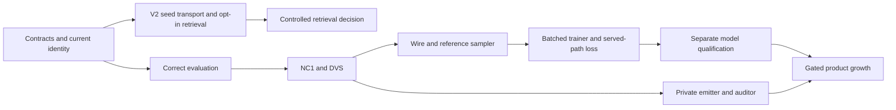

# Next version

This is the next engineering work program for DOPE and JopeDime. It contains a shared master plan and 22 individually scoped tasks: 12 for DOPE and 10 for JopeDime. All tasks are **PLANNED**. Product release numbers, scientific budgets and serving adoption remain separate decisions.

Start with [the master plan](MASTER_PLAN.md), then use the [DOPE task index](dope/README.md) or [JopeDime task index](jopedime/README.md). Each task file supplies ordered reads, exact existing/proposed files, ownership, implementation steps, edge cases, its own success criteria, validation, stop conditions and handoff. Task files are execution units; broad P0–P10 packets in the master explain the rationale.

## Recommended order

| Stage | DOPE | JopeDime | Exit condition |
| --- | --- | --- | --- |
| 1. Establish truth | D00 contracts; D01 evaluation; D02 metric successor; D10 local product gate | J00 lock current identities; await active queue/handoff | Current behavior, protocol and ownership are explicit; historical results remain readable |
| 2. Test immediate value | D03 thin facade and D04 landmark parity, separately | J01 v2 seed transport; J02 opt-in retrieval; J03 preregistered decision protocol | Retrieval consumes real generation-0 slots without held-label access; scientific efficacy remains separately measured |
| 3. Build shared foundations | D05 NC1; D06 DVS | J05 raw-source/additive intake; J06 private emitter; J07 gateway migration | One frozen FIT map, honest scoring and private/public boundary hold end to end |
| 4. Engineer the successor | D07 wire/basis/reference sampler; D08 batched resumable trainer; D09 served-path objective | J08 auditor adapter; J04 conditional CPU packaging when its gates hold | Train and serve semantics agree; packaging/default decisions have measured support |
| 5. Qualify before expansion | D11 qualification readiness and bounded campaign handoff | J09 gated growth decision | Fresh resource/cohort/model qualification exists before training publication or product adoption |

IDs identify tasks, not unconditional numerical execution order. D10 is intentionally early. D07 precedes D08/D09. J04 remains conditional on valid packaging/performance and, for default execution, positive retrieval evidence. J05/J06 do not need retrieval to win. D11 readiness is not a passing training campaign or released model.

## Isolation and scope

Both worktrees are on branch `codex/dope-jope-master-plan-20261102`:

- DOPE: `/home/ubuntu/dope/.agent/worktrees/codex-value-plan-20261102`, based on verified remote main `59b1e0513683fa4c5c347e4db6465eff84f496ef`.
- JopeDime: `/home/ubuntu/JopeDime/.agent/worktrees/codex-value-plan-20261102`, based on verified remote main `4548321f0f6c2baabbbec6c33a4a143fa8242800`.

Identical `docs/plans/next-version/` packages in both lanes allow cross-repository review without broken task links. Treat them as synchronized planning snapshots; a single integrator updates both. Live claims and delivery status remain in each repository's existing coordination records, not these snapshot inventories.

No product source, model, catalog, worker, PR, serving pointer or shared branch changed for this assignment. Existing canonical dirty work is preserved. JopeDime PR #2071 and overlapping owner claims must settle or explicitly hand off before implementation. Do not reuse the existing H228 identifier. No builds, scientific runs, CI or GPU work were launched.

## Task acceptance and handoff

Use [execution rules](EXECUTION_RULES.md) and each task's success IDs. A task completes only when each criterion maps to evidence or an explicitly reported blocker. Every check records the exact source SHA, command, exit, actual test count and artifacts. Source implementation, fixture proof, hosted CI, measured value and serving adoption are separate states.

The [dependency inventory](dependencies.json) is a planning snapshot for dependency and cycle checks. All entries remain PLANNED until a later authorized implementation records its stopped-head handoff in the existing project ledger. Review evidence is in [the planning review](review.md); raw source audits sit beside the local package in `dope-audit.md`, `jope-audit.md` and `spec-review.md`.
